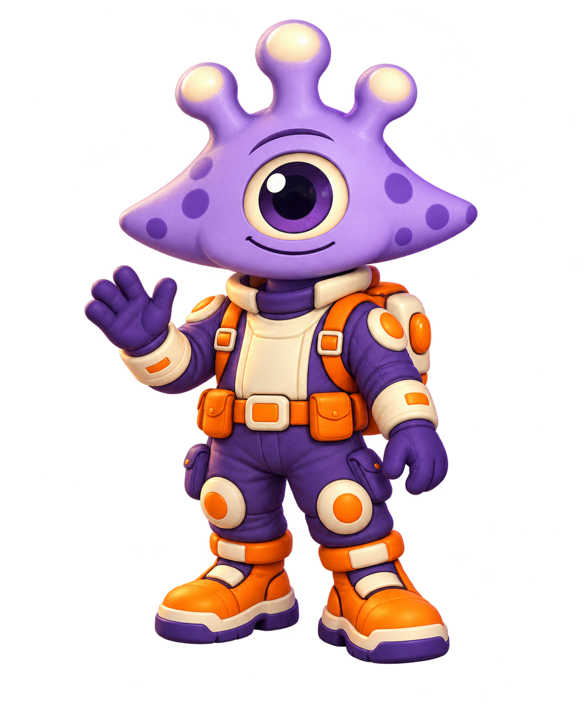
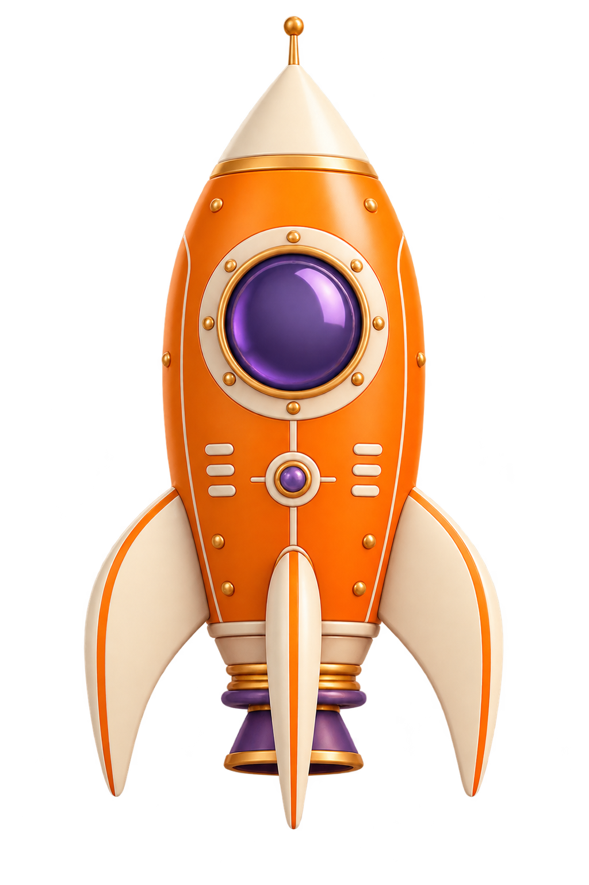
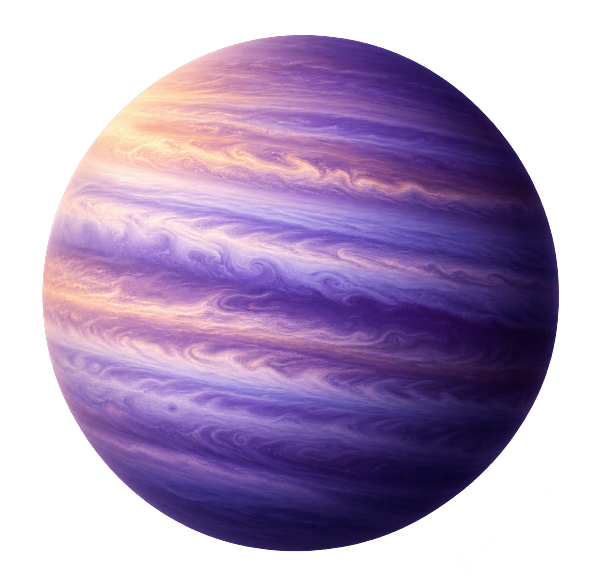

# AstroLearn — códigos completos do frontend

Todos os arquivos HTML, CSS, JavaScript, configuração JSON e README estão transcritos integralmente abaixo. Caminhos relativos à pasta `AstroLearn-estrutura-front`. Imagens, fontes e licenças ficam no ZIP completo. A index é a landing page. A autenticação e dados escolares são demonstrações locais, sem backend integrado.

Abra index.html com Go Live. Consulte README.md e docs/PENDENCIAS-BACKEND.md antes de integrar dados reais.

## .vscode/extensions.json

```json
{
  "recommendations": [
    "esbenp.prettier-vscode"
  ]
}
```

## .vscode/settings.json

```json
{
    "liveServer.settings.port": 5501
}
```

## README.md

```markdown
# AstroLearn — frontend completo

Frontend em **HTML, CSS e JavaScript**, sem framework e sem instalação de pacotes. Inclui a landing page, autenticação visual, todas as áreas do aluno e a estação do professor. As imagens e fontes locais foram preservadas.

## Abrir no VS Code

1. Extraia o ZIP e abra `AstroLearn-estrutura-front` no VS Code.
2. Clique com o botão direito em **index.html** e escolha **Open with Live Server / Go Live**.
3. A index é a landing page do projeto. Clique em **Explorar a plataforma** e escolha aluno ou professor, ou entre pelo login e use os links de prévia.
4. Mantenha a mesma origem e porta ao navegar para compartilhar os dados demonstrativos. Ctrl+Shift+R recarrega os estilos após alterações.

Alternativa: `npm start`. A conferência de sintaxe é `npm run check`. Não há etapa de build.

## Áreas implementadas

- **Landing:** apresentação STEAM, exemplos interativos, proposta para professores, perguntas frequentes e entrada nos dois perfis.
- **Autenticação visual:** login, cadastros de aluno/professor, recuperação e nova senha. Mascotes, olhos, proteção da senha, revelação, validação e redução de movimento.
- **Aluno:** início com trilha de planetas, atividade com anexos/revisão, conquistas, biblioteca, equipe, loja/oficina dos quatro avatares, perfil, configurações e jogos.
- **Jogos:** Rota do robô com três desafios, Quiz orbital com explicações, Cosmo Crew cooperativo por turnos no mesmo aparelho.
- **Professor:** galeria de turmas, detalhes da turma, desenvolvimento individual, atividades, criação/edição/publicação de proposta, materiais PDF/imagens, equipes, fila de entregas, correção com nota/devolutiva, perguntas e notificações.

## Testar aluno → professor

Use dados fictícios. A turma de exemplo é **3º P**, estudante **Maya**.

1. No aluno, abra uma atividade e escreva a resposta ou anexe um arquivo.
2. Abra a revisão e clique em **Confirmar entrega na prévia**. Se houver entrega anterior nessa atividade, o envio demonstrativo é substituído.
3. Entre na prévia do professor pelo login ou landing. Abra Notificações e a entrega, ou Turmas → 3º P → Correções.
4. Registre nota e devolutiva. Ao recarregar a atividade do aluno, o retorno aparece. Em outra aba da mesma origem, a alteração aparece automaticamente.
5. Perguntas da atividade seguem o mesmo ciclo: aluno pergunta, professor responde, aluno consulta o retorno.

Arquivos são guardados no IndexedDB; registros e preferências, no armazenamento local do navegador. Não existe comunicação entre computadores. Os exemplos sem anexos reais mostram materiais demonstrativos claramente identificados.

## Organização e manutenção

- `index.html`: landing page. CSS/JS em `public/css/pages/landing.css` e `public/js/pages/landing.js`.
- `auth/`, `aluno/`, `professor/`: páginas HTML.
- `public/css/`: estilos, navegação e preferências compartilhados, além dos estilos de cada área.
- `public/js/components/`: menus, upload, preferências, jogos e componentes compartilhados.
- `professor-dados.js`: fonte de dados **somente demonstrativa**; `professor-paginas.js`: renderização comum das telas do professor; `professor-notificacoes.js`: avisos; `atividade-demo.js`: ciclo local de entregas/perguntas.
- `public/js/services/`: estrutura reservada à integração futura; as telas desta entrega não chamam a API real.
- `public/assets/`: imagens originais, fonte e ícones locais.
- `docs/`: mapa de telas, código transcrito e relatório de integração para o backend.

## Limites desta entrega

É o frontend com interfaces e fluxos locais de demonstração. Login/cadastro não criam contas nem sessões; recuperação não envia e-mail. Notas, compras, XP, equipes e notificações são exemplos locais. O assistente usa orientações preparadas. Avatar é composição de imagens renderizadas em camadas/vistas, não um modelo 3D com rig. Cosmo Crew não sincroniza dispositivos.

Antes de usar com alunos reais, conectar as APIs e testar autorização, uploads privados, sessão, persistência e regras escolares. Nenhum backend foi alterado. Veja `docs/PENDENCIAS-BACKEND.md`.

## Acessibilidade

Links de pular conteúdo, rótulos de campos, mensagens de erro, foco visível, diálogos operáveis por teclado, tabelas com valores dos gráficos e navegação responsiva. Perfil/configurações ajustam texto e contraste; a redução de movimento do sistema tem prioridade. A landing tem botão para pausar animações. Esta entrega não equivale a uma auditoria formal de acessibilidade.
```

## aluno/atividade.html

```html
<!doctype html>

<html lang="pt-BR">
  <head>
    <meta charset="utf-8" />
    <meta content="width=device-width,initial-scale=1" name="viewport" />
    <title>Atividade · AstroLearn</title>
    <meta
      content="Leia sua missão, consulte os materiais e prepare sua entrega no AstroLearn."
      name="description"
    />
    <link href="../public/css/pages/aluno/atividade.css" rel="stylesheet" />
    <link href="../public/css/menu-pdf.css" rel="stylesheet" />
    <link rel="stylesheet" href="../public/css/preferencias.css" />
  </head>
  <body>
    <a class="skip" href="#main">Pular para a atividade</a>
    <!-- Navegação compacta e sem animações de cenário durante a leitura. -->
    <aside class="rail">
      <a
        aria-label="AstroLearn, voltar ao início"
        class="brand"
        href="home.html"
      >
        <svg aria-hidden="true" viewBox="0 0 40 40">
          <circle cx="20" cy="20" r="10"></circle>
          <ellipse
            cx="20"
            cy="20"
            rx="19"
            ry="6"
            transform="rotate(-28 20 20)"
          ></ellipse>
        </svg>
      </a>
      <nav aria-label="Navegação da atividade">
        <a aria-label="Voltar à trilha" href="home.html">
          <svg aria-hidden="true" viewBox="0 0 24 24">
            <path d="m14 5-7 7 7 7"></path>
          </svg>
          <span>Trilha</span>
        </a>
        <a aria-current="page" class="active" href="#instructions">
          <svg aria-hidden="true" viewBox="0 0 24 24">
            <rect height="18" rx="3" width="14" x="5" y="3"></rect>
            <path d="M9 8h6M9 12h6M9 16h4"></path>
          </svg>
          <span>Atividade</span>
        </a>
        <a href="#materials">
          <svg aria-hidden="true" viewBox="0 0 24 24">
            <path
              d="M12 5C8 3 5 3 2 4v16c4-1 7-1 10 1 3-2 6-2 10-1V4c-3-1-7-1-10 1Zm0 0v16"
            ></path>
          </svg>
          <span>Materiais</span>
        </a>
        <a href="#delivery">
          <svg aria-hidden="true" viewBox="0 0 24 24">
            <path d="M4 15v6h16v-6M12 17V3m-5 5 5-5 5 5"></path>
          </svg>
          <span>Entrega</span>
        </a>
      </nav>
      <span class="rail-footer">STEAM</span>
    </aside>
    <div class="shell">
      <header class="topbar">
        <nav aria-label="Caminho da página">
          <a href="home.html">Minha trilha</a>
          <span aria-hidden="true">/</span>
          <span>Atividade</span>
        </nav>
        <div class="activity-tools">
          <button
            aria-label="Pausar movimento das estrelas"
            aria-pressed="false"
            class="star-motion"
            id="starMotion"
            title="Pausar estrelas"
            type="button"
          >
            <svg aria-hidden="true" viewBox="0 0 24 24">
              <path d="m12 3 2 7 7 2-7 2-2 7-2-7-7-2 7-2Z"></path>
            </svg>
          </button>
          <span aria-label="Aluno demonstrativo Maya" class="profile">M</span>
        </div>
      </header>
      <main id="main">
        <div class="preview-note">
          <span class="dot"> </span>
          <p>
            Demonstração local: confirme a revisão para guardar a entrega neste
            navegador e vê-la na prévia do professor. Nada é enviado à escola.
          </p>
        </div>
        <section aria-labelledby="atividade-titulo" class="mission-banner">
          <div>
            <p class="kicker" id="missionNumber">MISSÃO 02 · CIÊNCIA</p>
            <h1 id="atividade-titulo">Órbita das ideias</h1>
            <p id="atividade-resumo">
              Uma observação pode ser o começo de uma grande descoberta.
            </p>
            <div class="tags">
              <span id="missionType">Individual</span>
              <span id="missionDuration">10 minutos</span>
              <span>Pesquisa &amp; investigação</span>
            </div>
          </div>
          <div aria-hidden="true" class="banner-orbits">
            <span> </span>
            <span> </span>
            <i> </i>
          </div>
          <div aria-hidden="true" class="banner-planet"></div>
        </section>
        <div class="activity-grid">
          <div class="lesson-column">
            <section class="card instructions" id="instructions">
              <div class="section-heading">
                <span class="section-icon">
                  <svg aria-hidden="true" viewBox="0 0 24 24">
                    <path
                      d="M12 3v4m-6-2 2 3m10-3-2 3M7 14a5 5 0 1 1 10 0l-2 3H9ZM9 21h6"
                    ></path>
                  </svg>
                </span>
                <h2>Sua missão</h2>
              </div>
              <div class="teacher-line">
                <div>
                  <strong>Professor da turma</strong>
                  <span>Atividade de exemplo · sem prazo definido</span>
                </div>
              </div>
              <p class="objective" id="atividade-objetivo">
                Transforme algo que você observou em uma pergunta que possa ser
                investigada.
              </p>
              <ol class="instruction-list" id="atividade-passos">
                <li>
                  <strong>Observe ao seu redor</strong>
                  <p>
                    Escolha uma situação do cotidiano que desperte sua
                    curiosidade.
                  </p>
                </li>
                <li>
                  <strong>Crie uma pergunta</strong>
                  <p>
                    Escreva uma pergunta que permita medir ou comparar
                    resultados.
                  </p>
                </li>
                <li>
                  <strong>Imagine um teste</strong>
                  <p>
                    Explique o que você mudaria, o que manteria igual e o que
                    iria observar.
                  </p>
                </li>
                <li>
                  <strong>Compartilhe sua descoberta</strong>
                  <p>
                    Anexe uma foto do seu registro, um documento ou escreva sua
                    resposta em “Sua entrega”.
                  </p>
                </li>
              </ol>
              <div class="learning-tip">
                <span aria-hidden="true">✦</span>
                <p>
                  <strong>Uma pista para começar</strong>
                  <span id="example"
                    >“Uma planta cresce diferente com mais ou menos luz?”
                    permite comparar resultados. “Qual planta é mais bonita?”
                    depende de opinião.</span
                  >
                </p>
              </div>
              <details class="criteria">
                <summary>O que deve aparecer na sua entrega?</summary>
                <ul id="criteriaList">
                  <li>Uma observação clara.</li>
                  <li>Uma pergunta que possa ser investigada.</li>
                  <li>Uma proposta de teste com comparação.</li>
                </ul>
              </details>
            </section>
            <section class="card materials" id="materials">
              <div class="section-heading">
                <span class="section-icon">
                  <svg aria-hidden="true" viewBox="0 0 24 24">
                    <path d="M6 3h9l4 4v14H6ZM15 3v5h4M9 12h7m-7 4h5"></path>
                  </svg>
                </span>
                <h2>Materiais de apoio</h2>
              </div>
              <p class="section-subtitle">
                Tudo que você precisa para começar, em um só lugar.
              </p>
              <button class="resource" id="material-roteiro" type="button">
                <span class="file-icon">GUIA</span>
                <span>
                  <strong>Como criar uma pergunta científica</strong>
                  <small>Leitura rápida · dentro da plataforma</small>
                </span>
                <span aria-hidden="true">↗</span>
              </button>
              <a
                class="resource"
                download=""
                href="../public/assets/documentos/roteiro-atividade.txt"
              >
                <span class="file-icon text">TXT</span>
                <span>
                  <strong>Roteiro para registrar sua pesquisa</strong>
                  <small>Modelo de exemplo · baixar arquivo</small>
                </span>
                <svg aria-hidden="true" viewBox="0 0 24 24">
                  <path d="M12 3v12m-5-5 5 5 5-5M4 17v4h16v-4"></path>
                </svg>
              </a>
            </section>
            <section aria-labelledby="notesTitle" class="card comments">
              <div class="section-heading">
                <span class="section-icon">
                  <svg aria-hidden="true" viewBox="0 0 24 24">
                    <path d="M3 4h18v13H8l-5 4Z"></path>
                  </svg>
                </span>
                <h2 id="notesTitle">Pergunte ao professor</h2>
              </div>
              <p class="section-subtitle">
                Perguntas e respostas desta demonstração ficam neste navegador.
              </p>
              <form id="pergunta-form">
                <label class="sr-only" for="pergunta"
                  >Escrever uma pergunta</label
                >
                <textarea
                  id="pergunta"
                  maxlength="1500"
                  placeholder="O que você quer lembrar ou perguntar?"
                  rows="2"
                ></textarea>
                <button class="secondary" type="submit">
                  Enviar pergunta na prévia
                </button>
                <p id="pergunta-status" role="status"></p>
              </form>
            </section>
          </div>
          <aside
            aria-labelledby="deliveryTitle"
            class="delivery-column"
            id="delivery"
          >
            <section class="card delivery-card">
              <div class="delivery-heading">
                <h2 id="deliveryTitle">Sua entrega</h2>
                <span class="status-chip" id="deliveryStatus">Não enviado</span>
              </div>
              <p class="delivery-caption">
                Reúna seus arquivos e revise antes de entregar.
              </p>
              <form id="entrega-form">
                <label class="field-label" for="resposta"
                  >Sua resposta <span>(opcional com anexo)</span>
                </label>
                <textarea
                  id="resposta"
                  maxlength="10000"
                  placeholder="Escreva sua pergunta e como você pretende investigá-la…"
                  rows="5"
                ></textarea>
                <div class="answer-meta">
                  <span aria-live="polite" id="entrega-status" role="status"
                    >Resposta nesta visita</span
                  >
                  <span id="anexos-contador">0 / 10.000</span>
                </div>
                <input
                  accept=".jpg,.jpeg,.png,.webp,.pdf,.doc,.docx,.ppt,.pptx,.xls,.xlsx,.txt,.odt"
                  aria-label="Selecionar arquivos da atividade"
                  class="sr-only"
                  id="arquivos"
                  multiple=""
                  type="file"
                />
                <div class="drop-zone" id="anexos-dropzone">
                  <svg aria-hidden="true" viewBox="0 0 24 24">
                    <path d="M12 16V3m-5 5 5-5 5 5M4 15v6h16v-6"></path>
                  </svg>
                  <strong>Foto, pesquisa ou documento</strong>
                  <p>Arraste seus arquivos para cá ou escolha abaixo.</p>
                  <button
                    class="attach-button"
                    id="adicionar-arquivos"
                    type="button"
                  >
                    <span aria-hidden="true">＋</span> Adicionar arquivos
                  </button>
                </div>
                <p class="file-hint" id="fileHint">
                  Imagens, PDF, Office, ODT ou TXT. Até 20 MB por arquivo, 10
                  arquivos e 50 MB no total.
                </p>
                <p class="error" id="anexos-status" role="alert"></p>
                <ul
                  aria-label="Arquivos anexados"
                  class="attachments"
                  id="anexos-lista"
                ></ul>
                <button class="primary full" id="submitDelivery" type="submit">
                  Revisar entrega
                  <svg aria-hidden="true" viewBox="0 0 24 24">
                    <path d="M4 12h16m-6-6 6 6-6 6"></path>
                  </svg>
                </button>
                <p class="delivery-footnote" id="deliveryNotice">
                  Revise primeiro. A confirmação guarda a entrega apenas neste
                  navegador.
                </p>
              </form>
            </section>
            <section class="feedback-card">
              <span aria-hidden="true" class="feedback-icon">
                <svg viewBox="0 0 24 24">
                  <path d="M5 3h14v18H5ZM8 8h8m-8 4h5m-5 4h3"></path>
                </svg>
              </span>
              <div>
                <h3>Retorno do professor</h3>
                <p>
                  Nota e orientações aparecerão aqui quando a correção estiver
                  conectada.
                </p>
              </div>
            </section>
            <div class="quiet-companion">
              <div aria-hidden="true" class="companion-image"></div>
              <p>Uma boa pergunta já é<br />uma grande partida.</p>
            </div>
          </aside>
        </div>
        <div
          class="activity-extra-links"
          style="
            display: flex;
            gap: 18px;
            flex-wrap: wrap;
            margin: 20px 0;
            font-size: 14px;
          "
        >
          <a href="jogos/index.html">Laboratório de jogos →</a
          ><a href="perfil.html">Meu perfil</a>
        </div>
      </main>
      <footer>AstroLearn · Aprender, investigar e criar.</footer>
    </div>
    <dialog aria-labelledby="material-titulo" id="material-dialog">
      <button
        aria-label="Fechar guia"
        class="dialog-close"
        data-close=""
        type="button"
      >
        ×
      </button>
      <p class="kicker">LEITURA RÁPIDA</p>
      <h2 id="material-titulo">Da curiosidade à investigação</h2>
      <p>
        Comece com uma observação. Depois, pense em algo que você consegue mudar
        e em um resultado que consegue medir.
      </p>
      <div class="guide-example">
        <strong>Observação</strong>
        <p>As plantas próximas à janela parecem crescer diferente.</p>
        <strong>Pergunta</strong>
        <p>A quantidade de luz influencia o crescimento da planta?</p>
        <strong>Teste</strong>
        <p>
          Compare plantas da mesma espécie, mantendo solo, água e tempo iguais.
          Registre a altura ao longo dos dias.
        </p>
      </div>
      <p>
        Altere uma condição por vez. Assim, fica mais fácil entender o que
        influenciou o resultado.
      </p>
      <button class="primary" data-close="" type="button">
        Entendi, vamos investigar!
      </button>
    </dialog>
    <dialog
      aria-labelledby="revisao-titulo"
      class="ui-dialog review-dialog"
      id="revisao-dialog"
    >
      <form method="dialog">
        <button aria-label="Fechar revisão" class="ui-close" type="submit">
          ×
        </button>
      </form>
      <p class="activity-eyebrow">REVISÃO LOCAL</p>
      <h2 id="revisao-titulo">Confira seu trabalho</h2>
      <h3>Resposta</h3>
      <p class="review-text" id="revisao-resposta"></p>
      <h3>Anexos</h3>
      <ul id="revisao-arquivos"></ul>
      <p class="preview-note">
        A confirmação salva a entrega somente neste navegador. O envio real será
        conectado depois.
      </p>
      <form method="dialog">
        <button class="ui-button ui-button--primary" type="submit">
          Continuar editando
        </button>
      </form>
      <p id="demoSubmissionStatus" role="status"></p>
      <button
        id="confirmDemoSubmission"
        class="ui-button ui-button--primary"
        type="button"
      >
        Confirmar entrega na prévia
      </button>
    </dialog>

    <script src="../public/js/components/professor-dados.js"></script>
    <script src="../public/js/pages/aluno/atividade.js" type="module"></script>
    <script
      defer="True"
      src="../public/js/components/estrelas-atividade.js"
    ></script>
    <script src="../public/js/components/preferencias.js"></script>
  </body>
</html>
```

## aluno/biblioteca.html

```html
<!doctype html>

<html lang="pt-BR">
  <head>
    <meta charset="utf-8" />
    <meta content="width=device-width,initial-scale=1" name="viewport" />
    <title>Biblioteca · AstroLearn</title>
    <meta
      content="Explore leituras e atividades sobre espaço, robótica, ciência e arte."
      name="description"
    />
    <link href="../public/css/aluno-pdf.css" rel="stylesheet" />
    <link href="../public/css/pages/aluno/biblioteca.css" rel="stylesheet" />
    <link href="../public/css/menu-pdf.css" rel="stylesheet" />
    <link rel="stylesheet" href="../public/css/preferencias.css" />
  </head>
  <body class="collapsed">
    <a class="skip" href="#main">Pular para a biblioteca</a>
    <aside class="sidebar">
      <a class="brand" href="home.html"
        ><svg aria-hidden="true" viewBox="0 0 40 40">
          <circle cx="20" cy="20" r="9"></circle>
          <ellipse
            cx="20"
            cy="20"
            rx="18"
            ry="6"
            transform="rotate(-28 20 20)"
          ></ellipse></svg
        >Astro<span>Learn</span></a
      >
      <button
        aria-controls="mainNav"
        aria-expanded="true"
        aria-label="Recolher menu"
        id="menuToggle"
        type="button"
      >
        ‹‹
      </button>
      <nav aria-label="Navegação principal" id="mainNav">
        <a aria-label="Início" href="home.html">
          <svg aria-hidden="true" viewBox="0 0 24 24">
            <path d="M3 10 12 3l9 7v10H3Zm6 10v-7h6v7"></path>
          </svg>
          <span class="label">Início</span>
        </a>
        <a aria-label="Minha trilha" href="home.html#journey">
          <svg aria-hidden="true" viewBox="0 0 24 24">
            <path
              d="M6 3a3 3 0 1 0 0 6 3 3 0 0 0 0-6Zm12 12a3 3 0 1 0 0 6 3 3 0 0 0 0-6ZM6 9v3h12v3"
            ></path>
          </svg>
          <span class="label">Minha trilha</span>
        </a>
        <a
          aria-current="page"
          aria-label="Biblioteca"
          class="active"
          href="biblioteca.html"
        >
          <svg aria-hidden="true" viewBox="0 0 24 24">
            <path
              d="M12 5C9 3 5 3 2 4v16c4-1 7-1 10 1 3-2 6-2 10-1V4c-3-1-7-1-10 1Zm0 0v16"
            ></path>
          </svg>
          <span class="label">Biblioteca</span>
        </a>
        <a aria-label="Conquistas" href="conquistas.html">
          <svg aria-hidden="true" viewBox="0 0 24 24">
            <path d="m12 2 3 6 7 1-5 5 1 7-6-3-6 3 1-7-5-5 7-1Z"></path>
          </svg>
          <span class="label">Conquistas</span>
        </a>
        <a aria-label="Loja" href="loja.html">
          <svg aria-hidden="true" viewBox="0 0 24 24">
            <path d="M3 9h18v12H3ZM2 9l3-6h14l3 6M9 21v-7h6v7"></path>
          </svg>
          <span class="label">Loja</span>
        </a>
        <a aria-label="Minha equipe" href="equipe.html">
          <svg aria-hidden="true" viewBox="0 0 24 24">
            <path
              d="M9 11a4 4 0 1 0 0-8 4 4 0 0 0 0 8ZM2 21v-3a7 7 0 0 1 14 0v3m1-17a4 4 0 0 1 0 8m2 2a6 6 0 0 1 3 5v2"
            ></path>
          </svg>
          <span class="label">Minha equipe</span>
        </a>
        <a aria-label="Perfil" href="perfil.html">
          <svg aria-hidden="true" viewBox="0 0 24 24">
            <path
              d="M12 12a5 5 0 1 0 0-10 5 5 0 0 0 0 10ZM3 22a9 9 0 0 1 18 0"
            ></path>
          </svg>
          <span class="label">Perfil</span>
        </a>
      </nav>
      <small>Uma descoberta de cada vez.</small>
    </aside>
    <main id="main" tabindex="-1">
      <header>
        <div>
          <h1>Biblioteca</h1>
          <p>Um universo de ideias para suas descobertas.</p>
        </div>
        <button aria-pressed="false" class="quiet" id="motion" type="button">
          Pausar animações
        </button>
      </header>
      <p class="preview-note">
        Materiais introdutórios AstroLearn · favoritos e leitura salvos neste
        navegador.
      </p>
      <p class="storage-notice" id="storageNotice" role="status"></p>
      <div class="search">
        <label class="sr-only" for="search">Buscar assunto ou material</label>
        <svg aria-hidden="true" viewBox="0 0 24 24">
          <circle cx="10" cy="10" r="6"></circle>
          <path d="m15 15 6 6"></path>
        </svg>
        <input
          id="search"
          maxlength="150"
          placeholder="Busque um assunto ou material"
          type="search"
        />
        <button
          aria-label="Limpar busca"
          hidden=""
          id="clearSearch"
          type="button"
        >
          ×
        </button>
      </div>
      <div class="filter-row">
        <div aria-label="Filtrar por assunto" class="filters" role="group">
          <button aria-pressed="true" data-topic="Todos" type="button">
            Todos
          </button>
          <button aria-pressed="false" data-topic="Espaço" type="button">
            Espaço
          </button>
          <button aria-pressed="false" data-topic="Robótica" type="button">
            Robótica
          </button>
          <button aria-pressed="false" data-topic="Ciência" type="button">
            Ciência
          </button>
          <button aria-pressed="false" data-topic="Arte" type="button">
            Arte
          </button>
        </div>
        <button
          aria-pressed="false"
          class="favorite-filter"
          id="favorites"
          type="button"
        >
          ☆ Favoritos <span id="favoriteCount">0</span>
        </button>
      </div>
      <section
        aria-labelledby="continueTitle"
        class="continue-panel"
        hidden=""
        id="continuePanel"
      >
        <div aria-hidden="true" class="thumb" id="continueThumb"></div>
        <div>
          <span class="eyebrow">CONTINUE EXPLORANDO</span>
          <h2 id="continueTitle"></h2>
          <p>Retome o material que você abriu por último.</p>
        </div>
        <button class="primary" id="continueReading" type="button">
          Continuar leitura →
        </button>
      </section>
      <div class="section-title">
        <h2>Materiais para explorar</h2>
        <p id="resultCount" role="status"></p>
      </div>
      <section
        aria-label="Materiais da biblioteca"
        class="materials"
        id="materials"
      ></section>
      <div class="empty" hidden="" id="empty">
        <h2 id="emptyTitle"></h2>
        <p id="emptyText"></p>
        <button class="primary" id="reset" type="button">
          Mostrar todos os materiais
        </button>
      </div>
      <footer>AstroLearn · Aprender, investigar e criar.</footer>
    </main>
    <button
      aria-label="Ajuda da biblioteca"
      class="helper"
      id="helper"
      type="button"
    >
      <span aria-hidden="true" class="helper-image"> </span>
      <span class="helper-tip">Encontre sua próxima descoberta.</span>
    </button>
    <dialog aria-labelledby="readerTitle" id="reader">
      <button
        aria-label="Fechar material"
        class="close"
        data-close=""
        type="button"
      >
        ×
      </button>
      <span class="eyebrow" id="readerMeta"> </span>
      <h2 id="readerTitle"></h2>
      <div id="readerContent"></div>
      <section class="reflection">
        <h3>Para pensar</h3>
        <p id="question"></p>
        <details>
          <summary>Ver uma pista</summary>
          <p id="hint"></p>
        </details>
      </section>
      <div id="sources"></div>
      <div class="reader-actions">
        <button
          aria-pressed="false"
          class="secondary"
          id="saveInReader"
          type="button"
        >
          Salvar nos favoritos
        </button>
        <button class="secondary" id="download" type="button">
          Baixar roteiro TXT
        </button>
        <button class="primary" id="markRead" type="button">
          Marcar como lido
        </button>
      </div>
      <p id="readingStatus" role="status"></p>
      <p class="demo-info">
        Marcar como lido é uma organização pessoal e não conclui missões nem
        concede notas.
      </p>
    </dialog>
    <dialog aria-labelledby="infoTitle" id="info">
      <button
        aria-label="Fechar aviso"
        class="close"
        data-close=""
        type="button"
      >
        ×
      </button>
      <h2 id="infoTitle"></h2>
      <p id="infoText"></p>
      <button class="primary" data-close="" type="button">Entendi</button>
    </dialog>
    <script defer="True" src="../public/js/pages/aluno/biblioteca.js"></script>
    <script defer="True" src="../public/js/components/estrelas-pdf.js"></script>
    <script defer="True" src="../public/js/components/menu-pdf.js"></script>
    <script src="../public/js/components/preferencias.js"></script>
  </body>
</html>
```

## aluno/configuracoes.html

```html
<!doctype html>

<html lang="pt-BR">
  <head>
    <meta charset="utf-8" />
    <meta content="width=device-width,initial-scale=1" name="viewport" />
    <title>Configurações · AstroLearn</title>
    <link href="../public/css/aluno-pdf.css" rel="stylesheet" />
    <link href="../public/css/pages/aluno/extra.css" rel="stylesheet" />
    <link href="../public/css/pages/aluno/configuracoes.css" rel="stylesheet" />
    <link href="../public/css/menu-pdf.css" rel="stylesheet" />
    <link href="../public/css/preferencias.css" rel="stylesheet" />
  </head>
  <body class="collapsed">
    <a class="skip" href="#main">Pular para o conteúdo</a>
    <aside class="sidebar">
      <a class="brand" href="home.html"
        ><svg aria-hidden="true" viewbox="0 0 40 40">
          <circle cx="20" cy="20" r="9"></circle>
          <ellipse
            cx="20"
            cy="20"
            rx="18"
            ry="6"
            transform="rotate(-28 20 20)"
          ></ellipse></svg
        >Astro<span>Learn</span></a
      >
      <button
        aria-controls="mainNav"
        aria-expanded="true"
        aria-label="Recolher menu"
        id="menuToggle"
        type="button"
      >
        ‹‹
      </button>
      <nav aria-label="Navegação principal" id="mainNav">
        <a aria-label="Início" href="home.html">
          <svg aria-hidden="true" viewbox="0 0 24 24">
            <path d="M3 10 12 3l9 7v10H3Zm6 10v-7h6v7"></path>
          </svg>
          <span class="label">Início</span>
        </a>
        <a aria-label="Minha trilha" href="home.html#journey">
          <svg aria-hidden="true" viewbox="0 0 24 24">
            <path
              d="M6 3a3 3 0 1 0 0 6 3 3 0 0 0 0-6Zm12 12a3 3 0 1 0 0 6 3 3 0 0 0 0-6ZM6 9v3h12v3"
            ></path>
          </svg>
          <span class="label">Minha trilha</span>
        </a>
        <a aria-label="Biblioteca" href="biblioteca.html">
          <svg aria-hidden="true" viewbox="0 0 24 24">
            <path
              d="M12 5C9 3 5 3 2 4v16c4-1 7-1 10 1 3-2 6-2 10-1V4c-3-1-7-1-10 1Zm0 0v16"
            ></path>
          </svg>
          <span class="label">Biblioteca</span>
        </a>
        <a aria-label="Conquistas" href="conquistas.html">
          <svg aria-hidden="true" viewbox="0 0 24 24">
            <path d="m12 2 3 6 7 1-5 5 1 7-6-3-6 3 1-7-5-5 7-1Z"></path>
          </svg>
          <span class="label">Conquistas</span>
        </a>
        <a aria-label="Loja" href="loja.html">
          <svg aria-hidden="true" viewbox="0 0 24 24">
            <path d="M3 9h18v12H3ZM2 9l3-6h14l3 6M9 21v-7h6v7"></path>
          </svg>
          <span class="label">Loja</span>
        </a>
        <a aria-label="Minha equipe" href="equipe.html">
          <svg aria-hidden="true" viewbox="0 0 24 24">
            <path
              d="M9 11a4 4 0 1 0 0-8 4 4 0 0 0 0 8ZM2 21v-3a7 7 0 0 1 14 0v3m1-17a4 4 0 0 1 0 8m2 2a6 6 0 0 1 3 5v2"
            ></path>
          </svg>
          <span class="label">Minha equipe</span>
        </a>
        <a aria-label="Perfil" href="perfil.html">
          <svg aria-hidden="true" viewbox="0 0 24 24">
            <path
              d="M12 12a5 5 0 1 0 0-10 5 5 0 0 0 0 10ZM3 22a9 9 0 0 1 18 0"
            ></path>
          </svg>
          <span class="label">Perfil</span>
        </a>
      </nav>
      <small>Uma descoberta de cada vez.</small>
    </aside>
    <main id="main" tabindex="-1">
      <header class="page-header">
        <div>
          <h1>Configurações</h1>
          <p>Sua experiência, do seu jeito.</p>
        </div>
        <a class="soft-link" href="perfil.html">← Meu perfil</a>
      </header>
      <div class="settings-grid">
        <section aria-labelledby="accessTitle" class="panel">
          <h2 id="accessTitle">Leitura e movimento</h2>
          <p class="muted">
            Experimente os ajustes. Salve para usar em todas as telas do aluno.
          </p>
          <form id="preferencesForm">
            <div class="setting-row">
              <div class="setting-copy">
                <label for="animations">Animações</label>
                <p id="animationHint">Movimentos suaves na plataforma.</p>
              </div>
              <input
                aria-describedby="animationHint"
                checked=""
                class="switch"
                id="animations"
                role="switch"
                type="checkbox"
              />
            </div>
            <div class="setting-row">
              <div class="setting-copy">
                <div class="size-heading">
                  <label for="textSize">Tamanho do texto</label
                  ><output for="textSize" id="textSizeValue">100%</output>
                </div>
                <div class="range-row">
                  <span aria-hidden="true">A</span
                  ><input
                    id="textSize"
                    max="150"
                    min="100"
                    step="5"
                    type="range"
                    value="100"
                  /><span aria-hidden="true">A</span>
                </div>
              </div>
            </div>
            <div class="setting-row">
              <div class="setting-copy">
                <label for="contrast">Maior contraste</label>
                <p>Fundos sólidos e texto mais destacado.</p>
              </div>
              <input
                class="switch"
                id="contrast"
                role="switch"
                type="checkbox"
              />
            </div>
            <div class="button-row">
              <button class="primary" type="submit">Salvar preferências</button
              ><button class="secondary" id="restore" type="button">
                Restaurar padrão
              </button>
            </div>
            <p class="status" id="preferenceStatus" role="status"></p>
            <p class="error" id="pageError" role="alert"></p>
          </form>
        </section>
        <div class="stack">
          <section class="panel">
            <h2>Conta e acesso</h2>
            <p class="muted">
              Nome de exibição: <strong data-student-name="">Maya</strong>
            </p>
            <div class="button-row">
              <a class="secondary" href="perfil.html">Editar meu nome</a
              ><a class="secondary" href="../auth/recuperar-senha.html"
                >Recuperar senha</a
              >
            </div>
            <p class="demo-note">
              Prévia local. E-mail, senha e vínculos escolares serão gerenciados
              pela conta real.
            </p>
            <a class="back-link" href="../auth/login.html"
              >Voltar à tela de login</a
            >
          </section>
          <section class="panel">
            <h2>Neste navegador</h2>
            <p class="muted">
              Favoritos, mural, nome, preferências e visual da oficina são
              armazenados apenas aqui.
            </p>
            <button class="secondary" id="clearLocal" type="button">
              Apagar dados da demonstração
            </button>
            <p class="status" id="storageStatus" role="status"></p>
          </section>
          <section class="panel">
            <h2>Atalhos que ajudam</h2>
            <p class="muted">
              Use <kbd>Tab</kbd> para navegar, <kbd>Enter</kbd> para abrir
              botões e <kbd>Esc</kbd> para fechar diálogos. O sistema pode
              reduzir as animações automaticamente.
            </p>
          </section>
        </div>
      </div>
      <dialog aria-labelledby="clearTitle" id="clearDialog">
        <h2 id="clearTitle">Apagar dados locais?</h2>
        <p>
          Isso remove somente os dados de demonstração do AstroLearn neste
          navegador. Arquivos do computador e contas não são alterados.
        </p>
        <p class="error" id="clearError" role="alert"></p>
        <div class="button-row">
          <button class="secondary" id="cancelClear">Cancelar</button
          ><button class="primary" id="confirmClear">
            Sim, apagar dados locais
          </button>
        </div>
      </dialog>
    </main>
    <script src="../public/js/components/menu-pdf.js"></script>
    <script src="../public/js/components/preferencias.js"></script>
    <script src="../public/js/components/identidade.js"></script>
    <script
      src="../public/js/pages/aluno/configuracoes.js"
      type="module"
    ></script>
  </body>
</html>
```

## aluno/conquistas.html

```html
<!doctype html>

<html lang="pt-BR">
  <head>
    <meta charset="utf-8" />
    <meta content="width=device-width,initial-scale=1" name="viewport" />
    <title>Minhas conquistas · AstroLearn</title>
    <meta
      content="Explore suas conquistas e descubra o próximo passo da sua jornada."
      name="description"
    />
    <link href="../public/css/aluno-pdf.css" rel="stylesheet" />
    <link href="../public/css/pages/aluno/conquistas.css" rel="stylesheet" />
    <link href="../public/css/menu-pdf.css" rel="stylesheet" />
    <link rel="stylesheet" href="../public/css/preferencias.css" />
  </head>
  <body>
    <a class="skip" href="#main">Pular para as conquistas</a>
    <aside class="sidebar">
      <a class="brand" href="home.html"
        ><svg aria-hidden="true" viewBox="0 0 40 40">
          <circle cx="20" cy="20" r="9"></circle>
          <ellipse
            cx="20"
            cy="20"
            rx="18"
            ry="6"
            transform="rotate(-28 20 20)"
          ></ellipse></svg
        >Astro<span>Learn</span></a
      >
      <button
        aria-controls="mainNav"
        aria-expanded="true"
        aria-label="Recolher menu"
        id="menuToggle"
        type="button"
      >
        ‹‹
      </button>
      <nav aria-label="Navegação principal" id="mainNav">
        <a aria-label="Início" href="home.html">
          <svg aria-hidden="true" viewBox="0 0 24 24">
            <path d="M3 10 12 3l9 7v10H3Zm6 10v-7h6v7"></path>
          </svg>
          <span class="label">Início</span>
        </a>
        <a aria-label="Minha trilha" href="home.html#journey">
          <svg aria-hidden="true" viewBox="0 0 24 24">
            <path
              d="M6 3a3 3 0 1 0 0 6 3 3 0 0 0 0-6Zm12 12a3 3 0 1 0 0 6 3 3 0 0 0 0-6ZM6 9v3h12v3"
            ></path>
          </svg>
          <span class="label">Minha trilha</span>
        </a>
        <a aria-label="Biblioteca" href="biblioteca.html">
          <svg aria-hidden="true" viewBox="0 0 24 24">
            <path
              d="M12 5C9 3 5 3 2 4v16c4-1 7-1 10 1 3-2 6-2 10-1V4c-3-1-7-1-10 1Zm0 0v16"
            ></path>
          </svg>
          <span class="label">Biblioteca</span>
        </a>
        <a
          aria-current="page"
          aria-label="Conquistas"
          class="active"
          href="conquistas.html"
        >
          <svg aria-hidden="true" viewBox="0 0 24 24">
            <path d="m12 2 3 6 7 1-5 5 1 7-6-3-6 3 1-7-5-5 7-1Z"></path>
          </svg>
          <span class="label">Conquistas</span>
        </a>
        <a aria-label="Loja" href="loja.html">
          <svg aria-hidden="true" viewBox="0 0 24 24">
            <path d="M3 9h18v12H3ZM2 9l3-6h14l3 6M9 21v-7h6v7"></path>
          </svg>
          <span class="label">Loja</span>
        </a>
        <a aria-label="Minha equipe" href="equipe.html">
          <svg aria-hidden="true" viewBox="0 0 24 24">
            <path
              d="M9 11a4 4 0 1 0 0-8 4 4 0 0 0 0 8ZM2 21v-3a7 7 0 0 1 14 0v3m1-17a4 4 0 0 1 0 8m2 2a6 6 0 0 1 3 5v2"
            ></path>
          </svg>
          <span class="label">Minha equipe</span>
        </a>
        <a aria-label="Perfil" href="perfil.html">
          <svg aria-hidden="true" viewBox="0 0 24 24">
            <path
              d="M12 12a5 5 0 1 0 0-10 5 5 0 0 0 0 10ZM3 22a9 9 0 0 1 18 0"
            ></path>
          </svg>
          <span class="label">Perfil</span>
        </a>
      </nav>
      <small>Uma descoberta de cada vez.</small>
    </aside>
    <main id="main" tabindex="-1">
      <header>
        <div>
          <h1>Minhas conquistas</h1>
          <p>Cada descoberta conta uma parte da sua jornada.</p>
        </div>
        <button aria-pressed="false" class="quiet" id="motion" type="button">
          Pausar animações
        </button>
      </header>
      <p class="preview-note">
        Prévia interativa · progresso de exemplo, sem vínculo com notas ou
        entregas reais.
      </p>
      <p class="summary">
        <strong>3 conquistas desbloqueadas</strong>
        <span>Investigação, criatividade e novas descobertas.</span>
      </p>
      <section aria-labelledby="nextTitle" class="next">
        <div aria-hidden="true" class="badge badge-3"></div>
        <div class="next-copy">
          <span class="eyebrow">PRÓXIMA CONQUISTA</span>
          <h2 id="nextTitle">Explorador curioso</h2>
          <p>Conclua 5 missões para desbloquear.</p>
          <label for="goalProgress">3 de 5 missões</label>
          <progress id="goalProgress" max="5" value="3">3 de 5</progress>
        </div>
        <a class="trail-link" href="home.html#journey"
          >Continuar minha trilha →</a
        >
        <button
          aria-label="Cumprimentar o mascote Lilás"
          class="mascot"
          id="mascot"
          type="button"
        >
          
          <span class="mascot-tip" role="status"
            >Você está construindo uma bela jornada!</span
          >
        </button>
      </section>
      <div aria-label="Filtrar conquistas" class="filters" role="group">
        <button aria-pressed="true" data-filter="all" type="button">
          Todas
        </button>
        <button aria-pressed="false" data-filter="earned" type="button">
          Desbloqueadas
        </button>
        <button aria-pressed="false" data-filter="progress" type="button">
          Em progresso
        </button>
      </div>
      <p class="sr-only" id="resultCount" role="status"></p>
      <section
        aria-label="Coleção de conquistas"
        class="collection"
        id="collection"
      ></section>
      <footer>
        AstroLearn · O importante é o que você aprende pelo caminho.
      </footer>
    </main>
    <button
      aria-label="Abrir ajuda sobre conquistas"
      class="helper"
      id="helper"
      type="button"
    >
      <span aria-hidden="true" class="helper-image"> </span>
      <span class="helper-tip">Precisa de uma pista?</span>
    </button>
    <dialog aria-labelledby="detailTitle" id="details">
      <button
        aria-label="Fechar detalhes"
        class="close"
        data-close=""
        type="button"
      >
        ×
      </button>
      <div aria-hidden="true" class="badge" id="detailBadge"></div>
      <span class="eyebrow" id="detailStatus"> </span>
      <h2 id="detailTitle"></h2>
      <p id="detailDescription"></p>
      <div class="criterion">
        <strong>Como conquistar</strong>
        <p id="detailCriterion"></p>
      </div>
      <p id="detailProgress"></p>
      <p class="demo-info">Os estados exibidos são exemplos desta prévia.</p>
      <a class="primary" href="home.html#journey">Voltar à minha trilha →</a>
    </dialog>
    <dialog aria-labelledby="infoTitle" id="info">
      <button
        aria-label="Fechar aviso"
        class="close"
        data-close=""
        type="button"
      >
        ×
      </button>
      <h2 id="infoTitle"></h2>
      <p id="infoText"></p>
      <button class="primary" data-close="" type="button">Entendi</button>
    </dialog>
    <script defer="True" src="../public/js/pages/aluno/conquistas.js"></script>
    <script defer="True" src="../public/js/components/menu-pdf.js"></script>
    <script src="../public/js/components/preferencias.js"></script>
  </body>
</html>
```

## aluno/equipe.html

```html
<!doctype html>

<html lang="pt-BR">
  <head>
    <meta charset="utf-8" />
    <meta content="width=device-width,initial-scale=1" name="viewport" />
    <title>Minha equipe · AstroLearn</title>
    <meta
      content="Organize as responsabilidades e registre as ideias da sua equipe."
      name="description"
    />
    <link href="../public/css/aluno-pdf.css" rel="stylesheet" />
    <link href="../public/css/pages/aluno/equipe.css" rel="stylesheet" />
    <link href="../public/css/menu-pdf.css" rel="stylesheet" />
    <link rel="stylesheet" href="../public/css/preferencias.css" />
  </head>
  <body class="collapsed">
    <a class="skip" href="#main">Pular para minha equipe</a>
    <aside class="sidebar">
      <a class="brand" href="home.html"
        ><svg aria-hidden="true" viewBox="0 0 40 40">
          <circle cx="20" cy="20" r="9"></circle>
          <ellipse
            cx="20"
            cy="20"
            rx="18"
            ry="6"
            transform="rotate(-28 20 20)"
          ></ellipse></svg
        >Astro<span>Learn</span></a
      >
      <button
        aria-controls="mainNav"
        aria-expanded="true"
        aria-label="Recolher menu"
        id="menuToggle"
        type="button"
      >
        ‹‹
      </button>
      <nav aria-label="Navegação principal" id="mainNav">
        <a aria-label="Início" href="home.html">
          <svg aria-hidden="true" viewBox="0 0 24 24">
            <path d="M3 10 12 3l9 7v10H3Zm6 10v-7h6v7"></path>
          </svg>
          <span class="label">Início</span>
        </a>
        <a aria-label="Minha trilha" href="home.html#journey">
          <svg aria-hidden="true" viewBox="0 0 24 24">
            <path
              d="M6 3a3 3 0 1 0 0 6 3 3 0 0 0 0-6Zm12 12a3 3 0 1 0 0 6 3 3 0 0 0 0-6ZM6 9v3h12v3"
            ></path>
          </svg>
          <span class="label">Minha trilha</span>
        </a>
        <a aria-label="Biblioteca" href="biblioteca.html">
          <svg aria-hidden="true" viewBox="0 0 24 24">
            <path
              d="M12 5C9 3 5 3 2 4v16c4-1 7-1 10 1 3-2 6-2 10-1V4c-3-1-7-1-10 1Zm0 0v16"
            ></path>
          </svg>
          <span class="label">Biblioteca</span>
        </a>
        <a aria-label="Conquistas" href="conquistas.html">
          <svg aria-hidden="true" viewBox="0 0 24 24">
            <path d="m12 2 3 6 7 1-5 5 1 7-6-3-6 3 1-7-5-5 7-1Z"></path>
          </svg>
          <span class="label">Conquistas</span>
        </a>
        <a aria-label="Loja" href="loja.html">
          <svg aria-hidden="true" viewBox="0 0 24 24">
            <path d="M3 9h18v12H3ZM2 9l3-6h14l3 6M9 21v-7h6v7"></path>
          </svg>
          <span class="label">Loja</span>
        </a>
        <a
          aria-current="page"
          aria-label="Minha equipe"
          class="active"
          href="equipe.html"
        >
          <svg aria-hidden="true" viewBox="0 0 24 24">
            <path
              d="M9 11a4 4 0 1 0 0-8 4 4 0 0 0 0 8ZM2 21v-3a7 7 0 0 1 14 0v3m1-17a4 4 0 0 1 0 8m2 2a6 6 0 0 1 3 5v2"
            ></path>
          </svg>
          <span class="label">Minha equipe</span>
        </a>
        <a aria-label="Perfil" href="perfil.html">
          <svg aria-hidden="true" viewBox="0 0 24 24">
            <path
              d="M12 12a5 5 0 1 0 0-10 5 5 0 0 0 0 10ZM3 22a9 9 0 0 1 18 0"
            ></path>
          </svg>
          <span class="label">Perfil</span>
        </a>
      </nav>
      <small>Uma descoberta de cada vez.</small>
    </aside>
    <main id="main" tabindex="-1">
      <header>
        <div>
          <h1>Minha equipe</h1>
          <p>Ideias diferentes. Uma descoberta em conjunto.</p>
        </div>
        <button aria-pressed="false" class="quiet" id="motion" type="button">
          Pausar animações
        </button>
      </header>
      <p class="team-label">Equipe Órion · 4 integrantes</p>
      <button class="preview-note" id="previewInfo" type="button">
        Prévia local · equipe de exemplo ⓘ
      </button>
      <p class="storage-notice" id="storageNotice" role="status"></p>
      <section
        aria-label="Integrantes da equipe"
        class="members"
        id="members"
      ></section>
      <div class="team-grid">
        <section aria-labelledby="missionTitle" class="mission-card">
          <div class="card-heading">
            <h2>
              <svg aria-hidden="true" class="heading-icon" viewBox="0 0 24 24">
                <circle cx="12" cy="12" r="9"></circle>
                <circle cx="12" cy="12" r="4"></circle>
                <path d="m12 12 9-9"></path></svg
              >Missão da equipe
            </h2>
            <span class="tag">Atividade em grupo</span>
          </div>
          <div class="mission-body">
            <div
              aria-label="Ilustração de um protótipo de explorador lunar"
              class="mission-image"
              role="img"
            ></div>
            <div>
              <h3 id="missionTitle">Construam um explorador lunar</h3>
              <p>
                Investiguem o terreno, planejem o robô e compartilhem suas
                decisões.
              </p>
              <a class="primary" href="atividade.html?equipe=lunar"
                >Abrir atividade →</a
              >
            </div>
          </div>
          <h3 class="agreement-title">Combinados da missão</h3>
          <div class="agreements">
            <p><span aria-hidden="true">◌</span>Ouvir todas as ideias</p>
            <p><span aria-hidden="true">▤</span>Registrar as decisões</p>
            <p>
              <span aria-hidden="true">♧</span>Revisar juntos antes de entregar
            </p>
          </div>
        </section>
        <section aria-labelledby="tasksTitle" class="tasks-card">
          <h2 id="tasksTitle">
            <svg aria-hidden="true" class="heading-icon" viewBox="0 0 24 24">
              <path d="M8 6h13M8 12h13M8 18h13"></path>
              <circle cx="3" cy="6" r="1"></circle>
              <circle cx="3" cy="12" r="1"></circle>
              <circle cx="3" cy="18" r="1"></circle></svg
            >Divisão de tarefas
          </h2>
          <ul id="taskList"></ul>
          <button class="secondary full" id="organize" type="button">
            Organizar tarefas
          </button>
          <p class="local-hint">
            Combine a divisão com seu grupo. Esta prévia não envia notificações.
          </p>
        </section>
      </div>
      <section aria-labelledby="wallTitle" class="wall-card">
        <div class="card-heading">
          <h2 id="wallTitle">
            <svg aria-hidden="true" class="heading-icon" viewBox="0 0 24 24">
              <path d="M3 3h18v14H9l-6 4Z"></path>
              <path d="M7 8h10M7 12h6"></path></svg
            >Mural da equipe
          </h2>
          <span class="local-chip">Neste navegador</span>
        </div>
        <form id="ideaForm">
          <label class="sr-only" for="idea"
            >Compartilhar uma ideia ou dúvida</label
          >
          <textarea
            id="idea"
            maxlength="1000"
            placeholder="Compartilhe uma ideia ou dúvida..."
            rows="2"
          ></textarea>
          <button class="primary" type="submit">Adicionar</button>
        </form>
        <div class="wall-meta">
          <span id="ideaCount">0 / 1000</span>
          <p id="formError" role="alert"></p>
        </div>
        <p class="sr-only" id="wallStatus" role="status"></p>
        <ul id="wall"></ul>
        <div class="example-note">
          <span>EXEMPLO PARA INSPIRAR</span>
          <p>Uma ideia: testar rodas de tamanhos diferentes.</p>
        </div>
      </section>
      <footer>AstroLearn · Juntos, a descoberta vai mais longe.</footer>
    </main>
    <button
      aria-label="Ajuda para trabalhar em equipe"
      class="helper"
      id="helper"
      type="button"
    >
      <span aria-hidden="true" class="helper-image"> </span>
      <span class="helper-tip">Uma pista para colaborar?</span>
    </button>
    <dialog aria-labelledby="taskDialogTitle" id="taskDialog">
      <button
        aria-label="Fechar organização de tarefas"
        class="close"
        data-close=""
        type="button"
      >
        ×
      </button>
      <h2 id="taskDialogTitle">Organizar responsabilidades</h2>
      <p>
        Registre o combinado de cada integrante. Isso não define notas nem
        impede que vocês ajudem uns aos outros.
      </p>
      <form id="taskForm">
        <div id="taskFields"></div>
        <p id="taskError" role="alert"></p>
        <button class="primary" type="submit">Salvar combinado</button>
      </form>
    </dialog>
    <dialog aria-labelledby="memberTitle" id="memberDialog">
      <button
        aria-label="Fechar integrante"
        class="close"
        data-close=""
        type="button"
      >
        ×
      </button>
      <div aria-hidden="true" class="portrait" id="memberPortrait"></div>
      <h2 id="memberTitle"></h2>
      <p id="memberTask"></p>
      <p>
        Integrante demonstrativo. As responsabilidades podem ser ajustadas pela
        equipe.
      </p>
      <button class="primary" data-close="" type="button">Entendi</button>
    </dialog>
    <dialog aria-labelledby="removeTitle" id="removeDialog">
      <button
        aria-label="Cancelar exclusão"
        class="close"
        data-close=""
        type="button"
      >
        ×
      </button>
      <h2 id="removeTitle">Remover sua ideia?</h2>
      <p>Esta anotação será removida do mural local.</p>
      <div class="dialog-actions">
        <button class="secondary" data-close="" type="button">
          Manter ideia
        </button>
        <button class="primary" id="confirmRemove" type="button">
          Remover ideia
        </button>
      </div>
    </dialog>
    <dialog aria-labelledby="infoTitle" id="info">
      <button
        aria-label="Fechar aviso"
        class="close"
        data-close=""
        type="button"
      >
        ×
      </button>
      <h2 id="infoTitle"></h2>
      <p id="infoText"></p>
      <button class="primary" data-close="" type="button">Entendi</button>
    </dialog>
    <script defer="True" src="../public/js/pages/aluno/equipe.js"></script>
    <script defer="True" src="../public/js/components/estrelas-pdf.js"></script>
    <script defer="True" src="../public/js/components/menu-pdf.js"></script>
    <script src="../public/js/components/preferencias.js"></script>
  </body>
</html>
```

## aluno/home.html

```html
<!doctype html>

<html lang="pt-BR">
  <head>
    <meta charset="utf-8" />
    <meta content="width=device-width,initial-scale=1" name="viewport" />
    <title>AstroLearn · Minha expedição</title>
    <meta
      content="Explore, investigue e crie no AstroLearn."
      name="description"
    />
    <link
      as="image"
      href="../public/assets/imagens/aluno/inicial/horizonte-v7.png"
      rel="preload"
    />
    <link
      as="image"
      href="../public/assets/imagens/aluno/inicial/avatar-vistas-v4.png"
      rel="preload"
    />
    <link href="../public/css/pages/aluno/home.css" rel="stylesheet" />
    <link href="../public/css/menu-pdf.css" rel="stylesheet" />
    <link rel="stylesheet" href="../public/css/preferencias.css" />
  </head>
  <body class="menu-collapsed">
    <a class="skip" href="#main">Pular para a trilha</a>
    <!-- Atmosfera discreta: decorativa, sem disputar atenção com as missões. -->
    <div aria-hidden="true" class="space-background">
      <span class="sky-orbit orbit-one"> </span>
      <span class="sky-orbit orbit-two"> </span>
      <span class="sky-orbit orbit-three"> </span>
      <span class="sky-star star-one">✦</span>
      <span class="sky-star star-two">✧</span>
      <span class="sky-star star-three">✦</span>
      <span class="asteroid asteroid-one">
        <svg aria-hidden="true" viewBox="0 0 100 100">
          <defs>
            <radialgradient cx="30%" cy="20%" id="rock">
              <stop stop-color="#e0d1c6"></stop>
              <stop offset=".55" stop-color="#ab98a9"></stop>
              <stop offset="1" stop-color="#766b86"></stop>
            </radialgradient>
          </defs>
          <path
            d="M27 8 61 6 83 22 94 51 79 78 58 92 23 81 8 56 13 29Z"
            fill="url(#rock)"
          ></path>
          <g fill="#655671" opacity=".3">
            <ellipse cx="32" cy="35" rx="11" ry="9"></ellipse>
            <ellipse cx="67" cy="55" rx="13" ry="11"></ellipse>
            <circle cx="31" cy="66" r="7"></circle>
            <circle cx="68" cy="26" r="5"></circle>
          </g>
        </svg>
      </span>
      <span class="asteroid asteroid-two">
        <svg aria-hidden="true" viewBox="0 0 100 100">
          <defs>
            <radialgradient cx="30%" cy="20%" id="rock2">
              <stop stop-color="#e0d1c6"></stop>
              <stop offset=".55" stop-color="#ab98a9"></stop>
              <stop offset="1" stop-color="#766b86"></stop>
            </radialgradient>
          </defs>
          <path
            d="M27 8 61 6 83 22 94 51 79 78 58 92 23 81 8 56 13 29Z"
            fill="url(#rock2)"
          ></path>
          <g fill="#655671" opacity=".3">
            <ellipse cx="32" cy="35" rx="11" ry="9"></ellipse>
            <ellipse cx="67" cy="55" rx="13" ry="11"></ellipse>
            <circle cx="31" cy="66" r="7"></circle>
            <circle cx="68" cy="26" r="5"></circle>
          </g>
        </svg>
      </span>
      <span class="satellite">
        <svg viewBox="0 0 120 75">
          <defs>
            <lineargradient id="metal">
              <stop stop-color="#f2ddbe"></stop>
              <stop offset="1" stop-color="#8c819e"></stop>
            </lineargradient>
          </defs>
          <g transform="rotate(-20 60 38)">
            <path
              d="M4 20h35v32H4Zm77 0h35v32H81Z"
              fill="#8997af"
              stroke="#d9dde7"
              stroke-width="2"
            ></path>
            <path
              d="M15 20v32m12-32v32m66-32v32m12-32v32M4 31h35M4 42h35m42-11h35m-35 11h35"
              stroke="#d3d2de"
            ></path>
            <path d="M39 36h42" stroke="#9e8ba8" stroke-width="5"></path>
            <rect
              fill="url(#metal)"
              height="31"
              rx="7"
              width="28"
              x="46"
              y="22"
            ></rect>
            <path d="M60 22V9m-9 0h18" stroke="#ad8a5c" stroke-width="3"></path>
          </g>
        </svg>
      </span>
    </div>
    <!-- Menu flutuante. Recolher mantém ícones e nomes acessíveis. -->
    <aside class="sidebar">
      <a class="brand" href="home.html">
        <span class="brand-orbit">✦</span>Astro<span>Learn</span>
      </a>
      <button
        aria-controls="mainNav"
        aria-expanded="true"
        aria-label="Recolher menu"
        class="menu-toggle"
        id="menuToggle"
      >
        <svg aria-hidden="true" viewBox="0 0 24 24">
          <path d="m14 6-6 6 6 6"></path>
        </svg>
      </button>
      <nav aria-label="Navegação principal" id="mainNav">
        <button
          aria-current="page"
          aria-label="Início"
          class="nav-item active"
          data-nav="home"
        >
          <svg aria-hidden="true" viewBox="0 0 24 24">
            <path d="M3 10 12 3l9 7v10H3Zm6 10v-7h6v7"></path>
          </svg>
          <span>Início</span>
        </button>
        <button aria-label="Minha trilha" class="nav-item" data-nav="trail">
          <svg aria-hidden="true" viewBox="0 0 24 24">
            <path
              d="M6 3a3 3 0 1 0 0 6 3 3 0 0 0 0-6Zm12 12a3 3 0 1 0 0 6 3 3 0 0 0 0-6ZM6 9v3h12v3"
            ></path>
          </svg>
          <span>Minha trilha</span>
        </button>
        <button aria-label="Biblioteca" class="nav-item" data-nav="book">
          <svg aria-hidden="true" viewBox="0 0 24 24">
            <path
              d="M12 5C9 3 5 3 2 4v16c4-1 7-1 10 1 3-2 6-2 10-1V4c-3-1-7-1-10 1Zm0 0v16"
            ></path>
          </svg>
          <span>Biblioteca</span>
        </button>
        <button aria-label="Minha equipe" class="nav-item" data-nav="team">
          <svg aria-hidden="true" viewBox="0 0 24 24">
            <path
              d="M9 11a4 4 0 1 0 0-8 4 4 0 0 0 0 8ZM2 21v-3a7 7 0 0 1 14 0v3m1-17a4 4 0 0 1 0 8m2 2a6 6 0 0 1 3 5v2"
            ></path>
          </svg>
          <span>Minha equipe</span>
        </button>
        <button aria-label="Conquistas" class="nav-item" data-nav="star">
          <svg aria-hidden="true" viewBox="0 0 24 24">
            <path d="m12 2 3 6 7 1-5 5 1 7-6-3-6 3 1-7-5-5 7-1Z"></path>
          </svg>
          <span>Conquistas</span>
        </button>
        <button aria-label="Loja" class="nav-item" data-nav="shop">
          <svg aria-hidden="true" viewBox="0 0 24 24">
            <path d="M3 9h18v12H3ZM2 9l3-6h14l3 6M9 21v-7h6v7"></path>
          </svg>
          <span>Loja</span>
        </button>
        <button aria-label="Perfil" class="nav-item" data-nav="user">
          <svg aria-hidden="true" viewBox="0 0 24 24">
            <path
              d="M12 12a5 5 0 1 0 0-10 5 5 0 0 0 0 10ZM3 22a9 9 0 0 1 18 0"
            ></path>
          </svg>
          <span>Perfil</span>
        </button>
      </nav>
      <div class="side-footer">
        Aprender, criar e descobrir juntos.<a href="../auth/login.html"
          >Voltar ao login</a
        >
      </div>
    </aside>
    <div class="app">
      <header class="topbar">
        <span class="demo-label">PRÉVIA · DADOS DE EXEMPLO</span>
        <div class="top-actions">
          <button aria-label="Ver meu progresso" class="fuel" id="progress">
            ★ <strong>120 XP</strong>
          </button>
          <button
            aria-label="Avisos do professor"
            class="icon-button"
            id="notifications"
          >
            <svg aria-hidden="true" viewBox="0 0 24 24">
              <path d="M5 17h14l-2-3V9a5 5 0 0 0-10 0v5Zm5 3h4"></path>
            </svg>
            <i> </i>
          </button>
          <button
            aria-label="Reduzir animações"
            aria-pressed="false"
            class="icon-button"
            id="motion"
          >
            <svg aria-hidden="true" viewBox="0 0 24 24">
              <path d="M20 15A9 9 0 0 1 9 3a9 9 0 1 0 11 12"></path>
            </svg>
          </button>
          <button
            aria-label="Abrir meu perfil"
            class="profile-button"
            data-nav="user"
          >
            <span class="avatar">M</span>
            <span>Explorador</span>
            <span>⌄</span>
          </button>
        </div>
      </header>
      <main id="main">
        <section
          aria-labelledby="welcomeTitle"
          class="page-heading landing-intro"
        >
          <h1 id="welcomeTitle">Bem-vinda, Maya!</h1>
          <p class="intro-copy">Vamos continuar sua expedição?</p>
          <div class="intro-actions">
            <button class="primary" id="continue">
              Continuar missão
              <svg aria-hidden="true" viewBox="0 0 24 24">
                <path d="M4 12h16m-6-6 6 6-6 6"></path>
              </svg>
            </button>
            <button class="text-action" id="enterTrail">
              Explorar minha trilha <span aria-hidden="true">↓</span>
            </button>
          </div>
          <p class="intro-detail">
            Missão atual · <strong id="introMission">Órbita das ideias</strong>
            <span>Individual · 10 min</span>
          </p>
        </section>
        <div class="learning-layout">
          <section
            aria-label="Trilha da expedição"
            class="journey"
            id="journey"
          >
            <div class="trail-heading">
              <div>
                <p class="trail-kicker">SEU MAPA DE DESCOBERTAS</p>
                <h2>Um mundo de cada vez.</h2>
              </div>
              <button class="guide-button" id="guide">
                Como jogar <span>↗</span>
              </button>
            </div>
            <div class="path-wrap">
              <svg aria-hidden="true" class="path-line">
                <path id="pathCurve"></path>
              </svg>
              <ol class="steps">
                <li class="step done step-0">
                  <button
                    aria-label="Primeiro contato: concluída"
                    class="planet"
                    data-step="0"
                  >
                    <span class="planet-surface world-0"> </span>
                    <span class="planet-status">✓</span>
                  </button>
                  <div class="step-copy">
                    <div class="step-title">
                      <span class="step-number">1</span>
                      <h2>Primeiro contato</h2>
                    </div>
                    <p>Explore o universo da ciência e do seu potencial.</p>
                  </div>
                </li>
                <li class="step current step-1">
                  <button
                    aria-label="Órbita das ideias: disponível"
                    class="planet"
                    data-step="1"
                  >
                    <span class="planet-surface world-1"> </span>
                    <span class="active-orbit"> </span>
                    <span class="orbit-ship">
                      
                    </span>
                    <span class="planet-status">▶</span>
                  </button>
                  <div class="step-copy">
                    <span class="here">⌖ VOCÊ ESTÁ AQUI</span>
                    <div class="step-title">
                      <span class="step-number">2</span>
                      <h2>Órbita das ideias</h2>
                    </div>
                    <p>Observe, faça perguntas e investigue.</p>
                  </div>
                </li>
                <li class="step locked step-2">
                  <button
                    aria-label="Mundo desconhecido: bloqueado"
                    class="planet"
                    data-step="2"
                  >
                    <span class="planet-surface world-2"> </span>
                    <span class="planet-status">
                      <svg aria-hidden="true" viewBox="0 0 24 24">
                        <rect height="11" rx="3" width="14" x="5" y="10"></rect>
                        <path d="M8 10V7a4 4 0 0 1 8 0v3m-4 5v2"></path>
                      </svg>
                    </span>
                  </button>
                  <div class="step-copy">
                    <div class="step-title">
                      <span class="step-number">3</span>
                      <h2>Mundo desconhecido</h2>
                    </div>
                    <p>Uma nova descoberta espera por você.</p>
                  </div>
                </li>
                <li class="step locked step-3">
                  <button
                    aria-label="Mundo desconhecido: bloqueado"
                    class="planet"
                    data-step="3"
                  >
                    <span class="planet-surface world-3"> </span>
                    <span class="planet-status">
                      <svg aria-hidden="true" viewBox="0 0 24 24">
                        <rect height="11" rx="3" width="14" x="5" y="10"></rect>
                        <path d="M8 10V7a4 4 0 0 1 8 0v3m-4 5v2"></path>
                      </svg>
                    </span>
                  </button>
                  <div class="step-copy">
                    <div class="step-title">
                      <span class="step-number">4</span>
                      <h2>Mundo desconhecido</h2>
                    </div>
                    <p>Uma nova descoberta espera por você.</p>
                  </div>
                </li>
                <li class="step locked step-4">
                  <button
                    aria-label="Mundo desconhecido: bloqueado"
                    class="planet"
                    data-step="4"
                  >
                    <span class="planet-surface world-4"> </span>
                    <span class="planet-status">
                      <svg aria-hidden="true" viewBox="0 0 24 24">
                        <rect height="11" rx="3" width="14" x="5" y="10"></rect>
                        <path d="M8 10V7a4 4 0 0 1 8 0v3m-4 5v2"></path>
                      </svg>
                    </span>
                  </button>
                  <div class="step-copy">
                    <div class="step-title">
                      <span class="step-number">5</span>
                      <h2>Mundo desconhecido</h2>
                    </div>
                    <p>Uma nova descoberta espera por você.</p>
                  </div>
                </li>
              </ol>
              <button
                aria-label="Descobrir uma curiosidade espacial"
                class="floating-star"
                id="curiosity"
              >
                ✦
              </button>
            </div>
            <p class="journey-note">
              Uma pergunta. Uma descoberta. Um novo mundo.
            </p>
          </section>
          <!-- Visualização por vistas renderizadas; sem opções de personalização. -->
          <aside
            aria-label="Visualização do seu explorador"
            class="avatar-viewer"
          >
            <button
              aria-label="Interagir com seu explorador"
              class="avatar-stage"
              id="avatarStage"
            >
              <div class="avatar-render" id="avatarRender"></div>
              <span aria-hidden="true" class="avatar-eye eye-left"> </span>
              <span aria-hidden="true" class="avatar-eye eye-right"> </span>
              <span aria-hidden="true" class="eyelid lid-left"> </span>
              <span aria-hidden="true" class="eyelid lid-right"> </span>
            </button>
            <p
              aria-live="polite"
              class="avatar-reaction"
              id="avatarReaction"
              role="status"
            ></p>
            <div class="rotation-control">
              <label for="avatarRotation">Girar avatar</label>
              <div class="slider-row">
                <span>0°</span>
                <input
                  aria-valuetext="Vista de frente, 0 graus"
                  id="avatarRotation"
                  max="360"
                  min="0"
                  step="1"
                  type="range"
                  value="0"
                />
                <span>360°</span>
              </div>
              <output class="sr-only" for="avatarRotation" id="avatarAngle"
                >0 graus</output
              >
            </div>
          </aside>
        </div>
      </main>
      <footer>AstroLearn · Dados e progresso demonstrativos.</footer>
    </div>
    <!-- Assistente compacto, separado do avatar pessoal. -->
    <div class="chat-launcher">
      <button
        aria-controls="chatPanel"
        aria-expanded="false"
        aria-label="Conversar com seu copiloto"
        class="helper-mascot"
        id="helperMascot"
      >
        <span class="helper-sprite" id="helperSprite"> </span>
        <span class="jet-flame"> </span>
        <span class="helper-tip" role="tooltip">Precisa de uma dica?</span>
      </button>
    </div>
    <section
      aria-label="Chat de ajuda"
      class="chat-panel"
      hidden=""
      id="chatPanel"
      inert=""
    >
      <header>
        <div>
          <strong>Seu copiloto</strong>
          <span>Ajuda demonstrativa · sem IA conectada</span>
        </div>
        <button aria-label="Fechar chat" id="chatClose">×</button>
      </header>
      <div
        aria-live="polite"
        aria-relevant="additions"
        class="chat-log"
        id="chatLog"
        role="log"
      >
        <p class="chat-message bot">
          Oi, explorador! Posso ajudar você a encontrar sua missão, entender a
          trilha ou pensar em uma pergunta para investigar.
        </p>
      </div>
      <div class="chat-prompts">
        <button data-prompt="Como começo a missão?">Minha missão</button>
        <button data-prompt="Como trabalho com minha equipe?">
          Minha equipe
        </button>
        <button data-prompt="Me conte uma curiosidade espacial">
          Curiosidade
        </button>
      </div>
      <form id="chatForm">
        <label class="sr-only" for="chatInput">Sua pergunta</label>
        <input
          autocomplete="off"
          id="chatInput"
          maxlength="400"
          placeholder="O que você quer descobrir?"
        />
        <button aria-label="Enviar pergunta">
          <svg aria-hidden="true" viewBox="0 0 24 24">
            <path d="M4 12h16m-6-6 6 6-6 6"></path>
          </svg>
        </button>
      </form>
    </section>
    <dialog id="dialog">
      <button aria-label="Fechar" class="dialog-close" id="closeDialog">
        ×
      </button>
      <span class="dialog-kicker" id="dialogKicker">MISSÃO</span>
      <h2 id="dialogTitle"></h2>
      <div id="dialogContent"></div>
      <button class="primary" id="dialogAction">Entendi</button>
    </dialog>

    <script defer src="../public/js/pages/aluno/home.js"></script>
    <script defer src="../public/js/components/estrelas-home.js"></script>
    <script defer src="../public/js/components/menu-pdf.js"></script>
    <script src="../public/js/components/preferencias.js"></script>
    <script src="../public/js/components/identidade.js"></script>
  </body>
</html>
```

## aluno/jogos/cosmo-crew.html

```html
<!doctype html>

<html lang="pt-BR">
  <head>
    <meta charset="utf-8" />
    <meta content="width=device-width,initial-scale=1" name="viewport" />
    <title>Cosmo Crew · AstroLearn</title>
    <link href="../../public/css/aluno-pdf.css" rel="stylesheet" />
    <link href="../../public/css/pages/aluno/extra.css" rel="stylesheet" />
    <link
      href="../../public/css/pages/aluno/jogos/cosmo-crew.css"
      rel="stylesheet"
    />
    <link href="../../public/css/menu-pdf.css" rel="stylesheet" />
    <link href="../../public/css/preferencias.css" rel="stylesheet" />
  </head>
  <body class="collapsed">
    <a class="skip" href="#main">Pular para o conteúdo</a>
    <aside class="sidebar" data-base="../">
      <a class="brand" href="../home.html"
        ><svg aria-hidden="true" viewbox="0 0 40 40">
          <circle cx="20" cy="20" r="9"></circle>
          <ellipse
            cx="20"
            cy="20"
            rx="18"
            ry="6"
            transform="rotate(-28 20 20)"
          ></ellipse></svg
        >Astro<span>Learn</span></a
      >
      <button
        aria-controls="mainNav"
        aria-expanded="true"
        aria-label="Recolher menu"
        id="menuToggle"
        type="button"
      >
        ‹‹
      </button>
      <nav aria-label="Navegação principal" id="mainNav">
        <a aria-label="Início" href="../home.html">
          <svg aria-hidden="true" viewbox="0 0 24 24">
            <path d="M3 10 12 3l9 7v10H3Zm6 10v-7h6v7"></path>
          </svg>
          <span class="label">Início</span>
        </a>
        <a aria-label="Minha trilha" href="../home.html#journey">
          <svg aria-hidden="true" viewbox="0 0 24 24">
            <path
              d="M6 3a3 3 0 1 0 0 6 3 3 0 0 0 0-6Zm12 12a3 3 0 1 0 0 6 3 3 0 0 0 0-6ZM6 9v3h12v3"
            ></path>
          </svg>
          <span class="label">Minha trilha</span>
        </a>
        <a aria-label="Biblioteca" href="../biblioteca.html">
          <svg aria-hidden="true" viewbox="0 0 24 24">
            <path
              d="M12 5C9 3 5 3 2 4v16c4-1 7-1 10 1 3-2 6-2 10-1V4c-3-1-7-1-10 1Zm0 0v16"
            ></path>
          </svg>
          <span class="label">Biblioteca</span>
        </a>
        <a aria-label="Conquistas" href="../conquistas.html">
          <svg aria-hidden="true" viewbox="0 0 24 24">
            <path d="m12 2 3 6 7 1-5 5 1 7-6-3-6 3 1-7-5-5 7-1Z"></path>
          </svg>
          <span class="label">Conquistas</span>
        </a>
        <a aria-label="Loja" href="../loja.html">
          <svg aria-hidden="true" viewbox="0 0 24 24">
            <path d="M3 9h18v12H3ZM2 9l3-6h14l3 6M9 21v-7h6v7"></path>
          </svg>
          <span class="label">Loja</span>
        </a>
        <a aria-label="Minha equipe" href="../equipe.html">
          <svg aria-hidden="true" viewbox="0 0 24 24">
            <path
              d="M9 11a4 4 0 1 0 0-8 4 4 0 0 0 0 8ZM2 21v-3a7 7 0 0 1 14 0v3m1-17a4 4 0 0 1 0 8m2 2a6 6 0 0 1 3 5v2"
            ></path>
          </svg>
          <span class="label">Minha equipe</span>
        </a>
        <a aria-label="Perfil" href="../perfil.html">
          <svg aria-hidden="true" viewbox="0 0 24 24">
            <path
              d="M12 12a5 5 0 1 0 0-10 5 5 0 0 0 0 10ZM3 22a9 9 0 0 1 18 0"
            ></path>
          </svg>
          <span class="label">Perfil</span>
        </a>
      </nav>
      <small>Uma descoberta de cada vez.</small>
    </aside>
    <main id="main" tabindex="-1">
      <header class="page-header">
        <div>
          <a class="back-link" href="index.html">← Laboratório de jogos</a>
          <h1>Cosmo Crew</h1>
        </div>
        <button class="secondary" data-dialog="instructionsDialog">
          Como jogar
        </button>
      </header>
      <div class="game-layout">
        <section class="panel">
          <span class="chip">Prévia por turnos · um aparelho</span>
          <h2>Preparem a nave juntos</h2>
          <p class="muted">
            Cada função resolve um problema. A expedição só termina quando as
            quatro estações estiverem prontas.
          </p>
          <div
            aria-label="Estações da nave"
            class="crew-map"
            id="crewMap"
          ></div>
          <div id="crewIntro">
            <div class="button-row">
              <button class="primary" id="startCrew">Começar expedição</button>
            </div>
          </div>
          <div class="crew-question" hidden="" id="crewQuestion">
            <p class="count" id="crewRole"></p>
            <h2 class="question-heading" id="crewTitle" tabindex="-1"></h2>
            <form id="crewForm">
              <div class="answer-list" id="crewOptions"></div>
              <p class="error" id="crewError" role="alert"></p>
              <button class="primary" id="crewConfirm">
                Confirmar decisão
              </button>
            </form>
            <p
              class="explanation"
              hidden=""
              id="crewFeedback"
              role="status"
            ></p>
            <div class="button-row">
              <button class="primary" hidden="" id="crewNext">
                Passar para a próxima função
              </button>
            </div>
          </div>
          <p class="status" id="crewFinal" role="status"></p>
        </section>
        <aside class="panel game-brief">
          <h2>Quatro funções</h2>
          <ul class="role-list">
            <li><strong>Navegação</strong><span>Rotas</span></li>
            <li><strong>Engenharia</strong><span>Energia</span></li>
            <li><strong>Ciência</strong><span>Investigação</span></li>
            <li><strong>Comunicação</strong><span>Cooperação</span></li>
          </ul>
          <p>
            Conversem sobre as opções antes de confirmar. Uma decisão incorreta
            pode ser revisada.
          </p>
          <p class="demo-note">
            Vocês podem revezar no mesmo computador. Salas, convites e quatro
            computadores simultâneos serão conectados pelo backend.
          </p>
        </aside>
      </div>
      <dialog aria-labelledby="instructionsTitle" id="instructionsDialog">
        <h2 id="instructionsTitle">Como jogar</h2>
        <p>
          Revezem entre quatro funções no mesmo aparelho ou experimente sozinho.
          Cada estação apresenta um desafio. Leiam, conversem e escolham uma
          opção. Se a decisão não funcionar, recebam uma dica e tentem de novo.
        </p>
        <p>
          Após completar as quatro estações, a nave estará pronta. Esta é uma
          demonstração por turnos; não há conexão entre computadores.
        </p>
        <button class="primary" data-close="">Entendi</button>
      </dialog>
      <dialog aria-labelledby="resultTitle" id="resultDialog">
        <h2 id="resultTitle"></h2>
        <p id="resultText"></p>
        <p class="muted" id="resultExtra"></p>
        <div class="button-row">
          <button class="primary" id="resultContinue">Continuar</button
          ><a class="secondary" href="index.html">Ver outros jogos</a>
        </div>
      </dialog>
    </main>
    <script src="../../public/js/components/menu-pdf.js"></script>
    <script src="../../public/js/components/preferencias.js"></script>
    <script src="../../public/js/components/identidade.js"></script>
    <script
      src="../../public/js/pages/aluno/jogos/cosmo-crew.js"
      type="module"
    ></script>
  </body>
</html>
```

## aluno/jogos/index.html

```html
<!doctype html>

<html lang="pt-BR">
  <head>
    <meta charset="utf-8" />
    <meta content="width=device-width,initial-scale=1" name="viewport" />
    <title>Jogos · AstroLearn</title>
    <link href="../../public/css/aluno-pdf.css" rel="stylesheet" />
    <link href="../../public/css/pages/aluno/extra.css" rel="stylesheet" />
    <link
      href="../../public/css/pages/aluno/jogos/index.css"
      rel="stylesheet"
    />
    <link href="../../public/css/menu-pdf.css" rel="stylesheet" />
    <link href="../../public/css/preferencias.css" rel="stylesheet" />
  </head>
  <body class="collapsed games-page">
    <a class="skip" href="#main">Pular para o conteúdo</a>
    <aside class="sidebar" data-base="../">
      <a class="brand" href="../home.html"
        ><svg aria-hidden="true" viewbox="0 0 40 40">
          <circle cx="20" cy="20" r="9"></circle>
          <ellipse
            cx="20"
            cy="20"
            rx="18"
            ry="6"
            transform="rotate(-28 20 20)"
          ></ellipse></svg
        >Astro<span>Learn</span></a
      >
      <button
        aria-controls="mainNav"
        aria-expanded="true"
        aria-label="Recolher menu"
        id="menuToggle"
        type="button"
      >
        ‹‹
      </button>
      <nav aria-label="Navegação principal" id="mainNav">
        <a aria-label="Início" href="../home.html">
          <svg aria-hidden="true" viewbox="0 0 24 24">
            <path d="M3 10 12 3l9 7v10H3Zm6 10v-7h6v7"></path>
          </svg>
          <span class="label">Início</span>
        </a>
        <a aria-label="Minha trilha" href="../home.html#journey">
          <svg aria-hidden="true" viewbox="0 0 24 24">
            <path
              d="M6 3a3 3 0 1 0 0 6 3 3 0 0 0 0-6Zm12 12a3 3 0 1 0 0 6 3 3 0 0 0 0-6ZM6 9v3h12v3"
            ></path>
          </svg>
          <span class="label">Minha trilha</span>
        </a>
        <a aria-label="Biblioteca" href="../biblioteca.html">
          <svg aria-hidden="true" viewbox="0 0 24 24">
            <path
              d="M12 5C9 3 5 3 2 4v16c4-1 7-1 10 1 3-2 6-2 10-1V4c-3-1-7-1-10 1Zm0 0v16"
            ></path>
          </svg>
          <span class="label">Biblioteca</span>
        </a>
        <a aria-label="Conquistas" href="../conquistas.html">
          <svg aria-hidden="true" viewbox="0 0 24 24">
            <path d="m12 2 3 6 7 1-5 5 1 7-6-3-6 3 1-7-5-5 7-1Z"></path>
          </svg>
          <span class="label">Conquistas</span>
        </a>
        <a aria-label="Loja" href="../loja.html">
          <svg aria-hidden="true" viewbox="0 0 24 24">
            <path d="M3 9h18v12H3ZM2 9l3-6h14l3 6M9 21v-7h6v7"></path>
          </svg>
          <span class="label">Loja</span>
        </a>
        <a aria-label="Minha equipe" href="../equipe.html">
          <svg aria-hidden="true" viewbox="0 0 24 24">
            <path
              d="M9 11a4 4 0 1 0 0-8 4 4 0 0 0 0 8ZM2 21v-3a7 7 0 0 1 14 0v3m1-17a4 4 0 0 1 0 8m2 2a6 6 0 0 1 3 5v2"
            ></path>
          </svg>
          <span class="label">Minha equipe</span>
        </a>
        <a aria-label="Perfil" href="../perfil.html">
          <svg aria-hidden="true" viewbox="0 0 24 24">
            <path
              d="M12 12a5 5 0 1 0 0-10 5 5 0 0 0 0 10ZM3 22a9 9 0 0 1 18 0"
            ></path>
          </svg>
          <span class="label">Perfil</span>
        </a>
      </nav>
      <small>Uma descoberta de cada vez.</small>
    </aside>
    <main id="main" tabindex="-1">
      <header class="page-header">
        <div>
          <h1>Laboratório de jogos</h1>
          <p>Pequenas missões. Grandes descobertas.</p>
        </div>
        <a class="soft-link" href="../home.html#journey">Voltar à trilha</a>
      </header>
      <section class="game-hero panel">
        <div>
          <span class="chip">Espaço + robótica</span>
          <h2>Aprenda fazendo.</h2>
          <p>
            Planeje uma rota, investigue o universo e cuide da sua tripulação.
            Escolha uma missão e veja como jogar antes de começar.
          </p>
          <p class="muted">
            Sem cronômetro. Você pode tentar novamente quantas vezes quiser.
          </p>
        </div>
        <div aria-hidden="true" class="hero-planet"></div>
      </section>
      <div aria-label="Filtrar jogos" class="game-filters" role="group">
        <button aria-pressed="true" class="secondary" data-filter="todos">
          Todos</button
        ><button aria-pressed="false" class="secondary" data-filter="robotica">
          Robótica</button
        ><button aria-pressed="false" class="secondary" data-filter="universo">
          Universo</button
        ><button aria-pressed="false" class="secondary" data-filter="equipe">
          Cooperação
        </button>
      </div>
      <section aria-label="Jogos disponíveis" class="game-grid">
        <article class="game-card panel" data-kind="robotica">
          <div aria-hidden="true" class="game-art art-robo">
            <svg viewbox="0 0 120 100">
              <path
                d="M60 17V6m-4 0h8M25 25h70v50H25ZM15 39H9v24h6m90-24h6v24h-6M37 83v9m46-9v9"
              ></path>
              <circle cx="43" cy="45" r="5"></circle>
              <circle cx="77" cy="45" r="5"></circle>
              <path d="M43 63h34"></path>
            </svg>
          </div>
          <span class="chip">Lógica + sequências</span>
          <h2>Rota do robô</h2>
          <p>
            Programe seu explorador para chegar à base sem esbarrar nas rochas.
          </p>
          <a class="primary" href="robo-rota.html">Ver missão</a
          ><small class="muted" id="roboProgress"
            >3 desafios de programação</small
          >
        </article>
        <article class="game-card panel" data-kind="universo">
          <div aria-hidden="true" class="game-art art-quiz"></div>
          <span class="chip">Ciência + curiosidade</span>
          <h2>Quiz orbital</h2>
          <p>
            Investigue planetas e o movimento dos astros. Cada resposta vem com
            uma explicação.
          </p>
          <a class="primary" href="quiz-orbital.html">Ver missão</a
          ><small class="muted" id="quizProgress"
            >6 perguntas, no seu ritmo</small
          >
        </article>
        <article class="game-card panel" data-kind="equipe">
          <div aria-hidden="true" class="game-art art-crew">
            <span class="crew-icon"></span>
          </div>
          <span class="chip">Equipe + investigação</span>
          <h2>Cosmo Crew</h2>
          <p>
            Quatro funções, uma nave. Distribuam as tarefas e preparem a
            expedição.
          </p>
          <a class="primary" href="cosmo-crew.html">Ver missão</a
          ><small class="muted" id="crewProgress"
            >Demonstração por turnos no mesmo aparelho</small
          >
        </article>
      </section>
      <p class="sr-only" id="filterStatus" role="status"></p>
      <p class="demo-note">
        Jogos funcionam nesta prévia. Resultados ficam neste navegador e não
        alteram a trilha, moedas ou conquistas da conta.
      </p>
    </main>
    <script src="../../public/js/components/menu-pdf.js"></script>
    <script src="../../public/js/components/preferencias.js"></script>
    <script src="../../public/js/components/identidade.js"></script>
    <script
      src="../../public/js/pages/aluno/jogos/index.js"
      type="module"
    ></script>
  </body>
</html>
```

## aluno/jogos/quiz-orbital.html

```html
<!doctype html>

<html lang="pt-BR">
  <head>
    <meta charset="utf-8" />
    <meta content="width=device-width,initial-scale=1" name="viewport" />
    <title>Quiz orbital · AstroLearn</title>
    <link href="../../public/css/aluno-pdf.css" rel="stylesheet" />
    <link href="../../public/css/pages/aluno/extra.css" rel="stylesheet" />
    <link
      href="../../public/css/pages/aluno/jogos/quiz-orbital.css"
      rel="stylesheet"
    />
    <link href="../../public/css/menu-pdf.css" rel="stylesheet" />
    <link href="../../public/css/preferencias.css" rel="stylesheet" />
  </head>
  <body class="collapsed">
    <a class="skip" href="#main">Pular para o conteúdo</a>
    <aside class="sidebar" data-base="../">
      <a class="brand" href="../home.html"
        ><svg aria-hidden="true" viewbox="0 0 40 40">
          <circle cx="20" cy="20" r="9"></circle>
          <ellipse
            cx="20"
            cy="20"
            rx="18"
            ry="6"
            transform="rotate(-28 20 20)"
          ></ellipse></svg
        >Astro<span>Learn</span></a
      >
      <button
        aria-controls="mainNav"
        aria-expanded="true"
        aria-label="Recolher menu"
        id="menuToggle"
        type="button"
      >
        ‹‹
      </button>
      <nav aria-label="Navegação principal" id="mainNav">
        <a aria-label="Início" href="../home.html">
          <svg aria-hidden="true" viewbox="0 0 24 24">
            <path d="M3 10 12 3l9 7v10H3Zm6 10v-7h6v7"></path>
          </svg>
          <span class="label">Início</span>
        </a>
        <a aria-label="Minha trilha" href="../home.html#journey">
          <svg aria-hidden="true" viewbox="0 0 24 24">
            <path
              d="M6 3a3 3 0 1 0 0 6 3 3 0 0 0 0-6Zm12 12a3 3 0 1 0 0 6 3 3 0 0 0 0-6ZM6 9v3h12v3"
            ></path>
          </svg>
          <span class="label">Minha trilha</span>
        </a>
        <a aria-label="Biblioteca" href="../biblioteca.html">
          <svg aria-hidden="true" viewbox="0 0 24 24">
            <path
              d="M12 5C9 3 5 3 2 4v16c4-1 7-1 10 1 3-2 6-2 10-1V4c-3-1-7-1-10 1Zm0 0v16"
            ></path>
          </svg>
          <span class="label">Biblioteca</span>
        </a>
        <a aria-label="Conquistas" href="../conquistas.html">
          <svg aria-hidden="true" viewbox="0 0 24 24">
            <path d="m12 2 3 6 7 1-5 5 1 7-6-3-6 3 1-7-5-5 7-1Z"></path>
          </svg>
          <span class="label">Conquistas</span>
        </a>
        <a aria-label="Loja" href="../loja.html">
          <svg aria-hidden="true" viewbox="0 0 24 24">
            <path d="M3 9h18v12H3ZM2 9l3-6h14l3 6M9 21v-7h6v7"></path>
          </svg>
          <span class="label">Loja</span>
        </a>
        <a aria-label="Minha equipe" href="../equipe.html">
          <svg aria-hidden="true" viewbox="0 0 24 24">
            <path
              d="M9 11a4 4 0 1 0 0-8 4 4 0 0 0 0 8ZM2 21v-3a7 7 0 0 1 14 0v3m1-17a4 4 0 0 1 0 8m2 2a6 6 0 0 1 3 5v2"
            ></path>
          </svg>
          <span class="label">Minha equipe</span>
        </a>
        <a aria-label="Perfil" href="../perfil.html">
          <svg aria-hidden="true" viewbox="0 0 24 24">
            <path
              d="M12 12a5 5 0 1 0 0-10 5 5 0 0 0 0 10ZM3 22a9 9 0 0 1 18 0"
            ></path>
          </svg>
          <span class="label">Perfil</span>
        </a>
      </nav>
      <small>Uma descoberta de cada vez.</small>
    </aside>
    <main id="main" tabindex="-1">
      <header class="page-header">
        <div>
          <a class="back-link" href="index.html">← Laboratório de jogos</a>
          <h1>Quiz orbital</h1>
        </div>
        <button class="secondary" data-dialog="instructionsDialog">
          Como jogar
        </button>
      </header>
      <div class="game-layout">
        <section class="panel quiz-board">
          <div id="quizIntro">
            <span class="chip">6 descobertas</span>
            <h2>O que você sabe sobre o universo?</h2>
            <p>
              Responda no seu ritmo. Depois de confirmar, veja a explicação
              antes de avançar.
            </p>
            <button class="primary" id="startQuiz">Começar investigação</button>
          </div>
          <div hidden="" id="questionPanel">
            <p class="count" id="questionCount"></p>
            <progress
              aria-label="Perguntas concluídas"
              class="progress-bar"
              id="quizProgress"
              max="6"
              value="0"
            ></progress>
            <h2 class="question-heading" id="questionTitle" tabindex="-1"></h2>
            <form id="answerForm">
              <fieldset style="border: 0; padding: 0; margin: 0">
                <legend class="sr-only">Escolha uma resposta</legend>
                <div class="answer-list" id="answers"></div>
              </fieldset>
              <p class="error" id="quizError" role="alert"></p>
              <button class="primary" id="confirmAnswer" type="submit">
                Confirmar resposta
              </button>
            </form>
            <div
              class="explanation"
              hidden=""
              id="explanation"
              role="status"
            ></div>
            <div class="button-row">
              <button class="primary" hidden="" id="nextQuestion">
                Próxima pergunta
              </button>
            </div>
          </div>
          <section aria-labelledby="quizResultTitle" hidden="" id="quizResult">
            <h2 id="quizResultTitle" tabindex="-1">Sua investigação</h2>
            <p class="result-number" id="score"></p>
            <p class="muted" id="quizSaved"></p>
            <ul class="result-review" id="review"></ul>
            <div class="button-row">
              <button class="primary" id="restartQuiz">Tentar novamente</button
              ><a class="secondary" href="../../aluno/biblioteca.html"
                >Explorar biblioteca</a
              >
            </div>
          </section>
        </section>
        <aside class="panel game-brief">
          <h2>Como aprender mais</h2>
          <p>
            Uma tentativa errada também ensina. Leia a explicação de cada
            pergunta e conecte as ideias.
          </p>
          <p>Não há contagem regressiva nem perda de pontos por demora.</p>
          <a class="soft-link" href="../biblioteca.html">Abrir biblioteca</a>
          <p class="demo-note">
            O resultado é local. Não é uma nota escolar e não muda suas
            conquistas.
          </p>
        </aside>
      </div>
      <dialog aria-labelledby="instructionsTitle" id="instructionsDialog">
        <h2 id="instructionsTitle">Como jogar</h2>
        <p>
          São seis perguntas. Escolha uma alternativa e confirme. A explicação
          mostra por que a resposta faz sentido. Clique em Próxima pergunta para
          continuar.
        </p>
        <p>
          Ao terminar, revise suas respostas ou tente novamente. Não existe
          cronômetro.
        </p>
        <button class="primary" data-close="">Entendi</button>
      </dialog>
      <dialog aria-labelledby="resultTitle" id="resultDialog">
        <h2 id="resultTitle"></h2>
        <p id="resultText"></p>
        <p class="muted" id="resultExtra"></p>
        <div class="button-row">
          <button class="primary" id="resultContinue">Continuar</button
          ><a class="secondary" href="index.html">Ver outros jogos</a>
        </div>
      </dialog>
    </main>
    <script src="../../public/js/components/menu-pdf.js"></script>
    <script src="../../public/js/components/preferencias.js"></script>
    <script src="../../public/js/components/identidade.js"></script>
    <script
      src="../../public/js/pages/aluno/jogos/quiz-orbital.js"
      type="module"
    ></script>
  </body>
</html>
```

## aluno/jogos/robo-rota.html

```html
<!doctype html>

<html lang="pt-BR">
  <head>
    <meta charset="utf-8" />
    <meta content="width=device-width,initial-scale=1" name="viewport" />
    <title>Rota do robô · AstroLearn</title>
    <link href="../../public/css/aluno-pdf.css" rel="stylesheet" />
    <link href="../../public/css/pages/aluno/extra.css" rel="stylesheet" />
    <link
      href="../../public/css/pages/aluno/jogos/robo-rota.css"
      rel="stylesheet"
    />
    <link href="../../public/css/menu-pdf.css" rel="stylesheet" />
    <link href="../../public/css/preferencias.css" rel="stylesheet" />
  </head>
  <body class="collapsed game-page">
    <a class="skip" href="#main">Pular para o conteúdo</a>
    <aside class="sidebar" data-base="../">
      <a class="brand" href="../home.html"
        ><svg aria-hidden="true" viewbox="0 0 40 40">
          <circle cx="20" cy="20" r="9"></circle>
          <ellipse
            cx="20"
            cy="20"
            rx="18"
            ry="6"
            transform="rotate(-28 20 20)"
          ></ellipse></svg
        >Astro<span>Learn</span></a
      >
      <button
        aria-controls="mainNav"
        aria-expanded="true"
        aria-label="Recolher menu"
        id="menuToggle"
        type="button"
      >
        ‹‹
      </button>
      <nav aria-label="Navegação principal" id="mainNav">
        <a aria-label="Início" href="../home.html">
          <svg aria-hidden="true" viewbox="0 0 24 24">
            <path d="M3 10 12 3l9 7v10H3Zm6 10v-7h6v7"></path>
          </svg>
          <span class="label">Início</span>
        </a>
        <a aria-label="Minha trilha" href="../home.html#journey">
          <svg aria-hidden="true" viewbox="0 0 24 24">
            <path
              d="M6 3a3 3 0 1 0 0 6 3 3 0 0 0 0-6Zm12 12a3 3 0 1 0 0 6 3 3 0 0 0 0-6ZM6 9v3h12v3"
            ></path>
          </svg>
          <span class="label">Minha trilha</span>
        </a>
        <a aria-label="Biblioteca" href="../biblioteca.html">
          <svg aria-hidden="true" viewbox="0 0 24 24">
            <path
              d="M12 5C9 3 5 3 2 4v16c4-1 7-1 10 1 3-2 6-2 10-1V4c-3-1-7-1-10 1Zm0 0v16"
            ></path>
          </svg>
          <span class="label">Biblioteca</span>
        </a>
        <a aria-label="Conquistas" href="../conquistas.html">
          <svg aria-hidden="true" viewbox="0 0 24 24">
            <path d="m12 2 3 6 7 1-5 5 1 7-6-3-6 3 1-7-5-5 7-1Z"></path>
          </svg>
          <span class="label">Conquistas</span>
        </a>
        <a aria-label="Loja" href="../loja.html">
          <svg aria-hidden="true" viewbox="0 0 24 24">
            <path d="M3 9h18v12H3ZM2 9l3-6h14l3 6M9 21v-7h6v7"></path>
          </svg>
          <span class="label">Loja</span>
        </a>
        <a aria-label="Minha equipe" href="../equipe.html">
          <svg aria-hidden="true" viewbox="0 0 24 24">
            <path
              d="M9 11a4 4 0 1 0 0-8 4 4 0 0 0 0 8ZM2 21v-3a7 7 0 0 1 14 0v3m1-17a4 4 0 0 1 0 8m2 2a6 6 0 0 1 3 5v2"
            ></path>
          </svg>
          <span class="label">Minha equipe</span>
        </a>
        <a aria-label="Perfil" href="../perfil.html">
          <svg aria-hidden="true" viewbox="0 0 24 24">
            <path
              d="M12 12a5 5 0 1 0 0-10 5 5 0 0 0 0 10ZM3 22a9 9 0 0 1 18 0"
            ></path>
          </svg>
          <span class="label">Perfil</span>
        </a>
      </nav>
      <small>Uma descoberta de cada vez.</small>
    </aside>
    <main id="main" tabindex="-1">
      <header class="page-header">
        <div>
          <a class="back-link" href="index.html">← Laboratório de jogos</a>
          <h1>Rota do robô</h1>
        </div>
        <button class="secondary" data-dialog="instructionsDialog">
          Como jogar
        </button>
      </header>
      <div class="game-layout">
        <section class="panel">
          <div aria-label="Desafios" class="level-steps">
            <span class="current">1</span><span>2</span><span>3</span>
          </div>
          <h2 id="levelTitle">Primeiros comandos</h2>
          <div class="game-board">
            <div
              aria-label="Mapa do robô"
              class="board"
              id="board"
              role="img"
            ></div>
            <div class="board-legend">
              <span>Robô: explorador</span><span>Rochas: obstáculos</span
              ><span>Verde: base</span>
            </div>
          </div>
          <p class="muted" id="mapDescription"></p>
          <p class="status robo-status" id="gameStatus" role="status"></p>
        </section>
        <section class="panel game-brief">
          <h2>Sua programação</h2>
          <p>
            Adicione movimentos em ordem. Depois execute e veja o que acontece.
          </p>
          <div
            aria-label="Adicionar comando"
            class="direction-buttons"
            role="group"
          >
            <button
              aria-label="Adicionar movimento para cima"
              class="secondary"
              data-command="up"
            >
              ↑</button
            ><button
              aria-label="Adicionar movimento para a direita"
              class="secondary"
              data-command="right"
            >
              →</button
            ><button
              aria-label="Adicionar movimento para baixo"
              class="secondary"
              data-command="down"
            >
              ↓</button
            ><button
              aria-label="Adicionar movimento para a esquerda"
              class="secondary"
              data-command="left"
            >
              ←
            </button>
          </div>
          <p class="count" id="commandCount">0 de 20 comandos</p>
          <div
            aria-label="Sequência de comandos"
            class="commands"
            id="commands"
          ></div>
          <div class="game-controls">
            <button class="primary" id="run">Executar rota</button
            ><button class="secondary" id="undoCommand">Desfazer</button
            ><button class="secondary" id="clearCommands">Limpar</button>
          </div>
          <button class="text-button" id="hint">Preciso de uma dica</button>
          <p class="muted" id="hintText" role="status"></p>
          <p class="demo-note">
            Use os botões ou as setas do teclado enquanto estiver no tabuleiro.
            Sem limite de tentativas.
          </p>
        </section>
      </div>
      <dialog aria-labelledby="instructionsTitle" id="instructionsDialog">
        <h2 id="instructionsTitle">Como jogar</h2>
        <p>
          Seu robô começa na casa indicada. Cada comando anda uma casa. Programe
          o caminho até a base verde, evitando rochas e bordas. Clique em
          Executar rota. Se não der certo, altere a sequência e tente novamente.
        </p>
        <p>
          As setas do teclado adicionam comandos quando o tabuleiro tem foco.
          Você também pode usar os quatro botões. Cada desafio permite até 20
          comandos.
        </p>
        <button class="primary" data-close="">Entendi</button>
      </dialog>
      <dialog aria-labelledby="resultTitle" id="resultDialog">
        <h2 id="resultTitle"></h2>
        <p id="resultText"></p>
        <p class="muted" id="resultExtra"></p>
        <div class="button-row">
          <button class="primary" id="resultContinue">Continuar</button
          ><a class="secondary" href="index.html">Ver outros jogos</a>
        </div>
      </dialog>
    </main>
    <script src="../../public/js/components/menu-pdf.js"></script>
    <script src="../../public/js/components/preferencias.js"></script>
    <script src="../../public/js/components/identidade.js"></script>
    <script
      src="../../public/js/pages/aluno/jogos/robo-rota.js"
      type="module"
    ></script>
  </body>
</html>
```

## aluno/loja.html

```html
<!doctype html>

<html lang="pt-BR">
  <head>
    <meta charset="utf-8" />
    <meta content="width=device-width,initial-scale=1" name="viewport" />
    <title>Monte seu explorador · AstroLearn</title>
    <meta
      content="Escolha seu mascote, combine roupas e acessórios e veja seu explorador de frente e costas."
      name="description"
    />
    <link href="../public/css/aluno-pdf.css" rel="stylesheet" />
    <link href="../public/css/pages/aluno/loja.css" rel="stylesheet" />
    <link href="../public/css/menu-pdf.css" rel="stylesheet" />
    <link rel="stylesheet" href="../public/css/preferencias.css" />
  </head>
  <body class="collapsed">
    <a class="skip" href="#main">Pular para o criador de personagem</a>
    <aside class="sidebar">
      <a class="brand" href="home.html"
        ><svg aria-hidden="true" viewBox="0 0 40 40">
          <circle cx="20" cy="20" r="9"></circle>
          <ellipse
            cx="20"
            cy="20"
            rx="18"
            ry="6"
            transform="rotate(-28 20 20)"
          ></ellipse></svg
        >Astro<span>Learn</span></a
      >
      <button
        aria-controls="mainNav"
        aria-expanded="true"
        aria-label="Recolher menu"
        id="menuToggle"
        type="button"
      >
        ‹‹
      </button>
      <nav aria-label="Navegação principal" id="mainNav">
        <a aria-label="Início" href="home.html">
          <svg aria-hidden="true" viewBox="0 0 24 24">
            <path d="M3 10 12 3l9 7v10H3Zm6 10v-7h6v7"></path>
          </svg>
          <span class="label">Início</span>
        </a>
        <a aria-label="Minha trilha" href="home.html#journey">
          <svg aria-hidden="true" viewBox="0 0 24 24">
            <path
              d="M6 3a3 3 0 1 0 0 6 3 3 0 0 0 0-6Zm12 12a3 3 0 1 0 0 6 3 3 0 0 0 0-6ZM6 9v3h12v3"
            ></path>
          </svg>
          <span class="label">Minha trilha</span>
        </a>
        <a aria-label="Biblioteca" href="biblioteca.html">
          <svg aria-hidden="true" viewBox="0 0 24 24">
            <path
              d="M12 5C9 3 5 3 2 4v16c4-1 7-1 10 1 3-2 6-2 10-1V4c-3-1-7-1-10 1Zm0 0v16"
            ></path>
          </svg>
          <span class="label">Biblioteca</span>
        </a>
        <a aria-label="Conquistas" href="conquistas.html">
          <svg aria-hidden="true" viewBox="0 0 24 24">
            <path d="m12 2 3 6 7 1-5 5 1 7-6-3-6 3 1-7-5-5 7-1Z"></path>
          </svg>
          <span class="label">Conquistas</span>
        </a>
        <a
          aria-current="page"
          aria-label="Loja"
          class="active"
          href="loja.html"
        >
          <svg aria-hidden="true" viewBox="0 0 24 24">
            <path d="M3 9h18v12H3ZM2 9l3-6h14l3 6M9 21v-7h6v7"></path>
          </svg>
          <span class="label">Loja</span>
        </a>
        <a aria-label="Minha equipe" href="equipe.html">
          <svg aria-hidden="true" viewBox="0 0 24 24">
            <path
              d="M9 11a4 4 0 1 0 0-8 4 4 0 0 0 0 8ZM2 21v-3a7 7 0 0 1 14 0v3m1-17a4 4 0 0 1 0 8m2 2a6 6 0 0 1 3 5v2"
            ></path>
          </svg>
          <span class="label">Minha equipe</span>
        </a>
        <a aria-label="Perfil" href="perfil.html">
          <svg aria-hidden="true" viewBox="0 0 24 24">
            <path
              d="M12 12a5 5 0 1 0 0-10 5 5 0 0 0 0 10ZM3 22a9 9 0 0 1 18 0"
            ></path>
          </svg>
          <span class="label">Perfil</span>
        </a>
      </nav>
      <small>Uma descoberta de cada vez.</small>
    </aside>
    <main id="main" tabindex="-1">
      <header class="shop-header">
        <div>
          <span class="eyebrow">LOJA · OFICINA DO EXPLORADOR</span>
          <h1>Seu personagem, do seu jeito.</h1>
          <p>Escolha um mascote e monte o visual da sua próxima aventura.</p>
        </div>
        <button aria-pressed="false" class="quiet" id="motion" type="button">
          Pausar animações
        </button>
      </header>
      <div class="editor-top">
        <ol aria-label="Etapas de criação" class="steps">
          <li id="stepCharacter">1 <span>Personagem</span></li>
          <li id="stepClothes">2 <span>Roupas</span></li>
          <li id="stepAccessories">3 <span>Acessórios</span></li>
        </ol>
        <div class="wallet">
          <span aria-hidden="true">✦</span>
          <strong id="balance">320</strong> astromoedas
          <small>Saldo demonstrativo · sem dinheiro real</small>
        </div>
      </div>
      <div class="editor">
        <section aria-label="Escolhas do personagem" class="parts">
          <h2>Escolha seu personagem</h2>
          <p class="section-hint">Cada ET tem seu próprio formato.</p>
          <div class="characters" id="characters"></div>
          <div class="wardrobe-heading">
            <h2 id="wardrobeTitle">Agora, vista seu explorador</h2>
            <button class="text-button" id="clearPart" type="button">
              Retirar peça
            </button>
          </div>
          <div
            aria-label="Partes do visual"
            class="category-tabs"
            role="tablist"
          >
            <button
              aria-controls="catalogue"
              aria-selected="true"
              data-category="top"
              id="tab-top"
              role="tab"
              type="button"
            >
              Tronco
            </button>
            <button
              aria-controls="catalogue"
              aria-selected="false"
              data-category="legs"
              id="tab-legs"
              role="tab"
              tabindex="-1"
              type="button"
            >
              Pernas
            </button>
            <button
              aria-controls="catalogue"
              aria-selected="false"
              data-category="hat"
              id="tab-hat"
              role="tab"
              tabindex="-1"
              type="button"
            >
              Acessórios
            </button>
          </div>
          <div
            aria-labelledby="tab-top"
            class="catalogue"
            id="catalogue"
            role="tabpanel"
          ></div>
          <p class="part-hint" id="partHint"></p>
        </section>
        <section aria-label="Prévia do personagem" class="preview">
          <div class="preview-heading">
            <div>
              <span class="eyebrow">SEU EXPLORADOR</span>
              <h2 id="characterName">Escolha um mascote</h2>
            </div>
            <span class="completion" id="completion">0 / 2 peças</span>
          </div>
          <div class="stage" id="stage">
            <div aria-hidden="true" class="ground"></div>
            <div
              aria-label="Prévia do personagem"
              class="avatar-composite"
              id="avatar"
              role="img"
            >
              <div class="frame base" id="baseFrame"></div>
              <div class="frame clothing top-layer" id="topFrame"></div>
              <div class="frame clothing legs-layer" id="legsFrame"></div>
              <div class="frame clothing hat-layer" id="hatFrame"></div>
            </div>
            <p class="stage-empty" id="stageEmpty">
              Seu explorador começa aqui.<br />Escolha um dos quatro
              personagens.
            </p>
            <div aria-hidden="true" class="stars">
              <i>✦</i>
              <i>·</i>
              <i>✧</i>
              <i>·</i>
              <i>✦</i>
            </div>
          </div>
          <div
            aria-label="Vista do personagem"
            class="view-switch"
            role="group"
          >
            <button aria-pressed="true" id="front" type="button">Frente</button>
            <button aria-pressed="false" id="back" type="button">Costas</button>
          </div>
          <p class="preview-hint" id="previewHint">
            Selecione um personagem para começar.
          </p>
          <div class="editor-actions">
            <div class="history-actions">
              <button
                aria-label="Desfazer última escolha"
                class="round"
                disabled=""
                id="undo"
                type="button"
              >
                ↶
              </button>
              <button
                aria-label="Refazer última escolha"
                class="round"
                disabled=""
                id="redo"
                type="button"
              >
                ↷
              </button>
            </div>
            <button class="secondary" id="cancel" type="button">
              Cancelar
            </button>
            <button class="primary" disabled="" id="save" type="button">
              Salvar visual
            </button>
          </div>
        </section>
      </div>
      <p aria-live="polite" class="status" id="status" role="status"></p>
      <p class="error" id="error" role="alert"></p>
      <div class="workshop-foot">
        <p>Prévia local · visual, inventário e saldo ficam neste navegador.</p>
        <button class="text-button" id="about" type="button">
          Como funciona?
        </button>
      </div>
    </main>
    <button
      aria-label="Ajuda para montar seu personagem"
      class="helper"
      id="helper"
      type="button"
    >
      <span aria-hidden="true" class="helper-image"> </span>
      <span class="helper-tip">Vamos montar seu explorador?</span>
    </button>
    <dialog aria-labelledby="redeemTitle" id="redeemDialog">
      <button
        aria-label="Cancelar resgate"
        class="close"
        data-close=""
        type="button"
      >
        ×
      </button>
      <h2 id="redeemTitle">Desbloquear peça?</h2>
      <p id="redeemText"></p>
      <p class="demo-info">
        Astromoedas de exemplo. Nenhuma compra com dinheiro real.
      </p>
      <div class="dialog-actions">
        <button class="secondary" data-close="" type="button">
          Continuar experimentando
        </button>
        <button class="primary" id="confirmRedeem" type="button">
          Resgatar peça
        </button>
      </div>
      <p id="redeemError" role="alert"></p>
    </dialog>
    <dialog aria-labelledby="cancelTitle" id="cancelDialog">
      <button
        aria-label="Continuar editando"
        class="close"
        data-close=""
        type="button"
      >
        ×
      </button>
      <h2 id="cancelTitle">Descartar estas mudanças?</h2>
      <p>
        Seu último visual salvo será mantido. Peças já resgatadas continuarão no
        inventário.
      </p>
      <div class="dialog-actions">
        <button class="secondary" data-close="" type="button">
          Continuar editando
        </button>
        <button class="primary" id="confirmCancel" type="button">
          Descartar mudanças
        </button>
      </div>
    </dialog>
    <dialog aria-labelledby="infoTitle" id="info">
      <button
        aria-label="Fechar aviso"
        class="close"
        data-close=""
        type="button"
      >
        ×
      </button>
      <h2 id="infoTitle"></h2>
      <p id="infoText"></p>
      <button class="primary" data-close="" type="button">Entendi</button>
    </dialog>
    <script defer="True" src="../public/js/pages/aluno/loja.js"></script>
    <script defer="True" src="../public/js/components/menu-pdf.js"></script>
    <script src="../public/js/components/preferencias.js"></script>
  </body>
</html>
```

## aluno/perfil.html

```html
<!doctype html>
<html lang="pt-BR">
  <head>
    <meta charset="utf-8" />
    <meta name="viewport" content="width=device-width,initial-scale=1" />
    <title>Meu perfil · AstroLearn</title>
    <meta
      name="description"
      content="Seu espaço na expedição: nome de exibição, turma e preferências de acessibilidade."
    />
    <link rel="stylesheet" href="../public/css/aluno-pdf.css" />
    <link rel="stylesheet" href="../public/css/pages/aluno/perfil.css" />
    <link rel="stylesheet" href="../public/css/preferencias.css" />
    <link rel="stylesheet" href="../public/css/menu-pdf.css" />
  </head>
  <body class="collapsed">
    <a class="skip" href="#main">Pular para meu perfil</a>
    <aside class="sidebar">
      <a class="brand" href="home.html"
        ><svg aria-hidden="true" viewBox="0 0 40 40">
          <circle cx="20" cy="20" r="9" />
          <ellipse
            cx="20"
            cy="20"
            rx="18"
            ry="6"
            transform="rotate(-28 20 20)"
          /></svg
        >Astro<span>Learn</span></a
      ><button
        id="menuToggle"
        aria-label="Recolher menu"
        aria-expanded="true"
        aria-controls="mainNav"
      >
        ‹‹
      </button>
      <nav id="mainNav" aria-label="Navegação principal">
        <a href="home.html" aria-label="Início"
          ><svg viewBox="0 0 24 24" aria-hidden="true">
            <path d="M3 10 12 3l9 7v10H3Zm6 10v-7h6v7" /></svg
          ><span class="label">Início</span></a
        ><a href="home.html#journey" aria-label="Minha trilha"
          ><svg viewBox="0 0 24 24" aria-hidden="true">
            <path
              d="M6 3a3 3 0 1 0 0 6 3 3 0 0 0 0-6Zm12 12a3 3 0 1 0 0 6 3 3 0 0 0 0-6ZM6 9v3h12v3"
            /></svg
          ><span class="label">Minha trilha</span></a
        ><a href="biblioteca.html" aria-label="Biblioteca"
          ><svg viewBox="0 0 24 24" aria-hidden="true">
            <path
              d="M12 5C9 3 5 3 2 4v16c4-1 7-1 10 1 3-2 6-2 10-1V4c-3-1-7-1-10 1Zm0 0v16"
            /></svg
          ><span class="label">Biblioteca</span></a
        ><a href="conquistas.html" aria-label="Conquistas"
          ><svg viewBox="0 0 24 24" aria-hidden="true">
            <path d="m12 2 3 6 7 1-5 5 1 7-6-3-6 3 1-7-5-5 7-1Z" /></svg
          ><span class="label">Conquistas</span></a
        ><a href="loja.html" aria-label="Loja"
          ><svg viewBox="0 0 24 24" aria-hidden="true">
            <path d="M3 9h18v12H3ZM2 9l3-6h14l3 6M9 21v-7h6v7" /></svg
          ><span class="label">Loja</span></a
        ><a href="equipe.html" aria-label="Minha equipe"
          ><svg viewBox="0 0 24 24" aria-hidden="true">
            <path
              d="M9 11a4 4 0 1 0 0-8 4 4 0 0 0 0 8ZM2 21v-3a7 7 0 0 1 14 0v3m1-17a4 4 0 0 1 0 8m2 2a6 6 0 0 1 3 5v2"
            /></svg
          ><span class="label">Minha equipe</span></a
        ><a
          href="perfil.html"
          class="active"
          aria-current="page"
          aria-label="Perfil"
          ><svg viewBox="0 0 24 24" aria-hidden="true">
            <path
              d="M12 12a5 5 0 1 0 0-10 5 5 0 0 0 0 10ZM3 22a9 9 0 0 1 18 0"
            /></svg
          ><span class="label">Perfil</span></a
        >
      </nav>
      <small>Uma descoberta de cada vez.</small>
    </aside>
    <main id="main" tabindex="-1">
      <header class="profile-header">
        <div>
          <h1>Meu perfil</h1>
          <p>Seu espaço na expedição.</p>
        </div>
      </header>
      <span class="preview-pill"
        ><svg viewBox="0 0 24 24" aria-hidden="true">
          <circle cx="12" cy="7" r="4" />
          <path d="M4 21a8 8 0 0 1 16 0Z" /></svg
        >Prévia de aluno</span
      >
      <section class="identity-card" aria-labelledby="studentName">
        <div class="identity-symbol" aria-hidden="true">
          <svg viewBox="0 0 64 64">
            <circle cx="32" cy="32" r="17" />
            <ellipse
              cx="32"
              cy="32"
              rx="28"
              ry="8"
              transform="rotate(-30 32 32)"
            />
          </svg>
        </div>
        <div class="identity-copy">
          <h2 id="studentName">Maya</h2>
          <p>Aluna · 3º P</p>
        </div>
        <div class="identity-actions">
          <div>
            <button id="editName" class="outline">
              <svg viewBox="0 0 24 24" aria-hidden="true">
                <path d="m4 17-1 4 4-1L21 6l-4-4Z" />
                <path d="m14 5 5 5" /></svg
              >Editar nome</button
            ><a class="outline" href="loja.html"
              ><svg viewBox="0 0 24 24" aria-hidden="true">
                <path
                  d="M12 3a9 9 0 1 0 0 18h2a2 2 0 0 0 1-4c-2-1 0-3 2-3h2c4-1 1-11-7-11Z"
                />
                <circle cx="7" cy="10" r="1" />
                <circle cx="11" cy="7" r="1" />
                <circle cx="16" cy="9" r="1" /></svg
              >Mudar visual</a
            >
          </div>
          <small>Dados de exemplo · nome local</small>
        </div>
      </section>
      <div class="profile-grid">
        <section class="school-card" aria-labelledby="schoolTitle">
          <h2 id="schoolTitle">
            <svg viewBox="0 0 24 24" aria-hidden="true">
              <circle cx="8" cy="7" r="3" />
              <circle cx="17" cy="8" r="3" />
              <path d="M2 21v-5a6 6 0 0 1 12 0v5m1-7a5 5 0 0 1 7 5v2" /></svg
            >Minha turma
          </h2>
          <div class="school-details">
            <div>
              <svg viewBox="0 0 24 24" aria-hidden="true">
                <path d="m2 8 10-5 10 5-10 5Zm4 2v8l6 3 6-3v-8m4-2v9" />
              </svg>
              <div>
                <strong>3º P</strong>
                <p>Seu ano escolar</p>
              </div>
            </div>
            <div>
              <svg viewBox="0 0 24 24" aria-hidden="true">
                <circle cx="12" cy="5" r="3" />
                <circle cx="4" cy="9" r="2" />
                <circle cx="20" cy="9" r="2" />
                <path
                  d="M7 21v-7a5 5 0 0 1 10 0v7M1 21v-5a3 3 0 0 1 5-2m17 7v-5a3 3 0 0 0-5-2"
                />
              </svg>
              <div>
                <strong>Equipe Órion</strong>
                <p>4 integrantes</p>
              </div>
            </div>
          </div>
          <a href="equipe.html" class="team-link">Ver minha equipe →</a>
          <p class="school-hint">
            Turma e equipe são definidas pelo professor.<br />Nesta prévia, os
            vínculos são demonstrativos.
          </p>
        </section>
        <section class="preferences-card" aria-labelledby="preferencesTitle">
          <h2 id="preferencesTitle">
            <svg viewBox="0 0 24 24" aria-hidden="true">
              <path
                d="m9 3 1-2h4l1 2 3 2 3 1v4l-2 2 2 2v4l-3 1-3 2-1 2h-4l-1-2-3-2-3-1v-4l2-2-2-2V6l3-1Z"
              />
              <circle cx="12" cy="12" r="4" /></svg
            >Preferências
          </h2>
          <p class="preferences-intro">Ajuste a experiência como preferir.</p>
          <form id="preferencesForm">
            <div class="setting-row">
              <span class="setting-icon" aria-hidden="true">▷</span>
              <div class="setting-copy">
                <label id="animationLabel" for="animations">Animações</label>
                <p id="animationHint">Movimentos suaves na plataforma.</p>
              </div>
              <input
                id="animations"
                class="switch"
                type="checkbox"
                role="switch"
                aria-labelledby="animationLabel"
                aria-describedby="animationHint"
                checked
              />
            </div>
            <div class="setting-row text-setting">
              <span class="setting-icon text-icon" aria-hidden="true">Tt</span>
              <div class="setting-copy">
                <div class="size-heading">
                  <label for="textSize">Tamanho do texto</label
                  ><output id="textSizeValue" for="textSize">100%</output>
                </div>
                <div class="range-row">
                  <span aria-hidden="true" class="small-a">A</span
                  ><input
                    id="textSize"
                    type="range"
                    min="100"
                    max="150"
                    step="5"
                    value="100"
                    aria-describedby="sizeHint"
                    aria-valuetext="100 por cento"
                  /><span aria-hidden="true" class="large-a">A</span>
                </div>
                <p id="sizeHint">
                  Arraste a barra para experimentar o tamanho.
                </p>
              </div>
            </div>
            <div class="setting-row">
              <span class="setting-icon" aria-hidden="true">◐</span>
              <div class="setting-copy">
                <label id="contrastLabel" for="contrast">Contraste</label>
                <p id="contrastHint">Aumentar contraste.</p>
              </div>
              <input
                id="contrast"
                class="switch"
                type="checkbox"
                role="switch"
                aria-labelledby="contrastLabel"
                aria-describedby="contrastHint"
              />
            </div>
            <div class="preferences-actions">
              <button id="savePreferences" class="primary" type="submit">
                Salvar preferências</button
              ><button id="restore" class="text-button" type="button">
                Restaurar padrão
              </button>
            </div>
            <p
              id="preferenceStatus"
              class="preference-status"
              role="status"
              aria-live="polite"
            ></p>
            <p class="local-hint">Preferências ficam neste navegador.</p>
            <a class="team-link" href="configuracoes.html"
              >Mais configurações →</a
            >
          </form>
        </section>
      </div>
      <p id="pageError" class="page-error" role="alert"></p>
    </main>
    <button id="helper" class="helper" aria-label="Ajuda com seu perfil">
      <span class="helper-image" aria-hidden="true"></span
      ><span class="helper-tip">Seu espaço, do seu jeito.</span>
    </button>
    <dialog id="nameDialog" aria-labelledby="nameTitle">
      <button class="close" data-close aria-label="Fechar edição do nome">
        ×
      </button>
      <h2 id="nameTitle">Como podemos chamar você?</h2>
      <p>Esse nome aparece na sua prévia. Não altera seu cadastro escolar.</p>
      <form id="nameForm">
        <label for="displayName">Nome de exibição</label
        ><input
          id="displayName"
          type="text"
          minlength="2"
          maxlength="40"
          autocomplete="nickname"
          required
        />
        <p id="nameError" role="alert"></p>
        <button class="primary" type="submit">Salvar nome</button>
      </form>
    </dialog>
    <dialog id="info" aria-labelledby="infoTitle">
      <button class="close" data-close aria-label="Fechar ajuda">×</button>
      <h2 id="infoTitle">Seu perfil na expedição</h2>
      <p>
        Edite seu nome de exibição ou use Mudar visual para abrir a oficina.
        Turma e equipe são informações de exemplo. A barra ajusta a letra ao
        vivo: use Salvar preferências para manter os ajustes nas páginas do
        aluno neste navegador. Restaurar padrão prepara os valores iniciais;
        salve para confirmar.
      </p>
      <button class="primary" data-close>Entendi</button>
    </dialog>
    <script src="../public/js/components/preferencias.js"></script>
    <script src="../public/js/pages/aluno/perfil.js"></script>
    <script src="../public/js/components/menu-pdf.js"></script>
  </body>
</html>
```

## auth/cadastro-aluno.html

```html
<!doctype html>

<html lang="pt-BR">
  <head>
    <meta charset="utf-8" />
    <meta content="width=device-width, initial-scale=1" name="viewport" />
    <title>Cadastro do aluno · AstroLearn</title>
    <link href="../public/css/global.css" rel="stylesheet" />
    <link href="../public/css/auth.css" rel="stylesheet" />
    <link href="../public/css/pages/auth/cadastro-aluno.css" rel="stylesheet" />
  </head>
  <body class="cadastro-page cadastro-aluno">
    <a class="skip-link" href="#conteudo">Pular para o cadastro</a>
    <!-- A mascote já faz parte do cenário original. -->
    <div class="cenario">
      <div class="cenario-canvas">
        <div aria-hidden="true" class="cenario-neutro"></div>
        <div aria-hidden="true" class="cenario-timido"></div>
        <span aria-hidden="true" class="olho olho-esquerdo"> </span>
        <span aria-hidden="true" class="olho olho-direito"> </span>
        <button
          aria-describedby="dica-mascote"
          aria-label="Conversar com a mascote turquesa"
          class="mascote"
          type="button"
        ></button>
        <p class="dica-mascote" hidden="" id="dica-mascote" role="status"></p>
      </div>
    </div>
    <header class="cadastro-header">
      <a
        aria-label="AstroLearn: voltar ao login"
        class="marca"
        href="login.html"
      >
        <svg aria-hidden="true" height="36" viewBox="0 0 48 48" width="36">
          <circle cx="24" cy="24" fill="currentColor" r="10"></circle>
          <ellipse
            cx="24"
            cy="24"
            fill="none"
            rx="22"
            ry="8"
            stroke="currentColor"
            stroke-width="2"
            transform="rotate(-30 24 24)"
          ></ellipse>
        </svg>

        AstroLearn
      </a>
      <button
        aria-pressed="false"
        class="auth-link-button"
        id="movimento"
        type="button"
      >
        Pausar animações
      </button>
      <a class="already-account" href="login.html">Já tenho conta</a>
    </header>
    <main id="conteudo" tabindex="-1">
      <section aria-labelledby="titulo" class="cadastro-conteudo">
        <a class="back-login" href="login.html">← Voltar para entrar</a>
        <p class="auth-eyebrow">SEUS DADOS · CADASTRO</p>
        <h1 id="titulo">
          Seu universo<br />
          <span>começa aqui.</span>
        </h1>
        <p class="introducao">
          Um espaço para investigar, criar e aprender juntos.
        </p>
        <!-- Prévia visual. A conexão com o backend será feita depois. -->
        <div class="profile-choice">
          <span>Aluno</span>
          <a href="cadastro-professor.html">Alterar perfil</a>
        </div>
        <form id="cadastro-form" novalidate="">
          <fieldset id="dados-cadastro">
            <label for="nome">Como você se chama?</label>
            <input
              aria-describedby="nome-erro"
              autocomplete="name"
              id="nome"
              maxlength="100"
              name="nome"
              placeholder="Seu nome"
              required=""
            />
            <p class="auth-error" hidden="" id="nome-erro"></p>
            <label for="email">E-mail</label>
            <input
              aria-describedby="email-erro"
              autocomplete="email"
              id="email"
              maxlength="254"
              name="email"
              placeholder="voce@exemplo.com"
              required=""
              type="email"
            />
            <p class="auth-error" hidden="" id="email-erro"></p>
            <label for="turma">
              Código da turma
              <span class="opcional">(opcional)</span>
            </label>
            <input
              aria-describedby="turma-ajuda"
              autocomplete="off"
              id="turma"
              maxlength="40"
              name="turma"
              placeholder="Código informado pelo professor"
            />
            <p class="auth-help" id="turma-ajuda">
              Pode deixar em branco por enquanto.
            </p>
            <div class="password-row">
              <div class="password-field">
                <label for="senha">Crie uma senha</label>
                <div class="auth-password">
                  <input
                    aria-describedby="senha-ajuda senha-erro"
                    autocomplete="new-password"
                    id="senha"
                    minlength="8"
                    name="senha"
                    required=""
                    type="password"
                  />
                  <button
                    aria-controls="senha"
                    aria-label="Mostrar senha"
                    aria-pressed="false"
                    class="auth-reveal"
                    data-senha="senha"
                    type="button"
                  >
                    <svg aria-hidden="true" viewBox="0 0 24 24">
                      <path
                        d="M2 12s4-7 10-7 10 7 10 7-4 7-10 7S2 12 2 12Z"
                      ></path>
                      <circle cx="12" cy="12" r="3"></circle>
                    </svg>
                  </button>
                </div>
                <p class="auth-help" id="senha-ajuda">
                  Use pelo menos 8 caracteres. A regra será alinhada ao backend.
                </p>
                <p class="auth-error" hidden="" id="senha-erro"></p>
              </div>
              <div class="password-field">
                <label for="confirmar">Confirme a senha</label>
                <div class="auth-password">
                  <input
                    aria-describedby="confirmar-erro"
                    autocomplete="new-password"
                    id="confirmar"
                    name="confirmar"
                    required=""
                    type="password"
                  />
                  <button
                    aria-controls="confirmar"
                    aria-label="Mostrar confirmação da senha"
                    aria-pressed="false"
                    class="auth-reveal"
                    data-senha="confirmar"
                    type="button"
                  >
                    <svg aria-hidden="true" viewBox="0 0 24 24">
                      <path
                        d="M2 12s4-7 10-7 10 7 10 7-4 7-10 7S2 12 2 12Z"
                      ></path>
                      <circle cx="12" cy="12" r="3"></circle>
                    </svg>
                  </button>
                </div>
                <p class="auth-error" hidden="" id="confirmar-erro"></p>
              </div>
            </div>
            <button class="auth-primary" type="submit">
              Começar minha jornada →
            </button>
          </fieldset>
          <p
            aria-live="polite"
            class="cadastro-status"
            id="cadastro-status"
            role="status"
          ></p>
        </form>
        <p class="aviso-demo">
          Prévia da interface: nenhuma conta será criada ainda.
        </p>
      </section>
    </main>
    <footer class="cadastro-footer">Aprenda. Explore. Vá além.</footer>
    <script
      src="../public/js/pages/auth/cadastro-aluno.js"
      type="module"
    ></script>
  </body>
</html>
```

## auth/cadastro-professor.html

```html
<!doctype html>

<html lang="pt-BR">
  <head>
    <meta charset="utf-8" />
    <meta content="width=device-width, initial-scale=1" name="viewport" />
    <title>Cadastro do professor · AstroLearn</title>
    <link href="../public/css/global.css" rel="stylesheet" />
    <link href="../public/css/auth.css" rel="stylesheet" />
    <link
      href="../public/css/pages/auth/cadastro-professor.css"
      rel="stylesheet"
    />
  </head>
  <body class="cadastro-page cadastro-professor">
    <a class="skip-link" href="#conteudo">Pular para o cadastro</a>
    <!-- Cenário original: a mascote já faz parte da imagem. -->
    <div class="cenario">
      <div class="cenario-canvas">
        <div aria-hidden="true" class="cenario-neutro"></div>
        <div aria-hidden="true" class="cenario-timido"></div>
        <span aria-hidden="true" class="olho olho-esquerdo"> </span>
        <button
          aria-describedby="dica-mascote"
          aria-label="Conversar com o professor explorador"
          class="mascote"
          type="button"
        ></button>
        <p class="dica-mascote" hidden="" id="dica-mascote" role="status"></p>
      </div>
    </div>
    <header class="cadastro-header">
      <a
        aria-label="AstroLearn: voltar ao login"
        class="marca"
        href="login.html"
      >
        <svg aria-hidden="true" height="36" viewBox="0 0 48 48" width="36">
          <circle cx="24" cy="24" fill="currentColor" r="10"></circle>
          <ellipse
            cx="24"
            cy="24"
            fill="none"
            rx="22"
            ry="8"
            stroke="currentColor"
            stroke-width="2"
            transform="rotate(-30 24 24)"
          ></ellipse>
        </svg>

        AstroLearn
      </a>
      <button
        aria-pressed="false"
        class="auth-link-button"
        id="movimento"
        type="button"
      >
        Pausar animações
      </button>
      <a class="already-account" href="login.html">Já tenho conta</a>
    </header>
    <main id="conteudo" tabindex="-1">
      <section aria-labelledby="titulo" class="cadastro-conteudo">
        <a class="back-login" href="login.html">← Voltar para entrar</a>
        <p class="auth-eyebrow">SEUS DADOS · CADASTRO</p>
        <h1 id="titulo">
          Seu universo<br />
          <span>começa aqui.</span>
        </h1>
        <p class="introducao">
          Um espaço para investigar, criar e aprender juntos.
        </p>
        <!-- Validação visual. A integração real será feita em outra etapa. -->
        <div class="profile-choice">
          <span>Professor</span>
          <a href="cadastro-aluno.html">Alterar perfil</a>
        </div>
        <form id="cadastro-form" novalidate="">
          <fieldset id="dados-cadastro">
            <label for="nome">Nome completo</label>
            <input
              aria-describedby="nome-erro"
              autocomplete="name"
              id="nome"
              maxlength="100"
              name="nome"
              placeholder="Seu nome completo"
              required=""
            />
            <p class="auth-error" hidden="" id="nome-erro"></p>
            <label for="email">E-mail</label>
            <input
              aria-describedby="email-erro"
              autocomplete="email"
              id="email"
              maxlength="254"
              name="email"
              placeholder="voce@exemplo.com"
              required=""
              type="email"
            />
            <p class="auth-error" hidden="" id="email-erro"></p>
            <label for="escola">Escola</label>
            <input
              aria-describedby="escola-erro"
              autocomplete="organization"
              id="escola"
              maxlength="150"
              name="escola"
              placeholder="Nome da sua escola"
              required=""
            />
            <p class="auth-error" hidden="" id="escola-erro"></p>
            <div class="password-row">
              <div class="password-field">
                <label for="senha">Crie uma senha</label>
                <div class="auth-password">
                  <input
                    aria-describedby="senha-ajuda senha-erro"
                    autocomplete="new-password"
                    id="senha"
                    minlength="8"
                    name="senha"
                    required=""
                    type="password"
                  />
                  <button
                    aria-controls="senha"
                    aria-label="Mostrar senha"
                    aria-pressed="false"
                    class="auth-reveal"
                    data-senha="senha"
                    type="button"
                  >
                    <svg aria-hidden="true" viewBox="0 0 24 24">
                      <path
                        d="M2 12s4-7 10-7 10 7 10 7-4 7-10 7S2 12 2 12Z"
                      ></path>
                      <circle cx="12" cy="12" r="3"></circle>
                    </svg>
                  </button>
                </div>
                <p class="auth-help" id="senha-ajuda">
                  Use pelo menos 8 caracteres. A regra será alinhada ao backend.
                </p>
                <p class="auth-error" hidden="" id="senha-erro"></p>
              </div>
              <div class="password-field">
                <label for="confirmar">Confirme a senha</label>
                <div class="auth-password">
                  <input
                    aria-describedby="confirmar-erro"
                    autocomplete="new-password"
                    id="confirmar"
                    name="confirmar"
                    required=""
                    type="password"
                  />
                  <button
                    aria-controls="confirmar"
                    aria-label="Mostrar confirmação da senha"
                    aria-pressed="false"
                    class="auth-reveal"
                    data-senha="confirmar"
                    type="button"
                  >
                    <svg aria-hidden="true" viewBox="0 0 24 24">
                      <path
                        d="M2 12s4-7 10-7 10 7 10 7-4 7-10 7S2 12 2 12Z"
                      ></path>
                      <circle cx="12" cy="12" r="3"></circle>
                    </svg>
                  </button>
                </div>
                <p class="auth-error" hidden="" id="confirmar-erro"></p>
              </div>
            </div>
            <details class="authorization" id="autorizacao">
              <summary>Autorização da escola</summary>
              <label for="chave">Chave de autorização</label>
              <div class="auth-password">
                <input
                  aria-describedby="chave-ajuda chave-erro"
                  autocapitalize="none"
                  autocomplete="off"
                  id="chave"
                  name="chave_mestra"
                  placeholder="Chave fornecida pela coordenação"
                  required=""
                  spellcheck="false"
                  type="password"
                />
                <button
                  aria-controls="chave"
                  aria-label="Mostrar chave de autorização"
                  aria-pressed="false"
                  class="auth-reveal"
                  data-senha="chave"
                  type="button"
                >
                  <svg aria-hidden="true" viewBox="0 0 24 24">
                    <path
                      d="M2 12s4-7 10-7 10 7 10 7-4 7-10 7S2 12 2 12Z"
                    ></path>
                    <circle cx="12" cy="12" r="3"></circle>
                  </svg>
                </button>
              </div>
              <p class="auth-help" id="chave-ajuda">
                Solicite a chave à coordenação. Ela será verificada pelo
                servidor.
              </p>
              <p class="auth-error" hidden="" id="chave-erro"></p>
            </details>
            <p class="approval-note">
              O acesso às funções de professor depende de aprovação da escola.
            </p>
            <button class="auth-primary" type="submit">
              Solicitar cadastro de professor →
            </button>
          </fieldset>
          <p
            aria-live="polite"
            class="cadastro-status"
            id="cadastro-status"
            role="status"
          ></p>
        </form>
        <p class="aviso-demo">
          Prévia da interface: nenhuma conta será criada ainda.
        </p>
      </section>
    </main>
    <footer class="cadastro-footer">Aprenda. Explore. Vá além.</footer>
    <script
      src="../public/js/pages/auth/cadastro-professor.js"
      type="module"
    ></script>
  </body>
</html>
```

## auth/login.html

```html
<!doctype html>

<html lang="pt-BR">
  <head>
    <meta charset="utf-8" />
    <meta content="width=device-width, initial-scale=1" name="viewport" />
    <title>Login · AstroLearn</title>
    <link href="../public/css/global.css" rel="stylesheet" />
    <link href="../public/css/pages/auth/login.css" rel="stylesheet" />
    <link
      as="image"
      href="../public/assets/imagens/login/cenarios-e-personagens/scene-cinematic-v5.png"
      rel="preload"
    />
    <link
      as="image"
      href="../public/assets/imagens/login/cenarios-e-personagens/alien-cinematic-v5.png"
      rel="preload"
    />
  </head>
  <body class="login-page">
    <a class="skip-link" href="#conteudo">Pular para o conteúdo</a>
    <!-- Cenário na tela inteira. -->
    <div aria-hidden="true" class="space-background">
      <div class="scene-canvas scene-image"></div>
      <div class="planet-light">
        
      </div>
    </div>
    <header class="login-header">
      <a aria-label="AstroLearn, início" class="brand" href="../index.html">
        <svg aria-hidden="true" viewBox="0 0 64 64">
          <circle cx="32" cy="32" fill="#8655bd" r="17"></circle>
          <ellipse
            cx="32"
            cy="32"
            fill="none"
            rx="29"
            ry="9"
            stroke="#e7a56f"
            stroke-width="5"
            transform="rotate(-25 32 32)"
          ></ellipse>
        </svg>
        AstroLearn
      </a>
      <a class="signup-link" href="cadastro-aluno.html">Criar conta</a>
    </header>
    <!-- Formulário sobre o cenário, sem uma janela ao redor. -->
    <main class="login-main" id="conteudo" tabindex="-1">
      <section aria-labelledby="login-title" class="login-content">
        <h1 id="login-title">
          Aprender é<br />
          <span>uma aventura.</span>
        </h1>
        <p class="intro">
          Investigue o universo. Experimente ideias.<br />
          Crie novas descobertas com sua equipe.
        </p>
        <form id="login-form" novalidate="">
          <label for="email">E-mail</label>
          <div class="input-wrap">
            <svg aria-hidden="true" class="input-symbol" viewBox="0 0 24 24">
              <rect height="14" rx="2" width="18" x="3" y="5"></rect>
              <path d="m3 5 9 7 9-7"></path>
            </svg>
            <input
              aria-describedby="email-error"
              autocomplete="username"
              id="email"
              name="email"
              placeholder="Seu e-mail"
              required=""
              type="email"
            />
          </div>
          <p class="field-error" id="email-error"></p>
          <label for="senha">Senha</label>
          <div class="input-wrap">
            <svg aria-hidden="true" class="input-symbol" viewBox="0 0 24 24">
              <rect height="11" rx="3" width="14" x="5" y="10"></rect>
              <path d="M8 10V7a4 4 0 0 1 8 0v3"></path>
            </svg>
            <input
              aria-describedby="senha-error"
              autocomplete="current-password"
              id="senha"
              name="senha"
              placeholder="Sua senha"
              required=""
              type="password"
            />
            <button
              aria-label="Mostrar senha"
              aria-pressed="false"
              class="reveal-button"
              id="mostrar-senha"
              type="button"
            >
              <svg aria-hidden="true" viewBox="0 0 24 24">
                <path d="M2 12s4-7 10-7 10 7 10 7-4 7-10 7S2 12 2 12Z"></path>
                <circle cx="12" cy="12" r="3"></circle>
              </svg>
            </button>
          </div>
          <p class="field-error" id="senha-error"></p>
          <div class="form-options">
            <span>Seu espaço de aprendizagem.</span>
            <a href="recuperar-senha.html">Esqueci minha senha</a>
          </div>
          <button class="primary-button" id="entrar" type="submit">
            Entrar na plataforma
            <span aria-hidden="true">→</span>
          </button>
          <p aria-live="polite" id="login-status" role="status"></p>
        </form>
        <p class="register-line">
          Ainda não tem uma conta?
          <a href="cadastro-aluno.html">Cadastre-se</a>
        </p>
        <small class="stage-note">
          <a href="../aluno/home.html">Explorar como aluno →</a><br /><a
            href="../professor/home.html"
            >Explorar como professor →</a
          ><br />Prévia da interface · use dados fictícios. O acesso real será
          conectado na próxima etapa.
        </small>
      </section>
    </main>
    <!-- O PNG do ET contém três poses, em três colunas. -->
    <section aria-label="Explore o cenário" class="space-interactions">
      <div class="scene-canvas interaction-canvas">
        <span aria-hidden="true" class="contact-shadow"> </span>
        <button
          aria-label="Fazer o ET acenar"
          class="mascot"
          data-pose="normal"
          id="mascote"
          type="button"
        >
          <span aria-hidden="true" class="mascot-sprite"> </span>
          <span aria-hidden="true" class="mascot-pupil"> </span>
          <svg aria-hidden="true" class="mascot-eyelid" viewBox="0 0 100 100">
            <ellipse cx="50" cy="50" fill="#b687de" rx="46" ry="45"></ellipse>
            <path
              d="M10 52Q50 66 90 52"
              fill="none"
              stroke="#57356e"
              stroke-linecap="round"
              stroke-width="5"
            ></path>
          </svg>
        </button>
        <p
          aria-live="polite"
          class="mascot-message"
          id="mascot-message"
          role="status"
        ></p>
        <button
          aria-label="Testar a decolagem do foguete"
          class="rocket"
          id="foguete"
          type="button"
        >
          
          <span aria-hidden="true" class="rocket-flame"> </span>
        </button>
        <button
          aria-label="Curiosidade sobre Vênus"
          class="discovery-star star-one"
          data-curiosidade="Vênus leva cerca de 243 dias terrestres para girar uma vez e cerca de 225 para completar uma órbita ao redor do Sol."
          type="button"
        >
          ✦
        </button>
        <button
          aria-label="Curiosidade sobre o espaço"
          class="discovery-star star-two"
          data-curiosidade="O som precisa de um meio para se propagar. No vácuo, astronautas usam ondas de rádio para conversar."
          type="button"
        >
          ✧
        </button>
        <button
          aria-label="Curiosidade sobre robótica"
          class="discovery-star star-three"
          data-curiosidade="Robôs exploradores usam câmeras, sensores e programação para investigar Marte e enviar descobertas à Terra."
          type="button"
        >
          ✦
        </button>
      </div>
    </section>
    <footer class="login-footer">
      <span>Aprenda. Explore. Vá além.</span>
      <button aria-pressed="false" id="pausar-movimentos" type="button">
        Pausar movimentos
      </button>
    </footer>
    <dialog aria-labelledby="curiosidade-title" id="curiosidade">
      <h2 id="curiosidade-title">Uma descoberta para sua órbita</h2>
      <p id="curiosidade-text"></p>
      <button class="primary-button" id="fechar-curiosidade" type="button">
        Entendi
      </button>
    </dialog>
    <script src="../public/js/pages/auth/login.js" type="module"></script>
  </body>
</html>
```

## auth/recuperar-senha.html

```html
<!doctype html>
<html lang="pt-BR">
  <head>
    <meta charset="utf-8" />
    <meta name="viewport" content="width=device-width,initial-scale=1" />
    <title>Recuperar senha · AstroLearn</title>
    <link rel="stylesheet" href="../public/css/fonts.css" />
    <link
      rel="stylesheet"
      href="../public/css/pages/auth/recuperar-senha.css"
    />
  </head>
  <body>
    <a class="skip" href="#main">Pular para o formulário</a>
    <div class="recovery-scene" aria-hidden="true"></div>
    <header>
      <a class="brand" href="login.html"
        ><svg viewBox="0 0 40 40" aria-hidden="true">
          <circle cx="20" cy="20" r="9" />
          <ellipse
            cx="20"
            cy="20"
            rx="18"
            ry="6"
            transform="rotate(-28 20 20)"
          /></svg
        >AstroLearn</a
      ><a class="login-link" href="login.html">Voltar ao login</a>
    </header>
    <main id="main" tabindex="-1">
      <section class="recovery-content" aria-labelledby="title">
        <span class="eyebrow">Vamos recuperar o caminho</span>
        <h1 id="title">Sua aventura<br />continua aqui.</h1>
        <p class="intro">
          Informe o e-mail da sua conta para solicitar as instruções de
          recuperação.
        </p>
        <form id="recoveryForm" novalidate>
          <label for="email">E-mail da conta</label
          ><input
            id="email"
            type="email"
            autocomplete="email"
            maxlength="254"
            required
            aria-describedby="emailError"
          />
          <p class="field-error" id="emailError" role="alert"></p>
          <button class="primary" type="submit">Solicitar recuperação →</button>
        </form>
        <div id="recoveryResult" class="feedback" hidden>
          <h2>E-mail validado nesta prévia</h2>
          <p>
            Nenhuma mensagem foi enviada. Quando o backend estiver conectado, o
            servidor enviará as instruções de recuperação para o e-mail da
            conta.
          </p>
          <a class="secondary" href="redefinir-senha.html?demo=1"
            >Testar a tela de nova senha</a
          ><button id="tryAgain" class="text-button">Usar outro e-mail</button>
        </div>
        <p class="stage-note">
          Demonstração do frontend · use dados fictícios.
        </p>
        <a class="text-link" href="login.html">← Já lembrei minha senha</a>
      </section>
    </main>
    <script src="../public/js/pages/auth/recuperar-senha.js"></script>
  </body>
</html>
```

## auth/redefinir-senha.html

```html
<!doctype html>
<html lang="pt-BR">
  <head>
    <meta charset="utf-8" />
    <meta name="viewport" content="width=device-width,initial-scale=1" />
    <title>Nova senha · AstroLearn</title>
    <link rel="stylesheet" href="../public/css/fonts.css" />
    <link
      rel="stylesheet"
      href="../public/css/pages/auth/recuperar-senha.css"
    />
  </head>
  <body>
    <a class="skip" href="#main">Pular para o formulário</a>
    <div class="recovery-scene" aria-hidden="true"></div>
    <header>
      <a class="brand" href="login.html"
        ><svg viewBox="0 0 40 40" aria-hidden="true">
          <circle cx="20" cy="20" r="9" />
          <ellipse
            cx="20"
            cy="20"
            rx="18"
            ry="6"
            transform="rotate(-28 20 20)"
          /></svg
        >AstroLearn</a
      ><a class="login-link" href="login.html">Voltar ao login</a>
    </header>
    <main id="main" tabindex="-1">
      <section class="recovery-content reset-content" aria-labelledby="title">
        <span class="eyebrow">Um novo começo</span>
        <h1 id="title">Defina sua<br />nova senha.</h1>
        <p class="intro">
          Na plataforma integrada, esta tela será aberta por um link de
          recuperação válido.
        </p>
        <div id="invalidLink" class="feedback" hidden>
          <h2>Solicite um link de recuperação</h2>
          <p>
            Esta prévia não valida tokens. Para testar o formulário, comece pela
            tela de recuperação de senha.
          </p>
          <a class="secondary" href="recuperar-senha.html">Recuperar senha</a>
        </div>
        <form id="resetForm" novalidate>
          <label for="newPassword">Nova senha</label>
          <div class="password-wrap">
            <input
              id="newPassword"
              type="password"
              autocomplete="new-password"
              minlength="8"
              maxlength="128"
              required
              aria-describedby="passwordHint passwordError"
            /><button
              class="reveal"
              type="button"
              data-reveal="newPassword"
              aria-label="Mostrar nova senha"
              aria-pressed="false"
            >
              <svg viewBox="0 0 24 24" aria-hidden="true">
                <path d="M2 12s4-7 10-7 10 7 10 7-4 7-10 7-10-7-10-7Z" />
                <circle cx="12" cy="12" r="3" />
              </svg>
            </button>
          </div>
          <small id="passwordHint" class="stage-note" style="margin: 0"
            >Use entre 8 e 128 caracteres nesta demonstração.</small
          >
          <p id="passwordError" class="field-error" role="alert"></p>
          <label for="confirmPassword">Confirme a nova senha</label>
          <div class="password-wrap">
            <input
              id="confirmPassword"
              type="password"
              autocomplete="new-password"
              maxlength="128"
              required
              aria-describedby="confirmError"
            /><button
              class="reveal"
              type="button"
              data-reveal="confirmPassword"
              aria-label="Mostrar confirmação da senha"
              aria-pressed="false"
            >
              <svg viewBox="0 0 24 24" aria-hidden="true">
                <path d="M2 12s4-7 10-7 10 7 10 7-4 7-10 7-10-7-10-7Z" />
                <circle cx="12" cy="12" r="3" />
              </svg>
            </button>
          </div>
          <p id="confirmError" class="field-error" role="alert"></p>
          <button type="submit" class="primary">Testar redefinição</button>
        </form>
        <div id="resetResult" class="feedback" hidden>
          <h2>Formulário validado</h2>
          <p>
            Nenhuma senha foi alterada ou armazenada. A redefinição real
            dependerá da validação do link e da atualização da conta pelo
            backend.
          </p>
          <a class="secondary" href="login.html">Voltar ao login</a>
        </div>
        <p class="stage-note">Prévia do frontend · use uma senha fictícia.</p>
      </section>
    </main>
    <script src="../public/js/pages/auth/redefinir-senha.js"></script>
  </body>
</html>
```

## index.html

```html
<!doctype html>
<html lang="pt-BR">
  <head>
    <meta charset="utf-8" />
    <meta name="viewport" content="width=device-width,initial-scale=1" />
    <meta
      name="description"
      content="AstroLearn: uma jornada de aprendizagem STEAM com missões, robótica, cooperação e descobertas sobre o universo."
    />
    <meta name="theme-color" content="#faf6f0" />
    <title>AstroLearn · Aprender é explorar</title>
    <link
      rel="icon"
      type="image/svg+xml"
      href="public/assets/icones/astrolearn.svg"
    />
    <link rel="stylesheet" href="public/css/pages/landing.css" />
  </head>
  <body>
    <a class="skip" href="#main">Pular para o conteúdo</a
    ><canvas id="landingStars" aria-hidden="true"></canvas>
    <header class="site-header">
      <a class="brand" href="index.html" aria-label="AstroLearn, início"
        ><svg viewBox="0 0 40 40" aria-hidden="true">
          <circle cx="20" cy="20" r="9" />
          <ellipse
            cx="20"
            cy="20"
            rx="18"
            ry="6"
            transform="rotate(-28 20 20)"
          /></svg
        >Astro<span>Learn</span></a
      ><button
        id="mobileNavToggle"
        class="nav-toggle"
        aria-controls="siteNav"
        aria-expanded="false"
        aria-label="Abrir menu"
      >
        ☰
      </button>
      <nav id="siteNav" aria-label="Navegação do site">
        <a href="#proposta">A proposta</a
        ><a href="#experiencia">Como funciona</a
        ><a href="#professores">Para professores</a
        ><a href="auth/login.html" class="login-link">Entrar →</a>
      </nav>
    </header>
    <main id="main" tabindex="-1">
      <section class="hero" aria-labelledby="heroTitle">
        <div class="hero-copy">
          <span class="eyebrow"
            ><span class="status-dot" aria-hidden="true"></span>UM UNIVERSO DE
            POSSIBILIDADES</span
          >
          <h1 id="heroTitle">Aprender é<br />uma <span>descoberta.</span></h1>
          <p>
            Transforme a curiosidade em ideias. Investigue, crie e aprenda com
            sua equipe em uma jornada pelo universo STEAM.
          </p>
          <div class="hero-actions">
            <a class="primary" href="auth/cadastro-aluno.html"
              >Começar minha jornada <span aria-hidden="true">↗</span></a
            ><button class="secondary" data-demo>Explorar a plataforma</button>
          </div>
          <div class="hero-caption">
            <span class="tiny-orbit" aria-hidden="true">✦</span>Ciência,
            tecnologia e criatividade na mesma órbita.
          </div>
        </div>
        <div
          class="hero-scene"
          id="heroScene"
          aria-label="Ilustração da expedição espacial"
        >
          <div class="scene-horizon"></div>
          <div class="scene-orbit" aria-hidden="true"></div>
          <div class="earth" aria-hidden="true"></div>
          <div class="scene-card mission-tag">
            <span class="small-caps">PRÓXIMA DESCOBERTA</span
            ><strong>Órbita das ideias</strong
            ><span>Observe. Pergunte. Experimente.</span>
            <div class="tag-progress" aria-hidden="true"><i></i></div>
          </div>
          <button
            id="landingMascot"
            class="landing-mascot"
            aria-label="Descobrir uma dica do explorador"
          >
            <span aria-hidden="true"></span>
          </button>
          <div class="scene-card science-tag">
            <span aria-hidden="true">✧</span>
            <div>
              <strong>Uma pergunta muda tudo.</strong
              ><span>O que você quer descobrir hoje?</span>
            </div>
          </div>
          <p id="mascotTip" class="mascot-tip" role="status" hidden></p>
          <span class="scene-caption">Uma descoberta de cada vez.</span>
        </div>
      </section>
      <div class="steam-strip" aria-label="Áreas STEAM">
        <span>CIÊNCIA</span><i aria-hidden="true">✦</i><span>TECNOLOGIA</span
        ><i aria-hidden="true">✦</i><span>ENGENHARIA</span
        ><i aria-hidden="true">✦</i><span>ARTE</span><i aria-hidden="true">✦</i
        ><span>MATEMÁTICA</span>
      </div>
      <section
        id="proposta"
        class="section proposal"
        aria-labelledby="proposalTitle"
      >
        <div class="section-heading">
          <span class="eyebrow">CURIOSIDADE É O PONTO DE PARTIDA</span>
          <h2 id="proposalTitle">
            Mais que estudar.<br /><span>Experimentar o mundo.</span>
          </h2>
          <p>
            O AstroLearn aproxima o conhecimento da prática, com atividades que
            convidam os alunos a pensar, construir e colaborar.
          </p>
        </div>
        <div class="feature-grid">
          <article class="feature-card">
            <span class="feature-symbol" aria-hidden="true"
              ><svg viewBox="0 0 24 24">
                <path
                  d="M6 3a3 3 0 1 0 0 6 3 3 0 0 0 0-6Zm12 12a3 3 0 1 0 0 6 3 3 0 0 0 0-6ZM6 9v3h12v3"
                /></svg
            ></span>
            <h3>Sua própria jornada</h3>
            <p>
              Missões organizadas em uma trilha de planetas, com um próximo
              passo claro para começar.
            </p>
          </article>
          <article class="feature-card">
            <span class="feature-symbol green" aria-hidden="true"
              ><svg viewBox="0 0 24 24">
                <circle cx="8" cy="7" r="3" />
                <circle cx="17" cy="8" r="3" />
                <path d="M2 21v-5a6 6 0 0 1 12 0v5m1-7a5 5 0 0 1 7 5v2" /></svg
            ></span>
            <h3>Ideias que se encontram</h3>
            <p>
              Equipes para dividir tarefas, investigar problemas e aprender com
              as contribuições de cada um.
            </p>
          </article>
          <article class="feature-card">
            <span class="feature-symbol amber" aria-hidden="true"
              ><svg viewBox="0 0 24 24">
                <path d="M9 3h6m-5 0v7L4 21h16l-6-11V3M7 15h10" /></svg
            ></span>
            <h3>Conhecimento em ação</h3>
            <p>
              Biblioteca, desafios de lógica e jogos educativos para testar o
              que foi aprendido.
            </p>
          </article>
        </div>
      </section>
      <section
        id="experiencia"
        class="section experience"
        aria-labelledby="experienceTitle"
      >
        <div class="journey-preview" aria-hidden="true">
          <div class="mini-node node-one"></div>
          <div class="mini-path"></div>
          <div class="mini-node node-two"></div>
          <div class="mini-lock">✦</div>
          <span class="preview-label">Sua próxima descoberta começa aqui.</span>
        </div>
        <div class="experience-copy">
          <span class="eyebrow">DO PRIMEIRO CONTATO À NOVA IDEIA</span>
          <h2 id="experienceTitle">
            Uma missão.<br />Várias formas de aprender.
          </h2>
          <ol class="steps">
            <li>
              <span>01</span>
              <div>
                <h3>Descubra o desafio</h3>
                <p>Leia a proposta e explore os materiais da atividade.</p>
              </div>
            </li>
            <li>
              <span>02</span>
              <div>
                <h3>Investigue e crie</h3>
                <p>
                  Registre suas ideias, teste hipóteses e construa com a equipe.
                </p>
              </div>
            </li>
            <li>
              <span>03</span>
              <div>
                <h3>Compartilhe e evolua</h3>
                <p>
                  Prepare sua entrega e aprenda com a orientação do professor.
                </p>
              </div>
            </li>
          </ol>
          <button class="text-link" data-demo>
            Conhecer as telas <span aria-hidden="true">→</span>
          </button>
        </div>
      </section>
      <section class="section steam-lab" aria-labelledby="labTitle">
        <div class="section-heading">
          <span class="eyebrow">ESCOLHA UMA ÓRBITA</span>
          <h2 id="labTitle">Tudo está conectado.</h2>
          <p>Clique em uma área e descubra uma ideia de investigação.</p>
        </div>
        <div
          class="steam-tabs"
          role="tablist"
          aria-label="Áreas da aprendizagem STEAM"
        >
          <button
            role="tab"
            id="tabScience"
            aria-selected="true"
            aria-controls="steamPanel"
            data-topic="science"
          >
            Ciência</button
          ><button
            role="tab"
            id="tabTech"
            aria-selected="false"
            aria-controls="steamPanel"
            data-topic="tech"
            tabindex="-1"
          >
            Tecnologia</button
          ><button
            role="tab"
            id="tabEngineering"
            aria-selected="false"
            aria-controls="steamPanel"
            data-topic="engineering"
            tabindex="-1"
          >
            Engenharia</button
          ><button
            role="tab"
            id="tabArt"
            aria-selected="false"
            aria-controls="steamPanel"
            data-topic="art"
            tabindex="-1"
          >
            Arte</button
          ><button
            role="tab"
            id="tabMath"
            aria-selected="false"
            aria-controls="steamPanel"
            data-topic="math"
            tabindex="-1"
          >
            Matemática
          </button>
        </div>
        <div
          id="steamPanel"
          class="steam-panel"
          role="tabpanel"
          aria-labelledby="tabScience"
          tabindex="0"
        >
          <span id="topicWord" class="topic-word" aria-hidden="true">S</span>
          <div>
            <span id="topicTag" class="eyebrow">OBSERVAR + INVESTIGAR</span>
            <h3 id="topicTitle">Uma pergunta pode virar uma experiência.</h3>
            <p id="topicText">
              Compare como duas plantas crescem com diferentes quantidades de
              luz, mantendo as outras condições iguais. O que você precisa
              medir?
            </p>
          </div>
          <a class="secondary" href="aluno/jogos/index.html"
            >Explorar desafios ↗</a
          >
        </div>
      </section>
      <section
        id="professores"
        class="section teacher-section"
        aria-labelledby="teacherTitle"
      >
        <div class="teacher-copy">
          <span class="eyebrow">PARA QUEM GUIA A EXPEDIÇÃO</span>
          <h2 id="teacherTitle">Ensinar com espaço<br />para cada aluno.</h2>
          <p>
            Uma estação organizada para planejar propostas, acompanhar turmas e
            oferecer uma devolutiva que ajude a avançar.
          </p>
          <ul class="check-list">
            <li>Turmas e desenvolvimento individual</li>
            <li>Atividades com materiais de apoio</li>
            <li>Equipes, entregas, perguntas e correções</li>
          </ul>
          <a class="primary" href="auth/cadastro-professor.html"
            >Sou professor <span aria-hidden="true">↗</span></a
          >
        </div>
        <div class="teacher-preview">
          <div class="mock-top">
            <span>ESTAÇÃO DO PROFESSOR</span
            ><span class="mock-dots" aria-hidden="true">•••</span>
          </div>
          <h3>Cada sala, uma expedição.</h3>
          <div class="mock-room">
            <span class="mock-icon" aria-hidden="true">◎</span>
            <div>
              <strong>Turma exploradora</strong
              ><span>Atividades · Equipes · Desenvolvimento</span>
            </div>
            <span aria-hidden="true">→</span>
          </div>
          <div class="mock-chart" aria-hidden="true">
            <i></i><i></i><i></i><i></i><i></i>
          </div>
          <p>Visual ilustrativo da área do professor.</p>
          <a class="text-link" href="professor/home.html"
            >Abrir demonstração do professor →</a
          >
        </div>
      </section>
      <section class="section faq" aria-labelledby="faqTitle">
        <div class="section-heading">
          <span class="eyebrow">ANTES DE PARTIR</span>
          <h2 id="faqTitle">Algumas respostas.</h2>
        </div>
        <div class="faq-list">
          <details>
            <summary>O que significa STEAM?</summary>
            <p>
              STEAM reúne ciência, tecnologia, engenharia, arte e matemática em
              propostas que conectam investigação, criatividade e resolução de
              problemas.
            </p>
          </details>
          <details>
            <summary>Como posso conhecer a plataforma?</summary>
            <p>
              Use “Explorar a plataforma” para visitar as demonstrações do aluno
              e do professor. As ações desta versão ficam neste navegador, com
              dados de exemplo.
            </p>
          </details>
          <details>
            <summary>Funciona no computador e no celular?</summary>
            <p>
              As telas se adaptam ao tamanho da tela. No computador, a navegação
              fica na lateral; no celular, os atalhos ficam embaixo. Os jogos
              também têm controles por toque.
            </p>
          </details>
          <details>
            <summary>O que já funciona nesta versão?</summary>
            <p>
              As interfaces, jogos e fluxos locais de atividades e correção
              estão disponíveis para demonstração. Contas, turmas reais, envios
              à escola e multiplayer em computadores separados precisam da
              integração com o backend.
            </p>
          </details>
          <details>
            <summary>Posso reduzir as animações?</summary>
            <p>
              Sim. Nesta página, use “Pausar animações” no rodapé. Na área do
              aluno, o perfil e as configurações permitem ajustar movimento,
              texto e contraste. A preferência do aparelho por menos movimento é
              respeitada.
            </p>
          </details>
        </div>
      </section>
      <section class="final-cta">
        <span class="eyebrow">SUA PRÓXIMA DESCOBERTA</span>
        <h2>O universo começa<br />com a sua curiosidade.</h2>
        <a class="primary" href="auth/login.html"
          >Vamos explorar <span aria-hidden="true">↗</span></a
        >
      </section>
    </main>
    <footer class="site-footer">
      <a class="brand" href="#"
        ><svg viewBox="0 0 40 40" aria-hidden="true">
          <circle cx="20" cy="20" r="9" />
          <ellipse
            cx="20"
            cy="20"
            rx="18"
            ry="6"
            transform="rotate(-28 20 20)"
          /></svg
        >Astro<span>Learn</span></a
      >
      <p>Projeto educacional STEAM · Uma descoberta de cada vez.</p>
      <button id="landingMotion" class="text-link" aria-pressed="false">
        Pausar animações</button
      ><span class="demo-disclosure">Frontend de demonstração</span>
    </footer>
    <dialog id="demoDialog" aria-labelledby="demoTitle">
      <button
        class="dialog-close"
        id="closeDemo"
        aria-label="Fechar escolha de perfil"
      >
        ×</button
      ><span class="eyebrow">CONHEÇA O ASTROLEARN</span>
      <h2 id="demoTitle">Qual órbita você quer explorar?</h2>
      <p>
        Escolha uma prévia. Os dados são demonstrativos e as ações ficam neste
        navegador.
      </p>
      <div class="demo-options">
        <a href="aluno/home.html"
          ><strong>Sou aluno <span aria-hidden="true">↗</span></strong
          ><span>Trilha, atividades, biblioteca e jogos.</span></a
        ><a href="professor/home.html"
          ><strong>Sou professor <span aria-hidden="true">↗</span></strong
          ><span>Turmas, atividades e acompanhamento.</span></a
        >
      </div>
      <a href="auth/login.html" class="text-link">Ir para a tela de login →</a>
    </dialog>
    <script src="public/js/pages/landing.js"></script>
  </body>
</html>
```

## package.json

```json
{
  "name": "astrolearn-estrutura-front",
  "version": "0.3.0",
  "private": true,
  "type": "module",
  "scripts": {
    "start": "node scripts/dev-server.cjs",
    "check": "node scripts/check.cjs"
  }
}
```

## professor/aluno.html

```html
<!doctype html>
<html lang="pt-BR">
  <head>
    <meta charset="utf-8" />
    <meta content="width=device-width,initial-scale=1" name="viewport" />
    <title>Desenvolvimento do aluno · AstroLearn</title>
    <meta
      content="Turmas, atividades e acompanhamento dos alunos no AstroLearn."
      name="description"
    />
    <link href="../public/css/aluno-pdf.css" rel="stylesheet" />
    <link href="../public/css/professor.css" rel="stylesheet" />
    <link href="../public/css/menu-professor.css" rel="stylesheet" />
    <link href="../public/css/preferencias.css" rel="stylesheet" />
  </head>
  <body data-page="student">
    <a class="skip" href="#main">Pular para o conteúdo</a>
    <aside class="sidebar">
      <a class="brand" href="home.html" id="brandHome"
        ><svg aria-hidden="true" viewbox="0 0 40 40">
          <circle cx="20" cy="20" r="9"></circle>
          <ellipse
            cx="20"
            cy="20"
            rx="18"
            ry="6"
            transform="rotate(-28 20 20)"
          ></ellipse></svg
        >Astro<span>Learn</span></a
      ><button
        aria-controls="mainNav"
        aria-expanded="true"
        aria-label="Recolher menu"
        id="menuToggle"
      >
        ‹‹
      </button>
      <nav aria-label="Menu do professor" id="mainNav"></nav>
      <div class="side-bottom">
        <button class="text-button" id="help">
          ? <span class="label">Ajuda</span></button
        ><a href="../auth/login.html" id="exit"
          >← <span class="label">Voltar ao login</span></a
        >
      </div>
    </aside>
    <main id="main" tabindex="-1">
      <div class="sr-only" id="frontend-local-banner">
        Demonstração local do professor.
      </div>
      <header class="teacher-top">
        <span class="mode" id="mode">ESTAÇÃO DO PROFESSOR</span>
        <div>
          <a
            aria-label="Notificações"
            class="notice-bell"
            href="notificacoes.html"
            id="noticeBell"
            ><svg aria-hidden="true" viewbox="0 0 24 24">
              <path
                d="M18 8a6 6 0 0 0-12 0c0 8-3 7-3 10h18c0-3-3-2-3-10M10 21h4"
              ></path></svg
            ><span hidden="" id="noticeCount">0</span></a
          ><button class="text-button" id="refresh">↻ Atualizar</button
          ><button class="text-button" id="topExit">Voltar ao login</button>
        </div>
      </header>
      <nav
        aria-label="Caminho da página"
        class="breadcrumbs"
        id="breadcrumbs"
      ></nav>
      <section class="page-heading">
        <p class="eyebrow">ENSINAR É ABRIR NOVOS MUNDOS</p>
        <h1 id="pageTitle" tabindex="-1">Suas turmas.</h1>
        <p id="pageSubtitle">Cada sala, uma nova expedição.</p>
        <div class="page-actions" id="pageActions"></div>
      </section>
      <p class="mode-note" id="modeNote"></p>
      <p class="error-panel" id="error" role="alert"></p>
      <p aria-live="polite" class="status" id="status" role="status"></p>
      <div aria-busy="true" id="content">
        <p class="empty">Preparando sua estação…</p>
      </div>
      <footer>AstroLearn · Uma descoberta de cada vez.</footer>
    </main>
    <dialog aria-labelledby="dialogTitle" id="actionDialog">
      <button aria-label="Fechar" class="close" id="closeDialog">×</button>
      <h2 id="dialogTitle"></h2>
      <div id="dialogContent"></div>
      <p id="dialogError" role="alert"></p>
    </dialog>
    <script src="../public/js/components/professor-dados.js"></script>
    <script src="../public/js/components/professor-paginas.js"></script>
    <script src="../public/js/components/preferencias.js"></script>
    <script src="../public/js/components/professor-notificacoes.js"></script>
    <script src="../public/js/components/menu-professor.js"></script>
    <script
      data-page-entry=""
      src="../public/js/pages/professor/aluno.js"
    ></script>
  </body>
</html>
```

## professor/atividade.html

```html
<!doctype html>
<html lang="pt-BR">
  <head>
    <meta charset="utf-8" />
    <meta content="width=device-width,initial-scale=1" name="viewport" />
    <title>Atividade · AstroLearn</title>
    <meta
      content="Turmas, atividades e acompanhamento dos alunos no AstroLearn."
      name="description"
    />
    <link href="../public/css/aluno-pdf.css" rel="stylesheet" />
    <link href="../public/css/professor.css" rel="stylesheet" />
    <link href="../public/css/menu-professor.css" rel="stylesheet" />
    <link href="../public/css/preferencias.css" rel="stylesheet" />
  </head>
  <body data-page="activity">
    <a class="skip" href="#main">Pular para o conteúdo</a>
    <aside class="sidebar">
      <a class="brand" href="home.html" id="brandHome"
        ><svg aria-hidden="true" viewbox="0 0 40 40">
          <circle cx="20" cy="20" r="9"></circle>
          <ellipse
            cx="20"
            cy="20"
            rx="18"
            ry="6"
            transform="rotate(-28 20 20)"
          ></ellipse></svg
        >Astro<span>Learn</span></a
      ><button
        aria-controls="mainNav"
        aria-expanded="true"
        aria-label="Recolher menu"
        id="menuToggle"
      >
        ‹‹
      </button>
      <nav aria-label="Menu do professor" id="mainNav"></nav>
      <div class="side-bottom">
        <button class="text-button" id="help">
          ? <span class="label">Ajuda</span></button
        ><a href="../auth/login.html" id="exit"
          >← <span class="label">Voltar ao login</span></a
        >
      </div>
    </aside>
    <main id="main" tabindex="-1">
      <div class="sr-only" id="frontend-local-banner">
        Demonstração local do professor.
      </div>
      <header class="teacher-top">
        <span class="mode" id="mode">ESTAÇÃO DO PROFESSOR</span>
        <div>
          <a
            aria-label="Notificações"
            class="notice-bell"
            href="notificacoes.html"
            id="noticeBell"
            ><svg aria-hidden="true" viewbox="0 0 24 24">
              <path
                d="M18 8a6 6 0 0 0-12 0c0 8-3 7-3 10h18c0-3-3-2-3-10M10 21h4"
              ></path></svg
            ><span hidden="" id="noticeCount">0</span></a
          ><button class="text-button" id="refresh">↻ Atualizar</button
          ><button class="text-button" id="topExit">Voltar ao login</button>
        </div>
      </header>
      <nav
        aria-label="Caminho da página"
        class="breadcrumbs"
        id="breadcrumbs"
      ></nav>
      <section class="page-heading">
        <p class="eyebrow">ENSINAR É ABRIR NOVOS MUNDOS</p>
        <h1 id="pageTitle" tabindex="-1">Suas turmas.</h1>
        <p id="pageSubtitle">Cada sala, uma nova expedição.</p>
        <div class="page-actions" id="pageActions"></div>
      </section>
      <p class="mode-note" id="modeNote"></p>
      <p class="error-panel" id="error" role="alert"></p>
      <p aria-live="polite" class="status" id="status" role="status"></p>
      <div aria-busy="true" id="content">
        <p class="empty">Preparando sua estação…</p>
      </div>
      <footer>AstroLearn · Uma descoberta de cada vez.</footer>
    </main>
    <dialog aria-labelledby="dialogTitle" id="actionDialog">
      <button aria-label="Fechar" class="close" id="closeDialog">×</button>
      <h2 id="dialogTitle"></h2>
      <div id="dialogContent"></div>
      <p id="dialogError" role="alert"></p>
    </dialog>
    <script src="../public/js/components/professor-dados.js"></script>
    <script src="../public/js/components/professor-paginas.js"></script>
    <script src="../public/js/components/preferencias.js"></script>
    <script src="../public/js/components/professor-notificacoes.js"></script>
    <script src="../public/js/components/menu-professor.js"></script>
    <script
      data-page-entry=""
      src="../public/js/pages/professor/atividade.js"
    ></script>
  </body>
</html>
```

## professor/atividades.html

```html
<!doctype html>
<html lang="pt-BR">
  <head>
    <meta charset="utf-8" />
    <meta content="width=device-width,initial-scale=1" name="viewport" />
    <title>Atividades da turma · AstroLearn</title>
    <meta
      content="Turmas, atividades e acompanhamento dos alunos no AstroLearn."
      name="description"
    />
    <link href="../public/css/aluno-pdf.css" rel="stylesheet" />
    <link href="../public/css/professor.css" rel="stylesheet" />
    <link href="../public/css/menu-professor.css" rel="stylesheet" />
    <link href="../public/css/preferencias.css" rel="stylesheet" />
  </head>
  <body data-page="activities">
    <a class="skip" href="#main">Pular para o conteúdo</a>
    <aside class="sidebar">
      <a class="brand" href="home.html" id="brandHome"
        ><svg aria-hidden="true" viewbox="0 0 40 40">
          <circle cx="20" cy="20" r="9"></circle>
          <ellipse
            cx="20"
            cy="20"
            rx="18"
            ry="6"
            transform="rotate(-28 20 20)"
          ></ellipse></svg
        >Astro<span>Learn</span></a
      ><button
        aria-controls="mainNav"
        aria-expanded="true"
        aria-label="Recolher menu"
        id="menuToggle"
      >
        ‹‹
      </button>
      <nav aria-label="Menu do professor" id="mainNav"></nav>
      <div class="side-bottom">
        <button class="text-button" id="help">
          ? <span class="label">Ajuda</span></button
        ><a href="../auth/login.html" id="exit"
          >← <span class="label">Voltar ao login</span></a
        >
      </div>
    </aside>
    <main id="main" tabindex="-1">
      <div class="sr-only" id="frontend-local-banner">
        Demonstração local do professor.
      </div>
      <header class="teacher-top">
        <span class="mode" id="mode">ESTAÇÃO DO PROFESSOR</span>
        <div>
          <a
            aria-label="Notificações"
            class="notice-bell"
            href="notificacoes.html"
            id="noticeBell"
            ><svg aria-hidden="true" viewbox="0 0 24 24">
              <path
                d="M18 8a6 6 0 0 0-12 0c0 8-3 7-3 10h18c0-3-3-2-3-10M10 21h4"
              ></path></svg
            ><span hidden="" id="noticeCount">0</span></a
          ><button class="text-button" id="refresh">↻ Atualizar</button
          ><button class="text-button" id="topExit">Voltar ao login</button>
        </div>
      </header>
      <nav
        aria-label="Caminho da página"
        class="breadcrumbs"
        id="breadcrumbs"
      ></nav>
      <section class="page-heading">
        <p class="eyebrow">ENSINAR É ABRIR NOVOS MUNDOS</p>
        <h1 id="pageTitle" tabindex="-1">Suas turmas.</h1>
        <p id="pageSubtitle">Cada sala, uma nova expedição.</p>
        <div class="page-actions" id="pageActions"></div>
      </section>
      <p class="mode-note" id="modeNote"></p>
      <p class="error-panel" id="error" role="alert"></p>
      <p aria-live="polite" class="status" id="status" role="status"></p>
      <div aria-busy="true" id="content">
        <p class="empty">Preparando sua estação…</p>
      </div>
      <footer>AstroLearn · Uma descoberta de cada vez.</footer>
    </main>
    <dialog aria-labelledby="dialogTitle" id="actionDialog">
      <button aria-label="Fechar" class="close" id="closeDialog">×</button>
      <h2 id="dialogTitle"></h2>
      <div id="dialogContent"></div>
      <p id="dialogError" role="alert"></p>
    </dialog>
    <script src="../public/js/components/professor-dados.js"></script>
    <script src="../public/js/components/professor-paginas.js"></script>
    <script src="../public/js/components/preferencias.js"></script>
    <script src="../public/js/components/professor-notificacoes.js"></script>
    <script src="../public/js/components/menu-professor.js"></script>
    <script
      data-page-entry=""
      src="../public/js/pages/professor/atividades.js"
    ></script>
  </body>
</html>
```

## professor/correcao.html

```html
<!doctype html>
<html lang="pt-BR">
  <head>
    <meta charset="utf-8" />
    <meta content="width=device-width,initial-scale=1" name="viewport" />
    <title>Correção · AstroLearn</title>
    <meta
      content="Turmas, atividades e acompanhamento dos alunos no AstroLearn."
      name="description"
    />
    <link href="../public/css/aluno-pdf.css" rel="stylesheet" />
    <link href="../public/css/professor.css" rel="stylesheet" />
    <link href="../public/css/menu-professor.css" rel="stylesheet" />
    <link href="../public/css/preferencias.css" rel="stylesheet" />
  </head>
  <body data-page="review">
    <a class="skip" href="#main">Pular para o conteúdo</a>
    <aside class="sidebar">
      <a class="brand" href="home.html" id="brandHome"
        ><svg aria-hidden="true" viewbox="0 0 40 40">
          <circle cx="20" cy="20" r="9"></circle>
          <ellipse
            cx="20"
            cy="20"
            rx="18"
            ry="6"
            transform="rotate(-28 20 20)"
          ></ellipse></svg
        >Astro<span>Learn</span></a
      ><button
        aria-controls="mainNav"
        aria-expanded="true"
        aria-label="Recolher menu"
        id="menuToggle"
      >
        ‹‹
      </button>
      <nav aria-label="Menu do professor" id="mainNav"></nav>
      <div class="side-bottom">
        <button class="text-button" id="help">
          ? <span class="label">Ajuda</span></button
        ><a href="../auth/login.html" id="exit"
          >← <span class="label">Voltar ao login</span></a
        >
      </div>
    </aside>
    <main id="main" tabindex="-1">
      <div class="sr-only" id="frontend-local-banner">
        Demonstração local do professor.
      </div>
      <header class="teacher-top">
        <span class="mode" id="mode">ESTAÇÃO DO PROFESSOR</span>
        <div>
          <a
            aria-label="Notificações"
            class="notice-bell"
            href="notificacoes.html"
            id="noticeBell"
            ><svg aria-hidden="true" viewbox="0 0 24 24">
              <path
                d="M18 8a6 6 0 0 0-12 0c0 8-3 7-3 10h18c0-3-3-2-3-10M10 21h4"
              ></path></svg
            ><span hidden="" id="noticeCount">0</span></a
          ><button class="text-button" id="refresh">↻ Atualizar</button
          ><button class="text-button" id="topExit">Voltar ao login</button>
        </div>
      </header>
      <nav
        aria-label="Caminho da página"
        class="breadcrumbs"
        id="breadcrumbs"
      ></nav>
      <section class="page-heading">
        <p class="eyebrow">ENSINAR É ABRIR NOVOS MUNDOS</p>
        <h1 id="pageTitle" tabindex="-1">Suas turmas.</h1>
        <p id="pageSubtitle">Cada sala, uma nova expedição.</p>
        <div class="page-actions" id="pageActions"></div>
      </section>
      <p class="mode-note" id="modeNote"></p>
      <p class="error-panel" id="error" role="alert"></p>
      <p aria-live="polite" class="status" id="status" role="status"></p>
      <div aria-busy="true" id="content">
        <p class="empty">Preparando sua estação…</p>
      </div>
      <footer>AstroLearn · Uma descoberta de cada vez.</footer>
    </main>
    <dialog aria-labelledby="dialogTitle" id="actionDialog">
      <button aria-label="Fechar" class="close" id="closeDialog">×</button>
      <h2 id="dialogTitle"></h2>
      <div id="dialogContent"></div>
      <p id="dialogError" role="alert"></p>
    </dialog>
    <script src="../public/js/components/professor-dados.js"></script>
    <script src="../public/js/components/professor-paginas.js"></script>
    <script src="../public/js/components/preferencias.js"></script>
    <script src="../public/js/components/professor-notificacoes.js"></script>
    <script src="../public/js/components/menu-professor.js"></script>
    <script
      data-page-entry=""
      src="../public/js/pages/professor/correcao.js"
    ></script>
  </body>
</html>
```

## professor/correcoes.html

```html
<!doctype html>
<html lang="pt-BR">
  <head>
    <meta charset="utf-8" />
    <meta content="width=device-width,initial-scale=1" name="viewport" />
    <title>Entregas · AstroLearn</title>
    <meta
      content="Turmas, atividades e acompanhamento dos alunos no AstroLearn."
      name="description"
    />
    <link href="../public/css/aluno-pdf.css" rel="stylesheet" />
    <link href="../public/css/professor.css" rel="stylesheet" />
    <link href="../public/css/menu-professor.css" rel="stylesheet" />
    <link href="../public/css/preferencias.css" rel="stylesheet" />
  </head>
  <body data-page="corrections">
    <a class="skip" href="#main">Pular para o conteúdo</a>
    <aside class="sidebar">
      <a class="brand" href="home.html" id="brandHome"
        ><svg aria-hidden="true" viewbox="0 0 40 40">
          <circle cx="20" cy="20" r="9"></circle>
          <ellipse
            cx="20"
            cy="20"
            rx="18"
            ry="6"
            transform="rotate(-28 20 20)"
          ></ellipse></svg
        >Astro<span>Learn</span></a
      ><button
        aria-controls="mainNav"
        aria-expanded="true"
        aria-label="Recolher menu"
        id="menuToggle"
      >
        ‹‹
      </button>
      <nav aria-label="Menu do professor" id="mainNav"></nav>
      <div class="side-bottom">
        <button class="text-button" id="help">
          ? <span class="label">Ajuda</span></button
        ><a href="../auth/login.html" id="exit"
          >← <span class="label">Voltar ao login</span></a
        >
      </div>
    </aside>
    <main id="main" tabindex="-1">
      <div class="sr-only" id="frontend-local-banner">
        Demonstração local do professor.
      </div>
      <header class="teacher-top">
        <span class="mode" id="mode">ESTAÇÃO DO PROFESSOR</span>
        <div>
          <a
            aria-label="Notificações"
            class="notice-bell"
            href="notificacoes.html"
            id="noticeBell"
            ><svg aria-hidden="true" viewbox="0 0 24 24">
              <path
                d="M18 8a6 6 0 0 0-12 0c0 8-3 7-3 10h18c0-3-3-2-3-10M10 21h4"
              ></path></svg
            ><span hidden="" id="noticeCount">0</span></a
          ><button class="text-button" id="refresh">↻ Atualizar</button
          ><button class="text-button" id="topExit">Voltar ao login</button>
        </div>
      </header>
      <nav
        aria-label="Caminho da página"
        class="breadcrumbs"
        id="breadcrumbs"
      ></nav>
      <section class="page-heading">
        <p class="eyebrow">ENSINAR É ABRIR NOVOS MUNDOS</p>
        <h1 id="pageTitle" tabindex="-1">Suas turmas.</h1>
        <p id="pageSubtitle">Cada sala, uma nova expedição.</p>
        <div class="page-actions" id="pageActions"></div>
      </section>
      <p class="mode-note" id="modeNote"></p>
      <p class="error-panel" id="error" role="alert"></p>
      <p aria-live="polite" class="status" id="status" role="status"></p>
      <div aria-busy="true" id="content">
        <p class="empty">Preparando sua estação…</p>
      </div>
      <footer>AstroLearn · Uma descoberta de cada vez.</footer>
    </main>
    <dialog aria-labelledby="dialogTitle" id="actionDialog">
      <button aria-label="Fechar" class="close" id="closeDialog">×</button>
      <h2 id="dialogTitle"></h2>
      <div id="dialogContent"></div>
      <p id="dialogError" role="alert"></p>
    </dialog>
    <script src="../public/js/components/professor-dados.js"></script>
    <script src="../public/js/components/professor-paginas.js"></script>
    <script src="../public/js/components/preferencias.js"></script>
    <script src="../public/js/components/professor-notificacoes.js"></script>
    <script src="../public/js/components/menu-professor.js"></script>
    <script
      data-page-entry=""
      src="../public/js/pages/professor/correcoes.js"
    ></script>
  </body>
</html>
```

## professor/editor-atividade.html

```html
<!doctype html>
<html lang="pt-BR">
  <head>
    <meta charset="utf-8" />
    <meta content="width=device-width,initial-scale=1" name="viewport" />
    <title>Editor de atividade · AstroLearn</title>
    <meta
      content="Turmas, atividades e acompanhamento dos alunos no AstroLearn."
      name="description"
    />
    <link href="../public/css/aluno-pdf.css" rel="stylesheet" />
    <link href="../public/css/professor.css" rel="stylesheet" />
    <link href="../public/css/menu-professor.css" rel="stylesheet" />
    <link href="../public/css/preferencias.css" rel="stylesheet" />
  </head>
  <body data-page="create">
    <a class="skip" href="#main">Pular para o conteúdo</a>
    <aside class="sidebar">
      <a class="brand" href="home.html" id="brandHome"
        ><svg aria-hidden="true" viewbox="0 0 40 40">
          <circle cx="20" cy="20" r="9"></circle>
          <ellipse
            cx="20"
            cy="20"
            rx="18"
            ry="6"
            transform="rotate(-28 20 20)"
          ></ellipse></svg
        >Astro<span>Learn</span></a
      ><button
        aria-controls="mainNav"
        aria-expanded="true"
        aria-label="Recolher menu"
        id="menuToggle"
      >
        ‹‹
      </button>
      <nav aria-label="Menu do professor" id="mainNav"></nav>
      <div class="side-bottom">
        <button class="text-button" id="help">
          ? <span class="label">Ajuda</span></button
        ><a href="../auth/login.html" id="exit"
          >← <span class="label">Voltar ao login</span></a
        >
      </div>
    </aside>
    <main id="main" tabindex="-1">
      <div class="sr-only" id="frontend-local-banner">
        Demonstração local do professor.
      </div>
      <header class="teacher-top">
        <span class="mode" id="mode">ESTAÇÃO DO PROFESSOR</span>
        <div>
          <a
            aria-label="Notificações"
            class="notice-bell"
            href="notificacoes.html"
            id="noticeBell"
            ><svg aria-hidden="true" viewbox="0 0 24 24">
              <path
                d="M18 8a6 6 0 0 0-12 0c0 8-3 7-3 10h18c0-3-3-2-3-10M10 21h4"
              ></path></svg
            ><span hidden="" id="noticeCount">0</span></a
          ><button class="text-button" id="refresh">↻ Atualizar</button
          ><button class="text-button" id="topExit">Voltar ao login</button>
        </div>
      </header>
      <nav
        aria-label="Caminho da página"
        class="breadcrumbs"
        id="breadcrumbs"
      ></nav>
      <section class="page-heading">
        <p class="eyebrow">ENSINAR É ABRIR NOVOS MUNDOS</p>
        <h1 id="pageTitle" tabindex="-1">Suas turmas.</h1>
        <p id="pageSubtitle">Cada sala, uma nova expedição.</p>
        <div class="page-actions" id="pageActions"></div>
      </section>
      <p class="mode-note" id="modeNote"></p>
      <p class="error-panel" id="error" role="alert"></p>
      <p aria-live="polite" class="status" id="status" role="status"></p>
      <div aria-busy="true" id="content">
        <p class="empty">Preparando sua estação…</p>
      </div>
      <footer>AstroLearn · Uma descoberta de cada vez.</footer>
    </main>
    <dialog aria-labelledby="dialogTitle" id="actionDialog">
      <button aria-label="Fechar" class="close" id="closeDialog">×</button>
      <h2 id="dialogTitle"></h2>
      <div id="dialogContent"></div>
      <p id="dialogError" role="alert"></p>
    </dialog>
    <script src="../public/js/components/professor-dados.js"></script>
    <script src="../public/js/components/professor-paginas.js"></script>
    <script src="../public/js/components/preferencias.js"></script>
    <script src="../public/js/components/professor-notificacoes.js"></script>
    <script src="../public/js/components/menu-professor.js"></script>
    <script
      data-page-entry=""
      src="../public/js/pages/professor/editor-atividade.js"
    ></script>
  </body>
</html>
```

## professor/equipes.html

```html
<!doctype html>
<html lang="pt-BR">
  <head>
    <meta charset="utf-8" />
    <meta content="width=device-width,initial-scale=1" name="viewport" />
    <title>Equipes · AstroLearn</title>
    <meta
      content="Turmas, atividades e acompanhamento dos alunos no AstroLearn."
      name="description"
    />
    <link href="../public/css/aluno-pdf.css" rel="stylesheet" />
    <link href="../public/css/professor.css" rel="stylesheet" />
    <link href="../public/css/menu-professor.css" rel="stylesheet" />
    <link href="../public/css/preferencias.css" rel="stylesheet" />
  </head>
  <body data-page="teams">
    <a class="skip" href="#main">Pular para o conteúdo</a>
    <aside class="sidebar">
      <a class="brand" href="home.html" id="brandHome"
        ><svg aria-hidden="true" viewbox="0 0 40 40">
          <circle cx="20" cy="20" r="9"></circle>
          <ellipse
            cx="20"
            cy="20"
            rx="18"
            ry="6"
            transform="rotate(-28 20 20)"
          ></ellipse></svg
        >Astro<span>Learn</span></a
      ><button
        aria-controls="mainNav"
        aria-expanded="true"
        aria-label="Recolher menu"
        id="menuToggle"
      >
        ‹‹
      </button>
      <nav aria-label="Menu do professor" id="mainNav"></nav>
      <div class="side-bottom">
        <button class="text-button" id="help">
          ? <span class="label">Ajuda</span></button
        ><a href="../auth/login.html" id="exit"
          >← <span class="label">Voltar ao login</span></a
        >
      </div>
    </aside>
    <main id="main" tabindex="-1">
      <div class="sr-only" id="frontend-local-banner">
        Demonstração local do professor.
      </div>
      <header class="teacher-top">
        <span class="mode" id="mode">ESTAÇÃO DO PROFESSOR</span>
        <div>
          <a
            aria-label="Notificações"
            class="notice-bell"
            href="notificacoes.html"
            id="noticeBell"
            ><svg aria-hidden="true" viewbox="0 0 24 24">
              <path
                d="M18 8a6 6 0 0 0-12 0c0 8-3 7-3 10h18c0-3-3-2-3-10M10 21h4"
              ></path></svg
            ><span hidden="" id="noticeCount">0</span></a
          ><button class="text-button" id="refresh">↻ Atualizar</button
          ><button class="text-button" id="topExit">Voltar ao login</button>
        </div>
      </header>
      <nav
        aria-label="Caminho da página"
        class="breadcrumbs"
        id="breadcrumbs"
      ></nav>
      <section class="page-heading">
        <p class="eyebrow">ENSINAR É ABRIR NOVOS MUNDOS</p>
        <h1 id="pageTitle" tabindex="-1">Suas turmas.</h1>
        <p id="pageSubtitle">Cada sala, uma nova expedição.</p>
        <div class="page-actions" id="pageActions"></div>
      </section>
      <p class="mode-note" id="modeNote"></p>
      <p class="error-panel" id="error" role="alert"></p>
      <p aria-live="polite" class="status" id="status" role="status"></p>
      <div aria-busy="true" id="content">
        <p class="empty">Preparando sua estação…</p>
      </div>
      <footer>AstroLearn · Uma descoberta de cada vez.</footer>
    </main>
    <dialog aria-labelledby="dialogTitle" id="actionDialog">
      <button aria-label="Fechar" class="close" id="closeDialog">×</button>
      <h2 id="dialogTitle"></h2>
      <div id="dialogContent"></div>
      <p id="dialogError" role="alert"></p>
    </dialog>
    <script src="../public/js/components/professor-dados.js"></script>
    <script src="../public/js/components/professor-paginas.js"></script>
    <script src="../public/js/components/preferencias.js"></script>
    <script src="../public/js/components/professor-notificacoes.js"></script>
    <script src="../public/js/components/menu-professor.js"></script>
    <script
      data-page-entry=""
      src="../public/js/pages/professor/equipes.js"
    ></script>
  </body>
</html>
```

## professor/home.html

```html
<!doctype html>
<html lang="pt-BR">
  <head>
    <meta charset="utf-8" />
    <meta content="width=device-width,initial-scale=1" name="viewport" />
    <title>Turmas · AstroLearn</title>
    <meta
      content="Turmas, atividades e acompanhamento dos alunos no AstroLearn."
      name="description"
    />
    <link href="../public/css/aluno-pdf.css" rel="stylesheet" />
    <link href="../public/css/professor.css" rel="stylesheet" />
    <link href="../public/css/menu-professor.css" rel="stylesheet" />
    <link href="../public/css/preferencias.css" rel="stylesheet" />
  </head>
  <body data-page="rooms">
    <a class="skip" href="#main">Pular para o conteúdo</a>
    <aside class="sidebar">
      <a class="brand" href="home.html" id="brandHome"
        ><svg aria-hidden="true" viewbox="0 0 40 40">
          <circle cx="20" cy="20" r="9"></circle>
          <ellipse
            cx="20"
            cy="20"
            rx="18"
            ry="6"
            transform="rotate(-28 20 20)"
          ></ellipse></svg
        >Astro<span>Learn</span></a
      ><button
        aria-controls="mainNav"
        aria-expanded="true"
        aria-label="Recolher menu"
        id="menuToggle"
      >
        ‹‹
      </button>
      <nav aria-label="Menu do professor" id="mainNav"></nav>
      <div class="side-bottom">
        <button class="text-button" id="help">
          ? <span class="label">Ajuda</span></button
        ><a href="../auth/login.html" id="exit"
          >← <span class="label">Voltar ao login</span></a
        >
      </div>
    </aside>
    <main id="main" tabindex="-1">
      <div class="sr-only" id="frontend-local-banner">
        Demonstração local do professor.
      </div>
      <header class="teacher-top">
        <span class="mode" id="mode">ESTAÇÃO DO PROFESSOR</span>
        <div>
          <a
            aria-label="Notificações"
            class="notice-bell"
            href="notificacoes.html"
            id="noticeBell"
            ><svg aria-hidden="true" viewbox="0 0 24 24">
              <path
                d="M18 8a6 6 0 0 0-12 0c0 8-3 7-3 10h18c0-3-3-2-3-10M10 21h4"
              ></path></svg
            ><span hidden="" id="noticeCount">0</span></a
          ><button class="text-button" id="refresh">↻ Atualizar</button
          ><button class="text-button" id="topExit">Voltar ao login</button>
        </div>
      </header>
      <nav
        aria-label="Caminho da página"
        class="breadcrumbs"
        id="breadcrumbs"
      ></nav>
      <section class="page-heading">
        <p class="eyebrow">ENSINAR É ABRIR NOVOS MUNDOS</p>
        <h1 id="pageTitle" tabindex="-1">Suas turmas.</h1>
        <p id="pageSubtitle">Cada sala, uma nova expedição.</p>
        <div class="page-actions" id="pageActions"></div>
      </section>
      <p class="mode-note" id="modeNote"></p>
      <p class="error-panel" id="error" role="alert"></p>
      <p aria-live="polite" class="status" id="status" role="status"></p>
      <div aria-busy="true" id="content">
        <p class="empty">Preparando sua estação…</p>
      </div>
      <footer>AstroLearn · Uma descoberta de cada vez.</footer>
    </main>
    <dialog aria-labelledby="dialogTitle" id="actionDialog">
      <button aria-label="Fechar" class="close" id="closeDialog">×</button>
      <h2 id="dialogTitle"></h2>
      <div id="dialogContent"></div>
      <p id="dialogError" role="alert"></p>
    </dialog>
    <script src="../public/js/components/professor-dados.js"></script>
    <script src="../public/js/components/professor-paginas.js"></script>
    <script src="../public/js/components/preferencias.js"></script>
    <script src="../public/js/components/professor-notificacoes.js"></script>
    <script src="../public/js/components/menu-professor.js"></script>
    <script
      data-page-entry=""
      src="../public/js/pages/professor/home.js"
    ></script>
  </body>
</html>
```

## professor/notificacoes.html

```html
<!doctype html>
<html lang="pt-BR">
  <head>
    <meta charset="utf-8" />
    <meta content="width=device-width,initial-scale=1" name="viewport" />
    <title>Notificações · AstroLearn</title>
    <meta
      content="Turmas, atividades e acompanhamento dos alunos no AstroLearn."
      name="description"
    />
    <link href="../public/css/aluno-pdf.css" rel="stylesheet" />
    <link href="../public/css/professor.css" rel="stylesheet" />
    <link href="../public/css/menu-professor.css" rel="stylesheet" />
    <link href="../public/css/preferencias.css" rel="stylesheet" />
  </head>
  <body data-page="notifications">
    <a class="skip" href="#main">Pular para o conteúdo</a>
    <aside class="sidebar">
      <a class="brand" href="home.html" id="brandHome"
        ><svg aria-hidden="true" viewbox="0 0 40 40">
          <circle cx="20" cy="20" r="9"></circle>
          <ellipse
            cx="20"
            cy="20"
            rx="18"
            ry="6"
            transform="rotate(-28 20 20)"
          ></ellipse></svg
        >Astro<span>Learn</span></a
      ><button
        aria-controls="mainNav"
        aria-expanded="true"
        aria-label="Recolher menu"
        id="menuToggle"
      >
        ‹‹
      </button>
      <nav aria-label="Menu do professor" id="mainNav"></nav>
      <div class="side-bottom">
        <button class="text-button" id="help">
          ? <span class="label">Ajuda</span></button
        ><a href="../auth/login.html" id="exit"
          >← <span class="label">Voltar ao login</span></a
        >
      </div>
    </aside>
    <main id="main" tabindex="-1">
      <div class="sr-only" id="frontend-local-banner">
        Demonstração local do professor.
      </div>
      <header class="teacher-top">
        <span class="mode" id="mode">ESTAÇÃO DO PROFESSOR</span>
        <div>
          <a
            aria-label="Notificações"
            class="notice-bell"
            href="notificacoes.html"
            id="noticeBell"
            ><svg aria-hidden="true" viewbox="0 0 24 24">
              <path
                d="M18 8a6 6 0 0 0-12 0c0 8-3 7-3 10h18c0-3-3-2-3-10M10 21h4"
              ></path></svg
            ><span hidden="" id="noticeCount">0</span></a
          ><button class="text-button" id="refresh">↻ Atualizar</button
          ><button class="text-button" id="topExit">Voltar ao login</button>
        </div>
      </header>
      <nav
        aria-label="Caminho da página"
        class="breadcrumbs"
        id="breadcrumbs"
      ></nav>
      <section class="page-heading">
        <p class="eyebrow">ENSINAR É ABRIR NOVOS MUNDOS</p>
        <h1 id="pageTitle" tabindex="-1">Suas turmas.</h1>
        <p id="pageSubtitle">Cada sala, uma nova expedição.</p>
        <div class="page-actions" id="pageActions"></div>
      </section>
      <p class="mode-note" id="modeNote"></p>
      <p class="error-panel" id="error" role="alert"></p>
      <p aria-live="polite" class="status" id="status" role="status"></p>
      <div aria-busy="true" id="content">
        <p class="empty">Preparando sua estação…</p>
      </div>
      <footer>AstroLearn · Uma descoberta de cada vez.</footer>
    </main>
    <dialog aria-labelledby="dialogTitle" id="actionDialog">
      <button aria-label="Fechar" class="close" id="closeDialog">×</button>
      <h2 id="dialogTitle"></h2>
      <div id="dialogContent"></div>
      <p id="dialogError" role="alert"></p>
    </dialog>
    <script src="../public/js/components/professor-dados.js"></script>
    <script src="../public/js/components/professor-paginas.js"></script>
    <script src="../public/js/components/preferencias.js"></script>
    <script src="../public/js/components/professor-notificacoes.js"></script>
    <script src="../public/js/components/menu-professor.js"></script>
    <script
      data-page-entry=""
      src="../public/js/pages/professor/notificacoes.js"
    ></script>
  </body>
</html>
```

## professor/perguntas.html

```html
<!doctype html>
<html lang="pt-BR">
  <head>
    <meta charset="utf-8" />
    <meta content="width=device-width,initial-scale=1" name="viewport" />
    <title>Perguntas · AstroLearn</title>
    <meta
      content="Turmas, atividades e acompanhamento dos alunos no AstroLearn."
      name="description"
    />
    <link href="../public/css/aluno-pdf.css" rel="stylesheet" />
    <link href="../public/css/professor.css" rel="stylesheet" />
    <link href="../public/css/menu-professor.css" rel="stylesheet" />
    <link href="../public/css/preferencias.css" rel="stylesheet" />
  </head>
  <body data-page="questions">
    <a class="skip" href="#main">Pular para o conteúdo</a>
    <aside class="sidebar">
      <a class="brand" href="home.html" id="brandHome"
        ><svg aria-hidden="true" viewbox="0 0 40 40">
          <circle cx="20" cy="20" r="9"></circle>
          <ellipse
            cx="20"
            cy="20"
            rx="18"
            ry="6"
            transform="rotate(-28 20 20)"
          ></ellipse></svg
        >Astro<span>Learn</span></a
      ><button
        aria-controls="mainNav"
        aria-expanded="true"
        aria-label="Recolher menu"
        id="menuToggle"
      >
        ‹‹
      </button>
      <nav aria-label="Menu do professor" id="mainNav"></nav>
      <div class="side-bottom">
        <button class="text-button" id="help">
          ? <span class="label">Ajuda</span></button
        ><a href="../auth/login.html" id="exit"
          >← <span class="label">Voltar ao login</span></a
        >
      </div>
    </aside>
    <main id="main" tabindex="-1">
      <div class="sr-only" id="frontend-local-banner">
        Demonstração local do professor.
      </div>
      <header class="teacher-top">
        <span class="mode" id="mode">ESTAÇÃO DO PROFESSOR</span>
        <div>
          <a
            aria-label="Notificações"
            class="notice-bell"
            href="notificacoes.html"
            id="noticeBell"
            ><svg aria-hidden="true" viewbox="0 0 24 24">
              <path
                d="M18 8a6 6 0 0 0-12 0c0 8-3 7-3 10h18c0-3-3-2-3-10M10 21h4"
              ></path></svg
            ><span hidden="" id="noticeCount">0</span></a
          ><button class="text-button" id="refresh">↻ Atualizar</button
          ><button class="text-button" id="topExit">Voltar ao login</button>
        </div>
      </header>
      <nav
        aria-label="Caminho da página"
        class="breadcrumbs"
        id="breadcrumbs"
      ></nav>
      <section class="page-heading">
        <p class="eyebrow">ENSINAR É ABRIR NOVOS MUNDOS</p>
        <h1 id="pageTitle" tabindex="-1">Suas turmas.</h1>
        <p id="pageSubtitle">Cada sala, uma nova expedição.</p>
        <div class="page-actions" id="pageActions"></div>
      </section>
      <p class="mode-note" id="modeNote"></p>
      <p class="error-panel" id="error" role="alert"></p>
      <p aria-live="polite" class="status" id="status" role="status"></p>
      <div aria-busy="true" id="content">
        <p class="empty">Preparando sua estação…</p>
      </div>
      <footer>AstroLearn · Uma descoberta de cada vez.</footer>
    </main>
    <dialog aria-labelledby="dialogTitle" id="actionDialog">
      <button aria-label="Fechar" class="close" id="closeDialog">×</button>
      <h2 id="dialogTitle"></h2>
      <div id="dialogContent"></div>
      <p id="dialogError" role="alert"></p>
    </dialog>
    <script src="../public/js/components/professor-dados.js"></script>
    <script src="../public/js/components/professor-paginas.js"></script>
    <script src="../public/js/components/preferencias.js"></script>
    <script src="../public/js/components/professor-notificacoes.js"></script>
    <script src="../public/js/components/menu-professor.js"></script>
    <script
      data-page-entry=""
      src="../public/js/pages/professor/perguntas.js"
    ></script>
  </body>
</html>
```

## professor/turma.html

```html
<!doctype html>
<html lang="pt-BR">
  <head>
    <meta charset="utf-8" />
    <meta content="width=device-width,initial-scale=1" name="viewport" />
    <title>Minha turma · AstroLearn</title>
    <meta
      content="Turmas, atividades e acompanhamento dos alunos no AstroLearn."
      name="description"
    />
    <link href="../public/css/aluno-pdf.css" rel="stylesheet" />
    <link href="../public/css/professor.css" rel="stylesheet" />
    <link href="../public/css/menu-professor.css" rel="stylesheet" />
    <link href="../public/css/preferencias.css" rel="stylesheet" />
  </head>
  <body data-page="room">
    <a class="skip" href="#main">Pular para o conteúdo</a>
    <aside class="sidebar">
      <a class="brand" href="home.html" id="brandHome"
        ><svg aria-hidden="true" viewbox="0 0 40 40">
          <circle cx="20" cy="20" r="9"></circle>
          <ellipse
            cx="20"
            cy="20"
            rx="18"
            ry="6"
            transform="rotate(-28 20 20)"
          ></ellipse></svg
        >Astro<span>Learn</span></a
      ><button
        aria-controls="mainNav"
        aria-expanded="true"
        aria-label="Recolher menu"
        id="menuToggle"
      >
        ‹‹
      </button>
      <nav aria-label="Menu do professor" id="mainNav"></nav>
      <div class="side-bottom">
        <button class="text-button" id="help">
          ? <span class="label">Ajuda</span></button
        ><a href="../auth/login.html" id="exit"
          >← <span class="label">Voltar ao login</span></a
        >
      </div>
    </aside>
    <main id="main" tabindex="-1">
      <div class="sr-only" id="frontend-local-banner">
        Demonstração local do professor.
      </div>
      <header class="teacher-top">
        <span class="mode" id="mode">ESTAÇÃO DO PROFESSOR</span>
        <div>
          <a
            aria-label="Notificações"
            class="notice-bell"
            href="notificacoes.html"
            id="noticeBell"
            ><svg aria-hidden="true" viewbox="0 0 24 24">
              <path
                d="M18 8a6 6 0 0 0-12 0c0 8-3 7-3 10h18c0-3-3-2-3-10M10 21h4"
              ></path></svg
            ><span hidden="" id="noticeCount">0</span></a
          ><button class="text-button" id="refresh">↻ Atualizar</button
          ><button class="text-button" id="topExit">Voltar ao login</button>
        </div>
      </header>
      <nav
        aria-label="Caminho da página"
        class="breadcrumbs"
        id="breadcrumbs"
      ></nav>
      <section class="page-heading">
        <p class="eyebrow">ENSINAR É ABRIR NOVOS MUNDOS</p>
        <h1 id="pageTitle" tabindex="-1">Suas turmas.</h1>
        <p id="pageSubtitle">Cada sala, uma nova expedição.</p>
        <div class="page-actions" id="pageActions"></div>
      </section>
      <p class="mode-note" id="modeNote"></p>
      <p class="error-panel" id="error" role="alert"></p>
      <p aria-live="polite" class="status" id="status" role="status"></p>
      <div aria-busy="true" id="content">
        <p class="empty">Preparando sua estação…</p>
      </div>
      <footer>AstroLearn · Uma descoberta de cada vez.</footer>
    </main>
    <dialog aria-labelledby="dialogTitle" id="actionDialog">
      <button aria-label="Fechar" class="close" id="closeDialog">×</button>
      <h2 id="dialogTitle"></h2>
      <div id="dialogContent"></div>
      <p id="dialogError" role="alert"></p>
    </dialog>
    <script src="../public/js/components/professor-dados.js"></script>
    <script src="../public/js/components/professor-paginas.js"></script>
    <script src="../public/js/components/preferencias.js"></script>
    <script src="../public/js/components/professor-notificacoes.js"></script>
    <script src="../public/js/components/menu-professor.js"></script>
    <script
      data-page-entry=""
      src="../public/js/pages/professor/turma.js"
    ></script>
  </body>
</html>
```

## public/css/aluno-pdf.css

```css
/* Fundação das áreas do aluno, conforme o PDF aprovado. */
@import url("./fonts.css");

:root {
  --ink: #26164f;
  --muted: #665478;
  --purple: #7041bd;
}
* {
  box-sizing: border-box;
}
body {
  margin: 0;
  font-family: Astro, Arial, sans-serif;
  color: var(--ink);
  background: #eee8f5;
  isolation: isolate;
}
body:before {
  content: "";
  position: fixed;
  inset: 0;
  z-index: -2;
  background:
    linear-gradient(180deg, #efe7f42b, #fff5eb45),
    url("../assets/imagens/aluno/conquistas/observatorio.png") center/cover
      no-repeat;
}
button,
a,
input {
  font: inherit;
}
button,
a {
  touch-action: manipulation;
}
button {
  cursor: pointer;
  border: 0;
}
a {
  color: inherit;
}
button:focus-visible,
a:focus-visible {
  outline: 3px solid #553494;
  outline-offset: 5px;
}
button:active,
.primary:active {
  transform: translateY(1px);
}
.skip {
  position: fixed;
  top: 0;
  left: 20px;
  z-index: 20;
  padding: 12px;
  background: white;
  transform: translateY(-150%);
}
.skip:focus {
  transform: none;
}
.sr-only {
  position: absolute;
  width: 1px;
  height: 1px;
  overflow: hidden;
  clip-path: inset(50%);
}
.sidebar {
  position: fixed;
  top: 22px;
  bottom: 22px;
  left: 20px;
  width: 235px;
  padding: 29px 16px;
  border: 1px solid #fff9;
  border-radius: 25px;
  background: #fffdf1bc;
  backdrop-filter: blur(18px);
  box-shadow: 0 15px 40px #39234412;
  z-index: 5;
  transition: width 0.3s;
}
.brand {
  display: block;
  text-decoration: none;
  font-size: 23px;
  font-weight: 700;
  margin: 6px 0 36px;
  white-space: nowrap;
}
.brand span {
  color: var(--purple);
}
#menuToggle {
  position: absolute;
  top: 15px;
  right: 10px;
  width: 33px;
  height: 33px;
  border-radius: 50%;
  background: #ffffffd9;
  color: var(--ink);
  font-size: 22px;
}
nav {
  display: grid;
  gap: 12px;
}
nav a,
nav button {
  display: flex;
  align-items: center;
  gap: 15px;
  text-align: left;
  background: transparent;
  text-decoration: none;
  border-radius: 13px;
  min-height: 51px;
  padding: 12px;
  font-size: 15px;
  color: var(--ink);
}
nav a > span:first-child,
nav button > span:first-child {
  width: 24px;
  flex-shrink: 0;
  font-size: 25px;
}
nav .active {
  background: #e7d9fa;
  color: #59319a;
  font-weight: 700;
}
nav a:hover,
nav button:hover {
  background: #eee5f7;
}
.sidebar small {
  position: absolute;
  bottom: 30px;
  font-size: 11px;
  color: var(--muted);
}
main {
  margin-left: 285px;
  padding: 42px 46px 35px 25px;
  max-width: 1700px;
  transition: margin 0.3s;
}
header {
  display: flex;
  gap: 15px;
  justify-content: space-between;
  align-items: flex-start;
}
h1 {
  font-size: clamp(30px, 3.5vw, 49px);
  letter-spacing: -1.7px;
  margin: 10px 0;
}
header p {
  font-size: 18px;
  line-height: 1.5;
  margin: 0;
}
.quiet {
  font-size: 11px;
  background: #ffffffda;
  border: 1px solid #e7dced;
  padding: 10px 13px;
  border-radius: 20px;
  color: #523565;
  white-space: nowrap;
}
.preview-note {
  font-size: 11px;
  background: #fffdf2e8;
  display: inline-block;
  padding: 8px 12px;
  border-radius: 9px;
  color: #655176;
  margin: 19px 0 12px;
}
.summary {
  display: flex;
  gap: 20px;
  align-items: center;
  font-size: 14px;
  margin: 0 0 25px;
}
.summary span {
  font-size: 12px;
  color: #58436c;
}
.next {
  display: flex;
  gap: 22px;
  align-items: center;
  position: relative;
  background: #fffaf4e8;
  border: 1px solid #fff;
  border-radius: 22px;
  padding: 24px 190px 24px 24px;
  min-height: 192px;
  box-shadow: 0 10px 35px #4929480c;
}
.badge {
  width: 135px;
  height: 135px;
  flex-shrink: 0;
  background: url("../assets/imagens/aluno/conquistas/medalhas.png") 0 0/300%
    200% no-repeat;
}
.badge-0 {
  background-position: 0 0;
}
.badge-1 {
  background-position: 50% 0;
}
.badge-2 {
  background-position: 100% 0;
}
.badge-3 {
  background-position: 0 100%;
}
.badge-4 {
  background-position: 50% 100%;
}
.badge-5 {
  background-position: 100% 100%;
}
.eyebrow {
  font-size: 10px;
  letter-spacing: 1.1px;
  font-weight: 700;
  color: #705184;
}
.next h2 {
  font-size: 25px;
  margin: 6px 0;
}
.next p {
  font-size: 13px;
  margin: 0 0 12px;
}
.next-copy {
  flex: 1;
  min-width: 180px;
  max-width: 450px;
}
.next label {
  display: block;
  font-size: 11px;
  margin-bottom: 7px;
}
progress {
  width: 100%;
  height: 9px;
  border: 0;
  border-radius: 9px;
  overflow: hidden;
  background: #e2d8e4;
}
progress::-webkit-progress-bar {
  background: #e2d8e4;
}
progress::-webkit-progress-value {
  background: linear-gradient(90deg, #7842bb, #ae70df);
  border-radius: 9px;
}
progress::-moz-progress-bar {
  background: #8f56c9;
}
.trail-link {
  font-size: 12px;
  white-space: nowrap;
  color: #674093;
  text-underline-offset: 5px;
}
.mascot {
  position: absolute;
  width: 150px;
  height: 220px;
  right: 22px;
  bottom: 0;
  background: transparent;
  transform-origin: 50% 100%;
}
.mascot img {
  height: 100%;
  width: 100%;
  object-fit: contain;
  filter: drop-shadow(0 9px 6px #47314c20);
  animation: breathe 5s ease-in-out infinite;
}
.mascot-tip {
  position: absolute;
  bottom: 100%;
  right: 0;
  width: 200px;
  font-size: 12px;
  line-height: 1.5;
  background: white;
  padding: 10px 14px;
  border-radius: 14px;
  opacity: 0;
  transition: opacity 0.2s;
  pointer-events: none;
}
.mascot:hover .mascot-tip,
.mascot:focus-visible .mascot-tip,
.mascot.greet .mascot-tip {
  opacity: 1;
}
.mascot.greet img {
  animation: greet 0.85s ease-in-out;
}
.filters {
  display: inline-flex;
  gap: 4px;
  background: #fffdf6ec;
  border: 1px solid #fff;
  border-radius: 30px;
  padding: 4px;
  margin: 24px 0 19px;
}
.filters button {
  padding: 10px 19px;
  background: transparent;
  border-radius: 23px;
  color: #513c67;
  font-size: 12px;
  min-height: 38px;
}
.filters button[aria-pressed="true"] {
  background: #7946b8;
  color: #fff;
}
.collection {
  display: grid;
  grid-template-columns: repeat(3, minmax(0, 1fr));
  gap: 18px;
}
.achievement {
  position: relative;
  display: flex;
  flex-direction: column;
  align-items: center;
  text-align: center;
  background: #fffaf5f0;
  border: 1px solid #fff;
  border-radius: 19px;
  padding: 18px 14px 21px;
  color: var(--ink);
  min-height: 226px;
  box-shadow: 0 7px 22px #5134460b;
  transition:
    transform 0.22s,
    box-shadow 0.22s;
}
.achievement:hover {
  transform: translateY(-5px);
  box-shadow: 0 14px 30px #47345e20;
}
.achievement .badge {
  width: 118px;
  height: 118px;
  transition: transform 0.35s;
}
.achievement:hover .badge {
  transform: rotate(-5deg) scale(1.06);
}
.achievement.locked .badge {
  filter: grayscale(1) saturate(0.3);
  opacity: 0.65;
}
.achievement strong {
  font-size: 17px;
  margin: 6px 0;
}
.achievement p {
  font-size: 12px;
  line-height: 1.5;
  margin: 0;
  color: var(--muted);
}
.state {
  position: absolute;
  top: 15px;
  right: 15px;
  font-size: 10px;
  border-radius: 15px;
  padding: 5px 8px;
  background: #e9ddf7;
  color: #673b98;
}
.locked .state {
  background: #eee8ef;
  color: #655775;
}
.card-progress {
  display: flex;
  align-items: center;
  gap: 8px;
  width: 90%;
  margin-top: 10px;
  font-size: 11px;
}
.card-progress progress {
  height: 6px;
}
footer {
  font-size: 11px;
  margin: 27px 0 0;
  color: #4d375b;
  background: #fff9;
  display: inline-block;
  padding: 7px 10px;
  border-radius: 7px;
}
.helper {
  position: fixed;
  bottom: 23px;
  right: 15px;
  background: transparent;
  width: 80px;
  height: 90px;
  z-index: 7;
}
.helper-image {
  display: block;
  width: 100%;
  height: 100%;
  background: url("../assets/imagens/aluno/inicial/assistente-poses-v4.png") 0
    100%/300% 200% no-repeat;
  animation: hovering 5s ease-in-out infinite;
  filter: drop-shadow(0 7px 7px #74576a26);
}
.helper-tip {
  position: absolute;
  bottom: 100%;
  right: 0;
  width: 170px;
  padding: 10px;
  background: white;
  border-radius: 12px;
  font-size: 12px;
  opacity: 0;
  pointer-events: none;
}
.helper:hover .helper-tip,
.helper:focus-visible .helper-tip {
  opacity: 1;
}
dialog {
  padding: 30px;
  border: 1px solid #e7dced;
  border-radius: 24px;
  width: calc(100% - 32px);
  max-width: 475px;
  color: var(--ink);
  box-shadow: 0 20px 80px #27103540;
}
dialog::backdrop {
  background: #21103666;
  backdrop-filter: blur(6px);
}
dialog .badge {
  margin: 0 auto 10px;
  width: 155px;
  height: 155px;
}
dialog h2 {
  font-size: 25px;
  margin: 9px 0 16px;
}
dialog p {
  font-size: 14px;
  line-height: 1.7;
  color: #665478;
}
.close {
  position: absolute;
  right: 14px;
  top: 13px;
  width: 38px;
  height: 38px;
  background: #f0e8f6;
  border-radius: 50%;
  font-size: 25px;
  color: #674b7d;
}
.criterion {
  background: #f5eff9;
  padding: 14px;
  border-radius: 13px;
  font-size: 13px;
}
.criterion p {
  margin-bottom: 0;
}
.primary {
  display: inline-block;
  background: #7444ad;
  color: white;
  border-radius: 12px;
  padding: 13px 18px;
  text-decoration: none;
  font-size: 13px;
}
.demo-info {
  font-size: 11px !important;
}
.sky {
  position: fixed;
  inset: 0;
  pointer-events: none;
  z-index: -1;
}
.collapsed .sidebar {
  width: 80px;
}
.collapsed .sidebar .label,
.collapsed .sidebar small,
.collapsed .brand {
  display: none;
}
.collapsed nav {
  margin-top: 60px;
}
.collapsed nav a,
.collapsed nav button {
  padding: 12px 9px;
}
.collapsed main {
  margin-left: 105px;
}
.collapsed #menuToggle {
  right: 22px;
}
@keyframes breathe {
  50% {
    transform: translateY(-3px) scale(1.015);
  }
}
@keyframes greet {
  25% {
    transform: rotate(-7deg);
  }
  55% {
    transform: rotate(6deg) translateY(-6px);
  }
  80% {
    transform: rotate(-3deg);
  }
}
@keyframes hovering {
  50% {
    transform: translateY(-7px) rotate(3deg);
  }
}
.motion-paused * {
  animation: none !important;
  transition: none !important;
}
@media (max-width: 1200px) {
  main {
    padding-right: 25px;
  }
  .next {
    padding-right: 145px;
    gap: 12px;
    flex-wrap: wrap;
  }
  .mascot {
    width: 125px;
    height: 180px;
    right: 8px;
  }
  .next > .badge {
    width: 100px;
    height: 100px;
  }
  .trail-link {
    margin-left: 112px;
  }
  .summary span {
    display: none;
  }
  .sidebar {
    width: 205px;
  }
  main {
    margin-left: 235px;
  }
  .collection {
    gap: 12px;
  }
  .achievement strong {
    font-size: 15px;
  }
}
@media (max-width: 800px) {
  .sidebar,
  .collapsed .sidebar {
    top: auto;
    bottom: 12px;
    left: 12px;
    right: 12px;
    width: auto;
    padding: 6px;
    border-radius: 19px;
    background: #fffdf5ed;
  }
  .brand,
  #menuToggle,
  .sidebar small {
    display: none;
  }
  .sidebar nav,
  .collapsed nav {
    display: flex;
    justify-content: space-around;
    gap: 0;
    margin: 0;
  }
  .sidebar nav a,
  .sidebar nav button,
  .collapsed nav a {
    padding: 8px;
    min-height: 49px;
    justify-content: center;
    flex: 1;
  }
  .sidebar .label {
    display: none;
  }
  main,
  .collapsed main {
    margin-left: 0;
    padding: 25px 20px 100px;
  }
  header {
    flex-wrap: wrap;
  }
  h1 {
    font-size: 34px;
  }
  header p {
    font-size: 15px;
  }
  .preview-note {
    font-size: 10px;
  }
  .collection {
    grid-template-columns: repeat(2, minmax(0, 1fr));
  }
  .next {
    padding: 20px 110px 20px 15px;
    min-height: 180px;
  }
  .next > .badge {
    display: none;
  }
  .next-copy {
    min-width: 140px;
  }
  .next h2 {
    font-size: 20px;
  }
  .trail-link {
    margin-left: 0;
    white-space: normal;
  }
  .mascot {
    width: 98px;
    height: 160px;
  }
  .filters {
    width: 100%;
    justify-content: space-between;
  }
  .filters button {
    padding: 10px 12px;
    font-size: 11px;
  }
  .helper {
    bottom: 80px;
    width: 62px;
    height: 70px;
  }
  .achievement {
    min-height: 215px;
    padding: 17px 10px;
  }
  .achievement .badge {
    width: 100px;
    height: 100px;
  }
  .state {
    font-size: 9px;
    right: 9px;
    top: 9px;
  }
}
@media (max-width: 380px) {
  .collection {
    grid-template-columns: 1fr;
  }
  .next {
    padding-right: 90px;
  }
  .mascot {
    width: 80px;
  }
  .filters button {
    padding: 9px 7px;
  }
}
@media (prefers-reduced-motion: reduce) {
  *,
  *:before,
  *:after {
    animation: none !important;
    transition: none !important;
    scroll-behavior: auto !important;
  }
}

nav svg {
  width: 24px;
  height: 24px;
  flex-shrink: 0;
  fill: none;
  stroke: currentColor;
  stroke-width: 1.7;
  stroke-linecap: round;
  stroke-linejoin: round;
}

header {
  padding: 16px 20px;
  border-radius: 20px;
  background: linear-gradient(90deg, #fffaf2ed, #fffaf2a8);
  backdrop-filter: blur(3px);
}

/* Marca em SVG: não depende de emoji ou fonte de ícones. */
.brand {
  display: flex;
  align-items: center;
  gap: 4px;
}
.brand svg {
  width: 30px;
  height: 30px;
  flex-shrink: 0;
  fill: none;
  stroke: #7742b0;
  stroke-width: 2;
}
```

## public/css/auth.css

```css
/* Compartilhado por login e cadastros. TODO: composição aprovada e transições. */
/* Componentes compartilhados.
   Classes próprias para preservar o login atual. */

.auth-eyebrow {
  font-size: .72rem;
  font-weight: 700;
  letter-spacing: .14em;
}

.auth-sr-only {
  position: absolute;
  width: 1px;
  height: 1px;
  padding: 0;
  margin: -1px;
  overflow: hidden;
  clip-path: inset(50%);
  white-space: nowrap;
  border: 0;
}

/* Botões */

.auth-primary,
.auth-secondary,
.auth-reveal,
.auth-link-button {
  font: inherit;
  cursor: pointer;
  touch-action: manipulation;
}

.auth-primary {
  display: flex;
  justify-content: center;
  align-items: center;
  gap: 12px;
  width: 100%;
  min-height: 48px;
  padding: 11px 18px;
  border: 0;
  border-radius: 14px;
  background: #553286;
  color: #fff;
  font-weight: 700;
  box-shadow: 0 5px 14px #55328624;
  transition: transform .18s ease, background .18s ease;
}

.auth-primary:hover {
  background: #422368;
  transform: translateY(-2px);
}

.auth-primary:active,
.auth-secondary:active {
  transform: scale(.98);
}

.auth-secondary {
  min-height: 48px;
  padding: 10px 16px;
  border: 1px solid #b7a7bd;
  border-radius: 14px;
  background: #fff9;
  color: #473154;
}

/* Campo com botão de revelar senha */

.auth-password {
  position: relative;
}

.auth-password input {
  padding-right: 88px;
}

.auth-reveal {
  position: absolute;
  right: 3px;
  top: 3px;
  min-height: 42px;
  padding: 0 12px;
  border: 0;
  border-radius: 10px;
  color: #553286;
  background: transparent;
  font-size: .8rem;
  font-weight: 700;
}

.auth-reveal:hover {
  background: #5532860d;
}

.auth-link-button {
  border: 0;
  min-height: 44px;
  padding: 8px;
  background: transparent;
  color: #493753;
  text-decoration: underline;
  text-underline-offset: 4px;
  font-size: .8rem;
}

/* Mensagens dos campos */

.auth-error {
  color: #9e2536;
  font-size: .8rem;
  margin: 5px 0 0;
}

.auth-help {
  color: #615467;
  font-size: .75rem;
  margin: 5px 0 0;
}
```

## public/css/components.css

```css
/* TODO: estilos reutilizáveis de menu, botões, cards, diálogos e estados de formulário. */
/* Componentes reutilizáveis das áreas internas */

.ui-sr-only {
  position: absolute;
  width: 1px;
  height: 1px;
  overflow: hidden;
  clip-path: inset(50%);
  white-space: nowrap;
}

.glass-panel {
  border: 1px solid #fff9;
  border-radius: 24px;
  background: #fffaf040;
  backdrop-filter: blur(10px);
  box-shadow: 0 8px 30px #6242650b;
}

/* Botões */

.ui-button {
  display: inline-flex;
  align-items: center;
  justify-content: center;
  gap: 10px;
  min-height: 44px;
  padding: 10px 18px;
  border: 0;
  border-radius: 14px;
  font: inherit;
  font-size: .86rem;
  font-weight: 700;
  cursor: pointer;
  text-decoration: none;
  touch-action: manipulation;
  transition: transform .2s, box-shadow .2s;
}

.ui-button:hover {
  transform: translateY(-2px);
}

.ui-button:active {
  transform: scale(.98);
}

.ui-button--primary {
  background: #62408c;
  color: white;
  box-shadow: 0 4px 14px #62408c21;
}

.ui-button--quiet {
  background: #fff8;
  color: #513960;
  font-size: .76rem;
}

/* Diálogos */

.ui-dialog {
  position: fixed;
  inset: 0;
  margin: auto;
  width: min(92vw, 460px);
  max-height: calc(100dvh - 40px);
  overflow-y: auto;
  padding: 30px;
  border: 1px solid #fff;
  border-radius: 24px;
  color: #30283d;
  background: #fffaf5;
  box-shadow: 0 20px 70px #30283d35;
}

.ui-dialog::backdrop {
  background: #2d223958;
  backdrop-filter: blur(5px);
}

.ui-dialog h2 {
  margin: 0 35px 14px 0;
  font-size: 1.6rem;
  line-height: 1.2;
}

.ui-dialog p {
  font-size: .92rem;
}

.ui-close {
  position: absolute;
  top: 12px;
  right: 12px;
  width: 44px;
  height: 44px;
  border: 0;
  border-radius: 50%;
  background: #ece3f0;
  color: #513960;
  font-size: 1.6rem;
  cursor: pointer;
}

.dialog-note {
  color: #67576d;
  font-size: .8rem !important;
}
```

## public/css/dashboard.css

```css
/* Compartilhado por aluno e professor. TODO: menu lateral e navegação inferior no mobile. */
/* Estrutura das áreas internas */

.dashboard-page {
  --menu-width: 210px;
  margin: 0;
  min-height: 100svh;
  font-family: Arial, Helvetica, sans-serif;
  color: #30283d;
  line-height: 1.5;
}

.dashboard-page.menu-collapsed {
  --menu-width: 76px;
}

.dashboard-main {
  margin-left: calc(var(--menu-width) + 38px);
  padding: 0 clamp(22px, 3vw, 48px);
  min-width: 0;
  transition: margin-left .28s ease;
}

/* Menu de vidro afastado das bordas */

.app-menu {
  position: fixed;
  left: 16px;
  top: 16px;
  bottom: 16px;
  width: var(--menu-width);
  z-index: 20;
  display: flex;
  flex-direction: column;
  padding: 14px 10px;
  border: 1px solid #fffc;
  border-radius: 24px;
  background: #fffaf0b8;
  backdrop-filter: blur(18px);
  box-shadow: 0 12px 36px #49334c14;
  transition: width .28s ease;
}

.menu-heading {
  display: flex;
  align-items: center;
  gap: 8px;
  padding: 4px 2px 18px;
}

.menu-brand {
  display: flex;
  align-items: center;
  gap: 8px;
  color: #4c355e;
  font-weight: 700;
  text-decoration: none;
  min-width: 0;
}

.menu-brand svg {
  width: 28px;
  height: 28px;
  flex-shrink: 0;
}

.menu-toggle {
  margin-left: auto;
  width: 36px;
  height: 36px;
  flex-shrink: 0;
  border: 0;
  border-radius: 10px;
  background: #fff9;
  color: #4c355e;
  cursor: pointer;
}

.menu-toggle svg {
  width: 20px;
  height: 20px;
}

.menu-links {
  display: grid;
  gap: 6px;
  overflow-y: auto;
  min-height: 0;
}

.menu-extras {
  display: grid;
  gap: 6px;
}

.menu-link {
  display: flex;
  align-items: center;
  gap: 12px;
  min-height: 46px;
  padding: 10px 12px;
  border-radius: 14px;
  text-decoration: none;
  color: #51415f;
  font-size: .88rem;
  white-space: nowrap;
  transition: background .2s, transform .2s;
}

.menu-link svg {
  width: 22px;
  height: 22px;
  flex-shrink: 0;
}

.menu-link:hover {
  background: #ffffff9c;
  transform: translateX(2px);
}

.menu-link[aria-current="page"] {
  color: #553087;
  background: #e9dff3d9;
  font-weight: 700;
}

.menu-caption {
  margin: auto 8px 0;
  padding-top: 16px;
  font-size: .7rem;
  color: #6c5a73;
}

.menu-more {
  display: none;
}

/* Menu recolhido: preservar os ícones */

.menu--recolhido .menu-text,
.menu--recolhido .menu-caption {
  display: none;
}

.menu--recolhido .menu-heading {
  flex-direction: column;
  padding-bottom: 12px;
}

.menu--recolhido .menu-toggle {
  margin: 0;
}

.menu--recolhido .menu-link {
  justify-content: center;
  padding: 10px;
}

/* Celular: navegação inferior */

@media (max-width: 760px) {
  .dashboard-main {
    margin-left: 0;
    padding: 0 20px 104px;
  }

  .app-menu {
    inset: auto 10px calc(10px + env(safe-area-inset-bottom));
    width: auto;
    padding: 7px;
    border-radius: 22px;
    overflow: visible;
  }

  .menu-heading,
  .menu-caption {
    display: none;
  }

  .menu-links {
    grid-template-columns: repeat(6, minmax(0, 1fr));
    gap: 2px;
    overflow: visible;
  }

  .menu-link,
  .menu--recolhido .menu-link,
  .menu-more {
    display: flex;
    flex-direction: column;
    justify-content: center;
    gap: 3px;
    padding: 6px 1px;
    min-height: 54px;
    font-size: .61rem;
  }

  .menu--recolhido .menu-text {
    display: inline;
  }

  .menu-link:hover {
    transform: none;
  }

  .menu-more {
    border: 0;
    border-radius: 14px;
    color: #51415f;
    background: transparent;
    cursor: pointer;
  }

  .menu-more svg {
    width: 22px;
    height: 22px;
  }

  .menu-extras {
    display: none;
    position: absolute;
    right: 0;
    bottom: calc(100% + 10px);
    width: 200px;
    padding: 10px;
    border: 1px solid #fff;
    border-radius: 18px;
    background: #fffaf2f5;
    box-shadow: 0 8px 28px #49334c24;
  }

  .menu-mobile-open .menu-extras {
    display: grid;
  }

  .menu-extras .menu-link {
    flex-direction: row;
    justify-content: flex-start;
    gap: 10px;
    font-size: .88rem;
    padding: 10px;
  }
}

@media (prefers-reduced-motion: reduce) {
  .dashboard-page *,
  .dashboard-page *::before,
  .dashboard-page *::after {
    animation: none !important;
    transition: none !important;
  }
}
```

## public/css/fonts.css

```css
/* Fonte local usada nas telas aprovadas do PDF. Não depende de CDN. */
@font-face {
  font-family: Astro;
  src: url("../assets/fontes/SpaceGrotesk-Regular.ttf") format("truetype");
  font-weight: 400;
  font-style: normal;
  font-display: swap;
}
@font-face {
  font-family: Astro;
  src: url("../assets/fontes/SpaceGrotesk-Bold.ttf") format("truetype");
  font-weight: 700;
  font-style: normal;
  font-display: swap;
}
```

## public/css/global.css

```css
@import url("./fonts.css");
/* Base compartilhada: ajuste os valores ao implementar o visual aprovado. */
:root {
  --cor-fundo: #f7f6fb;
  --cor-superficie: #fff;
  --cor-texto: #25213a;
  --cor-secundaria: #575269;
  --cor-destaque: #6440a6;
  --cor-borda: #d8d3e3;
  --raio-card: 1rem;
  --espaco-base: 1rem;
  --fonte-principal: Astro, Arial, Helvetica, sans-serif;
}
*,
*::before,
*::after {
  box-sizing: border-box;
}
body {
  margin: 0;
  background: var(--cor-fundo);
  color: var(--cor-texto);
  font-family: var(--fonte-principal);
  line-height: 1.6;
}
button,
input,
textarea,
select {
  font: inherit;
}
img {
  max-width: 100%;
  display: block;
}
a {
  color: var(--cor-destaque);
}
button {
  cursor: pointer;
}
[hidden] {
  display: none !important;
}
:focus-visible {
  outline: 3px solid var(--cor-destaque);
  outline-offset: 4px;
}
.page-base {
  width: min(100% - 2rem, 68rem);
  margin: 3rem auto;
}
.eyebrow {
  color: var(--cor-secundaria);
}
.page-index {
  display: grid;
  grid-template-columns: repeat(auto-fit, minmax(220px, 1fr));
  gap: 0.75rem;
  padding-left: 1.25rem;
}
.skip-link {
  position: absolute;
  top: -10rem;
  left: 1rem;
  padding: 0.75rem;
  background: white;
  z-index: 100;
}
.skip-link:focus {
  top: 1rem;
}
@media (prefers-reduced-motion: reduce) {
  *,
  *::before,
  *::after {
    animation: none !important;
    transition: none !important;
    scroll-behavior: auto !important;
  }
}
```

## public/css/menu-pdf.css

```css
/* Ajustes compartilhados: manter todas as áreas acessíveis em telas pequenas. */
.mobile-more {
  display: none !important;
}
.mobile-navigation {
  width: min(420px, calc(100% - 32px));
  max-height: 80svh;
  overflow: auto;
  border: 1px solid #ded0e8;
  border-radius: 22px;
  padding: 28px;
  color: #352046;
  background: #fffaf6;
}
.mobile-navigation::backdrop {
  background: #25153a77;
  backdrop-filter: blur(5px);
}
.mobile-navigation h2 {
  margin: 4px 0 18px;
  font-size: 24px;
}
.mobile-navigation nav {
  display: grid;
  gap: 5px;
  margin: 0;
}
.mobile-navigation nav a {
  display: flex;
  align-items: center;
  min-height: 48px;
  padding: 10px 14px;
  text-decoration: none;
  border-radius: 12px;
  color: #563372;
  font-size: 16px;
}
.mobile-navigation nav a:hover {
  background: #eee3f7;
}
.mobile-navigation-close {
  position: absolute;
  top: 10px;
  right: 10px;
  border: 0;
  border-radius: 50%;
  width: 44px;
  height: 44px;
  color: #553070;
  background: #f1e7f8;
  font-size: 25px;
}
.sidebar button:focus-visible,
.sidebar a:focus-visible {
  outline: 3px solid #684193;
  outline-offset: 3px;
}
.sidebar {
  overflow-y: auto;
  scrollbar-width: thin;
}
.sidebar #menuToggle {
  min-width: 36px;
  min-height: 36px;
}
@media (min-width: 801px) {
  .collapsed .sidebar .brand {
    display: flex;
    position: absolute;
    top: 22px;
    left: 18px;
    margin: 0;
    font-size: 0;
  }
  .collapsed .sidebar .brand:before {
    content: "✦";
    display: grid;
    place-items: center;
    font-size: 26px;
    color: #7140ac;
    width: 36px;
    height: 36px;
    border: 1px solid #c9b2df80;
    border-radius: 50%;
    background: #f3e4fb80;
  }
  .collapsed .sidebar .brand span {
    display: none;
  }
  .collapsed #menuToggle {
    right: -10px;
    top: 43px;
    z-index: 6;
    background: #fff9;
  }
  .menu-collapsed .sidebar {
    overflow: visible;
  }
}
@media (max-width: 800px) {
  .sidebar,
  .collapsed .sidebar,
  .menu-collapsed .sidebar {
    position: fixed;
    top: auto;
    bottom: calc(12px + env(safe-area-inset-bottom));
    left: 12px;
    right: 12px;
    width: auto;
    height: 68px;
    padding: 6px;
    border-radius: 19px;
    overflow: visible;
    z-index: 15;
    background: #fffaf0d9;
    backdrop-filter: blur(16px);
  }
  .sidebar .brand,
  .sidebar #menuToggle,
  .sidebar small,
  .sidebar .side-footer {
    display: none !important;
  }
  .sidebar nav,
  .collapsed .sidebar nav,
  .menu-collapsed .sidebar nav {
    display: flex;
    height: 100%;
    margin: 0;
    gap: 2px;
    justify-content: space-around;
  }
  .sidebar nav > a,
  .sidebar nav > button {
    display: flex;
    align-items: center;
    justify-content: center;
    flex-direction: column;
    flex: 1;
    min-width: 0;
    min-height: 48px;
    padding: 6px 2px;
    gap: 3px;
    background: transparent;
    color: #54326f;
    border-radius: 12px;
    font-size: 10px;
  }
  .sidebar nav > :nth-child(n + 5):not(.mobile-more) {
    display: none !important;
  }
  .sidebar nav > .mobile-more {
    display: flex !important;
  }
  .sidebar nav .label,
  .sidebar nav .nav-item > span {
    display: block !important;
    font-size: 10px;
    line-height: 1.2;
    white-space: nowrap;
  }
  .sidebar nav svg {
    width: 21px;
    height: 21px;
    stroke: currentColor;
    fill: none;
    stroke-width: 1.7;
  }
  .sidebar nav .active {
    background: #eadcf7;
  }
  .app,
  .menu-collapsed .app,
  .collapsed main {
    margin-inline-start: 0;
    margin-left: 0;
  }
  body:has(.sidebar) main {
    padding-bottom: 110px;
  }
}

@media (min-width: 801px) {
  .collapsed .sidebar .brand svg {
    display: none;
  }
}

/* Nove destinos: não encobrir os ícones em notebooks. */
@media (min-width: 801px) {
  .sidebar nav {
    gap: 5px;
  }
  .sidebar nav > a {
    min-height: 44px;
    padding: 10px 12px;
  }
  .sidebar small {
    position: static;
    display: block;
    margin-top: 14px;
  }
  .sidebar .brand {
    margin-bottom: 24px;
  }
}
@media (min-width: 801px) and (max-height: 800px) {
  .sidebar nav {
    gap: 2px;
  }
  .sidebar nav > a {
    min-height: 42px;
  }
  .sidebar small {
    display: none;
  }
}
```

## public/css/menu-professor.css

```css
/* Navegação docente: mesma moldura de vidro, conteúdo contextual da sala. */
.sidebar {
  overflow-y: auto;
  scrollbar-width: thin;
}
.sidebar nav a {
  min-height: 45px;
}
.sidebar svg {
  fill: none;
  stroke: currentColor;
  stroke-width: 1.7;
  stroke-linecap: round;
  stroke-linejoin: round;
}
.collapsed .sidebar .brand {
  font-size: 0;
  display: flex;
  justify-content: center;
  margin: 4px 0 32px;
}
.collapsed .sidebar .brand span {
  display: none;
}
.collapsed .sidebar .brand svg {
  width: 34px;
  height: 34px;
}
.sidebar #menuToggle {
  min-width: 36px;
  min-height: 36px;
}
.mobile-teacher-more {
  display: none;
}
.teacher-mobile-dialog {
  width: min(420px, calc(100% - 32px));
  max-height: 85svh;
  overflow: auto;
}
.teacher-mobile-dialog nav {
  display: grid;
  gap: 8px;
}
.teacher-mobile-dialog nav a {
  font-size: 16px;
  min-height: 46px;
}
.teacher-mobile-dialog .close {
  min-width: 44px;
  min-height: 44px;
}
@media (max-width: 800px) {
  .sidebar,
  .collapsed .sidebar {
    position: fixed;
    left: 12px;
    right: 12px;
    bottom: calc(12px + env(safe-area-inset-bottom));
    top: auto;
    width: auto;
    height: 68px;
    padding: 6px;
    border-radius: 19px;
    z-index: 15;
    overflow: visible;
    background: #fffaf0ed;
    backdrop-filter: blur(18px);
  }
  .sidebar .brand,
  .sidebar #menuToggle,
  .side-bottom {
    display: none !important;
  }
  .sidebar nav {
    display: flex;
    justify-content: space-around;
    gap: 3px;
    margin: 0;
    height: 100%;
  }
  .sidebar nav > a,
  .sidebar nav > button {
    display: flex;
    flex: 1;
    min-width: 0;
    min-height: 48px;
    align-items: center;
    justify-content: center;
    flex-direction: column;
    padding: 5px 2px;
    font-size: 10px;
    gap: 3px;
    border-radius: 12px;
    color: #53316b;
  }
  .sidebar nav a .label,
  .collapsed .sidebar nav a .label {
    display: block;
    font-size: 10px;
    white-space: nowrap;
  }
  .sidebar nav svg {
    width: 21px;
    height: 21px;
  }
  .sidebar nav > a:nth-child(n + 5) {
    display: none !important;
  }
  .mobile-teacher-more {
    display: flex !important;
    background: transparent;
  }
  .sidebar .active {
    background: #eadcf7;
  }
  main,
  .collapsed main {
    margin: 0;
    padding: 24px 18px 110px;
  }
  .teacher-top > div {
    gap: 3px;
  }
  .teacher-top .text-button {
    font-size: 11px;
    padding: 7px;
  }
  .teacher-top {
    gap: 10px;
  }
  .page-actions > * {
    min-height: 44px;
  }
  .teacher-mobile-dialog .active {
    background: #eee2f6;
  }
}
@media (min-width: 801px) and (max-height: 800px) {
  .sidebar nav {
    gap: 4px;
  }
  .sidebar nav > a {
    min-height: 42px;
  }
  .side-bottom {
    margin-top: 12px;
  }
}
```

## public/css/pages/aluno/atividade.css

```css
@import url("../../fonts.css");
/* Atividade: leitura primeiro; o espaço aparece nos detalhes e na identidade. */

:root {
  --ink: #342445;
  --muted: #716678;
  --purple: #7851ad;
  --line: #e9e2eb;
  --paper: #fbf9fc;
  --amber: #ffbe40;
}
* {
  box-sizing: border-box;
}
html {
  scroll-behavior: smooth;
  scroll-padding-top: 24px;
}
body {
  margin: 0;
  color: var(--ink);
  background:
    radial-gradient(ellipse at 95% 0, #efe7fa80, transparent 40%), var(--paper);
  font:
    15px Astro,
    "Segoe UI",
    Arial,
    sans-serif;
  line-height: 1.6;
}
button,
input,
textarea {
  font: inherit;
}
button,
a,
input,
textarea {
  -webkit-tap-highlight-color: transparent;
}
button {
  cursor: pointer;
}
button:disabled {
  cursor: default;
  opacity: 0.55;
}
a {
  color: inherit;
}
button:focus-visible,
a:focus-visible,
textarea:focus-visible,
input:focus-visible,
summary:focus-visible {
  outline: 3px solid #8252b9;
  outline-offset: 4px;
}
button {
  border: 0;
}
svg {
  width: 22px;
  height: 22px;
  fill: none;
  stroke: currentColor;
  stroke-width: 1.7;
  stroke-linejoin: round;
  stroke-linecap: round;
  flex-shrink: 0;
}
[hidden] {
  display: none !important;
}
h1,
h2,
h3,
p {
  margin-top: 0;
}
h2 {
  font-size: 21px;
  letter-spacing: -0.5px;
  line-height: 1.4;
  margin-bottom: 0;
}
h3 {
  font-size: 14px;
  margin-bottom: 5px;
}
p {
  margin-bottom: 16px;
}
.sr-only {
  position: absolute;
  width: 1px;
  height: 1px;
  overflow: hidden;
  clip-path: inset(50%);
}
.skip {
  position: fixed;
  top: -100px;
  left: 20px;
  padding: 12px 20px;
  border-radius: 12px;
  background: white;
  z-index: 20;
}
.skip:focus {
  top: 15px;
}
/* Navegação flutuante, refletindo o vidro da página de trilha. */
.rail {
  position: fixed;
  top: 20px;
  bottom: 20px;
  left: 20px;
  width: 90px;
  border: 1px solid #fff;
  border-radius: 25px;
  background: #f4edf88a;
  backdrop-filter: blur(14px);
  box-shadow: 0 8px 30px #54366b08;
  display: flex;
  flex-direction: column;
  align-items: center;
  z-index: 5;
}
.brand {
  padding: 24px 0 30px;
  color: #7047aa;
}
.brand svg {
  width: 43px;
  height: 43px;
  stroke-width: 2;
}
.rail nav {
  display: grid;
  gap: 14px;
  width: 100%;
  padding: 0 8px;
}
.rail nav a {
  display: flex;
  flex-direction: column;
  align-items: center;
  justify-content: center;
  gap: 5px;
  text-decoration: none;
  border-radius: 16px;
  min-height: 72px;
  color: #76617e;
  font-size: 10px;
  transition:
    background 0.2s,
    transform 0.2s;
}
.rail nav a:hover {
  background: #fff8;
  transform: translateY(-2px);
}
.rail nav a.active {
  background: #ede1f8;
  color: #694491;
  font-weight: 600;
}
.rail-footer {
  margin-top: auto;
  padding-bottom: 25px;
  font-size: 8px;
  letter-spacing: 2px;
  color: #917a9e;
}
.shell {
  max-width: 1530px;
  margin: 0 auto;
  padding: 0 40px 0 150px;
}
.topbar {
  height: 83px;
  display: flex;
  justify-content: space-between;
  align-items: center;
}
.topbar nav {
  display: flex;
  gap: 13px;
  font-size: 12px;
  color: #8b7c94;
}
.topbar nav a {
  text-decoration: none;
  color: #624780;
}
.topbar nav a:hover {
  text-decoration: underline;
}
.profile {
  display: grid;
  place-items: center;
  width: 35px;
  height: 35px;
  border: 1px solid #e3d5ef;
  background: #f0e5f8;
  border-radius: 50%;
  font-weight: 600;
  color: #6f4893;
}
.preview-note {
  display: flex;
  align-items: baseline;
  gap: 10px;
  font-size: 11px;
  color: #7d6d85;
  margin: 0 0 17px;
}
.preview-note p {
  margin: 0;
}
.dot {
  background: #ad8bcc;
  border-radius: 50%;
  width: 6px;
  height: 6px;
  flex-shrink: 0;
}
.preview-note strong {
  font-weight: 600;
}
.mission-banner {
  position: relative;
  isolation: isolate;
  overflow: hidden;
  min-height: 205px;
  border-radius: 27px;
  padding: 31px 36px;
  margin-bottom: 30px;
  background:
    linear-gradient(90deg, #fcf4e3ed 25%, #f2e8f4b0 65%, #ece1f323),
    url("../../../assets/imagens/aluno/inicial/horizonte-v7.png") center 34% /
      cover;
  border: 1px solid #efe2ed;
}
.mission-banner > div:first-child {
  max-width: 72%;
}
.kicker {
  font-size: 10px;
  color: #876590;
  font-weight: 600;
  letter-spacing: 1.6px;
  margin-bottom: 11px;
}
.mission-banner h1 {
  font-size: clamp(30px, 3vw, 43px);
  line-height: 1.15;
  letter-spacing: -1.3px;
  margin: 0 0 12px;
}
.mission-banner p:not(.kicker) {
  font-size: 14px;
  color: #7d647c;
  margin-bottom: 17px;
}
.tags {
  display: flex;
  gap: 8px;
  flex-wrap: wrap;
}
.tags span {
  padding: 4px 10px;
  background: #ffffff88;
  border: 1px solid #fff9;
  border-radius: 20px;
  font-size: 10px;
  color: #6b546f;
}
.banner-planet {
  position: absolute;
  width: 205px;
  height: 205px;
  right: 7%;
  top: 9px;
  background: url("../../../assets/imagens/aluno/inicial/mondes-v7.png") 25%
    50%/500% auto no-repeat;
  filter: drop-shadow(4px 9px 7px #72576c33);
  z-index: -1;
  rotate: -8deg;
}
.activity-grid {
  display: grid;
  grid-template-columns: minmax(0, 1fr) 355px;
  gap: 28px;
  align-items: start;
}
.lesson-column {
  display: grid;
  gap: 22px;
  min-width: 0;
}
.card {
  border: 1px solid var(--line);
  border-radius: 23px;
  background: #fff;
  box-shadow: 0 5px 24px #49305303;
  padding: 28px 30px;
}
.section-heading {
  display: flex;
  align-items: center;
  gap: 13px;
  margin-bottom: 20px;
}
.section-icon {
  width: 38px;
  height: 38px;
  display: grid;
  place-items: center;
  background: #f4eef9;
  border-radius: 12px;
  color: #8960ad;
}
.section-icon svg {
  width: 21px;
}
.teacher-line {
  display: flex;
  gap: 11px;
  align-items: center;
  margin-bottom: 23px;
}
.teacher-avatar {
  width: 32px;
  height: 32px;
  display: grid;
  place-items: center;
  border-radius: 50%;
  background: #eee9f2;
  color: #887099;
  font-size: 11px;
}
.teacher-line div {
  display: grid;
}
.teacher-line strong {
  font-size: 12px;
  font-weight: 600;
}
.teacher-line div span {
  font-size: 10px;
  color: #958698;
}
.objective {
  font-size: 15px;
  line-height: 1.8;
  color: #6c5b74;
  max-width: 620px;
}
.instruction-list {
  list-style: none;
  counter-reset: steps;
  padding: 0;
  margin: 25px 0;
  display: grid;
  gap: 21px;
}
.instruction-list li {
  counter-increment: steps;
  position: relative;
  padding-left: 43px;
}
.instruction-list li:before {
  content: counter(steps, decimal-leading-zero);
  position: absolute;
  left: 0;
  top: 0;
  display: grid;
  place-items: center;
  width: 29px;
  height: 29px;
  border-radius: 10px;
  background: #f6f1f9;
  color: #9a77b6;
  font-size: 11px;
  font-weight: 600;
}
.instruction-list strong {
  font-size: 14px;
  font-weight: 600;
}
.instruction-list p {
  margin: 4px 0 0;
  font-size: 13px;
  color: #84758b;
  line-height: 1.7;
}
.learning-tip {
  display: flex;
  gap: 14px;
  padding: 18px 21px;
  background: #fff9ec;
  border: 1px solid #f2e6ca;
  border-radius: 16px;
  color: #8e702f;
}
.learning-tip > span {
  font-size: 24px;
}
.learning-tip p {
  margin: 0;
  display: grid;
  gap: 6px;
}
.learning-tip strong {
  font-size: 12px;
  color: #806436;
}
.learning-tip p span {
  font-size: 12px;
  line-height: 1.7;
  color: #8b7955;
}
.criteria {
  border-top: 1px solid #f0eaf3;
  margin-top: 24px;
  padding-top: 18px;
}
.criteria summary {
  cursor: pointer;
  font-size: 12px;
  color: #795594;
}
.criteria ul {
  font-size: 12px;
  color: #847389;
  padding-left: 23px;
}
.section-subtitle {
  font-size: 12px;
  color: #9b8aa0;
  margin: -6px 0 19px;
}
.resource {
  display: flex;
  width: 100%;
  gap: 13px;
  align-items: center;
  padding: 15px;
  background: #fcfafd;
  border: 1px solid #eee7f1;
  border-radius: 14px;
  margin: 11px 0 0;
  text-align: left;
  text-decoration: none;
  transition:
    background 0.2s,
    transform 0.2s;
}
.resource:hover {
  background: #f5eefb;
  transform: translateY(-2px);
}
.resource > span:nth-child(2) {
  display: grid;
  gap: 2px;
  flex: 1;
}
.resource strong {
  font-size: 12px;
  font-weight: 600;
  color: #60496c;
}
.resource small {
  font-size: 10px;
  color: #99879f;
}
.resource > svg {
  width: 18px;
  color: #a087b0;
}
.file-icon {
  display: grid;
  place-items: center;
  flex-shrink: 0;
  width: 40px;
  height: 42px;
  border-radius: 9px;
  background: #eae0f4;
  color: #85649d;
  font-size: 8px;
  font-weight: 700;
}
.file-icon.text {
  background: #f3e9da;
  color: #a68b60;
}
textarea {
  display: block;
  resize: vertical;
  width: 100%;
  min-height: 85px;
  border: 1px solid #e6dfeb;
  border-radius: 12px;
  padding: 13px 14px;
  color: #574062;
  background: #fffeff;
  font-size: 12px;
  line-height: 1.7;
}
textarea::placeholder {
  color: #a494ae;
}
.comments form {
  display: flex;
  flex-direction: column;
  align-items: flex-end;
  gap: 12px;
}
.notes-list {
  list-style: none;
  padding: 0;
  margin: 18px 0 0;
  display: grid;
  gap: 12px;
}
.notes-list li {
  border-top: 1px solid #f0e9f3;
  padding-top: 15px;
  font-size: 12px;
}
.notes-list p {
  white-space: pre-wrap;
  overflow-wrap: anywhere;
  color: #74627e;
  margin: 5px 0;
}
.notes-list time {
  font-size: 10px;
  color: #a18ba8;
}
.notes-list button {
  float: right;
  background: none;
  color: #93799f;
  font-size: 10px;
  min-height: 28px;
}
/* Sua entrega: fluxo familiar, com estado de demonstração explícito. */
.delivery-column {
  position: sticky;
  top: 24px;
}
.delivery-card {
  padding: 24px;
}
.delivery-heading {
  display: flex;
  justify-content: space-between;
  align-items: center;
  gap: 8px;
  margin-bottom: 8px;
}
.delivery-heading h2 {
  font-size: 20px;
}
.status-chip {
  padding: 4px 10px;
  font-size: 9px;
  border-radius: 20px;
  color: #92723a;
  background: #fff5df;
  white-space: nowrap;
}
.status-chip.submitted {
  background: #edf5e7;
  color: #63834b;
}
.delivery-caption {
  font-size: 11px;
  color: #9a89a1;
  margin-bottom: 24px;
}
.field-label {
  font-size: 12px;
  font-weight: 600;
  display: block;
  margin-bottom: 8px;
}
.field-label span {
  color: #aa99b2;
  font-size: 10px;
  font-weight: 400;
}
.answer-meta {
  display: flex;
  justify-content: space-between;
  gap: 7px;
  font-size: 8px;
  color: #a292ac;
  margin: 7px 0 19px;
}
.drop-zone {
  padding: 20px 12px;
  border: 1px dashed #d5c1e3;
  border-radius: 15px;
  text-align: center;
  background: #faf7fc;
  transition:
    background 0.2s,
    border 0.2s;
}
.drop-zone > svg {
  color: #b094c6;
  width: 25px;
  height: 25px;
  display: block;
  margin: 0 auto 8px;
}
.drop-zone > strong {
  font-size: 11px;
  color: #8a6a9d;
  font-weight: 600;
}
.drop-zone p {
  font-size: 10px;
  color: #ad9bb7;
  margin: 4px 0 13px;
}
.drop-zone.dragging {
  background: #f0e5f9;
  border-color: #9063b5;
}
.attach-button {
  display: inline-flex;
  align-items: center;
  gap: 9px;
  border: 1px solid #dfcee9;
  background: white;
  color: #77568e;
  border-radius: 10px;
  padding: 9px 13px;
  font-size: 11px;
  min-height: 38px;
  transition: background 0.2s;
}
.attach-button:hover {
  background: #f1e8f8;
}
.attach-button > span {
  font-size: 17px;
}
.file-hint {
  font-size: 9px;
  color: #a492ad;
  line-height: 1.7;
  margin: 10px 0 0;
}
.error {
  font-size: 11px;
  color: #a73951;
  white-space: pre-line;
  line-height: 1.6;
  margin: 10px 0;
}
.error:empty {
  display: none;
}
.attachments {
  padding: 0;
  list-style: none;
  margin: 15px 0;
  display: grid;
  gap: 9px;
}
.attachment {
  display: flex;
  align-items: center;
  gap: 9px;
  border: 1px solid #e9e0ef;
  border-radius: 12px;
  padding: 10px;
  min-width: 0;
}
.attachment .attachment-icon {
  width: 31px;
  height: 34px;
  object-fit: cover;
  border-radius: 6px;
  background: #f2e9f9;
  display: grid;
  place-items: center;
  font-size: 8px;
  color: #9678a7;
  flex-shrink: 0;
}
.attachment .file-meta {
  flex: 1;
  min-width: 0;
}
.attachment strong {
  font-size: 10px;
  display: block;
  overflow-wrap: anywhere;
  font-weight: 600;
}
.attachment small {
  font-size: 9px;
  color: #a08aab;
}
.file-actions {
  display: flex;
  gap: 2px;
}
.file-actions button,
.file-actions a {
  display: grid;
  place-items: center;
  width: 29px;
  height: 33px;
  min-width: 29px;
  border-radius: 7px;
  background: none;
  color: #9572aa;
  text-decoration: none;
}
.file-actions button:hover,
.file-actions a:hover {
  background: #f1e8f8;
}
.file-actions svg {
  width: 14px;
}
.primary {
  display: inline-flex;
  align-items: center;
  justify-content: center;
  gap: 10px;
  border-radius: 12px;
  min-height: 43px;
  padding: 11px 17px;
  background: #7951a6;
  color: white;
  font-size: 12px;
  font-weight: 600;
  transition:
    background 0.2s,
    transform 0.2s,
    box-shadow 0.2s;
}
.primary:hover:not(:disabled) {
  background: #684391;
  transform: translateY(-2px);
  box-shadow: 0 6px 17px #68439120;
}
.primary:active:not(:disabled) {
  transform: translateY(1px);
}
.primary svg {
  width: 17px;
}
.secondary {
  padding: 9px 14px;
  border: 1px solid #dfd2e8;
  background: white;
  color: #89679f;
  border-radius: 10px;
  min-height: 39px;
  font-size: 11px;
}
.secondary:hover {
  background: #f8f3fc;
}
.full {
  width: 100%;
  margin-top: 8px;
}
.delivery-footnote {
  font-size: 9px;
  color: #ad9bb6;
  line-height: 1.7;
  text-align: center;
  margin: 11px 0 0;
}
.feedback-card {
  display: flex;
  gap: 12px;
  padding: 20px 15px;
  margin-top: 15px;
  background: #f3eef7;
  border-radius: 18px;
}
.feedback-icon {
  width: 27px;
  height: 27px;
  display: grid;
  place-items: center;
  background: #e5dbef;
  border-radius: 50%;
  color: #ad91bc;
  font-size: 12px;
  flex-shrink: 0;
}
.feedback-card h3 {
  font-size: 11px;
  color: #8c709e;
}
.feedback-card p {
  font-size: 10px;
  line-height: 1.7;
  color: #a28faf;
  margin-bottom: 0;
}
.quiet-companion {
  display: flex;
  justify-content: center;
  align-items: center;
  gap: 10px;
  padding: 18px;
}
.companion-image {
  width: 67px;
  height: 100px;
  background: url("../../../assets/imagens/aluno/inicial/avatar-vistas-v4.png")
    0 0/400% 200% no-repeat;
  filter: saturate(0.82);
}
.quiet-companion p {
  font-size: 10px;
  color: #ac91b8;
  line-height: 1.7;
  margin: 0;
}
footer {
  font-size: 9px;
  color: #b5a2bd;
  padding: 35px 0 25px;
}
/* Diálogos nativos: foco e fechamento pelo teclado. */
dialog {
  border: 1px solid #ece2f2;
  border-radius: 24px;
  padding: 32px;
  max-width: 530px;
  width: calc(100% - 32px);
  color: var(--ink);
  box-shadow: 0 25px 90px #28183335;
}
dialog::backdrop {
  background: #2d173d55;
  backdrop-filter: blur(5px);
}
dialog h2 {
  margin: 0 25px 20px 0;
  font-size: 25px;
}
dialog p {
  font-size: 13px;
  color: #8c7898;
}
.dialog-close {
  position: absolute;
  right: 17px;
  top: 15px;
  min-width: 35px;
  height: 35px;
  background: #f5edf9;
  border-radius: 50%;
  color: #a483b7;
  font-size: 23px;
}
.guide-example {
  padding: 18px;
  background: #f8f3fc;
  border-radius: 14px;
  margin-bottom: 18px;
}
.guide-example strong {
  font-size: 12px;
  color: #9371a8;
}
.guide-example p {
  font-size: 12px;
  margin: 5px 0 16px;
}
.guide-example p:last-child {
  margin-bottom: 0;
}
.dialog-actions {
  display: flex;
  justify-content: flex-end;
  gap: 12px;
  flex-wrap: wrap;
}
.review-warning {
  background: #fff6e7;
  padding: 15px;
  border-radius: 13px;
  color: #9a7f4e;
}
.preview-photo {
  cursor: pointer;
}
#imageDialog {
  max-width: 820px;
}
#imagePreview {
  max-width: 100%;
  max-height: 65vh;
  display: block;
  margin: auto;
  object-fit: contain;
}
@media (min-width: 1550px) {
  .activity-grid {
    grid-template-columns: minmax(0, 1fr) 385px;
    gap: 35px;
  }
  .card {
    padding: 33px;
  }
  .delivery-card {
    padding: 27px;
  }
}
@media (max-width: 1150px) {
  .shell {
    padding: 0 25px 0 135px;
  }
  .activity-grid {
    grid-template-columns: minmax(0, 1fr) 320px;
    gap: 20px;
  }
  .card {
    padding: 23px;
  }
  .delivery-card {
    padding: 20px;
  }
  .banner-planet {
    right: 2%;
    width: 175px;
    height: 175px;
    top: 25px;
  }
  .mission-banner {
    padding: 28px;
  }
  .mission-banner > div:first-child {
    max-width: 75%;
  }
}
@media (max-width: 860px) {
  .activity-grid {
    grid-template-columns: 1fr;
  }
  .delivery-column {
    position: static;
  }
  .quiet-companion {
    display: none;
  }
  .mission-banner > div:first-child {
    max-width: 70%;
  }
  .banner-planet {
    right: 1%;
  }
  .delivery-card {
    padding: 25px;
  }
  .drop-zone {
    padding: 25px;
  }
  .feedback-card {
    margin-bottom: 10px;
  }
}
@media (max-width: 600px) {
  .shell {
    padding: 0 18px 95px;
  }
  .rail {
    inset: auto 12px calc(12px + env(safe-area-inset-bottom));
    width: calc(100% - 24px);
    height: 65px;
    border-radius: 20px;
  }
  .rail .brand,
  .rail-footer {
    display: none;
  }
  .rail nav {
    display: flex;
    gap: 0;
    height: 100%;
    padding: 0 5px;
  }
  .rail nav a {
    flex: 1;
    min-height: 0;
    font-size: 9px;
    gap: 3px;
  }
  .rail nav svg {
    width: 19px;
    height: 19px;
  }
  .topbar {
    height: 69px;
  }
  .topbar nav {
    font-size: 11px;
  }
  .preview-note {
    font-size: 10px;
    margin-bottom: 15px;
  }
  .mission-banner {
    border-radius: 21px;
    padding: 25px 20px;
    min-height: 195px;
    margin-bottom: 20px;
  }
  .mission-banner h1 {
    font-size: 29px;
    max-width: 230px;
  }
  .mission-banner p:not(.kicker) {
    font-size: 12px;
  }
  .mission-banner > div:first-child {
    max-width: 82%;
  }
  .banner-planet {
    width: 120px;
    height: 120px;
    right: -20px;
    top: 38px;
    opacity: 0.45;
  }
  .tags span {
    font-size: 8px;
    padding: 4px 8px;
  }
  .kicker {
    font-size: 8px;
  }
  .card {
    padding: 22px 19px;
    border-radius: 20px;
  }
  .section-heading {
    gap: 10px;
    margin-bottom: 19px;
  }
  h2 {
    font-size: 19px;
  }
  .objective {
    font-size: 13px;
  }
  .instruction-list strong {
    font-size: 13px;
  }
  .instruction-list p {
    font-size: 12px;
  }
  .instruction-list li {
    padding-left: 37px;
  }
  .learning-tip {
    padding: 15px;
  }
  .resource {
    padding: 12px;
    gap: 10px;
  }
  .resource strong {
    font-size: 11px;
  }
  .delivery-card {
    padding: 22px;
  }
  .delivery-caption {
    font-size: 11px;
  }
  .answer-meta {
    font-size: 9px;
  }
  .file-hint {
    font-size: 10px;
  }
  .delivery-footnote {
    font-size: 10px;
  }
  .primary {
    min-height: 45px;
  }
  dialog {
    padding: 27px 22px;
  }
  .dialog-actions {
    flex-direction: column;
  }
  dialog h2 {
    font-size: 23px;
  }
  .file-actions button,
  .file-actions a {
    width: 33px;
    height: 38px;
  }
  .feedback-card p {
    font-size: 11px;
  }
}
@media (prefers-reduced-motion: reduce) {
  html {
    scroll-behavior: auto;
  }
  *,
  *:before,
  *:after {
    animation: none !important;
    transition: none !important;
  }
}
/* Texto secundário legível sem depender de tons muito claros. */
.section-subtitle,
.file-hint,
.delivery-footnote,
.delivery-caption,
.teacher-line div span,
.resource small,
.notes-list time,
.answer-meta,
.field-label span,
.attachment small,
.feedback-card p,
.quiet-companion p {
  color: #786680;
}
.drop-zone p {
  color: #806989;
}
textarea::placeholder {
  color: #86748f;
}
.rail-footer,
footer {
  color: #7e6988;
}

/* Acabamento v2. Mantém a estrutura e o fluxo de anexos aprovados. */

:root {
  --ink: #34213f;
  --muted: #75617e;
  --purple: #7752a4;
  --line: #e9e0ee;
}
body {
  background:
    radial-gradient(ellipse at 92% 4%, #e8def46b, transparent 36%),
    radial-gradient(ellipse at 4% 70%, #fff3da57, transparent 45%), #faf8fc;
}
.shell {
  max-width: 1480px;
}
.rail {
  background: linear-gradient(160deg, #fffafc9c, #eee4f47a);
  border-color: #fff;
  box-shadow:
    inset 0 1px 1px #fff,
    0 10px 32px #583d7610;
}
.brand {
  color: #7246a5;
}
.rail nav a.active {
  background: linear-gradient(135deg, #e8dcf3, #f1e9f8);
  box-shadow: inset 0 1px #fff9;
}
.rail nav a:hover {
  color: #603c8c;
}
.topbar nav {
  font-size: 12px;
}
.profile {
  box-shadow: 0 0 0 5px #f1e9f770;
  background: linear-gradient(145deg, #f2e8fb, #e5d5f0);
}
.preview-note {
  margin-bottom: 18px;
  color: #806b8a;
}
.preview-note strong {
  color: #73567f;
}
.dot {
  box-shadow: 0 0 0 4px #ae8bcb12;
}
/* Cabeçalho com órbitas discretas e área de leitura preservada. */
.mission-banner {
  min-height: 235px;
  padding: 35px 38px;
  border-radius: 28px;
  background:
    linear-gradient(90deg, #fff7eaf2 10%, #fbf0e4d9 45%, #f1e1f253 85%),
    url("../../../assets/imagens/aluno/inicial/horizonte-v7.png") center 41% /
      cover;
  box-shadow:
    inset 0 1px #fff9,
    0 14px 30px #ad87b10d;
  border-color: #e9dde6;
}
.mission-banner > div:first-child {
  max-width: 70%;
}
.mission-banner h1 {
  font-size: clamp(32px, 3.2vw, 47px);
  font-weight: 700;
  letter-spacing: -1.6px;
  color: #3e294c;
}
.mission-banner p:not(.kicker) {
  font-size: 14px;
  line-height: 1.7;
  color: #745c76;
}
.mission-banner .kicker {
  display: inline-block;
  background: #fff9;
  border: 1px solid #fff9;
  border-radius: 20px;
  padding: 5px 11px;
  margin-bottom: 14px;
  font-size: 9px;
  letter-spacing: 1.1px;
  color: #927097;
}
.tags {
  gap: 9px;
}
.tags span {
  padding: 5px 12px;
  background: #fff8;
  border-color: #fff9;
  backdrop-filter: blur(6px);
  color: #72567c;
  font-size: 10px;
}
.tags span:first-child {
  background: #eee2f3ba;
  border-color: #e8d9ef;
  color: #76538c;
}
.tags span:nth-child(2) {
  background: #fff1d6b5;
  border-color: #f3e5cb;
  color: #8d6e30;
}
.banner-planet {
  width: 240px;
  height: 240px;
  right: 5%;
  top: -1px;
  filter: drop-shadow(5px 15px 10px #77546234);
  animation: banner-drift 10s ease-in-out infinite;
}
.banner-orbits {
  position: absolute;
  right: 3%;
  top: 20px;
  width: 280px;
  height: 200px;
  z-index: -1;
  pointer-events: none;
}
.banner-orbits > span {
  position: absolute;
  inset: 40px -15px;
  border: 1px solid #ffffff90;
  border-radius: 50%;
  rotate: -25deg;
  box-shadow: 0 0 18px #fff9;
}
.banner-orbits > span:nth-child(2) {
  inset: 14px 8px;
  border-color: #bc8cbd25;
  rotate: 28deg;
}
.banner-orbits i {
  position: absolute;
  right: 3px;
  top: 45px;
  width: 8px;
  height: 8px;
  border-radius: 50%;
  background: #fff6da;
  box-shadow: 0 0 12px #ffd897;
  animation: signal-light 5s ease-in-out infinite;
}
.activity-grid {
  gap: 27px;
}
.card {
  border-radius: 24px;
  box-shadow: 0 7px 28px #49305305;
  border-color: #e9e2ed;
  padding: 29px 31px;
}
.section-heading {
  gap: 14px;
  margin-bottom: 24px;
}
.section-heading h2 {
  font-size: 21px;
  font-weight: 700;
  color: #473052;
}
.section-icon {
  background: linear-gradient(145deg, #f4edf9, #eae0f3);
  border: 1px solid #e7dbef;
  box-shadow: inset 0 1px #fff;
  width: 42px;
  height: 42px;
  border-radius: 13px;
  color: #9774ad;
}
.instructions .section-icon {
  background: linear-gradient(145deg, #fff5df, #faeacd);
  border-color: #f3e4c9;
  color: #b18c43;
}
.teacher-line {
  padding-bottom: 19px;
  border-bottom: 1px solid #f0e9f3;
  margin-bottom: 20px;
}
.teacher-avatar {
  background: #f2edf5;
  border: 1px solid #e7dce9;
  width: 35px;
  height: 35px;
}
.teacher-line strong {
  font-size: 12px;
  color: #725a7e;
}
.teacher-line div span {
  font-size: 10px;
}
.objective {
  color: #75617e;
  font-size: 14px;
  line-height: 1.85;
}
.instruction-list {
  gap: 23px;
  margin-top: 28px;
}
.instruction-list li {
  padding-left: 46px;
}
.instruction-list li:before {
  background: linear-gradient(145deg, #f7f1fb, #eee4f7);
  border: 1px solid #e8dcf0;
  border-radius: 11px;
  width: 31px;
  height: 31px;
  color: #9473aa;
  box-shadow: inset 0 1px #fff;
}
.instruction-list li:not(:last-child):after {
  content: "";
  position: absolute;
  left: 15px;
  top: 40px;
  bottom: -14px;
  width: 1px;
  background: linear-gradient(#ded0e9, #eee5f2);
  pointer-events: none;
}
.instruction-list strong {
  font-size: 14px;
  color: #513960;
}
.instruction-list p {
  font-size: 13px;
  color: #826e8a;
  line-height: 1.8;
}
.learning-tip {
  background: linear-gradient(120deg, #fffaed, #fff7e7);
  border-color: #f0e3c9;
  box-shadow: inset 0 1px #fff;
  padding: 20px 22px;
}
.learning-tip > span {
  color: #c09a52;
}
.learning-tip p span {
  color: #877348;
}
.criteria summary {
  font-size: 12px;
  padding-block: 2px;
  transition: color 0.2s;
}
.criteria summary:hover {
  color: #533367;
}
.materials .section-heading {
  margin-bottom: 17px;
}
.resource {
  background: linear-gradient(100deg, #fcfafd, #fff);
  border-color: #e9e0ee;
  min-height: 78px;
  padding: 17px;
  margin-top: 12px;
  transition:
    transform 0.22s,
    box-shadow 0.22s,
    border-color 0.22s,
    background 0.22s;
}
.resource:hover {
  border-color: #d9c3e8;
  background: #faf5ff;
  box-shadow: 0 7px 20px #7350890c;
  transform: translateY(-3px);
}
.resource strong {
  font-size: 13px;
  color: #684b79;
}
.resource small {
  font-size: 10px;
}
.file-icon {
  position: relative;
  width: 43px;
  height: 46px;
  background: linear-gradient(145deg, #eee3f8, #e7d9f0);
  border: 1px solid #e0cfe9;
  border-radius: 10px;
  box-shadow: 0 3px 7px #7e5c9210;
}
.file-icon:after {
  content: "";
  position: absolute;
  right: -1px;
  top: -1px;
  width: 10px;
  height: 10px;
  border-radius: 0 9px 0 5px;
  background: #fff8;
  border-left: 1px solid #d9c2e7;
  border-bottom: 1px solid #d9c2e7;
}
.file-icon.text {
  background: linear-gradient(145deg, #fff1d9, #f4e8d2);
  border-color: #ecdec4;
}
.file-icon.text:after {
  border-color: #ecdec4;
}
/* A entrega é o ponto de ação principal da coluna direita. */
.delivery-card {
  position: relative;
  overflow: hidden;
  padding: 25px;
  border-color: #e3d5eb;
  box-shadow: 0 12px 32px #6943840b;
  background: linear-gradient(180deg, #fbf7fe 0, #fff 130px);
}
.delivery-card:before {
  content: "";
  position: absolute;
  top: 0;
  left: 24px;
  right: 24px;
  height: 3px;
  background: linear-gradient(90deg, #c9afe1, #e9d5ad);
  border-radius: 0 0 4px 4px;
}
.delivery-heading {
  margin-top: 3px;
}
.delivery-heading h2 {
  font-size: 21px;
  font-weight: 700;
}
.status-chip {
  border: 1px solid #eadfc5;
  color: #8f7138;
  background: #fff8e9;
  font-size: 9px;
  display: inline-flex;
  align-items: center;
  gap: 5px;
}
.status-chip:before {
  content: "";
  width: 5px;
  height: 5px;
  border-radius: 50%;
  background: currentColor;
  opacity: 0.7;
}
.status-chip.submitted {
  border-color: #dbe8d1;
}
.delivery-caption {
  font-size: 12px;
  line-height: 1.7;
  margin-top: 10px;
  margin-bottom: 25px;
}
.field-label {
  font-size: 12px;
  color: #654772;
}
.field-label span {
  font-size: 10px;
}
textarea {
  background: #fefcff;
  border-color: #e4d9ec;
  padding: 14px;
  transition:
    border-color 0.2s,
    box-shadow 0.2s;
}
.delivery-card textarea {
  min-height: 146px;
  font-size: 12px;
  line-height: 1.85;
}
textarea:focus {
  border-color: #b594ce;
  box-shadow: 0 0 0 4px #b594ce12;
}
.answer-meta {
  font-size: 9px;
  margin: 8px 0 21px;
}
.drop-zone {
  position: relative;
  background: linear-gradient(145deg, #faf6fd, #fff);
  border: 1px dashed #cab2df;
  border-radius: 17px;
  padding: 23px 13px;
}
.drop-zone > svg {
  width: 29px;
  height: 29px;
  box-sizing: content-box;
  padding: 12px;
  border: 1px solid #e8dcef;
  border-radius: 17px;
  background: #f2eaf8;
  box-shadow: inset 0 1px #fff;
  margin-bottom: 11px;
  color: #a084b6;
}
.drop-zone > strong {
  font-size: 12px;
  color: #826092;
}
.drop-zone p {
  font-size: 10px;
  color: #887095;
  margin: 7px 0 15px;
}
.attach-button {
  box-shadow: 0 3px 8px #76518a08;
  font-size: 11px;
  border-color: #d9c5e5;
  border-radius: 11px;
  padding: 9px 16px;
}
.drop-zone.dragging {
  border: 2px dashed #9970b6;
  background: #f1e5fa;
}
.file-hint {
  font-size: 10px;
  line-height: 1.8;
}
.primary {
  background: linear-gradient(110deg, #845eb0, #705097);
  border: 1px solid #76539f;
  box-shadow:
    inset 0 1px #ffffff24,
    0 4px 10px #72509b15;
  border-radius: 13px;
  font-size: 12px;
  min-height: 45px;
}
.primary:hover:not(:disabled) {
  background: linear-gradient(110deg, #7951a8, #634085);
  box-shadow: 0 7px 17px #68439124;
}
.primary:disabled {
  box-shadow: none;
}
.delivery-card .primary {
  margin-top: 15px;
}
.delivery-footnote {
  margin-top: 14px;
  font-size: 10px;
  line-height: 1.8;
}
.attachment {
  background: #fdfaff;
  border-color: #e6daed;
  padding: 12px;
  border-radius: 13px;
}
.attachment strong {
  font-size: 11px;
}
.attachment small {
  font-size: 10px;
}
.attachment .attachment-icon {
  width: 35px;
  height: 38px;
}
.feedback-card {
  background: linear-gradient(120deg, #f0e9f6, #f7f2fa);
  border: 1px solid #e9dfef;
  border-radius: 19px;
  padding: 19px 17px;
}
.feedback-icon {
  width: 33px;
  height: 33px;
  border: 1px solid #ddcde8;
  background: #eae0f1;
  color: #a186b3;
}
.feedback-icon svg {
  width: 17px;
  height: 17px;
}
.feedback-card h3 {
  font-size: 12px;
  color: #836291;
}
.feedback-card p {
  font-size: 11px;
  color: #897492;
}
.quiet-companion {
  padding: 23px 12px;
  gap: 14px;
}
.companion-image {
  filter: saturate(0.82) drop-shadow(1px 4px 3px #7253741a);
}
.quiet-companion p {
  font-size: 11px;
  line-height: 1.8;
  color: #94759f;
}
.comments .section-subtitle {
  line-height: 1.8;
}
.secondary {
  border-color: #e2d4ec;
  border-radius: 11px;
}
.comments textarea {
  min-height: 96px;
}
.notes-list li {
  background: #faf7fc;
  border: 1px solid #eee5f3;
  border-radius: 13px;
  padding: 14px 17px;
}
dialog {
  box-shadow:
    0 25px 90px #28183335,
    inset 0 1px #fff;
  background: linear-gradient(150deg, #fff, #fbf8fd);
}
@keyframes banner-drift {
  50% {
    translate: 0 -5px;
    rotate: -5deg;
  }
}
@keyframes signal-light {
  50% {
    opacity: 0.5;
    scale: 0.8;
  }
}
@media (max-width: 1150px) {
  .mission-banner {
    padding: 31px 30px;
    min-height: 225px;
  }
  .banner-planet {
    width: 210px;
    height: 210px;
    right: 1%;
    top: 7px;
  }
  .banner-orbits {
    right: 0;
    width: 230px;
  }
  .card {
    padding: 25px;
  }
  .delivery-card {
    padding: 23px;
  }
  .resource strong {
    font-size: 12px;
  }
}
@media (max-width: 600px) {
  .mission-banner {
    padding: 25px 21px;
    min-height: 215px;
    border-radius: 22px;
  }
  .mission-banner h1 {
    font-size: 31px;
    letter-spacing: -1px;
  }
  .mission-banner > div:first-child {
    max-width: 85%;
  }
  .mission-banner p:not(.kicker) {
    font-size: 12px;
  }
  .mission-banner .kicker {
    font-size: 8px;
    padding: 4px 9px;
  }
  .banner-planet {
    width: 140px;
    height: 140px;
    right: -18px;
    top: 35px;
    opacity: 0.38;
  }
  .banner-orbits {
    width: 160px;
    height: 130px;
    right: -30px;
    top: 35px;
    opacity: 0.55;
  }
  .tags span {
    font-size: 9px;
    padding: 4px 9px;
  }
  .card {
    padding: 23px 20px;
  }
  .section-heading h2 {
    font-size: 20px;
  }
  .section-icon {
    width: 37px;
    height: 37px;
  }
  .instruction-list li {
    padding-left: 43px;
  }
  .instruction-list strong {
    font-size: 13px;
  }
  .instruction-list p {
    font-size: 12px;
  }
  .learning-tip {
    padding: 17px;
  }
  .resource {
    padding: 14px;
    gap: 11px;
  }
  .resource strong {
    font-size: 11px;
  }
  .delivery-card {
    padding: 25px 22px;
  }
  .delivery-card textarea {
    font-size: 13px;
  }
  .drop-zone {
    padding: 24px 14px;
  }
  .drop-zone p {
    font-size: 11px;
  }
  .feedback-card p {
    font-size: 11px;
  }
  .rail {
    background: #f5eef6ed;
    box-shadow: 0 5px 25px #553c7612;
  }
}
@media (prefers-reduced-motion: reduce) {
  .banner-planet,
  .banner-orbits i {
    animation: none !important;
  }
}
/* Fundo interativo atrás dos cartões, sem bloquear cliques. */
body {
  isolation: isolate;
}
.stars-canvas {
  pointer-events: none !important;
  display: block;
}
.ambient-stars {
  position: fixed;
  inset: 0;
  width: 100%;
  height: 100%;
  z-index: -1;
}
.hero-stars {
  position: absolute;
  inset: 0;
  width: 100%;
  height: 100%;
  z-index: -1;
}
.activity-tools {
  display: flex;
  align-items: center;
  gap: 14px;
}
.star-motion {
  display: grid;
  place-items: center;
  width: 37px;
  height: 37px;
  background: #f1e8f6;
  border: 1px solid #e2d3ec;
  border-radius: 50%;
  color: #9771b2;
  transition: background 0.2s;
}
.star-motion svg {
  width: 18px;
  height: 18px;
}
.star-motion:hover {
  background: #e9ddf2;
}
.star-motion[aria-pressed="true"] {
  background: #fff8ed;
  color: #aa8246;
  border-color: #eadfc7;
}
/* v4: céu natural em degradê, sempre atrás dos cartões opacos. */
body {
  background: #f7eef2;
}
body:before {
  content: "";
  position: fixed;
  inset: 0;
  z-index: -2;
  pointer-events: none;
  background:
    linear-gradient(180deg, #9d86b716 0%, #fff5ed0d 55%, #fff8f24a 100%),
    url("../../../assets/imagens/aluno/atividade/ceu-constelacoes-v4.png")
      center center/cover no-repeat;
}
.topbar nav {
  color: #fff7fa;
}
.topbar nav a {
  color: #fff7fa;
}
.preview-note {
  color: #f9f1ff;
  background: #70598c4a;
  backdrop-filter: blur(8px);
  border: 1px solid #ffffff35;
  border-radius: 13px;
  padding: 9px 13px;
  width: fit-content;
  max-width: 100%;
}
.preview-note strong {
  color: #fff;
}
.dot {
  background: #f8dda2;
}
.rail {
  background: #fff5fcbd;
  border-color: #ffffffa1;
}
.rail nav a {
  color: #775586;
}
.rail nav a.active {
  background: #e9def8e8;
}
.mission-banner {
  border-color: #ffffffb3;
  box-shadow: 0 9px 30px #4a305812;
  min-height: 225px;
}
.card {
  background: #fffefd;
  border-color: #f0e6ed;
}
.delivery-card {
  background: linear-gradient(180deg, #fcf9ff, #fffefd 140px);
}
.feedback-card {
  background: #f8f2fded;
  border-color: #fff9;
}
.teacher-line {
  gap: 0;
}
.quiet-companion {
  background: #fff6;
  border: 1px solid #ffffff80;
  border-radius: 19px;
  margin-top: 16px;
}
.quiet-companion p {
  color: #7e608c;
}
footer {
  color: #795b83;
}
.ambient-stars {
  z-index: -1;
}
.hero-stars {
  opacity: 0.65;
}
@media (max-width: 600px) {
  .preview-note {
    font-size: 10px;
    padding: 9px 11px;
  }
  .mission-banner {
    min-height: 215px;
  }
  body:before {
    background-position: 55% center;
  }
}
.teacher-questions textarea {
  width: 100%;
  resize: vertical;
  min-height: 100px;
  font: inherit;
  padding: 14px;
  border: 1px solid #d9cbe1;
  border-radius: 13px;
  background: #fffdf9;
  color: #62476f;
  line-height: 1.7;
}
.question-actions {
  display: flex;
  gap: 10px;
  flex-wrap: wrap;
  margin-top: 13px;
}
.question-history {
  display: grid;
  gap: 15px;
  margin-top: 20px;
}
.question-thread {
  padding: 18px;
  border: 1px solid #e7deeb;
  border-radius: 15px;
  background: #fffdf8aa;
}
.question-thread strong {
  font-size: 12px;
  color: #765684;
}
.question-thread p {
  white-space: pre-wrap;
  overflow-wrap: anywhere;
  font-size: 14px;
  line-height: 1.7;
  margin: 8px 0;
}
.question-thread small {
  font-size: 10px;
  color: #99879f;
}
.question-waiting {
  display: block;
  color: #937e99;
  font-size: 11px;
  margin-top: 12px;
}
.question-reply {
  margin-top: 15px;
  padding: 14px;
  background: #edf2eccc;
  border-radius: 11px;
  border-left: 3px solid #9bb2a1;
}
.question-reply strong {
  color: #607c65;
}
#questionStatus {
  font-size: 12px;
  color: #648369;
  line-height: 1.7;
}
#questionError:empty,
#questionStatus:empty {
  display: none;
}
.teacher-questions .section-icon {
  font-size: 22px;
}
#sendQuestion:disabled,
#questionInput:disabled {
  opacity: 0.6;
}
.team-assignment-note {
  background: #f0e8f4bb;
  border: 1px solid #ddd0e6;
  border-radius: 14px;
  padding: 18px;
  font-size: 13px;
  line-height: 1.8;
  color: #76558a;
}
.teacher-preview .preview-note {
  flex-wrap: wrap;
  align-items: center;
}
.teacher-preview .preview-note p {
  flex: 1;
  min-width: 220px;
}
.teacher-preview .preview-note a {
  text-decoration: none;
  white-space: nowrap;
  font-size: 12px;
}
.teacher-preview .delivery-card {
  opacity: 0.9;
}

/* Anexos do componente compartilhado; textos nunca são inseridos como HTML. */
.attachment-item {
  display: flex;
  align-items: center;
  gap: 10px;
  padding: 10px;
  border: 1px solid #e0d5eb;
  border-radius: 12px;
  margin: 8px 0;
  background: #fcf9ff;
}
.attachment-thumb {
  width: 44px;
  height: 44px;
  object-fit: cover;
  border-radius: 8px;
  flex-shrink: 0;
}
.attachment-symbol {
  display: grid;
  place-items: center;
  background: #ece2f8;
  font-size: 10px;
}
.attachment-info {
  flex: 1;
  min-width: 0;
}
.attachment-name {
  display: block;
  overflow-wrap: anywhere;
  font-size: 13px;
}
.attachment-size {
  display: block;
  color: #675476;
  font-size: 11px;
}
.attachment-remove {
  width: 44px;
  height: 44px;
  border-radius: 50%;
  background: #f0e7f7;
  color: #52316b;
  font-size: 22px;
  flex-shrink: 0;
}
.drag-active {
  border-color: #7541b4;
  background: #efe4fb;
}
[data-error="true"],
[aria-invalid="true"] {
  color: #9e2536;
}
textarea[aria-invalid="true"] {
  border-color: #9e2536;
}
#anexos-lista {
  list-style: none;
  margin: 10px 0;
  padding: 0;
}
#entrega-status:empty,
#anexos-status:empty {
  display: none;
}
#pergunta-status {
  font-size: 13px;
  line-height: 1.6;
}
#revisao-dialog {
  max-width: 560px;
}
#revisao-dialog .ui-close {
  position: absolute;
  right: 12px;
  top: 12px;
  width: 44px;
  height: 44px;
  border-radius: 50%;
  background: #f1e8f7;
  font-size: 24px;
  color: #51386b;
}
#revisao-dialog h3 {
  margin: 20px 0 8px;
}
#revisao-dialog .review-text {
  white-space: pre-wrap;
  overflow-wrap: anywhere;
}
#revisao-dialog .ui-button {
  border: 0;
  border-radius: 12px;
  background: #7544b7;
  color: white;
  padding: 13px 18px;
  min-height: 44px;
}
[hidden] {
  display: none !important;
}
/* Comunicação local de demonstração, sem acrescentar uma nova janela à página. */
.demo-materials{display:grid;gap:8px;margin-top:14px}.demo-materials a{padding:10px;border:1px solid #dfd0e8;border-radius:10px;font-size:13px;color:#674884;overflow-wrap:anywhere}.demo-question{padding:12px 14px;background:#f5edf8;border-radius:12px;margin-top:12px}.demo-question p{font-size:13px;line-height:1.6;overflow-wrap:anywhere}.demo-question p:last-child{color:#625177}.demo-question-history{max-height:300px;overflow:auto}#demoSubmissionStatus{font-size:14px;line-height:1.6;color:#48654e}
```

## public/css/pages/aluno/biblioteca.css

```css
/* Biblioteca: composição da referência aprovada. */
body:before {
  background:
    linear-gradient(180deg, #fff3e72a, #fff4e52b),
    url("../../../assets/imagens/aluno/biblioteca/centro-pesquisa.png")
      center/cover no-repeat;
}
header {
  background: linear-gradient(90deg, #fffaf3e6, #fffaf3ae);
}
.search {
  display: flex;
  align-items: center;
  gap: 13px;
  background: #fffdf9f2;
  border: 1px solid white;
  border-radius: 18px;
  padding: 13px 18px;
  margin: 10px 0 0;
  box-shadow: 0 6px 25px #49333108;
}
.search svg {
  width: 23px;
  fill: none;
  stroke: currentColor;
  stroke-width: 1.8;
  flex-shrink: 0;
}
.search input {
  border: 0;
  background: transparent;
  color: var(--ink);
  outline: 0;
  font-size: 16px;
  width: 100%;
  min-width: 0;
  height: 30px;
}
.search:focus-within {
  outline: 3px solid #8662b2;
  outline-offset: 3px;
}
.search button {
  background: #eee6f4;
  width: 30px;
  height: 30px;
  border-radius: 50%;
  font-size: 21px;
  color: #62437d;
}
.filter-row {
  display: flex;
  align-items: center;
  justify-content: space-between;
  gap: 15px;
  margin-bottom: 18px;
}
.filters {
  margin: 17px 0 0;
  flex-wrap: wrap;
}
.favorite-filter {
  background: #fffdf6eb;
  border: 1px solid #fff;
  border-radius: 25px;
  padding: 12px 17px;
  color: #533776;
  font-size: 12px;
  margin-top: 17px;
  min-height: 43px;
  white-space: nowrap;
}
.favorite-filter[aria-pressed="true"] {
  background: #7445b2;
  color: white;
}
.favorite-filter span {
  display: inline-grid;
  place-items: center;
  background: #eadff5;
  color: #5d3c7b;
  min-width: 20px;
  height: 20px;
  border-radius: 50%;
  margin-left: 5px;
}
.continue-panel {
  display: flex;
  gap: 20px;
  align-items: center;
  background: #fffaf5f0;
  border-radius: 21px;
  padding: 15px;
  border: 1px solid #fff;
  margin-bottom: 24px;
}
.continue-panel[hidden] {
  display: none;
}
.continue-panel .thumb {
  width: 180px;
  height: 110px;
  flex-shrink: 0;
  border-radius: 12px;
}
.continue-panel h2 {
  font-size: 21px;
  margin: 7px 0;
}
.continue-panel p {
  font-size: 12px;
  color: var(--muted);
  margin: 0;
}
.continue-panel button {
  margin-left: auto;
  white-space: nowrap;
}
.thumb {
  background: url("../../../assets/imagens/aluno/biblioteca/materiais.png") 0
    0/300% 200% no-repeat;
}
.thumb-0 {
  background-position: 0 0;
}
.thumb-1 {
  background-position: 50% 0;
}
.thumb-2 {
  background-position: 100% 0;
}
.thumb-3 {
  background-position: 0 100%;
}
.thumb-4 {
  background-position: 50% 100%;
}
.thumb-5 {
  background-position: 100% 100%;
}
.section-title {
  display: flex;
  justify-content: space-between;
  gap: 10px;
  align-items: center;
  padding: 8px 12px;
  background: #fff9;
  border-radius: 12px;
  margin: 0 0 13px;
}
.section-title h2 {
  font-size: 23px;
  margin: 0;
}
.section-title p {
  font-size: 12px;
  margin: 0;
}
.materials {
  display: grid;
  grid-template-columns: repeat(3, minmax(0, 1fr));
  gap: 17px;
}
.material {
  background: #fffdf9f5;
  border-radius: 18px;
  padding: 11px;
  position: relative;
  border: 1px solid white;
  box-shadow: 0 8px 25px #49333112;
  transition:
    transform 0.2s,
    box-shadow 0.2s;
}
.material:hover {
  transform: translateY(-4px);
  box-shadow: 0 14px 26px #49333125;
}
.material .thumb {
  width: 100%;
  height: 137px;
  border-radius: 11px;
}
.bookmark {
  position: absolute;
  top: 18px;
  right: 18px;
  background: #fffefaf2;
  border: 1px solid #eee7f3;
  border-radius: 50%;
  width: 36px;
  height: 36px;
  display: grid;
  place-items: center;
  color: #573c77;
}
.bookmark svg {
  width: 17px;
  height: 19px;
  fill: none;
  stroke: currentColor;
  stroke-width: 1.8;
}
.bookmark[aria-pressed="true"] {
  background: #7447af;
  color: white;
}
.bookmark[aria-pressed="true"] svg {
  fill: currentColor;
}
.material h3 {
  font-size: 17px;
  line-height: 1.4;
  margin: 12px 2px 6px;
}
.material .meta {
  font-size: 11px;
  color: #645572;
  margin: 0 2px 12px;
}
.material-footer {
  display: flex;
  justify-content: space-between;
  align-items: center;
  gap: 8px;
}
.tag {
  font-size: 10px;
  background: #e8def6;
  border-radius: 20px;
  padding: 6px 10px;
  color: #56387b;
}
.open-material {
  background: transparent;
  color: #63359d;
  padding: 8px;
  font-size: 12px;
}
.read-status {
  font-size: 10px;
  color: #3b755c;
  margin: 8px 2px 0;
}
.empty {
  padding: 36px;
  background: #fffaf3ef;
  border: 1px solid white;
  border-radius: 20px;
  text-align: center;
}
.empty[hidden] {
  display: none;
}
.empty p {
  color: #665478;
  font-size: 14px;
  line-height: 1.6;
}
.storage-notice:empty {
  display: none;
}
.storage-notice {
  background: #fff3df;
  padding: 10px;
  border-radius: 10px;
  font-size: 12px;
  color: #674c28;
}
#reader {
  max-width: 730px;
  max-height: 85vh;
  overflow: auto;
}
#reader h2 {
  font-size: 29px;
  margin: 14px 0 24px;
  padding-right: 15px;
}
#reader h3 {
  font-size: 18px;
  margin: 24px 0 10px;
}
#readerContent p,
#readerContent li {
  font-size: 15px;
  line-height: 1.85;
  color: #574665;
}
#readerContent ul {
  padding-left: 24px;
}
.reflection {
  padding: 18px;
  background: #f3edf8;
  border-radius: 15px;
  margin-top: 22px;
}
.reflection h3 {
  margin-top: 0 !important;
}
.reflection details {
  font-size: 13px;
  line-height: 1.7;
}
.reflection summary {
  cursor: pointer;
  font-weight: 700;
  color: #643d91;
}
.reader-actions {
  display: flex;
  gap: 10px;
  flex-wrap: wrap;
  margin: 23px 0 10px;
}
.secondary {
  background: #f5eff9;
  color: #60467a;
  padding: 12px 16px;
  border: 1px solid #e2d6ed;
  border-radius: 12px;
  font-size: 12px;
  min-height: 41px;
}
.secondary[aria-pressed="true"] {
  background: #e2d0f0;
}
.source-links {
  font-size: 12px;
  color: #6b537c;
  margin-top: 20px;
}
.source-links a {
  display: block;
  margin: 8px 0;
  text-underline-offset: 4px;
}
.source-links small {
  display: block;
  font-size: 11px;
}
.helper {
  width: 65px;
  height: 76px;
}
.preview-note {
  margin-bottom: 4px;
}
button[hidden] {
  display: none;
}
@media (max-width: 1150px) {
  .materials {
    grid-template-columns: repeat(2, minmax(0, 1fr));
  }
  .continue-panel .thumb {
    width: 135px;
    height: 100px;
  }
  .continue-panel {
    flex-wrap: wrap;
  }
  .continue-panel button {
    margin-left: 155px;
  }
  .filter-row {
    align-items: flex-start;
  }
  .filters button {
    padding: 10px 12px;
  }
}
@media (max-width: 800px) {
  .filter-row {
    flex-wrap: wrap;
    gap: 0;
  }
  .filters {
    width: auto;
  }
  .favorite-filter {
    margin-top: 9px;
  }
  .section-title h2 {
    font-size: 19px;
  }
  .material .thumb {
    height: 125px;
  }
  .continue-panel button {
    margin-left: 0;
  }
  .continue-panel h2 {
    font-size: 18px;
  }
  .continue-panel .thumb {
    width: 100px;
    height: 100px;
  }
  .continue-panel > div:nth-child(2) {
    flex: 1;
    min-width: 150px;
  }
  .material h3 {
    font-size: 15px;
  }
  .search input {
    font-size: 14px;
  }
}
@media (max-width: 470px) {
  .materials {
    grid-template-columns: 1fr;
  }
  .material .thumb {
    height: 165px;
  }
  .section-title {
    flex-wrap: wrap;
  }
  .reader-actions > * {
    width: 100%;
  }
  .filters {
    border-radius: 15px;
    gap: 2px;
  }
  .filters button {
    font-size: 10px;
    padding: 9px 10px;
  }
}
```

## public/css/pages/aluno/configuracoes.css

```css
@import url("./perfil.css");
.settings-grid {
  display: grid;
  grid-template-columns: 1.1fr 1fr;
  gap: 22px;
  align-items: start;
}
.settings-grid .panel h2 {
  font-size: 21px;
}
.settings-grid .setting-copy label {
  font-size: 15px;
}
.settings-grid .setting-copy p {
  font-size: 13px;
}
.settings-grid .setting-row {
  padding: 20px 0;
}
kbd {
  display: inline-block;
  border: 1px solid #d8c9e2;
  border-radius: 5px;
  padding: 1px 5px;
  background: #f6eef9;
}
@media (max-width: 1000px) {
  .settings-grid {
    grid-template-columns: 1fr;
  }
}
```

## public/css/pages/aluno/conquistas.css

```css
/* Conquistas: composição da referência aprovada. */
```

## public/css/pages/aluno/equipe.css

```css
/* Equipe: composição da referência aprovada. */
body:before {
  background:
    linear-gradient(180deg, #fff1e925, #fff4e438),
    url("../../../assets/imagens/aluno/equipe/comando.png") center/cover no-repeat;
}
.team-label {
  font-size: 13px;
  font-weight: 700;
  background: #e6d7f5;
  display: inline-block;
  border-radius: 30px;
  padding: 10px 17px;
  margin: 15px 0 8px;
}
.preview-note {
  display: block;
  width: fit-content;
  margin: 0 0 20px;
}
.storage-notice:empty {
  display: none;
}
.storage-notice {
  padding: 10px;
  background: #fff2d8;
  border-radius: 10px;
  font-size: 12px;
  color: #71582f;
}
.members {
  display: grid;
  grid-template-columns: repeat(4, minmax(0, 1fr));
  gap: 16px;
  margin-bottom: 20px;
}
.member {
  background: #fffaf5f0;
  border: 1px solid #fff;
  border-radius: 20px;
  padding: 10px;
  text-align: center;
  transition:
    transform 0.2s,
    box-shadow 0.2s;
  color: var(--ink);
}
.member:hover {
  transform: translateY(-4px);
  box-shadow: 0 10px 25px #4f335b1c;
}
.portrait {
  background: url("../../../assets/imagens/aluno/equipe/integrantes.png") 0 0/200%
    200% no-repeat;
  width: 100%;
  aspect-ratio: 1.2;
  border-radius: 13px;
}
.portrait-0 {
  background-position: 0 0;
}
.portrait-1 {
  background-position: 100% 0;
}
.portrait-2 {
  background-position: 0 100%;
}
.portrait-3 {
  background-position: 100% 100%;
}
.member strong {
  font-size: 15px;
  display: block;
  margin: 10px 0 5px;
}
.member strong span {
  color: #7944bc;
}
.team-grid {
  display: grid;
  grid-template-columns: minmax(0, 1.7fr) minmax(280px, 1fr);
  gap: 18px;
}
.mission-card,
.tasks-card,
.wall-card {
  background: #fffaf5f2;
  border: 1px solid white;
  border-radius: 20px;
  padding: 21px;
  box-shadow: 0 8px 25px #49333110;
}
.card-heading {
  display: flex;
  align-items: center;
  justify-content: space-between;
  gap: 10px;
  margin-bottom: 17px;
}
h2 {
  font-size: 22px;
  margin: 0;
}
.tag,
.local-chip {
  font-size: 10px;
  background: #e7dbf5;
  color: #623d85;
  border-radius: 20px;
  padding: 7px 11px;
  white-space: nowrap;
}
.mission-body {
  display: flex;
  gap: 20px;
  align-items: center;
}
.mission-body img {
  width: 43%;
  aspect-ratio: 1.45;
  object-fit: cover;
  border-radius: 14px;
}
.mission-body h3 {
  font-size: 20px;
  line-height: 1.4;
  margin: 0 0 10px;
}
.mission-body p {
  font-size: 13px;
  line-height: 1.7;
  color: #665478;
  margin: 0 0 16px;
}
.agreement-title {
  font-size: 14px;
  padding-top: 18px;
  border-top: 1px solid #e8ddeb;
  margin: 20px 0 10px;
}
.agreements {
  display: grid;
  grid-template-columns: repeat(3, 1fr);
  gap: 12px;
}
.agreements p {
  font-size: 11px;
  line-height: 1.6;
  margin: 0;
  color: #665478;
  padding: 7px 12px;
  border-left: 2px solid #d8c5ef;
}
.tasks-card h2 {
  margin-bottom: 15px;
}
.tasks-card ul {
  list-style: none;
  margin: 0;
  padding: 0;
  display: grid;
  gap: 9px;
}
.task {
  display: flex;
  align-items: center;
  gap: 10px;
  padding: 9px;
  background: #eee7f4;
  border-radius: 12px;
}
.task .portrait {
  width: 36px;
  height: 36px;
  aspect-ratio: 1;
  flex-shrink: 0;
  border-radius: 50%;
}
.task strong {
  font-size: 11px;
  min-width: 58px;
}
.task p {
  font-size: 11px;
  line-height: 1.5;
  margin: 0;
  color: #614c78;
  overflow-wrap: anywhere;
}
.secondary {
  background: #f6f0fa;
  color: #664180;
  border: 1px solid #dccccf;
  padding: 11px 16px;
  border-radius: 12px;
  font-size: 12px;
}
.full {
  width: 100%;
  margin-top: 15px;
  min-height: 41px;
}
.local-hint {
  font-size: 10px;
  line-height: 1.7;
  margin: 10px 0 0;
  color: #74617e;
}
.wall-card {
  margin-top: 18px;
}
.wall-card form {
  display: flex;
  gap: 12px;
  align-items: flex-start;
}
.wall-card textarea {
  resize: vertical;
  min-height: 50px;
  max-height: 250px;
  flex: 1;
  border: 1px solid #dbcee9;
  border-radius: 12px;
  background: #fffefa;
  padding: 12px;
  color: var(--ink);
  font: inherit;
  font-size: 13px;
  line-height: 1.6;
  width: 100%;
}
.wall-card form button {
  min-height: 49px;
}
.wall-meta {
  display: flex;
  justify-content: space-between;
  gap: 15px;
  font-size: 10px;
  margin-top: 6px;
  color: #776384;
}
.wall-meta p {
  color: #a13e4d;
  margin: 0;
  font-size: 12px;
}
#wall {
  list-style: none;
  padding: 0;
  margin: 14px 0 0;
  display: grid;
  gap: 10px;
}
.idea-note {
  display: flex;
  align-items: flex-start;
  gap: 11px;
  background: #f0e8f6;
  padding: 12px;
  border-radius: 13px;
}
.idea-note .portrait {
  width: 34px;
  height: 34px;
  aspect-ratio: 1;
  flex-shrink: 0;
  border-radius: 50%;
}
.idea-content {
  flex: 1;
  min-width: 0;
}
.idea-content strong {
  font-size: 11px;
}
.idea-content time {
  font-size: 9px;
  color: #7b6887;
  margin-left: 10px;
}
.idea-content p {
  margin: 7px 0 0;
  font-size: 13px;
  line-height: 1.7;
  white-space: pre-wrap;
  overflow-wrap: anywhere;
}
.remove-note {
  min-width: 32px;
  height: 32px;
  border-radius: 50%;
  background: #fff8;
  color: #80586f;
  font-size: 20px;
}
.example-note {
  padding: 13px;
  background: #faf7fc;
  border: 1px dashed #e2d7eb;
  border-radius: 12px;
  margin-top: 15px;
}
.example-note span {
  font-size: 9px;
  letter-spacing: 0.8px;
  color: #8a7896;
}
.example-note p {
  font-size: 12px;
  color: #756181;
  margin: 6px 0 0;
}
.dialog-actions {
  display: flex;
  gap: 10px;
  justify-content: flex-end;
}
#taskDialog {
  max-width: 520px;
}
#taskFields {
  display: grid;
  gap: 15px;
  margin: 23px 0;
}
#taskFields label {
  display: block;
  font-size: 12px;
  font-weight: 700;
  margin-bottom: 7px;
}
#taskFields input {
  font: inherit;
  width: 100%;
  border: 1px solid #d9cbe6;
  border-radius: 10px;
  padding: 11px;
  font-size: 13px;
  color: var(--ink);
}
#taskError {
  font-size: 12px;
  color: #a03a50;
}
#memberPortrait {
  width: 170px;
  height: 170px;
  aspect-ratio: 1;
  margin: 8px auto 20px;
}
#memberDialog {
  text-align: center;
}
.helper {
  width: 65px;
  height: 76px;
}
@media (max-width: 1050px) {
  .team-grid {
    grid-template-columns: 1fr;
  }
  .mission-body img {
    width: 35%;
    max-height: 200px;
  }
  .tasks-card ul {
    grid-template-columns: repeat(2, minmax(0, 1fr));
  }
  .members {
    gap: 10px;
  }
  .task strong {
    min-width: 50px;
  }
  .member strong {
    font-size: 13px;
  }
  .card-heading h2 {
    font-size: 20px;
  }
}
@media (max-width: 800px) {
  .members {
    grid-template-columns: repeat(2, minmax(0, 1fr));
  }
  .portrait {
    aspect-ratio: 1.35;
  }
  .mission-card,
  .tasks-card,
  .wall-card {
    padding: 16px;
  }
  .mission-body {
    flex-wrap: wrap;
  }
  .mission-body img {
    width: 100%;
    aspect-ratio: 2;
    max-height: 220px;
  }
  .task strong {
    min-width: 50px;
  }
  .tasks-card ul {
    grid-template-columns: 1fr;
  }
  .wall-card form {
    flex-wrap: wrap;
  }
  .wall-card textarea {
    flex-basis: 100%;
  }
  .wall-card form button {
    min-height: 42px;
    margin-left: auto;
  }
  .agreements {
    gap: 5px;
  }
  .agreements p {
    padding: 5px 7px;
    font-size: 10px;
  }
  .idea-content time {
    display: block;
    margin: 4px 0;
  }
  .card-heading {
    flex-wrap: wrap;
  }
}
/* Proporções do modelo aprovado. Os retratos reutilizam a própria composição,
   exibindo apenas a região de cada personagem, sem redesenhar seus rostos. */
.portrait {
  display: block;
  background-image: url("../../../assets/imagens/aluno/equipe/composicao-aprovada.png");
  background-size: 629.508% 533.333%;
  aspect-ratio: 1.27;
  background-repeat: no-repeat;
}
.heading-icon {
  width: 23px;
  height: 23px;
  vertical-align: -4px;
  margin-right: 8px;
  fill: none;
  stroke: #7844cd;
  stroke-width: 1.8;
  stroke-linecap: round;
  stroke-linejoin: round;
}
.portrait-0 {
  background-position: 26.935% 26.202%;
}
.portrait-1 {
  background-position: 48.84% 26.202%;
}
.portrait-2 {
  background-position: 70.279% 26.202%;
}
.portrait-3 {
  background-position: 91.95% 26.202%;
}
main {
  margin-left: 305px;
  padding: 42px 78px 35px 25px;
  max-width: none;
}
.sidebar {
  width: 255px;
  left: 18px;
  top: 22px;
  bottom: 22px;
  padding: 28px 17px;
  background: #fffdf5c9;
  backdrop-filter: blur(15px);
}
header {
  padding: 9px 0 0;
  background: none;
  backdrop-filter: none;
  position: relative;
}
h1 {
  font-size: clamp(32px, 3.45vw, 53px);
  margin: 0 0 3px;
  line-height: 1.14;
  letter-spacing: -1.5px;
}
header p {
  font-size: clamp(15px, 1.62vw, 25px);
  line-height: 1.45;
}
.quiet {
  font-size: 10px;
  padding: 7px 10px;
  margin-top: 8px;
  background: #fffaf1d9;
}
.team-label {
  padding: 9px 17px;
  margin: 12px 0 16px;
  font-size: 13px;
}
.preview-note {
  display: inline-flex;
  vertical-align: middle;
  position: relative;
  font-size: 9px;
  padding: 6px 9px;
  margin: 0 0 0 10px;
  border-radius: 20px;
  background: #fffcf4da;
}
.preview-note span {
  display: none;
  position: absolute;
  top: 100%;
  right: 0;
  width: 240px;
  background: #fffaf6;
  border: 1px solid #e6d8ee;
  padding: 12px;
  z-index: 6;
  border-radius: 12px;
  line-height: 1.6;
}
.preview-note:hover span {
  display: block;
}
.members {
  gap: 14px;
  margin-bottom: 15px;
}
.member {
  padding: 10px 10px 9px;
  min-width: 0;
  border-radius: 20px;
  background: #fffaf6f2;
}
.member strong {
  margin: 8px 0 2px;
  font-size: 15px;
}
.team-grid {
  grid-template-columns: minmax(0, 1.83fr) minmax(0, 1fr);
  gap: 13px;
}
.mission-card,
.tasks-card,
.wall-card {
  padding: 19px;
  border-radius: 20px;
  background: #fffaf8f5;
  box-shadow: none;
}
.card-heading {
  margin-bottom: 14px;
}
.card-heading h2,
.tasks-card h2 {
  font-size: 22px;
  line-height: 1.3;
}
.mission-body {
  gap: 20px;
  align-items: center;
  min-width: 0;
}
.mission-image {
  width: 49%;
  aspect-ratio: 2;
  flex-shrink: 0;
  border-radius: 13px;
  background: url("../../../assets/imagens/aluno/equipe/composicao-aprovada.png")
    29.022% 60.768%/465.455% 620.606% no-repeat;
}
.mission-body > div:not(.mission-image) {
  flex: 1;
  min-width: 0;
}
.mission-body h3 {
  font-size: 19px;
  line-height: 1.35;
  margin: 0 0 9px;
}
.mission-body p {
  font-size: 13px;
  line-height: 1.55;
  margin: 0 0 16px;
}
.mission-body .primary {
  min-width: 170px;
  border-radius: 24px;
  padding: 12px 18px;
  font-size: 13px;
  background: linear-gradient(120deg, #9b56ec, #7132d8);
}
.agreement-title {
  margin: 15px 0 9px;
  padding-top: 10px;
}
.agreements {
  gap: 5px;
}
.agreements p {
  display: flex;
  align-items: center;
  gap: 8px;
  padding: 5px 8px;
  font-size: 11px;
  line-height: 1.55;
}
.agreements p:first-child {
  border-left: 0;
}
.agreements span {
  flex-shrink: 0;
  display: grid;
  place-items: center;
  width: 30px;
  height: 30px;
  border-radius: 50%;
  background: #eadcff;
  color: #7438d2;
  font-size: 20px;
}
.tasks-card ul {
  gap: 9px;
}
.task {
  padding: 8px;
  min-height: 45px;
}
.task strong {
  min-width: 60px;
  font-size: 11px;
}
.task p {
  font-size: 10px;
}
.task .portrait,
.idea-note .portrait {
  background-size: 629.508% 533.333%;
  aspect-ratio: 1;
}
.tasks-card .secondary {
  background: #fffcf8;
  font-size: 12px;
  border-color: #c1a3ed;
}
.local-hint {
  font-size: 9px;
  line-height: 1.4;
  margin: 7px 0 0;
}
.wall-card {
  margin-top: 14px;
  padding: 18px 20px;
}
.wall-card form {
  align-items: center;
}
.wall-card textarea {
  min-height: 42px;
  height: 44px;
  line-height: 1.4;
  padding: 12px 14px;
  border-radius: 14px;
}
.wall-card form button {
  min-height: 44px;
  border-radius: 24px;
  padding: 10px 23px;
  background: linear-gradient(120deg, #9b56ec, #7132d8);
}
.wall-meta {
  margin-top: 4px;
  font-size: 9px;
}
.example-note {
  padding: 8px 12px;
  background: #eee6f5;
  border: 0;
  margin-top: 8px;
}
.example-note span {
  font-size: 8px;
}
.example-note p {
  font-size: 11px;
}
.wall-card .local-chip {
  font-size: 9px;
  padding: 5px 9px;
}
footer {
  font-size: 9px;
  margin: 14px 0 0;
}
.helper {
  width: 61px;
  height: 71px;
  bottom: 27px;
  right: 12px;
}
.collapsed main {
  margin-left: 105px;
}
@media (min-width: 1550px) {
  main {
    padding-right: calc(5vw + 10px);
  }
  .member .portrait {
    max-height: 225px;
  }
  .mission-body h3 {
    font-size: 22px;
  }
  .mission-body p {
    font-size: 15px;
  }
  .task p {
    font-size: 12px;
  }
  .task strong {
    font-size: 12px;
  }
}
@media (min-width: 1051px) and (max-width: 1300px) {
  .sidebar {
    width: 220px;
  }
  main {
    margin-left: 250px;
    padding-right: 40px;
  }
  .team-grid {
    grid-template-columns: minmax(0, 1.55fr) minmax(0, 1fr);
  }
  .mission-body {
    gap: 12px;
  }
  .mission-image {
    width: 43%;
    aspect-ratio: 1.5;
  }
  .mission-body h3 {
    font-size: 17px;
  }
  .mission-body p {
    font-size: 12px;
  }
  .mission-body .primary {
    min-width: 0;
  }
  .agreements p {
    font-size: 10px;
    padding: 4px;
    gap: 5px;
  }
  .agreements span {
    width: 23px;
    height: 23px;
    font-size: 15px;
  }
  .task strong {
    min-width: 46px;
  }
  .task p {
    font-size: 9px;
  }
}
@media (max-width: 1050px) {
  main {
    margin-left: 230px;
    padding-right: 28px;
  }
  .sidebar {
    width: 200px;
  }
  .team-grid {
    grid-template-columns: 1fr;
  }
  .tasks-card ul {
    grid-template-columns: repeat(2, minmax(0, 1fr));
  }
  .mission-image {
    width: 43%;
  }
  .preview-note {
    margin: 0 0 12px;
    display: block;
    width: fit-content;
  }
  .preview-note span {
    display: inline;
    position: static;
    background: none;
    border: 0;
    padding: 0;
    font-size: 9px;
    margin-left: 7px;
    width: auto;
  }
  .team-label {
    margin-bottom: 9px;
  }
  .members {
    gap: 9px;
  }
  .member strong {
    font-size: 12px;
  }
  .member {
    padding: 8px;
  }
}
@media (max-width: 800px) {
  main,
  .collapsed main {
    margin-left: 0;
    padding: 24px 18px 100px;
  }
  .sidebar,
  .collapsed .sidebar {
    width: auto;
    left: 12px;
    right: 12px;
    top: auto;
    bottom: 12px;
    padding: 6px;
  }
  .members {
    grid-template-columns: repeat(2, minmax(0, 1fr));
  }
  .portrait {
    aspect-ratio: 1.27;
  }
  .member strong {
    font-size: 14px;
  }
  .mission-body {
    flex-wrap: wrap;
  }
  .mission-image {
    width: 100%;
    aspect-ratio: 2;
  }
  .mission-body > div:not(.mission-image) {
    flex-basis: 100%;
  }
  .tasks-card ul {
    grid-template-columns: 1fr;
  }
  .agreements {
    grid-template-columns: repeat(3, 1fr);
  }
  .agreements p {
    font-size: 10px;
    display: block;
  }
  .agreements span {
    margin-bottom: 6px;
  }
  .wall-card form {
    align-items: flex-start;
  }
  .wall-card textarea {
    height: 70px;
  }
  .helper {
    bottom: 83px;
    width: 57px;
    height: 65px;
  }
  .preview-note {
    font-size: 9px;
    line-height: 1.6;
  }
  .preview-note span {
    display: block;
    margin: 0;
  }
  .card-heading h2,
  .tasks-card h2 {
    font-size: 20px;
  }
  .quiet {
    margin-top: 0;
  }
  .collapsed nav {
    margin: 0;
  }
}
```

## public/css/pages/aluno/extra.css

```css
/* Base das telas finais: pouca informação por bloco, controles claros e vidro discreto. */
body:before {
  background:
    linear-gradient(130deg, #faf4ecc9, #f7f2ed8f),
    url("../../../assets/imagens/aluno/perfil/cabine.png") center/cover
      no-repeat;
}
main {
  max-width: 1600px;
}
main h1 {
  font-size: clamp(30px, 3vw, 42px);
}
main h2 {
  font-size: 21px;
  letter-spacing: -0.5px;
}
main p {
  line-height: 1.6;
}
svg {
  width: 22px;
  height: 22px;
  fill: none;
  stroke: currentColor;
  stroke-width: 1.7;
  stroke-linecap: round;
  stroke-linejoin: round;
}
.sidebar .brand svg {
  width: 30px;
  height: 30px;
}
.page-header {
  align-items: center;
  margin-bottom: 26px;
}
.page-header p {
  font-size: 15px;
  color: #655274;
}
.page-actions {
  display: flex;
  gap: 10px;
  align-items: center;
}
.soft-link,
.secondary {
  display: inline-flex;
  align-items: center;
  justify-content: center;
  gap: 8px;
  text-decoration: none;
  color: #614083;
  border: 1px solid #d6c3e6;
  background: #fff9;
  min-height: 44px;
  padding: 10px 16px;
  border-radius: 13px;
  font-size: 14px;
}
.primary {
  display: inline-flex;
  align-items: center;
  justify-content: center;
  gap: 7px;
  min-height: 44px;
  padding: 11px 20px;
  text-decoration: none;
  border-radius: 13px;
  background: #7542af;
  color: white;
  font-size: 14px;
}
.primary:hover {
  background: #613294;
}
.primary:disabled,
.secondary:disabled {
  opacity: 0.55;
  cursor: default;
}
.panel {
  padding: 26px;
  border: 1px solid #ffffffd9;
  background: #fffdf5ed;
  backdrop-filter: blur(12px);
  border-radius: 22px;
  box-shadow: 0 12px 32px #45285109;
}
.panel h2 {
  margin-top: 0;
}
.muted,
.demo-note {
  color: #685573;
  font-size: 13px;
  line-height: 1.6;
}
.demo-note {
  padding: 10px 14px;
  background: #f4ebf6;
  border-radius: 12px;
  margin: 18px 0;
}
.status {
  min-height: 1.5em;
  font-size: 14px;
  color: #345e49;
  line-height: 1.6;
}
.status:empty {
  display: none;
}
.status-error {
  color: #9a2346;
}
.error {
  color: #a02544;
  font-size: 13px;
  margin: 6px 0;
  min-height: 1em;
}
.chip {
  display: inline-block;
  padding: 6px 10px;
  border-radius: 20px;
  background: #eee3f7;
  color: #60417b;
  font-size: 12px;
}
.stack {
  display: grid;
  gap: 18px;
}
label {
  line-height: 1.5;
}
input,
textarea,
select {
  font: inherit;
  max-width: 100%;
}
input[type="text"],
input[type="email"],
input[type="password"],
textarea,
select {
  width: 100%;
  padding: 12px;
  border: 1px solid #cbb8db;
  border-radius: 12px;
  background: #fffefa;
  color: #352345;
}
input:focus-visible,
textarea:focus-visible,
select:focus-visible {
  outline: 3px solid #7648b2;
  outline-offset: 3px;
}
dialog {
  max-height: 85svh;
  overflow: auto;
}
.button-row {
  display: flex;
  flex-wrap: wrap;
  gap: 10px;
  margin-top: 18px;
}
.field {
  display: grid;
  gap: 7px;
}
.back-link {
  font-size: 14px;
  text-underline-offset: 4px;
}
.progress-bar {
  height: 7px;
  border-radius: 7px;
  width: 100%;
  accent-color: #7748b3;
}
.hidden,
[hidden] {
  display: none !important;
}
@media (max-width: 800px) {
  main,
  .collapsed main {
    padding: 26px 18px 110px;
    margin-left: 0;
  }
  .page-header {
    flex-wrap: wrap;
    gap: 15px;
  }
  .panel {
    padding: 20px;
    border-radius: 19px;
  }
  .page-header h1 {
    margin-top: 0;
  }
  .page-actions {
    flex-wrap: wrap;
    width: 100%;
  }
  .page-actions > a {
    flex: 1;
  }
  .button-row > * {
    flex: 1;
    white-space: normal;
  }
}
.text-button {
  background: none;
  border: 0;
  padding: 12px 5px;
  font: inherit;
  font-size: 14px;
  text-decoration: underline;
  text-underline-offset: 4px;
  color: #644182;
  min-height: 44px;
}
```

## public/css/pages/aluno/home.css

```css
@import url("../../fonts.css");
/* 1. Identidade e acessibilidade */

:root {
  --ink: #382064;
  --muted: #81739e;
  --purple: #7c42dd;
  --amber: #ffbe26;
  --paper: #fffaf4;
  --menu-width: 225px;
  --menu-left: 20px;
  --app-left: 275px;
}
* {
  box-sizing: border-box;
}
body {
  margin: 0;
  background: var(--paper);
  color: var(--ink);
  font:
    16px Astro,
    Arial,
    sans-serif;
}
button,
input,
a {
  font: inherit;
}
button {
  cursor: pointer;
  border: 0;
}
button:active {
  transform: translateY(2px);
}
button:focus-visible,
a:focus-visible,
input:focus-visible {
  outline: 3px solid #a36a0c;
  outline-offset: 5px;
}
a {
  color: inherit;
}
svg {
  width: 22px;
  height: 22px;
  fill: none;
  stroke: currentColor;
  stroke-width: 1.8;
  stroke-linecap: round;
  stroke-linejoin: round;
  flex-shrink: 0;
}
[hidden] {
  display: none !important;
}
.sr-only {
  position: absolute;
  width: 1px;
  height: 1px;
  overflow: hidden;
  clip-path: inset(50%);
}
.skip {
  position: fixed;
  top: -80px;
  left: 20px;
  z-index: 30;
  padding: 15px;
  background: white;
}
.skip:focus {
  top: 10px;
}
p {
  line-height: 1.6;
}
/* 2. Fundo com movimento lento, sem elementos sobre o conteúdo */
.space-background {
  position: fixed;
  inset: 0;
  z-index: -1;
  overflow: hidden;
  pointer-events: none;
  background:
    radial-gradient(ellipse at 1% 8%, #eadcf350, transparent 40%),
    radial-gradient(ellipse at 98% 90%, #eee2f655, transparent 32%),
    radial-gradient(ellipse at 50% 80%, #fff1d855, transparent 55%), #fffaf4;
}
.sky-orbit {
  position: absolute;
  width: 100vw;
  height: 65vh;
  border: 1px solid #cbb9e840;
  border-radius: 50%;
  transform: rotate(-20deg);
  left: 13vw;
  top: 11vh;
}
.orbit-two {
  width: 95vw;
  height: 120vh;
  left: 2vw;
  top: -25vh;
  transform: rotate(23deg);
}
.orbit-three {
  width: 115vw;
  height: 75vh;
  left: -2vw;
  top: 45vh;
  transform: rotate(18deg);
}
.sky-star {
  position: absolute;
  color: #e1b9636b;
  font-size: 22px;
}
.star-one {
  left: 29%;
  top: 42%;
}
.star-two {
  right: 4%;
  top: 18%;
}
.star-three {
  left: 70%;
  top: 82%;
}
.asteroid {
  position: absolute;
  width: 28px;
  opacity: 0.48;
  filter: blur(1.8px);
  animation: drift 80s ease-in-out infinite;
}
.asteroid svg {
  width: 100%;
  height: auto;
  stroke: none;
}
.asteroid-one {
  left: 19%;
  top: 74%;
}
.asteroid-two {
  right: 3%;
  top: 18%;
  width: 23px;
  animation-delay: -30s;
  animation-duration: 100s;
}
.satellite {
  position: absolute;
  left: 26%;
  top: 4%;
  width: 48px;
  opacity: 0.4;
  animation: drift 110s ease-in-out infinite -25s;
}
.satellite svg {
  width: 100%;
  height: auto;
  stroke: none;
}
@keyframes drift {
  0%,
  100% {
    transform: translate(0, 0) rotate(-10deg);
  }
  50% {
    transform: translate(50px, 20px) rotate(15deg);
  }
}
/* 3. Menu flutuante e recolhível */
.sidebar {
  position: fixed;
  inset: 20px auto 20px var(--menu-left);
  width: var(--menu-width);
  display: flex;
  flex-direction: column;
  background: #fffdfce8;
  border: 1px solid #ffffff;
  border-radius: 23px;
  padding: 34px 18px 23px;
  box-shadow: 0 12px 35px #5d407c0b;
  backdrop-filter: blur(14px);
  z-index: 5;
  transition:
    width 0.3s,
    padding 0.3s;
}
.brand {
  display: flex;
  align-items: center;
  text-decoration: none;
  font-size: 25px;
  font-weight: 700;
  letter-spacing: -1px;
}
.brand > span:last-child {
  color: #8244df;
  font-weight: 400;
}
.brand-orbit {
  display: grid;
  place-items: center;
  width: 36px;
  height: 36px;
  margin-right: 8px;
  border: 2px solid #c193e754;
  border-radius: 50%;
  font-size: 27px;
  color: #7042b0;
}
.sidebar nav {
  display: grid;
  gap: 10px;
  margin-top: 47px;
}
.nav-item {
  position: relative;
  display: flex;
  align-items: center;
  gap: 14px;
  background: none;
  padding: 14px 15px;
  min-height: 49px;
  border-radius: 14px;
  text-align: left;
  color: #49316f;
  font-size: 14px;
  transition: background 0.2s;
}
.nav-item:hover {
  background: #f0e7fa80;
}
.nav-item.active {
  background: #eee4fa;
  color: #753be0;
  font-weight: 700;
}
.side-footer {
  margin-top: auto;
  padding: 20px 12px 0;
  color: #9b8da8;
  font-size: 9px;
  line-height: 1.8;
}
.side-footer a {
  display: block;
  font-size: 10px;
  margin-top: 10px;
  text-underline-offset: 4px;
}
.menu-toggle {
  position: absolute;
  right: -18px;
  top: 115px;
  display: grid;
  place-items: center;
  width: 36px;
  height: 36px;
  background: #fffdfa;
  border-radius: 50%;
  box-shadow: 0 4px 14px #53396713;
  color: #7740d0;
  border: 1px solid #f3ebf7;
}
.menu-toggle svg {
  width: 17px;
  transition: transform 0.3s;
}
.menu-collapsed {
  --menu-width: 80px;
  --app-left: 130px;
}
.menu-collapsed .sidebar {
  padding-inline: 10px;
}
.menu-collapsed .brand {
  font-size: 0;
  justify-content: center;
}
.menu-collapsed .brand-orbit {
  font-size: 27px;
  margin: 0;
}
.menu-collapsed .nav-item {
  justify-content: center;
  padding: 14px;
}
.menu-collapsed .nav-item span,
.menu-collapsed .side-footer {
  display: none;
}
.menu-collapsed .menu-toggle svg {
  transform: rotate(180deg);
}
.menu-collapsed .nav-item:hover:after,
.menu-collapsed .nav-item:focus-visible:after {
  content: attr(aria-label);
  position: absolute;
  left: calc(100% + 17px);
  top: 50%;
  transform: translateY(-50%);
  padding: 9px 12px;
  border: 1px solid #e1d3ef;
  border-radius: 9px;
  background: #fffaf5;
  color: #634880;
  font-size: 12px;
  white-space: nowrap;
  pointer-events: none;
  box-shadow: 0 5px 15px #54326612;
}
/* 4. Conteúdo com trilha espaçada e avatar separado */
.app {
  margin-left: var(--app-left);
  padding: 0 30px;
  transition: margin-left 0.3s;
}
.topbar {
  display: flex;
  align-items: center;
  justify-content: space-between;
  min-height: 85px;
  gap: 20px;
}
.demo-label {
  color: #b0a0b6;
  font-size: 8px;
  letter-spacing: 1.2px;
}
.top-actions {
  display: flex;
  align-items: center;
  gap: 14px;
  padding: 10px 15px;
  border: 1px solid #ffffff;
  border-radius: 30px;
  background: #fffdfbea;
  box-shadow: 0 5px 20px #60417e08;
}
.fuel {
  background: none;
  color: #dfa329;
  display: flex;
  align-items: center;
  gap: 6px;
  font-size: 24px;
}
.fuel strong {
  color: #58318a;
  font-size: 12px;
}
.icon-button {
  position: relative;
  color: #76509b;
  display: grid;
  place-items: center;
  width: 31px;
  height: 31px;
  background: none;
}
.icon-button i {
  position: absolute;
  top: 4px;
  right: 3px;
  width: 5px;
  height: 5px;
  border-radius: 50%;
  background: #d76f85;
}
.profile-button {
  display: flex;
  align-items: center;
  gap: 8px;
  background: none;
  color: #624281;
  font-size: 11px;
}
.avatar {
  display: grid;
  place-items: center;
  width: 30px;
  height: 30px;
  border-radius: 50%;
  background: #e5d8f2;
  color: #72469f;
  font-weight: 700;
}
.page-heading {
  margin: 25px 0 14px;
  max-width: calc(100% - 10px);
}
.eyebrow {
  display: flex;
  align-items: center;
  gap: 12px;
  font-size: 8px;
  letter-spacing: 1.4px;
  color: #a294b1;
  font-weight: 700;
  margin: 0 0 20px;
}
.eyebrow > span {
  width: 38px;
  height: 3px;
  background: #efb437;
  border-radius: 3px;
}
.page-heading h1 {
  font-size: clamp(25px, 2.7vw, 39px);
  letter-spacing: -1.3px;
  line-height: 1.2;
  margin: 0;
}
.page-heading > p:last-child {
  color: #9688af;
  font-size: 13px;
  margin: 9px 0;
}
.learning-layout {
  display: grid;
  grid-template-columns: minmax(0, 1fr) 290px;
  gap: 28px;
  align-items: start;
}
.journey {
  min-width: 0;
  position: relative;
}
.guide-button {
  background: transparent;
  color: #9a85ae;
  font-size: 9px;
  padding: 8px 0;
  margin-bottom: 2px;
}
.guide-button span {
  margin-left: 8px;
}
.path-wrap {
  position: relative;
  max-width: 780px;
}
.path-line {
  position: absolute;
  inset: 0;
  width: 100%;
  height: 100%;
  pointer-events: none;
  overflow: visible;
}
.path-line path {
  fill: none;
  stroke: #b390e0;
  stroke-width: 2.2;
  stroke-dasharray: 5 9;
  stroke-linecap: round;
  opacity: 0.6;
}
.steps {
  position: relative;
  list-style: none;
  margin: 0;
  padding: 0;
  display: grid;
  gap: 45px;
}
.step {
  display: flex;
  align-items: center;
  gap: 18px;
  min-height: 230px;
  padding-left: 6%;
}
.step-1,
.step-3 {
  padding-left: 24%;
}
.step-2 {
  padding-left: 2%;
}
.step-4 {
  padding-left: 9%;
}
.planet {
  position: relative;
  flex-shrink: 0;
  width: 184px;
  height: 230px;
  padding: 0;
  background: transparent;
  isolation: isolate;
  transition: transform 0.3s;
}
.planet:hover {
  transform: translateY(-5px);
}
.planet-surface {
  position: absolute;
  inset: 0;
  background: url("../../../assets/imagens/aluno/inicial/planetas-v3.png") 0%
    50%/500% auto no-repeat;
  filter: drop-shadow(0 10px 8px #59457528);
}
.world-1 {
  background-position-x: 25%;
}
.world-2 {
  background-position-x: 50%;
}
.world-3 {
  background-position-x: 75%;
}
.world-4 {
  background-position-x: 100%;
}
.planet-status {
  position: absolute;
  top: 32px;
  right: 2px;
  width: 29px;
  height: 29px;
  border-radius: 50%;
  display: grid;
  place-items: center;
  background: #fffdf9;
  color: #816593;
  border: 3px solid #fffaf4;
  box-shadow: 0 4px 12px #53336918;
  font-size: 13px;
  z-index: 3;
}
.planet-status svg {
  width: 14px;
  height: 14px;
}
.done .planet-status {
  background: #77b848;
  color: white;
  font-size: 18px;
}
.current .planet-status {
  background: #8450cb;
  color: #fff;
}
.locked .planet-status {
  background: #9b8ba9;
  color: #fff;
}
.locked .planet-surface {
  filter: drop-shadow(0 10px 8px #59457524);
}
.active-orbit {
  position: absolute;
  inset: 42% -12% 28%;
  border: 2px solid #fff6c7;
  border-top-color: #fbc351;
  border-bottom-color: #ffc455;
  box-shadow:
    0 0 10px #ffd2737d,
    inset 0 0 7px #ffd2737d;
  border-radius: 50%;
  transform: rotate(-10deg);
  z-index: 2;
  pointer-events: none;
}
.active-orbit:after {
  content: "";
  position: absolute;
  inset: -6px;
  border: 1px solid #eeb76638;
  border-radius: 50%;
}
.orbit-ship {
  position: absolute;
  right: -14px;
  top: 49%;
  width: 38px;
  height: 43px;
  z-index: 3;
  transform: rotate(40deg);
  animation: ship-hover 6s ease-in-out infinite;
}
.orbit-ship img {
  width: 100%;
  height: 100%;
  object-fit: contain;
}
@keyframes ship-hover {
  50% {
    transform: translateY(-5px) rotate(48deg);
  }
}
.step-copy {
  max-width: 240px;
  min-width: 0;
}
.step-title {
  display: flex;
  align-items: center;
  gap: 12px;
}
.step-number {
  flex-shrink: 0;
  display: grid;
  place-items: center;
  width: 31px;
  height: 31px;
  border: 3px solid #fff;
  border-radius: 50%;
  background: #ece7f2;
  color: #795997;
  font-size: 13px;
  font-weight: 700;
  box-shadow: 0 3px 8px #50327715;
}
.step h2 {
  font-size: 15px;
  line-height: 1.35;
  letter-spacing: -0.3px;
  margin: 0;
}
.step p {
  font-size: 12px;
  color: #9685ac;
  margin: 8px 0 0 43px;
  line-height: 1.5;
}
.here {
  display: inline-block;
  margin: 0 0 13px 43px;
  padding: 6px 10px;
  border-radius: 14px;
  background: #ffcb54;
  color: #613275;
  font-size: 7px;
  font-weight: 700;
  letter-spacing: 0.5px;
  box-shadow: 0 3px 10px #edb74620;
}
.current .step-number {
  background: #8952df;
  color: white;
}
.floating-star {
  position: absolute;
  right: 0;
  top: 605px;
  color: #d2a14c;
  border: 0;
  background: none;
  font-size: 23px;
  width: 44px;
  height: 44px;
}
.journey-note {
  font-size: 10px;
  color: #af98b1;
  text-align: center;
  margin: 32px 0 40px;
}
.avatar-viewer {
  position: sticky;
  top: 105px;
  align-self: start;
  display: flex;
  flex-direction: column;
  align-items: center;
  padding-top: 15px;
}
.avatar-stage {
  position: relative;
  width: 260px;
  height: 365px;
  touch-action: pan-y;
}
.avatar-stage:after {
  content: "";
  position: absolute;
  left: 18%;
  right: 18%;
  bottom: 11px;
  height: 12px;
  border-radius: 50%;
  background: #765b7220;
  filter: blur(7px);
  z-index: -1;
}
.avatar-render {
  position: absolute;
  inset: 0;
  background: url("../../../assets/imagens/aluno/inicial/avatar-vistas-v4.png")
    0% 0%/400% 200% no-repeat;
}
.rotation-control {
  width: 100%;
  padding: 8px 0 0;
  text-align: center;
}
.rotation-control label {
  font-size: 11px;
  color: #9b88af;
}
.slider-row {
  display: flex;
  align-items: center;
  gap: 12px;
  margin: 12px 0 0;
  font-size: 9px;
  color: #ad97c0;
}
.slider-row input {
  min-width: 0;
  flex: 1;
  accent-color: #8c56df;
  cursor: ew-resize;
  height: 20px;
}
.primary {
  display: inline-flex;
  align-items: center;
  justify-content: center;
  gap: 15px;
  min-height: 45px;
  padding: 12px 22px;
  border-radius: 24px;
  background: linear-gradient(110deg, #ffd862, #ffb914);
  color: #593375;
  font-size: 12px;
  font-weight: 700;
  box-shadow: 0 5px 18px #e8b62d14;
  transition: filter 0.2s;
}
.primary:hover {
  filter: brightness(1.04);
}
.primary svg {
  width: 17px;
}
.continue-button {
  margin-top: 24px;
  width: 100%;
}
footer {
  font-size: 8px;
  color: #b09aae;
  padding: 10px 0 35px;
}
/* 5. Assistente: poses e movimento controlados separadamente. */
.chat-launcher {
  position: fixed;
  right: 22px;
  bottom: 22px;
  z-index: 8;
  display: flex;
  align-items: center;
  gap: 9px;
}
.chat-pill {
  display: flex;
  align-items: center;
  gap: 8px;
  padding: 13px 17px;
  min-height: 44px;
  border-radius: 24px;
  background: #fffdfb;
  color: #78529c;
  font-size: 10px;
  border: 1px solid #f5edf9;
  box-shadow: 0 5px 25px #613c7b0b;
}
.chat-pill svg {
  width: 16px;
  height: 16px;
}
.helper-mascot {
  position: relative;
  display: block;
  background: none;
  padding: 0;
  width: 57px;
  height: 80px;
  transform-origin: 50% 70%;
  pointer-events: auto;
}
.helper-sprite {
  position: absolute;
  inset: 0;
  background: url("../../../assets/imagens/aluno/inicial/assistente-poses-v4.png")
    0% 100%/300% 200% no-repeat;
  animation: helper-hover 5s ease-in-out infinite;
  filter: drop-shadow(0 4px 4px #604c6618);
}
.jet-flame {
  position: absolute;
  left: 42%;
  top: 78%;
  width: 5px;
  height: 15px;
  background: linear-gradient(#fff4ce, #f5af449c, transparent);
  border-radius: 50%;
  transform: rotate(15deg);
  z-index: -1;
  animation: jet-flicker 1.2s ease-in-out infinite;
}
.helper-mascot[data-pose="walk"] .jet-flame,
.helper-mascot[data-pose="wave"] .jet-flame,
.helper-mascot[data-pose="fall"] .jet-flame {
  display: none;
}
.helper-mascot[data-pose="walk"] .helper-sprite {
  animation: none;
}
.helper-mascot[data-pose="wave"] .helper-sprite {
  animation: none;
}
.helper-mascot[data-pose="fall"] .helper-sprite {
  animation: none;
}
@keyframes helper-hover {
  50% {
    transform: translateY(-4px) rotate(3deg);
  }
}
@keyframes jet-flicker {
  50% {
    opacity: 0.55;
    transform: scaleY(0.8) rotate(15deg);
  }
}
.chat-panel {
  position: fixed;
  bottom: 85px;
  right: 22px;
  width: 340px;
  max-height: min(560px, 75vh);
  z-index: 10;
  border: 1px solid #dfd0e8;
  background: #fffaf7;
  border-radius: 20px;
  box-shadow: 0 18px 60px #51356722;
  overflow: hidden;
  display: flex;
  flex-direction: column;
}
.chat-panel > header {
  display: flex;
  align-items: center;
  justify-content: space-between;
  gap: 10px;
  background: #eee4f6;
  padding: 17px 18px;
}
.chat-panel header strong {
  font-size: 13px;
}
.chat-panel header span {
  display: block;
  font-size: 8px;
  margin-top: 5px;
  color: #9780a3;
}
.chat-panel header button {
  background: none;
  color: #6a487f;
  font-size: 24px;
  width: 32px;
  height: 32px;
}
.chat-log {
  padding: 17px;
  overflow: auto;
  min-height: 100px;
  max-height: 310px;
  overscroll-behavior: contain;
}
.chat-message {
  padding: 11px 13px;
  border-radius: 13px;
  font-size: 12px;
  line-height: 1.6;
  margin: 0 0 11px;
  overflow-wrap: anywhere;
}
.chat-message.bot {
  background: #f0e8f7;
  color: #705780;
  margin-right: 14px;
}
.chat-message.user {
  background: #fff0cd;
  color: #825a4c;
  margin-left: 22px;
}
.chat-prompts {
  padding: 0 16px 12px;
  display: flex;
  gap: 6px;
  flex-wrap: wrap;
}
.chat-prompts button {
  padding: 7px 9px;
  border: 1px solid #d9c7e5;
  border-radius: 14px;
  background: #fffaf8;
  color: #846795;
  font-size: 9px;
}
.chat-panel form {
  padding: 12px 14px;
  border-top: 1px solid #e9ddec;
  display: flex;
  gap: 8px;
  background: #fffdfa;
}
.chat-panel input {
  min-width: 0;
  flex: 1;
  background: #fff8f3;
  border: 1px solid #e6d7e7;
  padding: 11px;
  border-radius: 11px;
  font-size: 12px;
  color: #69467e;
}
.chat-panel form button {
  width: 40px;
  border-radius: 11px;
  background: #e8d7f3;
  color: #805699;
}
.chat-panel form svg {
  width: 17px;
}
/* 6. Diálogos e atividade demonstrativa */
dialog {
  border: 1px solid #ddc8e4;
  background: #fffaf4;
  color: var(--ink);
  padding: 34px;
  border-radius: 20px;
  width: min(480px, calc(100% - 32px));
  box-shadow: 0 25px 100px #2c164a33;
}
dialog::backdrop {
  background: #24133466;
  backdrop-filter: blur(5px);
}
dialog h2 {
  font-size: 25px;
  padding-right: 20px;
  margin: 12px 0;
}
dialog p,
dialog li {
  font-size: 14px;
  line-height: 1.8;
  color: #715c7b;
}
dialog li {
  margin-bottom: 8px;
}
.dialog-close {
  position: absolute;
  right: 16px;
  top: 13px;
  font-size: 27px;
  background: transparent;
  color: #6c5d80;
  width: 36px;
  height: 36px;
}
.dialog-kicker {
  font-size: 10px;
  letter-spacing: 1.5px;
  color: #7450a6;
}
dialog .primary {
  margin-top: 12px;
}
.answer {
  display: block;
  width: 100%;
  border: 1px solid #d9c8e5;
  background: #f6edf8;
  padding: 12px;
  text-align: left;
  border-radius: 9px;
  margin: 9px 0;
  color: #5c417c;
}
.answer:hover {
  background: #ede1fb;
}
.answer:disabled {
  cursor: default;
}
.feedback {
  padding: 12px;
  background: #eef3e8;
  border-radius: 9px;
  color: #3a684d !important;
}
.motion-reduced *,
.motion-reduced *:before,
.motion-reduced *:after {
  animation: none !important;
  transition: none !important;
  scroll-behavior: auto !important;
}
@media (prefers-reduced-motion: reduce) {
  *,
  *:before,
  *:after {
    animation: none !important;
    transition: none !important;
    scroll-behavior: auto !important;
  }
}
/* 7. Responsividade: desktop primeiro, navegação inferior no celular. */
@media (min-width: 1700px) {
  .app {
    max-width: 1600px;
    padding-inline: 55px;
  }
  .learning-layout {
    grid-template-columns: 1fr 350px;
    gap: 45px;
  }
  .avatar-stage {
    width: 300px;
    height: 420px;
  }
  .planet {
    width: 225px;
    height: 280px;
  }
  .step {
    min-height: 280px;
    gap: 25px;
  }
  .steps {
    gap: 50px;
  }
  .step h2 {
    font-size: 18px;
  }
  .step p {
    font-size: 14px;
  }
  .here {
    font-size: 9px;
  }
  .avatar-viewer {
    padding-top: 10px;
  }
  .page-heading {
    margin-bottom: 22px;
  }
}
@media (max-width: 1250px) {
  :root {
    --menu-width: 195px;
    --app-left: 240px;
  }
  .sidebar {
    padding-inline: 14px;
  }
  .brand {
    font-size: 22px;
  }
  .brand-orbit {
    width: 31px;
    height: 31px;
  }
  .nav-item {
    font-size: 12px;
    gap: 12px;
  }
  .app {
    padding-inline: 24px;
  }
  .learning-layout {
    grid-template-columns: 1fr 235px;
    gap: 20px;
  }
  .planet {
    width: 155px;
    height: 198px;
  }
  .step {
    min-height: 205px;
    gap: 12px;
  }
  .steps {
    gap: 45px;
  }
  .step-1,
  .step-3 {
    padding-left: 16%;
  }
  .step-copy {
    max-width: 185px;
  }
  .step h2 {
    font-size: 14px;
  }
  .step p {
    font-size: 11px;
    margin-left: 36px;
  }
  .step-title {
    gap: 7px;
  }
  .here {
    margin-left: 36px;
  }
  .step-number {
    width: 29px;
    height: 29px;
  }
  .avatar-stage {
    width: 220px;
    height: 305px;
  }
  .avatar-viewer {
    top: 90px;
  }
  .page-heading > p:last-child {
    font-size: 12px;
  }
  .chat-pill {
    font-size: 9px;
  }
  .menu-collapsed {
    --app-left: 125px;
  }
}
@media (max-width: 1000px) and (min-width: 761px) {
  :root {
    --menu-width: 170px;
    --app-left: 213px;
  }
  .brand {
    font-size: 19px;
  }
  .brand-orbit {
    width: 28px;
    height: 28px;
    font-size: 22px;
  }
  .nav-item {
    font-size: 11px;
    padding: 13px 10px;
    gap: 9px;
  }
  .sidebar nav {
    gap: 7px;
  }
  .app {
    padding-inline: 18px;
  }
  .learning-layout {
    grid-template-columns: 1fr 180px;
    gap: 14px;
  }
  .planet {
    width: 125px;
    height: 164px;
  }
  .step {
    min-height: 190px;
    gap: 8px;
    padding-left: 1%;
  }
  .step-1,
  .step-3 {
    padding-left: 10%;
  }
  .step-2 {
    padding-left: 0;
  }
  .step-copy {
    max-width: 155px;
  }
  .step h2 {
    font-size: 12px;
  }
  .step p {
    font-size: 10px;
    margin-left: 30px;
  }
  .step-number {
    width: 24px;
    height: 24px;
    font-size: 11px;
  }
  .step-title {
    gap: 6px;
  }
  .here {
    font-size: 6px;
    margin-left: 30px;
    padding: 6px 8px;
  }
  .avatar-stage {
    width: 175px;
    height: 245px;
  }
  .top-actions {
    gap: 7px;
    padding: 8px;
  }
  .profile-button > span:nth-child(2) {
    display: none;
  }
  .page-heading h1 {
    font-size: 28px;
  }
  .eyebrow {
    font-size: 7px;
    letter-spacing: 1px;
  }
  .primary {
    font-size: 11px;
    padding: 12px 16px;
  }
  .slider-row {
    gap: 7px;
  }
  .chat-launcher {
    right: 14px;
    bottom: 16px;
  }
  .helper-mascot {
    width: 48px;
    height: 68px;
  }
}
@media (max-width: 760px) {
  :root {
    --app-left: 0px;
  }
  .sidebar,
  .menu-collapsed .sidebar {
    inset: auto 12px calc(12px + env(safe-area-inset-bottom)) 12px;
    width: calc(100% - 24px);
    height: 68px;
    padding: 0 7px;
    border: 1px solid #ddd0e8;
    border-radius: 19px;
    background: #fffaf5f2;
  }
  .sidebar .brand,
  .sidebar .side-footer,
  .menu-toggle {
    display: none;
  }
  .sidebar nav,
  .menu-collapsed .sidebar nav {
    display: flex;
    justify-content: space-around;
    margin: 0;
    height: 100%;
    gap: 0;
  }
  .nav-item,
  .menu-collapsed .nav-item {
    flex-direction: column;
    justify-content: center;
    gap: 4px;
    width: auto;
    flex: 1;
    min-width: 0;
    padding: 10px 1px;
    border-radius: 12px;
    font-size: 8px;
  }
  .nav-item span,
  .menu-collapsed .nav-item span {
    display: block;
    font-size: 8px;
    white-space: nowrap;
  }
  .nav-item svg {
    width: 19px;
    height: 19px;
  }
  .nav-item[data-nav="shop"],
  .nav-item[data-nav="star"] {
    display: none;
  }
  .menu-collapsed .nav-item:hover:after,
  .menu-collapsed .nav-item:focus-visible:after {
    display: none;
  }
  .app,
  .menu-collapsed .app {
    margin-left: 0;
    padding: 0 19px 95px;
  }
  .topbar {
    min-height: 72px;
  }
  .demo-label {
    font-size: 6px;
    letter-spacing: 0.7px;
  }
  .top-actions {
    gap: 7px;
    padding: 8px 10px;
  }
  .fuel {
    font-size: 20px;
  }
  .fuel strong {
    font-size: 10px;
  }
  .profile-button > span:not(:first-child) {
    display: none;
  }
  .avatar {
    width: 26px;
    height: 26px;
  }
  .icon-button {
    width: 26px;
    height: 26px;
  }
  .icon-button svg {
    width: 18px;
  }
  .page-heading {
    margin-top: 24px;
  }
  .eyebrow {
    font-size: 6px;
    letter-spacing: 0.8px;
    gap: 8px;
    margin-bottom: 15px;
  }
  .eyebrow > span {
    width: 23px;
  }
  .page-heading h1 {
    font-size: 29px;
    max-width: 420px;
    letter-spacing: -1px;
  }
  .page-heading > p:last-child {
    font-size: 11px;
    max-width: 360px;
  }
  .learning-layout {
    display: flex;
    flex-direction: column;
    gap: 0;
  }
  .journey {
    width: 100%;
  }
  .planet {
    width: 145px;
    height: 185px;
  }
  .step {
    min-height: 205px;
    gap: 13px;
    padding-left: 2%;
  }
  .step-1,
  .step-3 {
    padding-left: 14%;
  }
  .step-2 {
    padding-left: 0;
  }
  .step-4 {
    padding-left: 4%;
  }
  .steps {
    gap: 45px;
  }
  .step-copy {
    max-width: 175px;
  }
  .step h2 {
    font-size: 13px;
  }
  .step p {
    font-size: 11px;
    margin-left: 32px;
  }
  .step-title {
    gap: 7px;
  }
  .step-number {
    width: 25px;
    height: 25px;
    font-size: 11px;
  }
  .here {
    font-size: 6px;
    margin-left: 32px;
  }
  .active-orbit {
    inset-inline: -9%;
  }
  .orbit-ship {
    width: 29px;
    right: -8px;
  }
  .avatar-viewer {
    position: relative;
    top: auto;
    width: 100%;
    max-width: 290px;
    align-self: center;
    margin: 10px auto 35px;
    padding: 0;
  }
  .avatar-stage {
    width: 210px;
    height: 292px;
  }
  .avatar-viewer:before {
    content: "SEU EXPLORADOR";
    font-size: 8px;
    letter-spacing: 1.5px;
    color: #a992b2;
    margin-bottom: 8px;
  }
  .continue-button {
    margin-top: 18px;
  }
  .floating-star {
    right: 1%;
    top: 570px;
  }
  .chat-launcher {
    bottom: calc(90px + env(safe-area-inset-bottom));
    right: 17px;
    gap: 3px;
  }
  .chat-pill {
    font-size: 0;
    width: 39px;
    height: 39px;
    min-height: 39px;
    padding: 0;
    justify-content: center;
    background: #fffcf8;
  }
  .chat-pill svg {
    width: 18px;
    height: 18px;
  }
  .helper-mascot {
    width: 42px;
    height: 59px;
  }
  .chat-panel {
    right: 14px;
    bottom: calc(145px + env(safe-area-inset-bottom));
    width: calc(100% - 28px);
    max-height: calc(100dvh - 190px);
  }
  .chat-log {
    max-height: 240px;
  }
  .satellite {
    left: 72%;
    top: 2%;
    width: 32px;
  }
  .asteroid-one {
    left: 5%;
  }
  .asteroid-two {
    right: 2%;
  }
  .sky-orbit {
    opacity: 0.6;
  }
  footer {
    text-align: center;
  }
}
@media (max-width: 380px) {
  .app {
    padding-inline: 15px;
  }
  .top-actions {
    gap: 4px;
    padding: 7px;
  }
  .planet {
    width: 128px;
    height: 165px;
  }
  .step {
    gap: 8px;
    min-height: 190px;
  }
  .step-1,
  .step-3 {
    padding-left: 9%;
  }
  .step-copy {
    max-width: 153px;
  }
  .step h2 {
    font-size: 12px;
  }
  .step p {
    font-size: 10px;
  }
  .here {
    margin-left: 0;
  }
  .page-heading h1 {
    font-size: 27px;
  }
}
.page-paused *,
.page-paused *:before,
.page-paused *:after {
  animation-play-state: paused !important;
}
/* As células das imagens conservam a proporção original. */
.avatar-stage {
  height: 390px;
}
.helper-mascot {
  width: 62px;
  height: 62px;
}
@media (min-width: 1700px) {
  .avatar-stage {
    height: 450px;
  }
}
@media (max-width: 1250px) {
  .avatar-stage {
    height: 330px;
  }
}
@media (max-width: 1000px) and (min-width: 761px) {
  .avatar-stage {
    height: 263px;
  }
  .helper-mascot {
    width: 52px;
    height: 52px;
  }
}
@media (max-width: 760px) {
  .avatar-stage {
    height: 315px;
  }
  .helper-mascot {
    width: 48px;
    height: 48px;
  }
}
/* Mundos vivos: movimento suave, concentrado nos detalhes. */
.planet {
  transform: rotate(var(--tilt, 0deg));
  transition:
    transform 0.35s,
    filter 0.35s;
  isolation: isolate;
}
.planet:hover,
.planet:focus-visible {
  transform: translateY(-5px) rotate(var(--tilt, 0deg));
  filter: drop-shadow(0 0 12px #a287dc50);
}
.cloud-layer {
  position: absolute;
  left: 20%;
  top: 31%;
  width: 45%;
  height: 8%;
  border-radius: 50%;
  background: radial-gradient(ellipse, #ffffff90, transparent 70%);
  filter: blur(3px);
  animation: clouds-drift 18s ease-in-out infinite;
  pointer-events: none;
}
.world-glint {
  position: absolute;
  left: 62%;
  top: 45%;
  width: 5px;
  height: 5px;
  border-radius: 50%;
  background: #fff2bd;
  box-shadow: 0 0 12px #ffe792;
  animation: world-shimmer 7s ease-in-out infinite;
  pointer-events: none;
}
.waterfall {
  position: absolute;
  left: 38%;
  top: 49%;
  width: 3%;
  height: 11%;
  border-radius: 50%;
  opacity: 0.45;
  background: repeating-linear-gradient(
    0deg,
    transparent 0 4px,
    #ccfcff 5px 8px
  );
  background-size: 100% 18px;
  animation: water-flow 1.8s linear infinite;
  pointer-events: none;
}
@keyframes clouds-drift {
  50% {
    transform: translateX(16px);
    opacity: 0.5;
  }
}
@keyframes world-shimmer {
  0%,
  100% {
    opacity: 0.2;
    transform: scale(0.7);
  }
  50% {
    opacity: 0.9;
    transform: scale(1.4);
  }
}
@keyframes water-flow {
  to {
    background-position: 0 18px;
  }
}
.step {
  position: relative;
}
.locked .planet-surface {
  filter: grayscale(0.8) brightness(0.65) blur(5px);
  opacity: 0.35;
}
.locked .planet:after {
  content: "?";
  position: absolute;
  inset: 24% 10% 19%;
  display: grid;
  place-items: center;
  font-size: 38px;
  font-weight: 600;
  color: #7a679c;
  background: radial-gradient(
    ellipse,
    #ece7f3dc 10%,
    #ded3ed99 45%,
    transparent 72%
  );
  border-radius: 50%;
  pointer-events: none;
  animation: mist-breathe 9s ease-in-out infinite;
}
.locked .cloud-layer,
.locked .world-glint,
.locked .waterfall {
  visibility: hidden;
}
.locked .planet-status {
  z-index: 2;
}
.revealing .planet-surface {
  animation: world-reveal 2.2s ease-out;
}
.discovery {
  position: absolute;
  left: calc(6% + 155px);
  top: 69%;
  border: 1px solid #d8c9ec;
  background: #fffcf3;
  color: #68419c;
  border-radius: 50%;
  width: 44px;
  height: 44px;
  box-shadow: 0 4px 15px #8b66c61a;
  cursor: pointer;
  z-index: 3;
}
.step-1 .discovery,
.step-3 .discovery {
  left: calc(24% + 155px);
}
.discovery:hover,
.discovery:focus-visible {
  background: #eee5ff;
  transform: scale(1.08);
}
.locked .discovery {
  visibility: hidden;
}
@keyframes mist-breathe {
  50% {
    opacity: 0.65;
    transform: scale(1.05);
  }
}
@keyframes world-reveal {
  from {
    filter: blur(12px) brightness(1.5);
    opacity: 0.2;
  }
  to {
    filter: none;
    opacity: 1;
  }
}
.chat-pill {
  position: relative;
  width: 44px;
  height: 44px;
  min-height: 44px;
  padding: 11px;
  font-size: 0;
}
.chat-pill svg {
  width: 22px;
  height: 22px;
}
.helper-tip {
  position: absolute;
  right: 0;
  bottom: calc(100% + 12px);
  white-space: nowrap;
  padding: 11px 15px;
  border: 1px solid #e1d6ef;
  border-radius: 15px;
  background: #fffdf8;
  color: #4b356b;
  font-size: 12px;
  box-shadow: 0 6px 24px #54317418;
  opacity: 0;
  visibility: hidden;
  transform: translateY(5px);
  transition: 0.2s;
  pointer-events: none;
}
.chat-launcher:hover .helper-tip,
.chat-launcher:focus-within .helper-tip {
  opacity: 1;
  visibility: visible;
  transform: none;
}
.helper-mascot[data-pose="walk"] .helper-sprite {
  transform: scaleX(-1);
}
.activity-open .planet *,
.activity-open .space-background *,
.chat-open .planet *,
.chat-open .space-background * {
  animation-play-state: paused !important;
}
.activity-open .helper-mascot,
.chat-open .helper-mascot {
  animation-play-state: paused !important;
}
@media (max-width: 1250px) {
  .discovery {
    left: calc(6% + 130px);
  }
  .step-1 .discovery,
  .step-3 .discovery {
    left: calc(24% + 130px);
  }
}
@media (max-width: 1000px) {
  .discovery {
    left: calc(6% + 105px);
  }
  .step-1 .discovery,
  .step-3 .discovery {
    left: calc(24% + 105px);
  }
}
@media (max-width: 760px) {
  .discovery {
    left: calc(6% + 120px);
  }
  .step-1 .discovery,
  .step-3 .discovery {
    left: calc(24% + 120px);
  }
  .helper-tip {
    max-width: 230px;
  }
  .chat-pill {
    width: 44px;
    height: 44px;
  }
}
@media (prefers-reduced-motion: reduce) {
  .cloud-layer,
  .world-glint,
  .waterfall,
  .locked .planet:after,
  .revealing .planet-surface {
    animation: none !important;
  }
}
.discovery svg {
  width: 22px;
  height: 22px;
  fill: none;
  stroke: currentColor;
  stroke-width: 1.6;
  stroke-linecap: round;
  stroke-linejoin: round;
}
.mission-preview {
  position: absolute;
  left: 8%;
  top: calc(100% - 20px);
  max-width: 290px;
  background: #fffdf9;
  border: 1px solid #e3d7ef;
  border-radius: 14px;
  box-shadow: 0 8px 24px #66419c12;
  padding: 11px 14px;
  font-size: 12px;
  line-height: 1.5;
  opacity: 0;
  visibility: hidden;
  pointer-events: none;
  z-index: 4;
  transition: opacity 0.2s;
}
.current:hover .mission-preview,
.current:focus-within .mission-preview {
  opacity: 1;
  visibility: visible;
}
.step-1 .mission-preview,
.step-3 .mission-preview {
  left: 25%;
}

/* Expedição v6: cenário com horizonte, apresentação curta e companheiro compacto. */
:root {
  --ink: #352647;
  --muted: #62546e;
  --paper: #eee3d7;
}
html {
  scroll-behavior: smooth;
  scroll-padding-top: 24px;
}
body {
  background: #eee3d7;
  isolation: isolate;
}
.space-background {
  background:
    linear-gradient(90deg, #fff5e68c, #f4eaf339 70%, #e4d9ec15),
    url("../../../assets/imagens/aluno/inicial/superficie-v6.png") center
      center/cover no-repeat;
  z-index: -2;
}
.space-background:after {
  content: "";
  position: absolute;
  inset: 0;
  background: linear-gradient(180deg, #f8f1e224, transparent 40%, #eadbc31f);
  pointer-events: none;
}
.sky-orbit {
  display: none;
}
.sky-star {
  opacity: 0.6;
}
.asteroid {
  opacity: 0.25;
}
.satellite {
  top: 8%;
  left: 76%;
  opacity: 0.28;
  width: 38px;
}
.sidebar {
  background: #fffaf1d9;
  border-color: #fff8;
  box-shadow: 0 12px 40px #4f345b12;
}
.sidebar nav {
  margin-top: 34px;
}
.side-footer {
  color: #6e5c73;
}
.topbar {
  min-height: 90px;
}
.demo-label {
  color: #574765;
}
.top-actions {
  background: #fffaf0d9;
  border: 1px solid #fff9;
  backdrop-filter: blur(12px);
}
.app {
  padding-right: 205px;
  max-width: 1600px;
  margin-inline-start: var(--app-left);
}
.landing-intro {
  position: relative;
  min-height: 380px;
  padding: 36px 0 42px;
  margin: 0;
  max-width: 760px;
}
.eyebrow {
  color: #675671;
  font-size: 9px;
  letter-spacing: 1.5px;
  margin-bottom: 23px;
}
.eyebrow > span {
  background: #b78039;
}
.landing-intro h1 {
  font-size: clamp(40px, 4.7vw, 66px);
  line-height: 1.08;
  letter-spacing: -2.5px;
  color: #332442;
  font-weight: 700;
}
.landing-intro .intro-copy {
  max-width: 465px;
  font-size: 15px;
  color: #5c4d66;
  line-height: 1.7;
  margin: 20px 0 22px;
}
.intro-actions {
  display: flex;
  align-items: center;
  gap: 22px;
  flex-wrap: wrap;
}
.primary {
  background: #42275f;
  color: #fffaf1;
  box-shadow: 0 7px 20px #42275f22;
  font-size: 13px;
  border-radius: 16px;
  min-height: 49px;
}
.primary:hover {
  background: #5d3582;
}
.text-action {
  background: none;
  color: #493552;
  font-size: 12px;
  padding: 13px 0;
  min-height: 44px;
}
.text-action span {
  display: inline-block;
  margin-left: 10px;
}
.landing-intro .intro-detail {
  font-size: 11px;
  color: #66546b;
  margin: 18px 0 0;
}
.intro-detail strong {
  font-weight: 700;
}
.intro-detail span {
  margin-left: 12px;
}
.learning-layout {
  display: block;
}
.journey {
  max-width: 800px;
  margin: 0 auto;
}
.trail-heading {
  display: flex;
  align-items: center;
  justify-content: space-between;
  gap: 20px;
  padding: 24px 0 28px;
  border-top: 1px solid #74577730;
}
.trail-kicker {
  font-size: 9px;
  letter-spacing: 1.6px;
  color: #6e556f;
  margin: 0 0 8px;
}
.trail-heading h2 {
  font-size: 23px;
  letter-spacing: -0.6px;
  margin: 0;
}
.guide-button {
  color: #60426c;
  font-size: 11px;
  min-height: 44px;
  white-space: nowrap;
}
.path-wrap {
  max-width: 800px;
}
.steps {
  gap: 80px;
}
.step {
  min-height: 225px;
  gap: 24px;
  padding-left: 4%;
}
.step-1,
.step-3 {
  padding-left: 19%;
}
.step-2 {
  padding-left: 3%;
}
.step-4 {
  padding-left: 8%;
}
.planet {
  width: 190px;
  height: 190px;
}
.planet-surface {
  background-image: url("../../../assets/imagens/aluno/inicial/planetas-naturais-v6.png");
  inset: 0;
  filter: drop-shadow(6px 16px 14px #33244938);
  background-size: 500% auto;
  background-position-y: 50%;
}
.planet-status {
  top: 18px;
  right: 4px;
  width: 30px;
  height: 30px;
}
.active-orbit {
  inset: 35% -12% 32%;
  border-color: #f1ca86;
  border-top-color: #c68b3a;
  border-bottom-color: #c68b3a;
  box-shadow: 0 0 16px #ffd17b55;
  transform: rotate(-15deg);
}
.orbit-ship {
  top: 48%;
  right: -20px;
  width: 31px;
}
.path-line path {
  stroke: #795894;
  opacity: 0.52;
  stroke-width: 2;
  stroke-dasharray: 4 10;
}
.step-copy {
  max-width: 270px;
  padding: 16px 18px;
  background: #fff9efb8;
  border: 1px solid #fff9;
  border-radius: 20px;
  backdrop-filter: blur(10px);
  box-shadow: 0 8px 30px #4d34520a;
}
.step h2 {
  font-size: 17px;
  color: #3d2854;
}
.step p {
  font-size: 12px;
  color: #66506c;
  margin-left: 0;
  line-height: 1.7;
}
.step-title {
  gap: 10px;
}
.step-number {
  width: 29px;
  height: 29px;
  box-shadow: none;
  background: #efe5ee;
  border-color: #fff8;
}
.here {
  margin: 0 0 11px;
  font-size: 8px;
  background: #f2d39a;
  color: #4d345c;
  box-shadow: none;
}
.current .step-copy {
  background: #fff9eef0;
  border-color: #edcea0;
  box-shadow: 0 9px 25px #875b2817;
}
.done .step-copy {
  background: #fff9efa6;
}
.locked .step-copy {
  background: #f4eee9a1;
}
.locked .planet:after {
  inset: 12%;
  font-size: 36px;
  background: radial-gradient(
    ellipse,
    #d0c4d9d9,
    #d0c4d94a 60%,
    transparent 72%
  );
  color: #695272;
}
.locked .planet-surface {
  opacity: 0.3;
  filter: grayscale(0.6) brightness(0.72) blur(3px);
}
.cloud-layer {
  top: 27%;
  opacity: 0.35;
}
.world-glint {
  display: none;
}
.waterfall {
  display: none;
}
.discovery {
  left: calc(4% + 146px);
  top: 73%;
  background: #fff8e9;
  color: #684474;
  box-shadow: 0 5px 18px #50345818;
}
.step-1 .discovery,
.step-3 .discovery {
  left: calc(19% + 146px);
}
.mission-preview {
  top: calc(100% - 5px);
  background: #fff8ed;
  left: 30%;
  color: #624a6b;
}
.step-1 .mission-preview,
.step-3 .mission-preview {
  left: 40%;
}
.journey-note {
  color: #644d66;
  font-size: 11px;
}
.floating-star {
  right: 3%;
  color: #a2702f;
  top: 575px;
}
footer {
  color: #5d4a60;
}
/* Avatar sem painel: sombra no chão, controle acessível e espaço compacto. */
.avatar-viewer {
  position: fixed;
  right: 28px;
  bottom: 128px;
  top: auto;
  width: 145px;
  z-index: 6;
  margin: 0;
  padding: 0;
  align-self: auto;
  gap: 0;
}
.avatar-stage {
  background: none;
  border: 0;
  display: block;
  width: 145px;
  height: 217px;
  padding: 0;
  cursor: pointer;
  overflow: visible;
  transform-origin: 55% 94%;
  transition: transform 0.3s;
  will-change: transform;
}
.avatar-stage:after {
  bottom: 1px;
  left: 27%;
  right: 5%;
  height: 8px;
  background: #45313b42;
  filter: blur(6px);
  z-index: -1;
}
.avatar-render {
  filter: drop-shadow(2px 4px 2px #2b243729);
  animation: explorer-breath 6s ease-in-out infinite;
  transform-origin: 55% 90%;
  will-change: transform;
}
.avatar-eye {
  position: absolute;
  inset: 0;
  background: url("../../../assets/imagens/aluno/inicial/avatar-vistas-v4.png")
    0 0/400% 200% no-repeat;
  pointer-events: none;
  display: none;
  transform: translate(var(--eye-x, 0px), var(--eye-y, 0px));
  animation: explorer-breath 6s ease-in-out infinite;
  transform-origin: 55% 90%;
}
.avatar-front .avatar-eye {
  display: block;
}
.eye-left {
  clip-path: ellipse(3.3% 3.5% at 49% 33%);
}
.eye-right {
  clip-path: ellipse(3.3% 3.5% at 72% 33%);
}
@keyframes explorer-breath {
  0%,
  100% {
    scale: 1 1;
  }
  50% {
    scale: 1.009 1.014;
  }
}
.rotation-control {
  width: 135px;
  padding-top: 6px;
}
.rotation-control label {
  font-size: 10px;
  color: #50375d;
}
.slider-row {
  margin: 0;
  gap: 5px;
  color: #5b4567;
  font-size: 8px;
}
.slider-row input {
  height: 32px;
  accent-color: #644282;
}
.avatar-viewer:before {
  display: none;
}
.avatar-reaction {
  position: absolute;
  right: 4px;
  bottom: calc(100% + 8px);
  width: 180px;
  background: #fff9eeeb;
  border: 1px solid #e4cdb9;
  border-radius: 16px 16px 2px 16px;
  padding: 10px 13px;
  font-size: 11px;
  color: #4c365c;
  line-height: 1.5;
  box-shadow: 0 6px 22px #48305a17;
  opacity: 0;
  transform: translateY(5px);
  transition: 0.2s;
  pointer-events: none;
  margin: 0;
}
.avatar-reaction:empty {
  display: none;
}
.avatar-reaction.visible {
  opacity: 1;
  transform: none;
}
.chat-launcher {
  right: 58px;
  bottom: 22px;
  gap: 0;
}
.helper-mascot {
  width: 64px;
  height: 64px;
}
.helper-tip {
  right: 0;
  bottom: 100%;
  font-size: 11px;
}
.chat-panel {
  bottom: 105px;
  right: 22px;
}
.chat-panel > header {
  background: #e9deee;
}
.chat-open .avatar-viewer {
  visibility: hidden;
}
@media (min-width: 1700px) {
  .app {
    padding-right: 220px;
    padding-left: 50px;
  }
  .landing-intro {
    min-height: 420px;
  }
  .avatar-viewer {
    width: 160px;
    right: 40px;
  }
  .avatar-stage {
    width: 160px;
    height: 240px;
  }
  .steps {
    gap: 90px;
  }
  .planet {
    width: 210px;
    height: 210px;
  }
  .step {
    min-height: 245px;
  }
}
@media (max-width: 1100px) {
  .app {
    padding-right: 155px;
    padding-left: 22px;
  }
  .landing-intro h1 {
    font-size: 48px;
  }
  .landing-intro {
    min-height: 370px;
  }
  .avatar-viewer {
    right: 17px;
    width: 115px;
    bottom: 128px;
  }
  .avatar-stage {
    width: 115px;
    height: 172px;
  }
  .rotation-control {
    width: 113px;
  }
  .step {
    gap: 16px;
  }
  .planet {
    width: 160px;
    height: 160px;
  }
  .step-copy {
    max-width: 230px;
    padding: 14px;
  }
  .step-1,
  .step-3 {
    padding-left: 10%;
  }
  .discovery {
    left: calc(4% + 130px);
  }
  .step-1 .discovery,
  .step-3 .discovery {
    left: calc(10% + 130px);
  }
  .chat-launcher {
    right: 42px;
  }
}
@media (max-width: 760px) {
  .app,
  .menu-collapsed .app {
    padding: 0 20px 115px;
    margin-left: 0;
  }
  .topbar {
    min-height: 78px;
  }
  .sidebar,
  .menu-collapsed .sidebar {
    background: #fff8eceb;
  }
  .landing-intro {
    padding-top: 32px;
    min-height: 375px;
  }
  .landing-intro h1 {
    font-size: 44px;
    max-width: 330px;
  }
  .eyebrow {
    font-size: 7px;
    letter-spacing: 0.8px;
    max-width: 320px;
    line-height: 1.7;
  }
  .landing-intro .intro-copy {
    max-width: 310px;
    font-size: 13px;
  }
  .intro-actions {
    gap: 12px;
  }
  .intro-detail span {
    display: block;
    margin: 4px 0;
  }
  .landing-intro .intro-detail {
    max-width: 245px;
    font-size: 10px;
  }
  .trail-heading {
    padding-top: 20px;
  }
  .trail-heading h2 {
    font-size: 20px;
  }
  .trail-kicker {
    font-size: 8px;
  }
  .guide-button {
    font-size: 10px;
  }
  .journey {
    width: 100%;
  }
  .planet {
    width: 135px;
    height: 135px;
  }
  .step {
    min-height: 180px;
    gap: 13px;
    padding-left: 0;
  }
  .step-1,
  .step-3 {
    padding-left: 7%;
  }
  .step-2,
  .step-4 {
    padding-left: 0;
  }
  .steps {
    gap: 72px;
  }
  .step-copy {
    padding: 12px;
    max-width: 210px;
  }
  .step h2 {
    font-size: 14px;
  }
  .step p {
    font-size: 11px;
  }
  .step-number {
    width: 25px;
    height: 25px;
    font-size: 11px;
  }
  .here {
    font-size: 7px;
  }
  .discovery {
    left: 105px;
    top: 74%;
  }
  .step-1 .discovery,
  .step-3 .discovery {
    left: calc(7% + 105px);
  }
  .avatar-viewer {
    right: 12px;
    bottom: calc(156px + env(safe-area-inset-bottom));
    width: 83px;
    max-width: none;
    margin: 0;
    opacity: 0.97;
  }
  .avatar-stage {
    width: 83px;
    height: 124px;
  }
  .rotation-control {
    width: 83px;
  }
  .rotation-control label {
    font-size: 8px;
  }
  .slider-row > span {
    display: none;
  }
  .slider-row input {
    height: 34px;
    width: 100%;
  }
  .chat-launcher {
    right: 24px;
    bottom: calc(92px + env(safe-area-inset-bottom));
  }
  .helper-mascot {
    width: 52px;
    height: 52px;
  }
  .chat-panel {
    bottom: calc(155px + env(safe-area-inset-bottom));
  }
  .avatar-reaction {
    width: 160px;
    font-size: 10px;
  }
  .mission-preview {
    display: none;
  }
  .space-background {
    background-position: 58% center;
  }
  .avatar-viewer.reading-trail {
    opacity: 0.3;
    pointer-events: none;
  }
  .avatar-viewer.reading-trail:focus-within {
    opacity: 1;
    pointer-events: auto;
  }
}
@media (max-width: 390px) {
  .landing-intro h1 {
    font-size: 39px;
  }
  .intro-actions {
    gap: 8px;
  }
  .intro-actions .primary {
    padding-inline: 15px;
    font-size: 12px;
  }
  .text-action {
    font-size: 11px;
  }
  .planet {
    width: 117px;
    height: 117px;
  }
  .step {
    gap: 10px;
  }
  .step-copy {
    padding: 10px;
  }
  .step-title {
    gap: 6px;
  }
  .step h2 {
    font-size: 13px;
  }
  .step-1,
  .step-3 {
    padding-left: 3%;
  }
  .discovery {
    left: 88px;
  }
  .step-1 .discovery,
  .step-3 .discovery {
    left: calc(3% + 88px);
  }
}
@media (prefers-reduced-motion: reduce) {
  html {
    scroll-behavior: auto;
  }
  .avatar-render,
  .avatar-eye {
    animation: none;
  }
  .avatar-stage {
    transition: none;
  }
}

/* As vistas se dissolvem suavemente; não são uma malha 3D contínua. */
.avatar-transition {
  opacity: 0;
  pointer-events: none;
  z-index: 1;
  animation: none;
}
.avatar-eye {
  z-index: 2;
}
.planet-surface {
  animation: planet-turn 55s ease-in-out infinite;
  transform-origin: 50% 50%;
}
@keyframes planet-turn {
  0%,
  100% {
    transform: rotate(-4deg);
  }
  50% {
    transform: rotate(5deg);
  }
}
.locked .planet-surface {
  animation: none;
}
@media (prefers-reduced-motion: reduce) {
  .planet-surface {
    animation: none !important;
  }
}

/* v7 — composição aprovada: boas-vindas, trilha à esquerda e vidro delicado. */
:root {
  --ink: #302044;
  --muted: #655675;
  --app-left: 270px;
}
.space-background {
  background: url("../../../assets/imagens/aluno/inicial/horizonte-v7.png")
    center center/cover no-repeat;
}
.space-background:after {
  background: linear-gradient(90deg, #fff2df24, transparent 70%);
}
.sidebar,
.avatar-viewer {
  background:
    radial-gradient(
      circle at var(--glass-x, 40%) var(--glass-y, 20%),
      #ffffff24,
      transparent 65%
    ),
    #f9effb26;
  border: 1px solid #fff9;
  backdrop-filter: blur(14px) saturate(1.08);
  -webkit-backdrop-filter: blur(14px) saturate(1.08);
  box-shadow:
    inset 0 1px 0 #ffffff60,
    0 10px 36px #55345612;
}
.sidebar {
  padding: 25px 15px;
  transition:
    width 0.38s ease,
    padding 0.38s ease;
}
.sidebar nav {
  margin-top: 28px;
  gap: 8px;
}
.nav-item {
  color: #3b205d;
  transition:
    background 0.25s,
    transform 0.25s,
    color 0.25s;
}
.nav-item.active {
  background: #ffbf4236;
  color: #9b5000;
}
.nav-item:hover {
  background: #fff8;
  transform: translateY(-2px);
}
.nav-item:active {
  transform: translateY(1px);
}
.menu-toggle {
  top: 35px;
  background: #fff5;
  backdrop-filter: blur(12px);
}
.app {
  padding-right: 350px;
  padding-left: 25px;
  margin-inline-start: var(--app-left);
}
.topbar {
  min-height: 75px;
  position: relative;
}
.top-actions {
  position: fixed;
  right: 25px;
  top: 20px;
  z-index: 7;
  background: #fff5;
  backdrop-filter: blur(15px);
  border-color: #fff8;
}
.demo-label {
  font-size: 8px;
  color: #63506d;
}
.landing-intro {
  min-height: 0;
  padding: 14px 0 18px;
  max-width: 700px;
}
.landing-intro h1 {
  font-size: clamp(32px, 3.4vw, 52px);
  letter-spacing: -1.5px;
  line-height: 1.15;
}
.landing-intro .intro-copy {
  font-size: 20px;
  margin: 8px 0 18px;
  line-height: 1.4;
}
.landing-intro .intro-detail {
  font-size: 12px;
  margin: 15px 0 0;
}
.intro-detail span {
  margin-left: 8px;
}
.intro-actions {
  gap: 16px;
}
.primary {
  background: linear-gradient(120deg, #ffcf62, #ffae14);
  color: #352045;
  border-radius: 28px;
  transition:
    transform 0.2s,
    box-shadow 0.2s;
  box-shadow: 0 5px 20px #df98251a;
}
.primary:hover {
  background: linear-gradient(120deg, #ffd77a, #ffb626);
  transform: translateY(-3px);
  box-shadow: 0 9px 22px #ac70212b;
}
.primary:active {
  transform: translateY(1px) scale(0.98);
}
.text-action {
  font-size: 11px;
}
.journey {
  max-width: 760px;
  margin: 0;
}
.trail-heading {
  border: 0;
  padding: 0;
  justify-content: flex-end;
  height: 32px;
}
.trail-heading > div {
  display: none;
}
.guide-button {
  font-size: 10px;
}
.steps {
  gap: 65px;
}
.step {
  min-height: 220px;
  padding-left: 0;
  gap: 24px;
}
.step-1,
.step-3 {
  padding-left: 8%;
}
.step-2,
.step-4 {
  padding-left: 2%;
}
.planet {
  width: 210px;
  height: 210px;
}
.planet-surface {
  background-image: url("../../../assets/imagens/aluno/inicial/mondes-v7.png");
  background-size: 500% auto;
  background-position-y: center;
  filter: drop-shadow(5px 12px 12px #60405a30);
  animation: planet-turn 65s ease-in-out infinite;
}
.step-copy,
.current .step-copy,
.done .step-copy,
.locked .step-copy {
  background: none;
  border: 0;
  backdrop-filter: none;
  box-shadow: none;
  padding: 0;
  max-width: 290px;
}
.step h2 {
  font-size: 21px;
  color: #302044;
}
.step p {
  font-size: 14px;
  color: #65536d;
  line-height: 1.5;
}
.step-number {
  display: none;
}
.here {
  background: #ffd06d;
  color: #49304d;
  font-size: 9px;
  padding: 7px 12px;
}
.planet-status {
  top: auto;
  bottom: 22px;
  right: 10px;
  width: 34px;
  height: 34px;
}
.current .planet-status {
  background: #bb7514;
}
.planet:hover,
.planet:focus-visible {
  filter: drop-shadow(0 0 10px #ffdb9199);
  transform: translateY(-5px);
}
.path-line path {
  stroke: #7950aa;
  opacity: 0.8;
  stroke-width: 3;
  stroke-dasharray: 5 10;
}
.path-celebrating path {
  animation: trail-pulse 2s ease-out;
}
.discovery {
  top: 78%;
  left: 175px;
  width: 34px;
  height: 34px;
  background: #fff5;
  border-color: #fff9;
}
.step-1 .discovery,
.step-3 .discovery {
  left: calc(8% + 175px);
}
.discovery svg {
  width: 17px;
}
.mission-preview {
  display: none !important;
}
.cloud-layer {
  opacity: 0.2;
}
.world-glint,
.waterfall {
  display: none;
}
.floating-star {
  right: 0;
  top: 580px;
}
.journey-note {
  text-align: left;
}
.locked .planet-surface {
  filter: grayscale(0.5) blur(2px);
  opacity: 0.45;
}
/* Avatar por vistas: acabamento e iluminação coerentes com o cenário. */
.avatar-viewer {
  position: fixed;
  top: 145px;
  right: 5%;
  bottom: auto;
  width: 260px;
  padding: 18px 18px 14px;
  border-radius: 28px;
  gap: 0;
  z-index: 4;
}
.avatar-stage {
  width: 205px;
  height: 307px;
  transform-origin: 55% 94%;
}
.avatar-render {
  filter: drop-shadow(3px 7px 5px #62494c35) saturate(0.9) contrast(0.97);
  animation: explorer-breath 6s ease-in-out infinite;
}
.avatar-eye {
  filter: saturate(0.9) contrast(0.97);
}
.rotation-control {
  width: 205px;
  padding-top: 4px;
}
.rotation-control label {
  font-size: 13px;
  color: #37224c;
}
.slider-row > span {
  display: none;
}
.slider-row input {
  height: 36px;
  width: 100%;
  accent-color: #7843b0;
}
.avatar-reaction {
  bottom: calc(100% + 10px);
  right: 0;
}
.chat-launcher {
  right: 34px;
  bottom: 25px;
}
.helper-mascot {
  width: 78px;
  height: 78px;
}
.helper-sprite {
  filter: drop-shadow(2px 5px 4px #58375435) saturate(0.9);
}
.helper-tip {
  background: #fffaf3f0;
  border-color: #fff9;
}
.chat-panel {
  bottom: 118px;
}
.chat-open .avatar-viewer {
  visibility: visible;
}
.satellite {
  animation: sky-crossing 100s linear infinite;
  top: 12%;
  opacity: 0.5;
}
.asteroid {
  opacity: 0.18;
}
.sky-star {
  animation: quiet-twinkle 7s ease-in-out infinite;
}
.star-two {
  animation-delay: 3s;
}
@keyframes trail-pulse {
  50% {
    stroke: #ffbf44;
    filter: drop-shadow(0 0 6px #ffd26b);
    stroke-dashoffset: -40;
  }
}
@keyframes quiet-twinkle {
  50% {
    opacity: 0.25;
    scale: 0.85;
  }
}
@keyframes sky-crossing {
  0% {
    translate: 35vw 0;
    opacity: 0;
  }
  10%,
  80% {
    opacity: 0.4;
  }
  100% {
    translate: -110vw 8vh;
    opacity: 0;
  }
}
@media (max-width: 1200px) {
  :root {
    --app-left: 245px;
  }
  .app {
    padding-right: 255px;
    padding-left: 20px;
  }
  .avatar-viewer {
    right: 24px;
    width: 215px;
    top: 150px;
    padding: 15px;
  }
  .avatar-stage {
    width: 175px;
    height: 262px;
  }
  .rotation-control {
    width: 175px;
  }
  .planet {
    width: 175px;
    height: 175px;
  }
  .step {
    gap: 15px;
    min-height: 190px;
  }
  .step h2 {
    font-size: 17px;
  }
  .step p {
    font-size: 12px;
  }
  .landing-intro .intro-copy {
    font-size: 17px;
  }
  .discovery {
    left: 145px;
  }
  .step-1 .discovery,
  .step-3 .discovery {
    left: calc(8% + 145px);
  }
}
@media (max-width: 960px) and (min-width: 761px) {
  .sidebar {
    width: 80px;
    padding-inline: 10px;
  }
  .brand {
    font-size: 0;
    justify-content: center;
  }
  .brand-orbit {
    font-size: 27px;
    margin: 0;
  }
  .nav-item {
    justify-content: center;
    padding: 14px;
  }
  .nav-item span,
  .side-footer {
    display: none;
  }
  .app {
    margin-left: 130px;
    margin-inline-start: 130px;
    padding-right: 245px;
  }
  .menu-toggle {
    display: none;
  }
  .planet {
    width: 155px;
    height: 155px;
  }
  .step {
    gap: 12px;
  }
  .steps {
    gap: 60px;
  }
  .step h2 {
    font-size: 16px;
  }
}
@media (max-width: 760px) {
  .app,
  .menu-collapsed .app {
    margin: 0;
    padding: 0 20px 105px;
  }
  .topbar {
    min-height: 75px;
  }
  .top-actions {
    position: static;
    padding: 8px;
    gap: 6px;
  }
  .demo-label {
    display: none;
  }
  .topbar {
    justify-content: flex-end;
  }
  .landing-intro {
    padding: 12px 0 20px;
    min-height: 0;
    max-width: none;
  }
  .landing-intro h1 {
    font-size: 34px;
    max-width: none;
  }
  .landing-intro .intro-copy {
    font-size: 17px;
    max-width: none;
  }
  .intro-actions {
    gap: 10px;
  }
  .landing-intro .intro-detail {
    font-size: 11px;
    max-width: none;
  }
  .intro-detail span {
    display: inline;
    margin-left: 4px;
  }
  .avatar-viewer {
    position: relative;
    inset: auto;
    width: 150px;
    padding: 9px;
    margin: 0 0 25px auto;
    border-radius: 20px;
    align-self: flex-end;
  }
  .avatar-stage {
    width: 120px;
    height: 180px;
  }
  .rotation-control {
    width: 120px;
  }
  .rotation-control label {
    font-size: 10px;
  }
  .learning-layout {
    display: flex;
    flex-direction: column;
  }
  .journey {
    order: 2;
    width: 100%;
  }
  .avatar-viewer {
    order: 1;
  }
  .trail-heading {
    height: 25px;
  }
  .steps {
    gap: 55px;
  }
  .step {
    min-height: 160px;
    gap: 13px;
  }
  .planet {
    width: 140px;
    height: 140px;
  }
  .step h2 {
    font-size: 16px;
  }
  .step p {
    font-size: 12px;
  }
  .step-copy {
    max-width: 200px;
  }
  .step-1,
  .step-3 {
    padding-left: 5%;
  }
  .discovery {
    left: 112px;
    top: 78%;
  }
  .step-1 .discovery,
  .step-3 .discovery {
    left: calc(5% + 112px);
  }
  .sidebar,
  .menu-collapsed .sidebar {
    background: #f9effb70;
    backdrop-filter: blur(16px);
    padding: 0 7px;
  }
  .sidebar nav {
    margin: 0;
    gap: 0;
  }
  .nav-item[data-nav="shop"],
  .nav-item[data-nav="star"] {
    display: flex;
  }
  .nav-item span {
    font-size: 7px;
  }
  .chat-launcher {
    right: 20px;
    bottom: calc(92px + env(safe-area-inset-bottom));
  }
  .helper-mascot {
    width: 57px;
    height: 57px;
  }
  .chat-panel {
    bottom: calc(155px + env(safe-area-inset-bottom));
  }
  .space-background {
    background-position: 58% center;
  }
  .avatar-reaction {
    width: 180px;
  }
  .sky-star {
    opacity: 0.35;
  }
}
@media (prefers-reduced-motion: reduce) {
  *,
  *:before,
  *:after {
    animation: none !important;
    transition: none !important;
  }
  html {
    scroll-behavior: auto;
  }
}
.motion-reduced *,
.page-paused * {
  animation-play-state: paused !important;
}
.motion-reduced * {
  transition: none !important;
}
/* Piscada sincronizada nas duas pálpebras, apenas na vista frontal. */
.eyelid {
  position: absolute;
  display: none;
  z-index: 3;
  width: 8%;
  height: 8%;
  top: 29%;
  border-radius: 50%;
  background: linear-gradient(#add64b, #89b833);
  transform: scaleY(0);
  transform-origin: center;
  pointer-events: none;
  animation: explorer-blink 8s infinite;
}
.avatar-front .eyelid {
  display: block;
}
.lid-left {
  left: 45%;
}
.lid-right {
  left: 68%;
}
@keyframes explorer-blink {
  0%,
  43%,
  47%,
  100% {
    transform: scaleY(0);
  }
  45% {
    transform: scaleY(1);
  }
}
@media (prefers-reduced-motion: reduce) {
  .eyelid {
    animation: none !important;
  }
}
/* v8 — rosto original intacto, chão e luz para integrar o explorador. */
.avatar-eye,
.avatar-front .avatar-eye,
.eyelid,
.avatar-front .eyelid {
  display: none !important;
}
.avatar-viewer {
  background:
    radial-gradient(ellipse at 20% 18%, #ffe2b12b, transparent 60%), #f9effb13;
  backdrop-filter: blur(5px) saturate(1.05);
  -webkit-backdrop-filter: blur(5px) saturate(1.05);
}
.avatar-stage:before {
  content: "";
  position: absolute;
  left: 9%;
  right: 4%;
  bottom: -1px;
  height: 32px;
  border-radius: 50%;
  background:
    linear-gradient(#fff0d138, #70544c20),
    url("../../../assets/imagens/aluno/inicial/horizonte-v7.png") 87% 90%/650%
      auto;
  box-shadow: 0 5px 7px #5437431a;
  z-index: -2;
  pointer-events: none;
}
.avatar-stage:after {
  height: 10px;
  bottom: 4px;
  left: 25%;
  right: 10%;
  background: #62443b66;
  filter: blur(4px);
}
.avatar-render {
  filter: drop-shadow(-2px -1px 1px #ffdfb334)
    drop-shadow(3px 6px 3px #51394838) saturate(0.87) contrast(0.98);
}
.scene-discovery {
  position: fixed;
  right: 24%;
  top: 72%;
  width: 78px;
  height: 67px;
  z-index: 3;
  padding: 8px;
  background: none;
  color: #52376c;
  transition:
    transform 0.25s,
    filter 0.25s;
  animation: signal-float 8s ease-in-out infinite;
}
.scene-discovery > svg {
  width: 100%;
  height: 100%;
  filter: drop-shadow(1px 4px 3px #4c345b25);
}
.scene-discovery:hover,
.scene-discovery:focus-visible {
  filter: drop-shadow(0 0 9px #ffe3a9);
  transform: scale(1.08);
}
.scene-tip {
  position: absolute;
  right: 0;
  bottom: 100%;
  white-space: nowrap;
  font-size: 11px;
  border: 1px solid #fff9;
  border-radius: 13px;
  padding: 8px 12px;
  background: #fff4eccc;
  backdrop-filter: blur(12px);
  opacity: 0;
  transition: opacity 0.2s;
  pointer-events: none;
}
.scene-discovery:hover .scene-tip,
.scene-discovery:focus-visible .scene-tip {
  opacity: 1;
}
.scene-discovery.discovered:after {
  content: "✓";
  position: absolute;
  right: 0;
  bottom: 8px;
  border-radius: 50%;
  background: #689743;
  color: white;
  width: 20px;
  height: 20px;
  font-size: 12px;
  line-height: 20px;
}
@keyframes signal-float {
  50% {
    translate: 0 -8px;
    rotate: 3deg;
  }
}
@media (max-width: 1200px) {
  .scene-discovery {
    right: 22%;
    width: 65px;
  }
}
@media (max-width: 760px) {
  .scene-discovery {
    position: absolute;
    right: auto;
    left: 35px;
    top: 355px;
    width: 65px;
    height: 60px;
  }
  .avatar-stage:before {
    height: 20px;
  }
  .scene-tip {
    left: 0;
    right: auto;
  }
}
@media (prefers-reduced-motion: reduce) {
  .scene-discovery {
    animation: none !important;
  }
}

/* Não antecipar a imagem dos mundos ainda bloqueados. */
.locked .planet-surface {
  visibility: hidden;
}
.step.locked .planet:after {
  opacity: 0.85;
}

/* Camada de estrelas responde ao cursor atrás de todo o conteúdo. */
.home-sky {
  position: fixed;
  inset: 0;
  z-index: -1;
  pointer-events: none;
}
@media (max-width: 760px) {
  .space-background:after {
    background: linear-gradient(180deg, #fff7eeb0, #fff5e770 58%, #fff2df55);
  }
  .landing-intro .intro-detail {
    color: #52385f;
  }
  .step-copy,
  .current .step-copy,
  .done .step-copy,
  .locked .step-copy {
    background: #fffaf1d9;
    border: 1px solid #fff9;
    border-radius: 16px;
    padding: 10px;
  }
  .step p {
    color: #543b62;
    font-size: 13px;
  }
}
```

## public/css/pages/aluno/jogos/cosmo-crew.css

```css
/* Estilos compartilhados do laboratório de jogos. */
@import url("./jogo.css");
```

## public/css/pages/aluno/jogos/index.css

```css
/* Laboratório: fundo exclusivo e artes discretas com assets já aprovados. */
body:before {
  background:
    linear-gradient(150deg, #f8f6eef2, #eeedf2d9),
    url("../../../../assets/imagens/aluno/inicial/nave-cinematic-v3.png")
      center/cover no-repeat;
}
.game-hero {
  display: grid;
  grid-template-columns: 1fr 210px;
  align-items: center;
  gap: 20px;
  margin-bottom: 24px;
  padding: 30px;
}
.game-hero h2 {
  font-size: 32px;
  margin: 12px 0;
}
.game-hero p {
  max-width: 650px;
  margin: 8px 0;
  font-size: 15px;
}
.hero-planet {
  height: 190px;
  background: url("../../../../assets/imagens/login/cenarios-e-personagens/planet.png")
    center/contain no-repeat;
  filter: drop-shadow(0 12px 18px #725a6f22);
}
.game-filters {
  display: flex;
  gap: 8px;
  flex-wrap: wrap;
  margin-bottom: 20px;
}
.game-filters [aria-pressed="true"] {
  background: #7542af;
  color: white;
  border-color: #7542af;
}
.game-grid {
  display: grid;
  grid-template-columns: repeat(3, minmax(0, 1fr));
  gap: 20px;
}
.game-card {
  display: flex;
  flex-direction: column;
  gap: 12px;
  padding: 22px;
}
.game-card .chip {
  align-self: flex-start;
}
.game-card h2 {
  margin: 0;
}
.game-card p {
  margin: 0 0 10px;
  font-size: 14px;
  color: #675574;
}
.game-card .primary {
  margin-top: auto;
}
.game-card small {
  margin-top: 2px;
  text-align: center;
}
.game-art {
  height: 160px;
  border-radius: 15px;
  display: grid;
  place-items: center;
  background: #ebe5f0;
}
.art-robo {
  background: linear-gradient(130deg, #e5efe9, #f5f1e7);
}
.art-robo svg {
  width: 135px;
  height: 120px;
  color: #668874;
  stroke-width: 3;
}
.art-quiz {
  background:
    linear-gradient(120deg, #eee8f6aa, #efe7ed66),
    url("../../../../assets/imagens/aluno/inicial/horizonte-v7.png") center
      42% / cover;
}
.art-crew {
  background: linear-gradient(120deg, #e7e9f0, #f1e4ef);
}
.crew-icon {
  display: block;
  width: 130px;
  height: 145px;
  background: url("../../../../assets/imagens/aluno/inicial/assistente-poses-v4.png")
    0 100%/300% 200% no-repeat;
}
@media (max-width: 1150px) {
  .game-grid {
    grid-template-columns: 1fr 1fr;
  }
  .game-grid > article:last-child {
    grid-column: 1/-1;
  }
  .game-hero {
    grid-template-columns: 1fr 150px;
  }
  .hero-planet {
    height: 145px;
  }
}
@media (max-width: 650px) {
  .game-grid {
    grid-template-columns: 1fr;
  }
  .game-grid > article:last-child {
    grid-column: auto;
  }
  .game-hero {
    grid-template-columns: 1fr;
    padding: 22px;
  }
  .hero-planet {
    display: none;
  }
  .game-hero h2 {
    font-size: 27px;
  }
  .game-art {
    height: 140px;
  }
}

.hero-planet {
  animation: hovering 9s ease-in-out infinite;
}
.game-card {
  transition:
    transform 0.2s,
    box-shadow 0.2s;
}
.game-card:hover {
  transform: translateY(-3px);
  box-shadow: 0 12px 30px #4d335716;
}
@media (prefers-reduced-motion: reduce) {
  .hero-planet {
    animation: none;
  }
  .game-card {
    transition: none;
  }
}
```

## public/css/pages/aluno/jogos/jogo.css

```css
/* UI dos jogos: tabuleiro separado dos controles, teclado e toque equivalentes. */
body:before {
  background:
    linear-gradient(140deg, #f4f1eee0, #eeeaf0ef),
    url("../../../../assets/imagens/aluno/inicial/horizonte-v7.png")
      center/cover no-repeat;
}
.game-layout {
  display: grid;
  grid-template-columns: minmax(0, 1.4fr) minmax(260px, 0.8fr);
  gap: 22px;
  align-items: start;
}
.game-brief {
  font-size: 14px;
}
.game-brief p {
  color: #685373;
}
.game-board {
  background: #f7f5f0;
  border-radius: 17px;
  border: 1px solid #dfd4e8;
  padding: 14px;
}
.board {
  display: grid;
  grid-template-columns: repeat(5, 1fr);
  gap: 6px;
  max-width: 480px;
  margin: 0 auto;
}
.cell {
  aspect-ratio: 1;
  display: grid;
  place-items: center;
  border: 1px solid #d7cee2;
  border-radius: 13px;
  background: #ede8ed;
  font-size: 25px;
  position: relative;
  min-width: 0;
}
.cell.wall {
  background: #c6c6c8;
  background-image: radial-gradient(circle at 35% 35%, #e3e2df 0, #acaaad 68%);
  border-radius: 19px 14px 17px 12px;
  box-shadow: inset -5px -4px 5px #73727d22;
}
.cell.base {
  background: #d1e7d9;
  border-color: #abcab8;
}
.cell.base:before {
  content: "BASE";
  font-size: 11px;
  color: #3a614c;
  font-weight: 700;
}
.robot {
  width: 75%;
  height: 75%;
  display: grid;
  place-items: center;
  border-radius: 11px;
  background: linear-gradient(145deg, #fdfaf3, #b9ced0);
  box-shadow: 0 4px 6px #34264622;
  font-size: 30px;
  color: #355866;
}
.robot svg {
  width: 75%;
  height: 75%;
  stroke-width: 2;
}
.commands {
  display: flex;
  flex-wrap: wrap;
  gap: 7px;
  margin: 14px 0;
  min-height: 50px;
  padding: 12px;
  border-radius: 12px;
  background: #f1e9f5;
}
.command-chip {
  min-width: 38px;
  min-height: 38px;
  border: 1px solid #d8c8e4;
  background: white;
  color: #663e8a;
  border-radius: 8px;
  display: grid;
  place-items: center;
  font-size: 20px;
}
.command-chip.running {
  outline: 3px solid #7c51aa;
}
.direction-buttons {
  display: grid;
  grid-template-columns: repeat(4, 1fr);
  gap: 7px;
}
.direction-buttons button {
  font-size: 22px;
  min-height: 48px;
  padding: 8px;
}
.level-steps {
  display: flex;
  gap: 7px;
  margin-bottom: 18px;
}
.level-steps span {
  background: #e9deef;
  color: #755184;
  width: 32px;
  height: 32px;
  border-radius: 50%;
  display: grid;
  place-items: center;
}
.level-steps .current {
  background: #7542af;
  color: white;
}
.board-legend {
  font-size: 12px;
  color: #655675;
  display: flex;
  justify-content: space-between;
  gap: 12px;
  margin: 12px 0 0;
}
.result-number {
  font-size: 44px;
  color: #7542af;
  margin: 0;
}
.answer-list {
  display: grid;
  gap: 11px;
  margin: 20px 0;
}
.answer-option {
  display: flex;
  gap: 10px;
  align-items: center;
  padding: 16px;
  border: 1px solid #d5c5e3;
  background: #fffdfa;
  border-radius: 13px;
  cursor: pointer;
  font-size: 16px;
}
.answer-option:has(input:checked) {
  background: #ede1f6;
  border-color: #8863ad;
}
.answer-option:focus-within {
  outline: 3px solid #7243ab;
  outline-offset: 3px;
}
.answer-option input {
  accent-color: #7542af;
  width: 18px;
  height: 18px;
}
.question-heading {
  font-size: 23px !important;
  line-height: 1.4;
}
.explanation {
  padding: 18px;
  background: #eef4ec;
  border-radius: 14px;
  font-size: 15px;
  line-height: 1.6;
}
.explanation.wrong {
  background: #fff1e4;
}
.crew-map {
  min-height: 220px;
  background: linear-gradient(140deg, #e9edf0, #eee6f0);
  display: grid;
  grid-template-columns: repeat(2, minmax(0, 1fr));
  gap: 14px;
  padding: 18px;
  border-radius: 16px;
}
.crew-station {
  background: #fffaf3;
  display: flex;
  align-items: center;
  justify-content: center;
  flex-direction: column;
  gap: 12px;
  border-radius: 14px;
  border: 1px solid #d1c4dc;
  padding: 18px;
  font-size: 14px;
}
.crew-station svg {
  width: 38px;
  height: 38px;
}
.crew-station.done {
  background: #e5f0e7;
  border-color: #7f9e86;
}
.role-list {
  list-style: none;
  padding: 0;
  display: grid;
  gap: 12px;
}
.role-list li {
  padding: 12px;
  background: #f0e9f3;
  border-radius: 12px;
  display: flex;
  justify-content: space-between;
  gap: 10px;
  font-size: 14px;
}
.result-review {
  display: grid;
  gap: 14px;
  padding: 0;
  list-style: none;
}
.result-review li {
  padding: 15px;
  background: #f4edf7;
  border-radius: 13px;
  line-height: 1.6;
  font-size: 14px;
}
.result-review strong {
  display: block;
}
.game-controls {
  display: flex;
  gap: 8px;
  flex-wrap: wrap;
}
#resultDialog .button-row a {
  flex: 1;
}
.count {
  font-size: 13px;
  color: #72567d;
}
.robo-status {
  min-height: 3em;
}
.crew-question {
  margin-top: 20px;
}
.quiz-board {
  min-height: 370px;
}
@media (max-width: 1100px) {
  .game-layout {
    grid-template-columns: 1fr;
  }
  .game-brief > p {
    margin-bottom: 0;
  }
  .board {
    max-width: 440px;
  }
}
@media (max-width: 450px) {
  .game-board {
    padding: 8px;
  }
  .board {
    gap: 4px;
  }
  .cell {
    border-radius: 9px;
  }
  .crew-map {
    padding: 12px;
    gap: 9px;
  }
  .crew-station {
    padding: 12px;
  }
  .direction-buttons button {
    padding: 6px;
  }
  .answer-option {
    font-size: 15px;
    padding: 13px;
  }
  .question-heading {
    font-size: 20px !important;
  }
}

.crew-station span{max-width:100%;min-width:0;overflow-wrap:anywhere;text-align:center}.role-list li{flex-wrap:wrap}.role-list li strong{min-width:0;overflow-wrap:anywhere}
```

## public/css/pages/aluno/jogos/quiz-orbital.css

```css
/* Estilos compartilhados do laboratório de jogos. */
@import url("./jogo.css");
```

## public/css/pages/aluno/jogos/robo-rota.css

```css
/* Estilos compartilhados do laboratório de jogos. */
@import url("./jogo.css");
```

## public/css/pages/aluno/loja.css

```css
/* Loja: composição da referência aprovada. */
/* Oficina: a navegação acompanha o restante da plataforma; o editor mantém duas áreas. */
body:before {
  background:
    radial-gradient(ellipse at 86% 27%, #e2d6f89c, transparent 55%),
    linear-gradient(160deg, #faf6f0, #f3eef8 65%, #fff7ef);
}
.sidebar {
  background: #fffdf4b8;
  box-shadow: 0 10px 45px #3a205810;
}
.shop-header {
  background: none;
  backdrop-filter: none;
  padding: 0;
  margin-bottom: 23px;
}
.shop-header h1 {
  font-size: clamp(26px, 2.8vw, 42px);
  letter-spacing: -1.2px;
  margin: 7px 0;
}
.shop-header p {
  font-size: 14px;
  color: var(--muted);
}
main {
  max-width: 1850px;
  padding-right: 34px;
}
.editor-top {
  display: flex;
  align-items: center;
  justify-content: space-between;
  gap: 12px;
  padding: 15px 20px;
  background: #fffdfbe8;
  border-radius: 20px 20px 0 0;
  border: 1px solid #fff;
}
.steps {
  display: flex;
  gap: 10px;
  list-style: none;
  padding: 0;
  margin: 0;
  font-size: 12px;
  counter-reset: step;
}
.steps li {
  border: 1px solid #e1d8ec;
  border-radius: 25px;
  padding: 10px 14px;
  color: #84708f;
  white-space: nowrap;
}
.steps li.current {
  color: #6533a9;
  background: #eee2fc;
  border-color: #c5a4ee;
  font-weight: 700;
}
.steps li.done {
  color: #407b65;
  background: #e8f3ed;
}
.wallet {
  font-size: 12px;
  color: #60457e;
  text-align: right;
}
.wallet > span {
  color: #c78015;
  font-size: 22px;
  vertical-align: middle;
  margin-right: 3px;
}
.wallet strong {
  font-size: 16px;
  color: #39205a;
}
.wallet small {
  display: block;
  font-size: 9px;
  margin-top: 3px;
  color: #71627c;
}
.editor {
  display: grid;
  grid-template-columns: 1.03fr 1fr;
  border: 1px solid #fff;
  border-top: 0;
  border-radius: 0 0 22px 22px;
  overflow: hidden;
  box-shadow: 0 15px 45px #4830520e;
  min-height: 680px;
}
.parts {
  background: #fffdfbef;
  padding: 24px;
  min-width: 0;
}
.parts h2 {
  font-size: 19px;
  margin: 0;
}
.section-hint {
  font-size: 11px;
  color: #7b6587;
  margin: 7px 0 16px;
}
.characters {
  display: grid;
  grid-template-columns: repeat(4, minmax(0, 1fr));
  gap: 7px;
  margin-bottom: 27px;
}
.character {
  background: #f6f1f9;
  border: 1px solid transparent;
  border-radius: 13px;
  padding: 4px 3px 10px;
  color: var(--ink);
  position: relative;
  transition:
    border-color 0.2s,
    transform 0.2s;
}
.character:hover {
  transform: translateY(-3px);
}
.character[aria-pressed="true"] {
  border: 2px solid #8c50d6;
  background: #faf5ff;
  padding: 3px 2px 9px;
}
.character[aria-pressed="true"]:after {
  content: "✓";
  position: absolute;
  top: 7px;
  left: 7px;
  background: #8244cd;
  color: white;
  width: 20px;
  height: 20px;
  border-radius: 50%;
  font-size: 12px;
  display: grid;
  place-items: center;
}
.character-art {
  position: relative;
  width: 100%;
  aspect-ratio: 1;
  overflow: hidden;
}
.character-art .frame {
  width: 100%;
  height: 100%;
}
.character strong {
  font-size: 10px;
  display: block;
  margin-top: 3px;
}
.wardrobe-heading {
  display: flex;
  align-items: center;
  justify-content: space-between;
  gap: 10px;
  padding-top: 20px;
  border-top: 1px solid #e7ddec;
}
.wardrobe-heading h2 {
  font-size: 17px;
}
.text-button {
  background: none;
  text-decoration: underline;
  text-underline-offset: 3px;
  color: #6f429c;
  font-size: 11px;
  padding: 8px 0;
}
.category-tabs {
  display: flex;
  gap: 7px;
  margin: 17px 0;
}
.category-tabs button {
  flex: 1;
  padding: 11px 6px;
  border-radius: 22px;
  border: 1px solid #d9c9e9;
  background: #fff;
  color: #593a76;
  font-size: 12px;
  min-height: 42px;
}
.category-tabs button[aria-selected="true"] {
  background: linear-gradient(120deg, #9250e8, #7242bf);
  border-color: transparent;
  color: white;
}
.catalogue {
  display: grid;
  grid-template-columns: repeat(3, minmax(0, 1fr));
  gap: 12px;
}
.item {
  position: relative;
  border: 1px solid #eee4f3;
  border-radius: 14px;
  background: #fbf8fd;
  padding: 0 7px 12px;
  text-align: left;
  color: var(--ink);
  transition:
    border-color 0.2s,
    background 0.2s;
  min-width: 0;
}
.item:hover {
  border-color: #a97cce;
  background: #f4eafa;
}
.item[aria-pressed="true"] {
  border: 2px solid #9758cf;
  padding: 0 6px 11px;
  background: #f7efff;
}
.item[aria-pressed="true"]:after {
  content: "✓";
  position: absolute;
  right: 8px;
  top: 8px;
  width: 20px;
  height: 20px;
  border-radius: 50%;
  background: #8444c5;
  color: white;
  font-size: 12px;
  display: grid;
  place-items: center;
}
.item-art {
  width: 100%;
  height: 125px;
  position: relative;
  overflow: hidden;
}
.item-art .frame {
  width: 310%;
  height: 310%;
  left: -105%;
  top: -139%;
}
.item.legs .item-art .frame {
  width: 290%;
  height: 290%;
  left: -95%;
  top: -211%;
}
.item.hat .item-art .frame {
  width: 160%;
  height: 160%;
  left: -30%;
  top: 0;
}
.item strong {
  font-size: 12px;
  display: block;
  line-height: 1.4;
}
.item small {
  display: block;
  margin-top: 4px;
  font-size: 10px;
  color: #725087;
}
.item:disabled {
  cursor: default;
  opacity: 0.5;
}
.no-item {
  display: grid;
  place-items: center;
  min-height: 125px;
  font-size: 35px;
  color: #a68eb5;
}
.part-hint {
  font-size: 11px;
  line-height: 1.6;
  margin: 15px 0 0;
  color: #756082;
}
.preview {
  background: radial-gradient(
    ellipse at 40% 28%,
    #fbf9ff,
    #ece1f7 75%,
    #f8f4fa
  );
  border-left: 1px solid #e8def0;
  padding: 24px 20px 18px;
  position: relative;
  min-width: 0;
  display: flex;
  flex-direction: column;
  align-items: center;
}
.preview-heading {
  display: flex;
  align-items: center;
  justify-content: space-between;
  width: 100%;
  gap: 10px;
}
.preview-heading h2 {
  font-size: 22px;
  margin: 5px 0;
}
.completion {
  white-space: nowrap;
  font-size: 10px;
  border: 1px solid #d7c5e7;
  background: #ffffff85;
  padding: 7px 10px;
  border-radius: 20px;
}
.stage {
  position: relative;
  width: 100%;
  aspect-ratio: 1;
  min-height: 290px;
  max-height: 570px;
  flex: 1;
  display: grid;
  place-items: center;
  margin: 5px 0 4px;
}
.avatar-composite {
  position: relative;
  width: 100%;
  aspect-ratio: 1;
  z-index: 2;
  animation: breathe 6s ease-in-out infinite;
}
.frame {
  position: absolute;
  inset: 0;
  background-size: 200% 300%;
  background-repeat: no-repeat;
  pointer-events: none;
}
.frame[hidden] {
  display: none;
}
.top-layer {
  clip-path: inset(44% 0 33% 0);
}
.legs-layer {
  clip-path: inset(67% 0 0 0);
}
.hat-layer {
  clip-path: inset(0 0 56% 0);
}
.ground {
  position: absolute;
  bottom: 6%;
  left: 24%;
  width: 52%;
  height: 4%;
  border-radius: 50%;
  background: #62427925;
  filter: blur(8px);
  z-index: 0;
}
.stage-empty {
  text-align: center;
  font-size: 16px;
  line-height: 1.7;
  color: #8c75a5;
  z-index: 2;
}
.stars {
  position: absolute;
  inset: 0;
  pointer-events: none;
  z-index: 0;
}
.stars i {
  position: absolute;
  color: #af8ada;
  font-size: 25px;
  font-style: normal;
  opacity: 0.4;
  animation: twinkle 9s ease-in-out infinite;
}
.stars i:nth-child(1) {
  top: 13%;
  left: 8%;
}
.stars i:nth-child(2) {
  top: 28%;
  right: 12%;
  animation-delay: -3s;
}
.stars i:nth-child(3) {
  bottom: 18%;
  left: 7%;
  animation-delay: -5s;
}
.stars i:nth-child(4) {
  top: 57%;
  right: 6%;
}
.stars i:nth-child(5) {
  top: 10%;
  right: 16%;
  font-size: 16px;
  animation-delay: -7s;
}
.view-switch {
  display: flex;
  border: 1px solid #cdb6e2;
  background: #fffefa;
  border-radius: 25px;
  padding: 3px;
  width: 230px;
  z-index: 3;
}
.view-switch button {
  border-radius: 23px;
  flex: 1;
  min-height: 37px;
  background: none;
  color: #62417d;
  font-size: 13px;
}
.view-switch button[aria-pressed="true"] {
  background: linear-gradient(120deg, #9152d6, #7441ba);
  color: white;
}
.preview-hint {
  font-size: 11px;
  line-height: 1.6;
  text-align: center;
  color: #756086;
  margin: 12px 0 19px;
  min-height: 35px;
  max-width: 330px;
}
.editor-actions {
  width: 100%;
  display: flex;
  align-items: center;
  gap: 10px;
  padding-top: 14px;
  border-top: 1px solid #ddcfea;
  margin-top: auto;
}
.history-actions {
  display: flex;
  gap: 6px;
  margin-right: auto;
}
.round {
  border-radius: 50%;
  width: 36px;
  height: 36px;
  font-size: 24px;
  background: #fff9;
  color: #633d89;
}
.secondary {
  background: transparent;
  border: 1px solid #b299c9;
  color: #643d84;
  padding: 12px 14px;
  border-radius: 22px;
  font-size: 12px;
}
.primary {
  border-radius: 24px;
  background: linear-gradient(120deg, #934fda, #7443b6);
  font-size: 12px;
  min-height: 42px;
  white-space: nowrap;
}
.primary:disabled,
.round:disabled,
.text-button:disabled {
  opacity: 0.4;
  cursor: not-allowed;
}
.status,
.error {
  font-size: 12px;
  line-height: 1.6;
  margin: 14px 5px 0;
}
.status:empty,
.error:empty {
  display: none;
}
.error {
  color: #a0324b;
  background: #fff0f1;
  padding: 10px;
  border-radius: 10px;
}
.workshop-foot {
  display: flex;
  justify-content: space-between;
  align-items: center;
  gap: 12px;
  margin-top: 15px;
  color: #796187;
  font-size: 10px;
}
.workshop-foot p {
  margin: 0;
}
.dialog-actions {
  display: flex;
  gap: 9px;
  flex-wrap: wrap;
}
.helper {
  width: 58px;
  height: 68px;
  right: 10px;
}
.motion-paused * {
  animation: none !important;
  transition: none !important;
}
[hidden] {
  display: none !important;
}
@keyframes twinkle {
  50% {
    transform: translateY(-8px);
    opacity: 0.65;
  }
}
@media (max-width: 1300px) {
  main {
    padding-right: 24px;
  }
  .parts {
    padding: 20px 15px;
  }
  .preview {
    padding: 20px 14px;
  }
  .steps {
    gap: 5px;
  }
  .steps li {
    padding: 9px 10px;
    font-size: 11px;
  }
  .item-art {
    height: 105px;
  }
  .editor {
    min-height: 620px;
  }
  .character strong {
    font-size: 9px;
  }
  .preview-heading h2 {
    font-size: 19px;
  }
}
@media (max-width: 1080px) {
  main {
    margin-left: 230px;
    padding-left: 15px;
  }
  .sidebar {
    width: 200px;
  }
  .editor-top {
    align-items: flex-start;
    flex-wrap: wrap;
  }
  .wallet {
    text-align: left;
  }
  .wallet small {
    display: inline;
    margin-left: 6px;
  }
  .editor {
    grid-template-columns: 1fr 1fr;
  }
  .parts {
    padding: 18px 12px;
  }
  .characters {
    grid-template-columns: repeat(2, minmax(0, 1fr));
    gap: 7px;
  }
  .character-art {
    max-height: 108px;
  }
  .character {
    padding: 5px;
  }
  .stage {
    min-height: 240px;
    flex: 0;
    margin-top: 30px;
  }
  .editor-actions {
    flex-wrap: wrap;
  }
  .history-actions {
    width: 100%;
    justify-content: center;
    margin-right: 0;
  }
  .editor-actions > .secondary,
  .editor-actions > .primary {
    flex: 1;
  }
  .catalogue {
    grid-template-columns: repeat(2, minmax(0, 1fr));
  }
  .item-art {
    height: 100px;
  }
  .wardrobe-heading {
    flex-wrap: wrap;
  }
  .preview-hint {
    font-size: 10px;
  }
  .completion {
    font-size: 9px;
    padding: 6px;
  }
  .preview-heading {
    flex-wrap: wrap;
  }
}
@media (max-width: 800px) {
  main,
  .collapsed main {
    margin-left: 0;
    padding: 24px 16px 105px;
  }
  .shop-header {
    gap: 14px;
  }
  .shop-header h1 {
    font-size: 29px;
  }
  .shop-header p {
    font-size: 12px;
  }
  .editor-top {
    padding: 12px;
  }
  .editor {
    grid-template-columns: 1fr;
  }
  .parts {
    padding: 18px;
  }
  .characters {
    grid-template-columns: repeat(4, minmax(0, 1fr));
    margin-bottom: 20px;
  }
  .character-art {
    max-height: none;
  }
  .catalogue {
    grid-template-columns: repeat(3, minmax(0, 1fr));
  }
  .item-art {
    height: 125px;
  }
  .preview {
    border-left: 0;
    border-top: 1px solid #e1d3ee;
    padding: 22px;
  }
  .stage {
    max-width: 450px;
    min-height: 0;
    margin: 5px 0;
    flex: none;
  }
  .preview-heading {
    flex-wrap: nowrap;
  }
  .history-actions {
    width: auto;
    justify-content: flex-start;
    margin-right: auto;
  }
  .editor-actions {
    flex-wrap: nowrap;
    max-width: 450px;
  }
  .editor-actions > .secondary,
  .editor-actions > .primary {
    flex: none;
  }
  .preview-hint {
    min-height: 0;
  }
  .helper {
    bottom: 83px;
    width: 50px;
    height: 59px;
  }
  .steps {
    width: 100%;
    justify-content: space-between;
  }
  .steps li {
    flex: 1;
    text-align: center;
    padding: 8px 5px;
  }
  .wallet small {
    display: block;
    margin-left: 0;
  }
  .workshop-foot {
    align-items: flex-start;
  }
  .sidebar,
  .collapsed .sidebar {
    width: auto;
    top: auto;
    bottom: 12px;
    left: 12px;
    right: 12px;
  }
  .wardrobe-heading {
    flex-wrap: nowrap;
  }
  .item strong {
    font-size: 11px;
  }
  .preview-heading h2 {
    font-size: 23px;
  }
}
@media (max-width: 420px) {
  .item-art {
    height: 105px;
  }
  .parts {
    padding: 15px 12px;
  }
  .characters {
    gap: 4px;
  }
  .character strong {
    font-size: 9px;
  }
  .category-tabs button {
    font-size: 11px;
  }
  .editor-actions {
    gap: 6px;
  }
  .round {
    width: 30px;
    height: 32px;
  }
  .secondary,
  .primary {
    padding: 11px 13px;
    font-size: 11px;
  }
  .steps li {
    font-size: 10px;
  }
  .preview {
    padding: 20px 14px;
  }
}
/* Marcos das camadas: cada mascote mantém sua própria anatomia. */
.character-art,
.item-art {
  display: block;
}
.base {
  clip-path: inset(0 0 calc(100% - var(--neck, 48%)) 0);
}
.top-layer {
  clip-path: inset(var(--neck, 48%) 0 calc(100% - var(--waist, 67%)) 0);
}
.legs-layer {
  clip-path: inset(var(--waist, 67%) 0 0 0);
}
.frame[data-character="lilas"] {
  --neck: 44%;
}
.frame[data-character="tres-olhos"] {
  --neck: 46%;
  --waist: 66%;
}
.frame {
  transform: translateX(-11%);
}
.frame[data-side="back"] {
  transform: translateX(11%);
}
.character-art .frame {
  clip-path: none;
}
.item.top .frame {
  clip-path: inset(44% 0 33% 0);
}
.item.legs .frame {
  clip-path: inset(67% 0 0 0);
}
.item.hat .frame {
  clip-path: inset(0 0 56% 0);
}
/* O corpo sem peça fica discreto; a cabeça conserva a identidade do mascote. */
.clothing[data-row="0"] {
  opacity: 0.6;
}
```

## public/css/pages/aluno/perfil.css

```css
/* Tipografia acompanha a Loja: Astro regular (400) e bold (700), sem peso intermediário sintético. */
main {
  font-family: Astro, Arial, sans-serif;
  font-weight: 400;
  line-height: 1.5;
}
main h1,
main h2 {
  line-height: 1.2;
}
main button,
main input,
main output {
  font-family: inherit;
}
/* Perfil: tipografia da oficina, pesos mais leves e cenário discreto. */
body:before {
  background:
    linear-gradient(120deg, #fffaf585, #fffaf545),
    url("../../../assets/imagens/aluno/perfil/cabine.png") center/cover
      no-repeat;
}
.profile-header {
  padding: 0;
  background: none;
  backdrop-filter: none;
  display: block;
}
main {
  max-width: 1730px;
  padding-right: 45px;
  padding-top: 42px;
}
.profile-header h1 {
  font-size: clamp(26px, 2.8vw, 42px);
  font-weight: 700;
  letter-spacing: -1.2px;
  margin: 7px 0;
}
.profile-header p {
  font-size: 14px;
  font-weight: 400;
  color: #735b8c;
  margin: 0;
}
.preview-pill {
  display: inline-flex;
  align-items: center;
  gap: 9px;
  font-size: 12px;
  color: #7239ad;
  background: #eee0f8e8;
  border-radius: 25px;
  padding: 9px 15px;
  margin: 17px 0 20px;
}
.preview-pill svg {
  width: 19px;
  height: 19px;
}
.identity-card,
.school-card,
.preferences-card {
  background: #fffdfaf2;
  border: 1px solid #ffffffdd;
  border-radius: 21px;
  box-shadow: 0 9px 32px #39244708;
}
.identity-card {
  display: flex;
  align-items: center;
  gap: 18px;
  padding: 21px 25px;
  margin-bottom: 18px;
  min-height: 124px;
}
.identity-symbol {
  width: 75px;
  height: 75px;
  border-radius: 18px;
  background: #f3eaf8;
  display: grid;
  place-items: center;
  flex-shrink: 0;
}
.identity-symbol svg {
  width: 50px;
  height: 50px;
  fill: #a18bbb;
  stroke: #a18bbb;
  stroke-width: 3;
}
.identity-symbol ellipse {
  fill: none;
}
.identity-copy h2 {
  font-size: 22px;
  font-weight: 700;
  margin: 0 0 4px;
}
.identity-copy p {
  font-size: 14px;
  color: #755e91;
  margin: 0;
}
.identity-actions {
  margin-left: auto;
  text-align: right;
}
.identity-actions > div {
  display: flex;
  gap: 12px;
  flex-wrap: wrap;
  justify-content: flex-end;
}
.identity-actions small {
  display: block;
  font-size: 12px;
  color: #796584;
  margin-top: 12px;
}
.outline {
  display: inline-flex;
  align-items: center;
  justify-content: center;
  gap: 9px;
  border: 1px solid #a67cd1;
  border-radius: 17px;
  padding: 11px 15px;
  min-height: 40px;
  font-size: 12px;
  font-weight: 400;
  background: #fffefa;
  color: #713c9f;
  text-decoration: none;
}
.outline:hover {
  background: #f1e6fa;
}
.outline svg {
  width: 18px;
  height: 18px;
}
.profile-grid {
  display: grid;
  grid-template-columns: minmax(0, 0.92fr) minmax(0, 1.08fr);
  gap: 18px;
  align-items: start;
}
.school-card,
.preferences-card {
  padding: 23px;
}
.school-card h2,
.preferences-card h2 {
  display: flex;
  align-items: center;
  gap: 11px;
  font-size: 19px;
  font-weight: 700;
  margin: 0;
}
.school-card h2 svg,
.preferences-card h2 svg {
  width: 24px;
  height: 24px;
  color: #793ec0;
  flex-shrink: 0;
}
.preferences-intro {
  font-size: 12px;
  color: #75628b;
  margin: 7px 0 16px 35px;
}
.school-details {
  display: grid;
  grid-template-columns: 1fr 1.15fr;
  gap: 9px;
  margin-top: 20px;
}
.school-details > div {
  display: flex;
  align-items: center;
  gap: 11px;
  background: #f5eff8;
  border-radius: 15px;
  padding: 17px 12px;
}
.school-details svg {
  width: 32px;
  height: 32px;
  flex-shrink: 0;
  color: #8950c0;
}
.school-details strong {
  font-size: 14px;
  font-weight: 700;
  display: block;
  line-height: 1.5;
}
.school-details p {
  font-size: 12px;
  color: #7c6590;
  line-height: 1.5;
  margin: 4px 0 0;
}
.team-link {
  display: block;
  text-align: center;
  font-size: 13px;
  text-decoration: none;
  color: #7435b2;
  margin: 20px 0 0;
  padding: 8px;
}
.team-link:hover {
  text-decoration: underline;
  text-underline-offset: 4px;
}
.school-hint {
  font-size: 12px;
  line-height: 1.6;
  color: #83718e;
  text-align: center;
  margin: 12px 0 0;
}
.setting-row {
  display: flex;
  align-items: center;
  gap: 13px;
  padding: 15px 0;
  border-top: 1px solid #e7dfea;
}
.setting-icon {
  display: grid;
  place-items: center;
  width: 41px;
  height: 41px;
  background: #f3eafa;
  color: #743cad;
  border-radius: 50%;
  font-size: 25px;
  flex-shrink: 0;
}
.text-icon {
  font-size: 21px;
}
.setting-copy {
  flex: 1;
  min-width: 0;
}
.setting-copy label {
  font-size: 13px;
  font-weight: 700;
  line-height: 1.6;
  display: block;
}
.setting-copy p {
  font-size: 12px;
  color: #7b628a;
  line-height: 1.6;
  margin: 2px 0 0;
}
.switch {
  appearance: none;
  -webkit-appearance: none;
  display: block;
  position: relative;
  width: 48px;
  height: 27px;
  flex-shrink: 0;
  border: 1px solid #c2b8cf;
  border-radius: 20px;
  background: #c5bdcd;
  cursor: pointer;
  margin: 0;
}
.switch:before {
  content: "";
  position: absolute;
  width: 21px;
  height: 21px;
  border-radius: 50%;
  left: 2px;
  top: 2px;
  background: #fff;
  box-shadow: 0 1px 4px #50376b25;
  transition: transform 0.2s;
}
.switch:checked {
  background: #8950cd;
  border-color: #8950cd;
}
.switch:checked:before {
  transform: translateX(21px);
}
.switch:disabled {
  opacity: 0.6;
  cursor: default;
}
.size-heading {
  display: flex;
  align-items: center;
  justify-content: space-between;
  gap: 12px;
}
.size-heading output {
  font-size: 12px;
  color: #5f3c7c;
}
.range-row {
  display: flex;
  align-items: center;
  gap: 13px;
  margin: 13px 0 3px;
}
.small-a {
  font-size: 15px;
  color: #8b73a3;
}
.large-a {
  font-size: 23px;
  color: #8b73a3;
}
#textSize {
  appearance: none;
  -webkit-appearance: none;
  flex: 1;
  min-width: 70px;
  background: linear-gradient(
    to right,
    #8950cd 0 var(--range-fill, 0%),
    #ded5e9 var(--range-fill, 0%) 100%
  );
  height: 5px;
  border-radius: 5px;
  cursor: pointer;
}
#textSize::-webkit-slider-thumb {
  appearance: none;
  width: 17px;
  height: 25px;
  border-radius: 5px;
  background: #fff;
  border: 1px solid #cbb9df;
  box-shadow: 0 2px 5px #53396725;
}
#textSize::-moz-range-thumb {
  width: 15px;
  height: 23px;
  border-radius: 5px;
  background: #fff;
  border: 1px solid #cbb9df;
  box-shadow: 0 2px 5px #53396725;
}
#textSize:focus-visible {
  outline: 3px solid #673398;
  outline-offset: 8px;
}
.preferences-actions {
  display: flex;
  flex-direction: column;
  align-items: center;
  gap: 4px;
  padding-top: 8px;
}
.preferences-actions .primary {
  width: 100%;
  background: #7a40b8;
  border-radius: 15px;
  padding: 13px 15px;
  font-size: 13px;
  font-weight: 400;
  min-height: 43px;
}
.text-button {
  background: none;
  padding: 8px;
  color: #7b5295;
  font-size: 12px;
  text-decoration: underline;
  text-underline-offset: 3px;
}
.preference-status {
  font-size: 12px;
  line-height: 1.6;
  text-align: center;
  margin: 7px 0;
  color: #456954;
}
.preference-status:empty {
  display: none;
}
.local-hint {
  font-size: 12px;
  text-align: center;
  color: #85718e;
  margin: 8px 0 0;
}
.page-error {
  background: #fff0f2;
  border: 1px solid #dfb6c2;
  padding: 12px;
  border-radius: 12px;
  color: #953d55;
  font-size: 12px;
  line-height: 1.6;
}
.page-error:empty {
  display: none;
}
.helper {
  width: 58px;
  height: 68px;
  right: 12px;
  bottom: 23px;
}
.profile-header ~ .preview-pill + section {
  scroll-margin: 20px;
}
svg {
  fill: none;
  stroke: currentColor;
  stroke-width: 1.7;
  stroke-linecap: round;
  stroke-linejoin: round;
}
#nameForm label {
  display: block;
  margin: 18px 0 8px;
  font-size: 13px;
}
#displayName {
  font: inherit;
  padding: 12px;
  width: 100%;
  border: 1px solid #cdbade;
  border-radius: 12px;
  color: #39204e;
  background: #fff;
}
#nameForm .primary {
  margin-top: 10px;
}
#nameError {
  color: #9b3c54;
  font-size: 12px;
  line-height: 1.6;
}
.outline:focus-visible,
.switch:focus-visible {
  outline: 3px solid #553494;
  outline-offset: 4px;
}
@media (max-width: 1200px) {
  main {
    padding-right: 28px;
  }
  .profile-grid {
    grid-template-columns: 1fr 1.1fr;
    gap: 14px;
  }
  .school-card,
  .preferences-card {
    padding: 20px;
  }
  .school-details {
    grid-template-columns: 1fr;
  }
  .identity-actions > div {
    gap: 8px;
  }
  .outline {
    font-size: 12px;
    padding: 10px 13px;
  }
  .identity-card {
    padding: 19px;
  }
  .identity-symbol {
    width: 62px;
    height: 62px;
  }
  .identity-copy h2 {
    font-size: 22px;
  }
}
@media (max-width: 1000px) {
  .profile-grid {
    grid-template-columns: 1fr;
  }
  .school-details {
    grid-template-columns: 1fr 1fr;
  }
  .identity-card {
    flex-wrap: wrap;
  }
  .identity-actions {
    flex-basis: 100%;
    margin-left: 0;
    text-align: left;
  }
  .identity-actions > div {
    justify-content: flex-start;
  }
  .identity-actions small {
    margin-top: 8px;
  }
  .profile-header h1 {
    font-size: 32px;
  }
  .preferences-card {
    max-width: none;
  }
}
@media (max-width: 800px) {
  main,
  .collapsed main {
    margin-left: 0;
    padding: 25px 17px 100px;
  }
  .sidebar,
  .collapsed .sidebar {
    width: auto;
    left: 12px;
    right: 12px;
    top: auto;
    bottom: 12px;
  }
  .profile-header h1 {
    font-size: 28px;
  }
  .profile-header p {
    font-size: 14px;
  }
  .identity-card {
    padding: 18px;
    gap: 13px;
    border-radius: 18px;
  }
  .identity-copy h2 {
    font-size: 22px;
  }
  .school-card,
  .preferences-card {
    padding: 20px;
    border-radius: 18px;
  }
  .school-card h2,
  .preferences-card h2 {
    font-size: 19px;
  }
  .school-details {
    gap: 8px;
  }
  .school-details > div {
    padding: 13px 10px;
    gap: 8px;
  }
  .school-details svg {
    width: 28px;
  }
  .school-details strong {
    font-size: 13px;
  }
  .helper {
    bottom: 83px;
    width: 50px;
    height: 60px;
  }
  .preferences-intro {
    margin-left: 35px;
  }
  .setting-copy label {
    font-size: 14px;
  }
  .setting-copy p {
    font-size: 12px;
  }
  .outline {
    min-height: 42px;
  }
  .identity-actions > div .outline {
    flex: 1;
  }
  .preview-pill {
    margin-bottom: 16px;
    font-size: 12px;
  }
  .preference-status {
    font-size: 12px;
  }
}
@media (max-width: 390px) {
  .school-details {
    grid-template-columns: 1fr;
  }
  .setting-icon {
    width: 33px;
    height: 33px;
  }
  .setting-row {
    gap: 9px;
  }
  .identity-actions > div {
    flex-direction: column;
  }
  .identity-actions > div .outline {
    width: 100%;
  }
}
```

## public/css/pages/auth/cadastro-aluno.css

```css
/* Layout compartilhado dos cadastros */

.cadastro-page {
  margin: 0;
  min-height: 100svh;
  display: grid;
  grid-template-rows: auto minmax(min-content, 1fr) auto;
  line-height: 1.4;
  overflow-x: hidden;
  font-family: Astro, Arial, Helvetica, sans-serif;
  color: #33263c;
  background: #f9ecdd;
}

/* Cenário */

.cenario {
  position: fixed;
  inset: 0;
  overflow: hidden;
  pointer-events: none;
  z-index: 0;
}

.cenario-canvas {
  position: absolute;
  left: 50%;
  top: 50%;
  width: max(100vw, 177.683svh);
  height: max(100svh, 56.28vw);
  transform: translate(-50%, -50%);
}

.cenario-neutro,
.cenario-timido {
  position: absolute;
  inset: 0;
  background-size: 100% 100%;
  background-image: url("../../../assets/imagens/login/poses-e-versoes/turquesa-female-neutral.png");
}

.cenario-timido {
  background-image: url("../../../assets/imagens/login/poses-e-versoes/turquesa-female-shy.png");
  opacity: 0;
  transition: opacity 0.22s ease;
}

.senha-ativa .cenario-timido {
  opacity: 1;
}

/* Olhos */

.olho {
  position: absolute;
  left: 25.4%;
  top: 50.4%;
  width: 1.55%;
  height: 3.25%;
  border-radius: 50%;
  transform: translate(-50%, -50%);

  background:
    radial-gradient(circle at 35% 27%, #fff 0 9%, transparent 13%),
    radial-gradient(ellipse at center, #20132e 45%, #604074 75%, #3e2553);

  box-shadow: inset 0 0 2px #2d183f;
  transition: opacity 0.15s;
  animation: piscar 7s infinite;
  transform-origin: center;
}

.olho-direito {
  left: 30.4%;
  top: 51.5%;
  width: 1.35%;
  height: 2.9%;
}

.senha-ativa .olho {
  opacity: 0;
}

/* Mascote clicável */

.mascote {
  position: absolute;
  left: 19%;
  top: 37%;
  width: 17%;
  height: 35%;
  padding: 0;
  border: 0;
  background: transparent;
  cursor: pointer;
  border-radius: 45%;
  z-index: 1;
  pointer-events: auto;
}

.dica-mascote {
  position: absolute;
  left: 13%;
  top: 27%;
  width: 270px;
  max-width: 30vw;
  padding: 14px 18px;
  border: 1px solid #fff9;
  border-radius: 18px;
  color: #352442;
  background: #fffaf0eb;
  box-shadow: 0 8px 30px #3d244324;
  font-size: 0.85rem;
  z-index: 2;
}

/* Cabeçalho */

.cadastro-header {
  position: relative;
  z-index: 1;
  display: flex;
  align-items: center;
  justify-content: space-between;
  gap: 16px;
  padding: 12px 4vw 6px;
}

.marca {
  display: flex;
  align-items: center;
  gap: 9px;
  font-weight: 700;
  font-size: 1.1rem;
  color: #443052;
  text-decoration: none;
}

/* Conteúdo */

.cadastro-page main {
  position: relative;
  z-index: 1;
  pointer-events: none;
  display: flex;
  align-items: center;
  justify-content: flex-end;
  min-width: 0;
  padding: 8px 9vw 8px 4vw;
}

.cadastro-conteudo {
  pointer-events: auto;
  width: min(100%, 420px);
  min-width: 0;
  animation: chegada 0.65s ease both;
}

.auth-eyebrow {
  color: #654778;
  margin: 0 0 10px;
}

.cadastro-conteudo h1 {
  font-size: clamp(32px, 3.5vw, 52px);
  letter-spacing: -0.045em;
  line-height: 1.06;
  margin: 0 0 12px;
}

.introducao {
  font-size: 0.93rem;
  line-height: 1.5;
  color: #615467;
  margin: 0 0 16px;
}

/* Indicadores das etapas */

.etapas {
  display: flex;
  gap: 22px;
  padding: 0;
  margin: 0 0 16px;
  list-style: none;
  font-size: 0.8rem;
  color: #6c5b74;
}

.etapas li {
  display: flex;
  align-items: center;
  gap: 7px;
}

.etapas span {
  display: grid;
  place-items: center;
  width: 26px;
  height: 26px;
  border: 1px solid #a592af;
  border-radius: 50%;
}

.etapas [aria-current] {
  color: #553286;
  font-weight: 700;
}

.etapas [aria-current] span {
  color: white;
  background: #553286;
  border-color: #553286;
}

/* Campos */

.cadastro-page fieldset {
  margin: 0;
  padding: 0;
  border: 0;
  min-width: 0;
}

.cadastro-page label {
  display: block;
  margin: 10px 0 5px;
  font-size: 0.85rem;
  font-weight: 700;
}

.opcional {
  font-weight: 400;
  color: #615467;
}

.cadastro-page input {
  width: 100%;
  min-width: 0;
  height: 48px;
  padding: 0 14px;
  border: 1px solid #baaabc;
  border-radius: 12px;
  background: #fffaf2dd;
  color: #33263c;
  font-size: 0.95rem;
  transition:
    border-color 0.2s,
    box-shadow 0.2s;
}

.cadastro-page input::placeholder {
  color: #776a7c;
}

.cadastro-page input:focus {
  border-color: #654778;
  box-shadow: 0 0 0 3px #65477815;
}

.cadastro-page input[aria-invalid="true"] {
  border-color: #9e2536;
}

#continuar,
.acoes {
  margin-top: 18px;
}

.acoes {
  display: flex;
  gap: 10px;
}

.acoes .auth-primary {
  flex: 1;
}

/* Mensagens e links */

.cadastro-status {
  font-size: 0.8rem;
  line-height: 1.45;
  margin: 10px 0 0;
}

.cadastro-status:empty {
  display: none;
}

.entrar {
  font-size: 0.85rem;
  margin: 14px 0 6px;
  text-align: center;
}

.entrar a {
  font-weight: 700;
  color: #553286;
  text-underline-offset: 3px;
}

.aviso-demo {
  font-size: 0.7rem;
  color: #615467;
  margin: 0;
  text-align: center;
}

.cadastro-footer {
  position: relative;
  padding: 8px 4vw 12px;
  font-size: 0.7rem;
  color: #51415b;
  text-align: right;
}

/* Animações */

.sem-movimento *,
.sem-movimento *::before,
.sem-movimento *::after {
  animation: none !important;
  transition: none !important;
}

@keyframes chegada {
  from {
    opacity: 0;
    transform: translateX(18px);
  }

  to {
    opacity: 1;
    transform: translateX(0);
  }
}

@keyframes piscar {
  0%,
  94%,
  98%,
  100% {
    scale: 1 1;
  }

  96% {
    scale: 1 0.08;
  }
}

/* A etapa oculta não deve ocupar espaço. */

.cadastro-page [hidden] {
  display: none !important;
}

.cadastro-page .auth-password input {
  padding-right: 88px;
}

.cadastro-page #cadastro-form {
  margin: 0;
}

/* Compactação para telas de computador com pouca altura */

@media (min-width: 801px) and (max-height: 760px) {
  .cadastro-header {
    padding: 6px 4vw 4px;
  }

  .marca svg {
    width: 32px;
    height: 32px;
  }

  .cadastro-conteudo h1 {
    font-size: clamp(28px, 5.4svh, 40px);
    line-height: 1.04;
    margin-bottom: 8px;
  }

  .cadastro-page .auth-eyebrow {
    margin-bottom: 6px;
    font-size: 0.68rem;
  }

  .cadastro-page .introducao {
    font-size: 0.86rem;
    line-height: 1.4;
    margin-bottom: 10px;
  }

  .etapas {
    margin-bottom: 8px;
  }

  .etapas span {
    width: 24px;
    height: 24px;
  }

  .cadastro-page label {
    margin: 8px 0 4px;
    font-size: 0.82rem;
  }

  .cadastro-page input {
    height: 44px;
  }

  .cadastro-page .auth-reveal {
    min-height: 38px;
  }

  .cadastro-page .auth-help,
  .cadastro-page .auth-error {
    margin-top: 4px;
    line-height: 1.35;
  }

  #continuar,
  .acoes {
    margin-top: 12px;
  }

  .cadastro-page .auth-primary,
  .cadastro-page .auth-secondary {
    min-height: 44px;
    padding-top: 10px;
    padding-bottom: 10px;
    line-height: 1.2;
  }

  .cadastro-page .entrar {
    margin: 10px 0 4px;
    line-height: 1.4;
  }

  .cadastro-status {
    margin-top: 8px;
  }

  .cadastro-footer {
    padding: 4px 4vw 6px;
  }
}

/* Em janelas ainda mais baixas, título em uma linha */

@media (min-width: 801px) and (max-height: 620px) {
  .cadastro-conteudo h1 {
    font-size: clamp(25px, 3vw, 30px);
  }

  .cadastro-conteudo h1 br {
    display: none;
  }

  .cadastro-page main {
    padding-top: 4px;
    padding-bottom: 4px;
  }

  .cadastro-page .introducao {
    margin-bottom: 8px;
  }

  .cadastro-page .entrar {
    margin-top: 8px;
  }
}

/* Celular: cenário no topo e formulário abaixo */

@media (max-width: 800px) {
  .cenario {
    position: absolute;
    height: 270px;
    z-index: 0;
  }

  .cenario-canvas {
    width: 800px;
    height: 450px;
    top: 47%;
    left: 66%;
  }

  .cenario::after {
    content: "";
    position: absolute;
    inset: 0;
    background: linear-gradient(transparent 65%, #f9ecdd);
  }

  .cadastro-header {
    position: relative;
    z-index: 2;
    padding: 10px 5vw;
  }

  .marca {
    font-size: 1rem;
  }

  .auth-link-button {
    font-size: 0.7rem;
  }

  .cadastro-page main {
    position: relative;
    padding: 210px 6vw 20px;
    justify-content: center;
    align-items: start;
  }

  .cadastro-conteudo h1 {
    font-size: 36px;
  }

  .mascote,
  .dica-mascote {
    display: none;
  }

  .cadastro-footer {
    text-align: center;
  }
}

/* Preferência de movimento reduzido */

@media (prefers-reduced-motion: reduce) {
  .cadastro-page *,
  .cadastro-page *::before,
  .cadastro-page *::after {
    animation: none !important;
    transition: none !important;
  }
}
/* Cadastro aprovado: formulário completo à direita, cenário preservado à esquerda. */
.cadastro-conteudo {
  width: min(100%, 390px);
}
.cadastro-page main {
  padding-right: 5vw;
}
.cadastro-conteudo h1 {
  font-size: clamp(34px, 3.5vw, 52px);
  line-height: 1.07;
  letter-spacing: -0.045em;
  margin: 12px 0 16px;
  color: #280c40;
}
.cadastro-conteudo h1 span {
  color: #783fc3;
}
.cadastro-page .introducao {
  font-size: 13px;
  line-height: 1.5;
  margin-bottom: 18px;
}
.back-login {
  display: inline-block;
  color: #665074;
  font-size: 11px;
  text-decoration: none;
  margin-bottom: 16px;
}
.profile-choice {
  display: flex;
  align-items: center;
  justify-content: space-between;
  margin: 8px 0 12px;
  font-size: 11px;
}
.profile-choice span {
  padding: 7px 14px;
  border-radius: 20px;
  background: #eddef7;
  color: #5d3685;
}
.profile-choice a {
  color: #794e9d;
  text-underline-offset: 3px;
}
.already-account {
  font-size: 12px;
  color: #665074;
  text-underline-offset: 4px;
}
.cadastro-header #movimento {
  position: fixed;
  right: 4vw;
  bottom: 20px;
  z-index: 5;
  font-size: 10px;
  background: #fffaf3cc;
  border: 1px solid #9375a8;
  padding: 6px 12px;
  min-height: 36px;
  text-decoration: none;
}
.cadastro-page label {
  font-size: 12px;
  margin: 10px 0 5px;
}
.cadastro-page input {
  height: 42px;
  border-radius: 10px;
  font-size: 13px;
  background: #fffaf5dd;
}
.password-row {
  display: grid;
  grid-template-columns: 1fr 1fr;
  gap: 12px;
}
.password-field {
  min-width: 0;
}
.cadastro-page .auth-password input {
  padding-right: 40px;
}
.cadastro-page .auth-reveal {
  top: 0;
  right: 0;
  width: 40px;
  height: 42px;
  min-height: 42px;
  font-size: 0;
  padding: 10px;
}
.auth-reveal svg {
  width: 19px;
  height: 19px;
  fill: none;
  stroke: currentColor;
  stroke-width: 1.7;
}
.cadastro-page .auth-primary {
  margin-top: 22px;
  min-height: 44px;
  background: linear-gradient(180deg, #984be6, #6530c5);
  border-radius: 16px;
  font-size: 13px;
}
.cadastro-page .auth-help,
.cadastro-page .auth-error {
  font-size: 10px;
  line-height: 1.45;
}
.cadastro-page .auth-error {
  max-width: 100%;
}
.cadastro-page .aviso-demo {
  margin-top: 10px;
  text-align: left;
  font-size: 10px;
}
.cadastro-footer {
  text-align: left;
  color: #fff;
  text-shadow: 0 1px 5px #251330;
}
.authorization {
  margin-top: 12px;
  color: #694b7c;
  font-size: 11px;
}
.authorization summary {
  cursor: pointer;
  padding: 6px 0;
}
.approval-note {
  color: #796573;
  font-size: 10px;
  border-left: 2px solid #c5b099;
  padding-left: 8px;
  margin: 9px 0 0;
}
@media (min-width: 801px) and (max-height: 900px) {
  .cadastro-conteudo {
    width: min(100%, 380px);
  }
  .cadastro-conteudo h1 {
    font-size: clamp(30px, 5.3svh, 40px);
    margin: 7px 0 10px;
  }
  .back-login {
    margin-bottom: 8px;
  }
  .cadastro-page .introducao {
    margin-bottom: 12px;
    font-size: 12px;
  }
  .cadastro-page input {
    height: 38px;
  }
  .cadastro-page .auth-reveal {
    height: 38px;
    min-height: 38px;
  }
  .cadastro-page label {
    margin-top: 7px;
    font-size: 11px;
  }
  .cadastro-page .auth-primary {
    margin-top: 14px;
  }
  .profile-choice {
    margin: 6px 0;
  }
  .approval-note {
    margin-top: 5px;
  }
}
@media (max-width: 800px) {
  .cadastro-page main {
    padding: 210px 6vw 35px;
  }
  .cadastro-header #movimento {
    position: static;
    min-height: 36px;
    font-size: 9px;
  }
  .cadastro-header {
    flex-wrap: wrap;
  }
  .cadastro-conteudo h1 {
    font-size: 36px;
  }
  .cadastro-footer {
    color: #584367;
    text-shadow: none;
  }
}
```

## public/css/pages/auth/cadastro-professor.css

```css
/* Professor: mantém a composição, com o personagem aprovado de um olho. */
@import url("./cadastro-aluno.css");
.cadastro-professor .cenario-neutro {
  background-image: url("../../../assets/imagens/login/poses-e-versoes/observatory-neutral.png");
}
.cadastro-professor .cenario-timido {
  background-image: url("../../../assets/imagens/login/poses-e-versoes/observatory-shy.png");
}
.cadastro-professor .olho-esquerdo {
  left: 27.8%;
  top: 49.9%;
  width: 2.8%;
  height: 4.9%;
  background:
    radial-gradient(circle at 34% 24%, #fff 0 10%, transparent 13%),
    radial-gradient(ellipse at center, #102d32 50%, #245a60 77%, #386c6c);
  box-shadow: inset 0 0 3px #09272e;
}
```

## public/css/pages/auth/login.css

```css
/* ========================================
   1. CENÁRIO NA TELA INTEIRA
======================================== */

.login-page {
  display: grid;
  grid-template-rows: auto minmax(min-content, 1fr) auto;
  min-height: 100svh;
  margin: 0;
  overflow-x: hidden;
  background: #fff8ef;
  color: #322046;

  /* Mantém a proporção original da imagem. */
  --canvas-w: max(100vw, 177.87234svh);
  --canvas-h: max(100svh, 56.2201vw);
}

.login-page button {
  border: 0;
  font: inherit;
}

.login-page a {
  color: #6940a5;
}

.space-background {
  position: fixed;
  inset: 0;
  overflow: hidden;
  z-index: 0;
  pointer-events: none;
}

.scene-canvas {
  position: absolute;
  left: 50%;
  top: 50%;
  width: var(--canvas-w);
  height: var(--canvas-h);
  transform:
    translate(-50%, -50%)
    translate(var(--scene-x, 0px), var(--scene-y, 0px));
}

.scene-image {
  background:
    url("../../../assets/imagens/login/cenarios-e-personagens/scene-cinematic-v5.png")
    center / 100% 100% no-repeat;
}

.planet-light {
  position: absolute;
  left: calc(50% - var(--canvas-w) / 2 + var(--canvas-w) * .52);
  top: calc(50% - var(--canvas-h) / 2 + var(--canvas-h) * .095);
  width: calc(var(--canvas-w) * .385);
  aspect-ratio: 1;
  border-radius: 50%;
  overflow: hidden;
  opacity: .09;
  mix-blend-mode: soft-light;
}

.planet-light img {
  width: 100%;
  height: 100%;
  object-fit: cover;
  animation: orbit 200s linear infinite;
}

/* ========================================
   2. CABEÇALHO E FORMULÁRIO
======================================== */

.login-header {
  position: relative;
  grid-row: 1;
  z-index: 3;
  padding: clamp(12px, 2svh, 24px) 4.2vw 8px;
  display: flex;
  align-items: center;
  justify-content: space-between;
}

.brand {
  display: inline-flex;
  align-items: center;
  gap: 9px;
  font-size: clamp(23px, 1.8vw, 32px);
  font-weight: 700;
  text-decoration: none;
}

.brand svg {
  width: 48px;
  height: 48px;
}

.signup-link {
  color: white !important;
  text-underline-offset: 5px;
  text-shadow: 0 2px 6px #301944;
}

/* O formulário ocupa o espaço entre cabeçalho e rodapé. */
.login-main {
  position: relative;
  grid-row: 2;
  z-index: 2;
  min-height: 0;
  display: flex;
  align-items: center;
  padding: 12px 4.2vw;

  /* Permite clicar no cenário fora do formulário. */
  pointer-events: none;
}

.login-content {
  width: clamp(340px, 33vw, 520px);
  pointer-events: auto;
}

.login-content h1 {
  font-size: clamp(38px, min(4.2vw, 7svh), 72px);
  line-height: 1.02;
  letter-spacing: -.045em;
  margin: 0 0 16px;
}

/* Evita separar "uma aventura" em duas linhas no computador. */
.login-content h1 span {
  display: inline-block;
  white-space: nowrap;
  color: #633499;
}

.intro {
  font-size: clamp(15px, 1.3vw, 20px);
  line-height: 1.5;
  color: #594566;
  margin: 0 0 18px;
}

#login-form > label {
  display: block;
  font-size: 15px;
  font-weight: 700;
  margin: 12px 0 6px;
}

.input-wrap {
  position: relative;
}

.input-wrap input {
  width: 100%;
  height: 50px;
  padding: 0 52px;
  border: 1px solid #c8b3d6;
  border-radius: 18px;
  background: #fffaf2c9;
  color: #322046;
  font-size: 16px;
}

.input-wrap input::placeholder {
  color: #796682;
}

.input-wrap input:focus {
  border-color: #7949b9;
  background: #fffdf9;
}

.input-wrap input[aria-invalid="true"] {
  border: 2px solid #a02748;
}

.input-symbol {
  position: absolute;
  left: 18px;
  top: 50%;
  transform: translateY(-50%);
  width: 22px;
  height: 22px;
  font-weight: 700;
  color: #78598c;
  line-height: 22px;
  pointer-events: none;
}

svg.input-symbol,
.reveal-button svg {
  fill: none;
  stroke: currentColor;
  stroke-width: 1.8;
}

.reveal-button {
  position: absolute;
  right: 3px;
  top: 3px;
  width: 44px;
  height: 44px;
  border-radius: 12px;
  background: transparent;
  color: #78598c;
}

.reveal-button svg {
  width: 23px;
  height: 23px;
  margin: auto;
}

.reveal-button:hover {
  background: #eadff1;
}

.field-error {
  color: #a02748;
  font-size: 13px;
  margin: 6px 0 0;
}

.field-error:empty,
#login-status:empty {
  display: none;
}

.form-options {
  display: flex;
  justify-content: space-between;
  gap: 12px;
  flex-wrap: wrap;
  font-size: 12px;
  margin: 14px 0 16px;
  color: #66516d;
}

.primary-button {
  display: flex;
  justify-content: center;
  align-items: center;
  gap: 14px;
  width: 100%;
  min-height: 50px;
  padding: 12px 20px;
  border-radius: 20px;
  background: linear-gradient(180deg, #9254df, #6534b3);
  color: white;
  font-weight: 700 !important;
  box-shadow: 0 8px 22px #7343aa25;
  transition: transform .2s, box-shadow .2s;
}

.primary-button:hover {
  transform: translateY(-2px);
  box-shadow: 0 12px 26px #7343aa38;
}

.primary-button:active {
  transform: scale(.98);
}

.primary-button:disabled {
  cursor: wait;
  opacity: .75;
}

#login-status {
  font-size: 14px;
  color: #5b396e;
  margin: 14px 0;
}

.register-line {
  font-size: 13px;
  text-align: center;
  margin: 12px 0 8px;
}

.stage-note {
  display: block;
  font-size: 11px;
  color: #6c5876;
  line-height: 1.5;
}

/* ========================================
   3. MASCOTE, OLHO E SOMBRA
======================================== */

.space-interactions {
  position: fixed;
  inset: 0;
  z-index: 1;
  pointer-events: none;
}

.interaction-canvas > button {
  pointer-events: auto;
}

.mascot {
  position: absolute;
  left: 70.8%;
  top: 42.1%;
  width: 14.4%;
  aspect-ratio: 1;
  padding: 0;
  background: transparent;
  clip-path: inset(0 0 8%);
}

.mascot-sprite {
  position: absolute;
  inset: 0;

  /* Três poses dentro do mesmo arquivo. */
  background:
    url("../../../assets/imagens/login/cenarios-e-personagens/alien-cinematic-v5.png")
    0 0 / 300% 100% no-repeat;
}

.mascot[data-pose="aceno"] .mascot-sprite {
  background-position: 50% 0;
}

.mascot[data-pose="senha"] .mascot-sprite {
  background-position: 100% 0;
}

.mascot-pupil {
  position: absolute;
  left: 48.6%;
  top: 42.5%;
  width: 14%;
  height: 14%;
  border-radius: 50%;

  background:
    radial-gradient(
      circle at 32% 25%,
      #fff 0 10%,
      transparent 14%
    ),
    radial-gradient(
      circle,
      #21112f 0 50%,
      #654487 70%,
      #a17bbb 83%,
      #392049 100%
    );

  transform: translate(
    calc(-50% + var(--eye-x, 0px)),
    calc(-50% + var(--eye-y, 0px))
  );

  pointer-events: none;
}

.mascot-eyelid {
  position: absolute;
  left: 48.6%;
  top: 42.5%;
  width: 25%;
  height: 25%;
  transform: translate(-50%, -50%) scaleY(0);
  animation: blink 7s infinite;
  pointer-events: none;
}

.mascot[data-pose="senha"] .mascot-pupil,
.mascot[data-pose="senha"] .mascot-eyelid {
  visibility: hidden;
}

.contact-shadow {
  position: absolute;
  left: 74%;
  top: 55.4%;
  width: 8%;
  height: 1.4%;
  border-radius: 50%;
  background: #3a1d5240;
  filter: blur(7px);
}

.mascot-message {
  position: absolute;
  left: 70.8%;
  top: 34%;
  width: 240px;
  padding: 12px 16px;
  border-radius: 16px 16px 16px 4px;
  background: #fffbf5f2;
  color: #4e315e;
  font-size: 13px;
  opacity: 0;
  transition: opacity .2s;
}

.mascot-message.is-visible {
  opacity: 1;
}

/* ========================================
   4. FOGUETE E ESTRELAS
======================================== */

.rocket {
  position: absolute;
  left: 45.2%;
  top: 7%;
  width: 8.5%;
  height: 16%;
  background: none;
  padding: 0;
  transform: rotate(26deg);
  animation: float 6s ease-in-out infinite;
}

.rocket img {
  width: 100%;
  height: 100%;
  object-fit: contain;
}

.rocket.is-flying {
  animation: launch 2.1s ease-in forwards;
}

.rocket-flame {
  position: absolute;
  top: 80%;
  left: 43%;
  width: 14%;
  height: 80px;
  opacity: 0;
  background: linear-gradient(#fff5ba, #ffab64, transparent);
  filter: blur(4px);
}

.is-flying .rocket-flame {
  opacity: 1;
}

.discovery-star {
  position: absolute;
  width: 44px;
  height: 44px;
  padding: 0;
  background: none;
  font-size: 28px !important;
  color: #fff3d8;
  text-shadow: 0 0 16px #ffd08b;
  animation: twinkle 4s ease-in-out infinite;
}

.discovery-star:hover {
  transform: scale(1.2);
}

.star-one {
  left: 51.8%;
  top: 2.2%;
}

.star-two {
  left: 77.5%;
  top: .8%;
  animation-delay: 1s;
}

.star-three {
  left: 65.1%;
  top: 90%;
  animation-delay: 2s;
}

/* ========================================
   5. RODAPÉ E DIÁLOGO
======================================== */

.login-footer {
  position: relative;
  grid-row: 3;
  z-index: 3;
  margin: 0;
  padding: 8px 4.2vw 12px;
  display: flex;
  align-items: center;
  justify-content: space-between;
  gap: 16px;
  font-size: 12px;
  color: #61496d;
}

#pausar-movimentos {
  min-height: 44px;
  padding: 8px 14px;
  border-radius: 20px;
  color: #553573;
  background: #fffaf1ed;
}

dialog {
  position: fixed;
  inset: 0;
  margin: auto;
  max-height: calc(100dvh - 32px);
  overflow-y: auto;
  width: min(90vw, 430px);
  padding: 28px;
  border: 1px solid #d3bfdf;
  border-radius: 22px;
  color: #322046;
  background: #fffcf8;
}

dialog::backdrop {
  background: #26143699;
  backdrop-filter: blur(5px);
}

dialog h2 {
  margin-top: 0;
  font-size: 23px;
  line-height: 1.3;
}

dialog p {
  margin-bottom: 24px;
}

/* ========================================
   6. ANIMAÇÕES E REDUÇÃO DE MOVIMENTO
======================================== */

@keyframes orbit {
  to {
    transform: rotate(360deg);
  }
}

@keyframes float {
  50% {
    transform: translateY(-8px) rotate(26deg);
  }
}

@keyframes twinkle {
  50% {
    opacity: .5;
  }
}

@keyframes blink {
  0%, 43%, 47%, 100% {
    transform: translate(-50%, -50%) scaleY(0);
  }

  45% {
    transform: translate(-50%, -50%) scaleY(1);
  }
}

@keyframes launch {
  to {
    transform: translate(45vw, -100vh) rotate(32deg);
    opacity: 0;
  }
}

.login-page.motion-paused *,
.login-page.motion-paused *::before,
.login-page.motion-paused *::after {
  animation: none !important;
  transition: none !important;
}

.motion-paused .mascot-eyelid {
  display: none;
}

/* ========================================
   7. NOTEBOOKS E TELAS MAIS BAIXAS
   Reduz espaços sem esconder conteúdo.
======================================== */

@media (min-width: 761px) and (max-height: 760px) {
  .login-header {
    padding-top: 8px;
    padding-bottom: 6px;
  }

  .brand svg {
    width: 38px;
    height: 38px;
  }

  .login-main {
    padding-top: 8px;
    padding-bottom: 8px;
  }

  .login-content h1 {
    font-size: clamp(34px, min(4vw, 6.8svh), 52px);
    margin-bottom: 12px;
  }

  .intro {
    font-size: 15px;
    line-height: 1.4;
    margin-bottom: 14px;
  }

  #login-form > label {
    font-size: 14px;
    margin-top: 10px;
  }

  .input-wrap input {
    height: 48px;
  }

  .reveal-button {
    top: 2px;
    right: 2px;
  }

  .form-options {
    margin: 10px 0 14px;
  }

  .primary-button {
    min-height: 46px;
    padding: 10px 16px;
    font-size: 15px;
  }

  .register-line {
    font-size: 12px;
    margin: 10px 0 6px;
  }

  .stage-note {
    font-size: 10px;
    line-height: 1.4;
  }

  #login-status {
    font-size: 12px;
    margin: 8px 0;
  }

  .login-footer {
    padding-top: 4px;
    padding-bottom: 6px;
  }
}

/* ========================================
   8. CELULAR
======================================== */

@media (max-width: 760px) {
  .space-background::after {
    content: "";
    position: absolute;
    inset: 0;

    background: linear-gradient(
      90deg,
      #fff8edf5,
      #fff8eddd 68%,
      #fff8ed85
    );
  }

  .login-header {
    padding: 16px 6% 8px;
  }

  .brand {
    font-size: 23px;
  }

  .brand svg {
    width: 37px;
    height: 37px;
  }

  .signup-link {
    color: #6940a5 !important;
    text-shadow: none;
    font-size: 13px;
  }

  .login-main {
    align-items: flex-start;
    padding: 44px 6% 20px;
  }

  .login-content {
    width: 100%;
    max-width: 430px;
    margin: auto;
  }

  .login-content h1 {
    font-size: clamp(32px, 8vw, 44px);
    max-width: 72%;
  }

  .login-content h1 span {
    white-space: normal;
  }

  .intro {
    font-size: 15px;
    margin-top: 16px;
  }

  .interaction-canvas {
    width: 100%;
    height: 100svh;
    left: 0;
    top: 0;
    transform: none;
  }

  .mascot {
    left: auto;
    right: 0;
    top: 118px;
    width: 110px;
    clip-path: none;
  }

  .mascot-message {
    left: auto;
    right: 12px;
    top: 225px;
    width: 165px;
    font-size: 11px;
  }

  .contact-shadow,
  .planet-light {
    display: none;
  }

  .discovery-star {
    top: auto;
    bottom: 70px;
    color: #795198;
    text-shadow: 0 0 12px #d2b4e5;
  }

  .star-one {
    left: auto;
    right: 104px;
  }

  .star-two {
    left: auto;
    right: 60px;
  }

  .star-three {
    left: auto;
    right: 16px;
  }

  .rocket {
    left: auto;
    right: 22%;
    top: 65px;
    width: 42px;
    height: 60px;
  }

  .login-footer {
    padding: 8px 6% 16px;
    font-size: 10px;
  }

  #pausar-movimentos {
    font-size: 11px;
  }
}
```

## public/css/pages/auth/recuperar-senha.css

```css
/* Recuperação compartilha o cenário cinematográfico e a tipografia do login. */
* {
  box-sizing: border-box;
}
body {
  margin: 0;
  font-family: Astro, Arial, sans-serif;
  color: #302246;
  min-height: 100svh;
  background: #f5eee9;
  isolation: isolate;
}
.recovery-scene {
  position: fixed;
  inset: 0;
  z-index: -2;
  background:
    linear-gradient(90deg, #faf5edeb 0%, #faf5edc7 43%, #f1e9f533 78%),
    url("../../../assets/imagens/login/cenarios-e-personagens/scene-cinematic-v5.png")
      center/cover no-repeat;
}
header {
  display: flex;
  align-items: center;
  justify-content: space-between;
  gap: 20px;
  padding: 27px 5vw;
}
.brand {
  display: inline-flex;
  align-items: center;
  gap: 10px;
  font-size: 24px;
  font-weight: 700;
  text-decoration: none;
  color: #533375;
}
.brand svg {
  width: 40px;
  height: 40px;
  fill: #9565be;
  stroke: #ab83c3;
  stroke-width: 2;
}
.brand ellipse {
  fill: none;
}
.login-link {
  padding: 10px 18px;
  text-decoration: none;
  color: #61447a;
  border: 1px solid #cdb8da;
  border-radius: 25px;
  background: #fffa;
  font-size: 14px;
}
main {
  padding: clamp(16px, 5vh, 70px) 8vw 28px;
}
.recovery-content {
  max-width: 460px;
}
.eyebrow {
  font-size: 13px;
  color: #695075;
}
h1 {
  font-size: clamp(34px, 4vw, 54px);
  line-height: 1.08;
  letter-spacing: -1.8px;
  margin: 14px 0 18px;
}
h2 {
  font-size: 20px;
  line-height: 1.4;
  margin: 0 0 10px;
}
.intro {
  font-size: 16px;
  line-height: 1.6;
  margin: 0 0 25px;
  color: #624b70;
}
form {
  display: grid;
  gap: 8px;
}
label {
  font-size: 14px;
}
input {
  width: 100%;
  height: 47px;
  background: #fffaf5e8;
  border: 1px solid #c3add1;
  border-radius: 12px;
  padding: 12px;
  color: #342044;
  font: inherit;
  min-width: 0;
}
.primary,
.secondary {
  display: flex;
  align-items: center;
  justify-content: center;
  min-height: 47px;
  padding: 12px 18px;
  font: inherit;
  font-size: 14px;
  line-height: 1.4;
  border: 0;
  border-radius: 13px;
  text-decoration: none;
  cursor: pointer;
}
.primary {
  background: #7749ac;
  color: white;
  margin-top: 5px;
}
.secondary {
  color: #644182;
  background: #f1e7f7;
}
.primary:hover {
  background: #60368f;
}
.field-error {
  color: #a02344;
  font-size: 13px;
  margin: 0;
  line-height: 1.4;
}
.field-error:empty {
  display: none;
}
.stage-note {
  font-size: 12px;
  color: #6d587a;
  line-height: 1.5;
  margin: 20px 0 15px;
}
.text-link,
.text-button {
  color: #64427c;
  font-size: 14px;
  text-underline-offset: 4px;
}
.text-button {
  background: transparent;
  border: 0;
  display: block;
  margin: 15px auto 0;
  text-decoration: underline;
  cursor: pointer;
}
.feedback {
  background: #fffaf4d9;
  border: 1px solid #dccde6;
  border-radius: 16px;
  padding: 20px;
  margin-top: 18px;
}
.feedback p {
  line-height: 1.6;
  font-size: 14px;
  color: #644d71;
}
.password-wrap {
  display: flex;
  align-items: center;
  background: #fffaf5e8;
  border: 1px solid #c3add1;
  border-radius: 12px;
}
.password-wrap input {
  border: 0;
  background: transparent;
  flex: 1;
}
.reveal {
  border: 0;
  background: transparent;
  cursor: pointer;
  padding: 8px;
  min-width: 44px;
  min-height: 44px;
  color: #624478;
}
.reveal svg {
  width: 22px;
  height: 22px;
  fill: none;
  stroke: currentColor;
  stroke-width: 1.8;
}
.skip {
  position: fixed;
  top: 4px;
  left: 12px;
  padding: 10px;
  background: white;
  transform: translateY(-150%);
  z-index: 10;
}
.skip:focus {
  transform: none;
}
:focus-visible {
  outline: 3px solid #70469c;
  outline-offset: 4px;
}
[hidden] {
  display: none !important;
}
.reset-content h1 {
  font-size: 44px;
}
.reset-content .intro {
  margin-bottom: 18px;
}
@media (max-height: 800px) and (min-width: 801px) {
  header {
    padding: 19px 5vw;
  }
  main {
    padding-top: 16px;
  }
  h1 {
    font-size: 44px;
  }
  .intro {
    margin-bottom: 20px;
  }
  .stage-note {
    margin-top: 16px;
  }
  .reset-content h1 {
    font-size: 38px;
  }
}
@media (max-width: 800px) {
  header {
    padding: 20px;
    gap: 10px;
  }
  .brand {
    font-size: 20px;
  }
  .brand svg {
    width: 30px;
  }
  .login-link {
    font-size: 12px;
    padding: 9px 12px;
  }
  main {
    padding: 28px 24px 32px;
  }
  .recovery-content {
    max-width: 480px;
    margin: auto;
  }
  .recovery-scene {
    background:
      linear-gradient(180deg, #fbf6efe8, #fbf6efef),
      url("../../../assets/imagens/login/cenarios-e-personagens/scene-cinematic-v5.png")
        center/cover;
  }
  h1,
  .reset-content h1 {
    font-size: 39px;
  }
}
```

## public/css/pages/landing.css

```css
/* Landing editorial, com assets do AstroLearn e movimento discreto fora do conteúdo. */
@import url("../fonts.css");
:root {
  --ink: #332344;
  --muted: #72667d;
  --purple: #7349a4;
  --paper: #faf7f2;
  --line: #e6dde9;
}
* {
  box-sizing: border-box;
}
html {
  scroll-behavior: smooth;
  scroll-padding-top: 110px;
}
body {
  margin: 0;
  color: var(--ink);
  background: var(--paper);
  font-family: Astro, Arial, sans-serif;
  isolation: isolate;
}
a {
  color: inherit;
}
button,
input {
  font: inherit;
}
button {
  cursor: pointer;
}
button,
a {
  touch-action: manipulation;
}
svg {
  fill: none;
  stroke: currentColor;
  stroke-width: 1.7;
  stroke-linecap: round;
  stroke-linejoin: round;
  width: 24px;
  height: 24px;
}
h1,
h2,
h3,
p {
  margin-top: 0;
}
p {
  line-height: 1.75;
}
button:focus-visible,
a:focus-visible,
summary:focus-visible,
[tabindex]:focus-visible {
  outline: 3px solid #754bab;
  outline-offset: 5px;
}
#landingStars {
  position: fixed;
  inset: 0;
  pointer-events: none;
  z-index: -1;
  opacity: 0.55;
}
.skip {
  position: fixed;
  z-index: 100;
  top: 5px;
  left: 15px;
  padding: 12px;
  background: white;
  transform: translateY(-160%);
}
.skip:focus {
  transform: none;
}
.site-header {
  position: sticky;
  top: 16px;
  z-index: 20;
  display: flex;
  align-items: center;
  justify-content: space-between;
  gap: 24px;
  max-width: 1240px;
  margin: 16px auto 0;
  padding: 18px 25px;
  border: 1px solid #fffc;
  border-radius: 22px;
  background: #fffaf0d9;
  backdrop-filter: blur(18px);
  box-shadow: 0 8px 28px #62495b08;
}
.brand {
  display: inline-flex;
  align-items: center;
  gap: 8px;
  font-size: 24px;
  font-weight: 700;
  text-decoration: none;
  white-space: nowrap;
}
.brand span {
  color: #8b5bac;
  margin-left: -8px;
}
.brand svg {
  width: 35px;
  height: 35px;
  fill: #9870b9;
  stroke: #ae8ac2;
  stroke-width: 2;
}
.brand ellipse {
  fill: none;
}
.site-header nav {
  display: flex;
  align-items: center;
  gap: 27px;
}
.site-header nav a {
  font-size: 13px;
  text-decoration: none;
  color: #665275;
}
.site-header nav a:hover {
  color: #7349a4;
}
.site-header nav .login-link {
  padding: 12px 21px;
  border: 1px solid #ceb9dd;
  border-radius: 14px;
  color: #58377a;
  background: #fff8;
  min-height: 44px;
}
.nav-toggle {
  display: none;
}
main {
  overflow: clip;
}
.hero {
  display: grid;
  grid-template-columns: 1fr 1fr;
  gap: 35px;
  align-items: center;
  max-width: 1240px;
  margin: 0 auto;
  padding: 74px 22px 64px;
  min-height: 660px;
}
.hero-copy {
  max-width: 570px;
}
.eyebrow {
  display: inline-flex;
  align-items: center;
  gap: 10px;
  font-size: 10px;
  font-weight: 400;
  letter-spacing: 1.7px;
  color: #856391;
  line-height: 1.6;
}
.status-dot {
  height: 7px;
  width: 7px;
  background: #9d7bbb;
  border-radius: 50%;
  box-shadow: 0 0 0 5px #e7dbef80;
}
.hero h1 {
  font-size: clamp(50px, 5.6vw, 78px);
  line-height: 1.06;
  letter-spacing: -4px;
  font-weight: 700;
  margin: 25px 0;
}
.hero h1 span {
  color: #8052a8;
}
.hero-copy > p {
  font-size: 17px;
  max-width: 450px;
  color: #706278;
  margin: 0 0 27px;
}
.hero-actions {
  display: flex;
  gap: 12px;
  flex-wrap: wrap;
}
.primary,
.secondary {
  display: inline-flex;
  align-items: center;
  justify-content: center;
  gap: 17px;
  border-radius: 15px;
  min-height: 50px;
  padding: 14px 20px;
  text-decoration: none;
  font-size: 14px;
  line-height: 1.4;
  border: 1px solid transparent;
  transition:
    transform 0.2s,
    background 0.2s;
}
.primary {
  color: #fff;
  background: #7447a0;
  border-color: #7447a0;
}
.primary:hover {
  background: #5e3688;
  transform: translateY(-2px);
}
.secondary {
  background: #fffc;
  color: #62437f;
  border-color: #d9cbe3;
}
.secondary:hover {
  background: #f0e8f6;
  transform: translateY(-2px);
}
.hero-caption {
  display: flex;
  align-items: center;
  gap: 10px;
  font-size: 11px;
  color: #7c6c82;
  margin-top: 23px;
}
.tiny-orbit {
  font-size: 18px;
  color: #7f688f;
}
.hero-scene {
  height: 465px;
  position: relative;
  border-radius: 44% 44% 28px 28px;
  isolation: isolate;
  background: radial-gradient(
    ellipse at 50% 30%,
    #ddd9ee99,
    #e8deeb55 55%,
    #f4ead955
  );
  --scene-x: 0px;
  --scene-y: 0px;
  transform: translate(var(--scene-x), var(--scene-y));
  transition: transform 0.6s ease-out;
}
.scene-horizon {
  position: absolute;
  inset: 0;
  border-radius: inherit;
  background:
    linear-gradient(180deg, #f6efe940, #f4ebe68a),
    url("../../assets/imagens/aluno/inicial/horizonte-v7.png") center 58% /
      cover;
  mask-image: linear-gradient(180deg, #000 65%, transparent 100%);
}
.scene-orbit {
  position: absolute;
  left: 9%;
  right: 9%;
  height: 245px;
  top: 55px;
  border: 1px solid #ba9bca70;
  border-radius: 50%;
  transform: rotate(-23deg);
  z-index: 1;
}
.earth {
  position: absolute;
  left: 20%;
  top: 10px;
  width: 270px;
  height: 270px;
  background: url("../../assets/imagens/aluno/inicial/planetas-naturais-v6.png")
    0% 50%/500% auto no-repeat;
  filter: drop-shadow(0 18px 17px #5a456b26);
  z-index: 2;
  animation: planet-float 8s ease-in-out infinite;
}
.scene-card {
  position: absolute;
  z-index: 4;
  background: #fffaf0db;
  border: 1px solid #fffdf7;
  backdrop-filter: blur(15px);
  box-shadow: 0 14px 30px #69527116;
  border-radius: 17px;
}
.mission-tag {
  top: 214px;
  left: 10px;
  width: 230px;
  padding: 19px;
  display: grid;
  gap: 9px;
  transform: rotate(-4deg);
}
.small-caps {
  font-size: 9px;
  letter-spacing: 1.2px;
  color: #80688c;
}
.mission-tag strong {
  font-size: 18px;
}
.mission-tag > span:last-of-type {
  font-size: 11px;
  color: #78627f;
}
.tag-progress {
  background: #eadfeb;
  height: 5px;
  border-radius: 5px;
  margin-top: 4px;
}
.tag-progress i {
  display: block;
  width: 60%;
  height: 100%;
  border-radius: 5px;
  background: #aa8bbb;
}
.landing-mascot {
  position: absolute;
  right: 35px;
  bottom: 54px;
  width: 144px;
  height: 170px;
  border: 0;
  background: transparent;
  z-index: 3;
  filter: drop-shadow(0 10px 7px #50475926);
  animation: mascot-float 6s ease-in-out infinite;
}
.landing-mascot > span {
  display: block;
  width: 100%;
  height: 100%;
  background: url("../../assets/imagens/aluno/inicial/assistente-poses-v4.png")
    0 100%/300% 200% no-repeat;
}
.landing-mascot:hover {
  filter: drop-shadow(0 10px 10px #a384bc55);
}
.science-tag {
  bottom: 20px;
  left: 9px;
  padding: 16px 18px;
  display: flex;
  gap: 13px;
  align-items: center;
  max-width: 305px;
  transform: rotate(2deg);
}
.science-tag > span {
  font-size: 29px;
  color: #7c6890;
}
.science-tag strong,
.science-tag div > span {
  display: block;
}
.science-tag strong {
  font-size: 13px;
  margin-bottom: 5px;
}
.science-tag div > span {
  font-size: 10px;
  color: #7d6c85;
}
.scene-caption {
  position: absolute;
  bottom: -19px;
  right: 15px;
  font-size: 10px;
  color: #7e6984;
}
.mascot-tip {
  position: absolute;
  right: 0;
  bottom: 235px;
  z-index: 5;
  max-width: 255px;
  border: 1px solid #d6c7df;
  border-radius: 15px;
  background: #fffaf4f2;
  padding: 15px;
  font-size: 13px;
  line-height: 1.6;
  box-shadow: 0 10px 20px #49345b12;
}
.steam-strip {
  display: flex;
  justify-content: center;
  align-items: center;
  gap: 35px;
  padding: 24px;
  border-block: 1px solid #e5dfe5;
  font-size: 11px;
  letter-spacing: 1.8px;
  color: #7a6b80;
  background: #f2edf28a;
}
.steam-strip i {
  font-size: 14px;
  color: #776d7e;
}
.section {
  max-width: 1240px;
  margin: 0 auto;
  padding: 86px 24px;
}
.section-heading {
  max-width: 660px;
  margin-bottom: 40px;
}
.section-heading h2,
.experience h2,
.teacher-section h2 {
  font-size: clamp(30px, 3.5vw, 45px);
  line-height: 1.14;
  letter-spacing: -1.8px;
  margin: 18px 0;
}
.section-heading h2 span {
  color: #7e698a;
}
.section-heading p {
  font-size: 15px;
  color: #7a6b82;
  max-width: 560px;
  margin-bottom: 0;
}
.feature-grid {
  display: grid;
  grid-template-columns: repeat(3, minmax(0, 1fr));
  gap: 22px;
}
.feature-card {
  padding: 28px;
  border-radius: 22px;
  border: 1px solid #e8deec;
  background: #fffc;
  box-shadow: 0 12px 30px #5b436c04;
}
.feature-symbol {
  height: 47px;
  width: 47px;
  display: grid;
  place-items: center;
  border-radius: 14px;
  background: #ede3f4;
  color: #8661a2;
  margin-bottom: 27px;
}
.feature-symbol.green {
  background: #e4ece6;
  color: #60766b;
}
.feature-symbol.amber {
  background: #f2e9db;
  color: #7f6e4e;
}
.feature-card h3 {
  font-size: 21px;
  letter-spacing: -0.6px;
  margin-bottom: 11px;
}
.feature-card p {
  color: #7a6b82;
  font-size: 14px;
  margin-bottom: 0;
}
.experience {
  display: grid;
  grid-template-columns: 1fr 1fr;
  gap: 80px;
  align-items: center;
  padding-top: 40px;
}
.journey-preview {
  height: 440px;
  position: relative;
  background: linear-gradient(145deg, #f3e8f299, #f1efe5cc);
  border: 1px solid #e7dfe9;
  border-radius: 28px;
  overflow: hidden;
}
.mini-node {
  position: absolute;
  width: 180px;
  height: 180px;
  background: url("../../assets/imagens/aluno/inicial/mondes-v7.png") 0
    center/500% auto no-repeat;
  z-index: 2;
  filter: drop-shadow(0 10px 9px #70585f19);
}
.node-one {
  top: 22px;
  left: 22%;
}
.node-two {
  top: 200px;
  left: 44%;
  background-position: 50% center;
}
.mini-path {
  position: absolute;
  top: 160px;
  left: 43%;
  width: 95px;
  height: 116px;
  border-left: 2px dashed #baa1ce;
  border-bottom: 2px dashed #baa1ce;
  border-radius: 0 0 0 90px;
  transform: rotate(-15deg);
}
.mini-lock {
  position: absolute;
  left: 17%;
  top: 270px;
  width: 75px;
  height: 75px;
  border-radius: 50%;
  display: grid;
  place-items: center;
  background: #d7cbdf6b;
  color: #796b83;
  border: 1px dashed #b9a3c3;
  font-size: 25px;
}
.preview-label {
  position: absolute;
  bottom: 20px;
  left: 25px;
  right: 25px;
  color: #7c6983;
  font-size: 12px;
  text-align: center;
}
.steps {
  list-style: none;
  padding: 0;
  margin: 26px 0;
  display: grid;
  gap: 23px;
}
.steps li {
  display: flex;
  align-items: flex-start;
  gap: 19px;
}
.steps li > span {
  font-size: 12px;
  border: 1px solid #ddcde6;
  border-radius: 50%;
  height: 36px;
  width: 36px;
  flex-shrink: 0;
  display: grid;
  place-items: center;
  color: #846698;
}
.steps h3 {
  font-size: 16px;
  letter-spacing: -0.3px;
  margin: 1px 0 5px;
}
.steps p {
  font-size: 13px;
  color: #7f6c84;
  margin: 0;
}
.text-link {
  display: inline-block;
  color: #765294;
  border: 0;
  background: none;
  font-size: 13px;
  text-decoration: underline;
  text-underline-offset: 5px;
  line-height: 1.6;
  padding: 7px 0;
  min-height: 40px;
}
.steam-lab {
  padding-top: 35px;
}
.steam-lab .section-heading {
  text-align: center;
  margin: 0 auto 30px;
}
.steam-lab .section-heading p {
  margin-inline: auto;
}
.steam-tabs {
  display: flex;
  justify-content: center;
  flex-wrap: wrap;
  gap: 9px;
  margin-bottom: 20px;
}
.steam-tabs button {
  padding: 12px 22px;
  border-radius: 30px;
  border: 1px solid #decfe8;
  background: #fff9;
  color: #856695;
  font-size: 13px;
  min-height: 44px;
}
.steam-tabs button[aria-selected="true"] {
  background: #8053a5;
  border-color: #8053a5;
  color: white;
}
.steam-panel {
  display: grid;
  grid-template-columns: 120px 1fr auto;
  gap: 25px;
  align-items: center;
  border: 1px solid #e3d7e9;
  background: #fff9;
  border-radius: 23px;
  padding: 35px;
}
.topic-word {
  font-size: 87px;
  color: #796c81;
  text-align: center;
  line-height: 1;
}
.steam-panel h3 {
  font-size: 23px;
  margin: 9px 0;
  letter-spacing: -0.8px;
  line-height: 1.3;
}
.steam-panel p {
  color: #7e6b86;
  font-size: 14px;
  max-width: 640px;
  margin: 0;
}
.steam-panel > .secondary {
  font-size: 12px;
}
.teacher-section {
  display: grid;
  grid-template-columns: 1fr 1fr;
  gap: 75px;
  align-items: center;
  padding-top: 50px;
}
.teacher-copy > p {
  color: #7a6884;
  font-size: 15px;
  max-width: 460px;
}
.check-list {
  list-style: none;
  padding: 0;
  display: grid;
  gap: 12px;
  margin: 24px 0 28px;
  font-size: 13px;
  color: #76647f;
}
.check-list li:before {
  content: "✓";
  margin-right: 13px;
  color: #816895;
}
.teacher-preview {
  background: #fffdf8;
  border: 1px solid #e4dae9;
  border-radius: 27px;
  padding: 30px;
  box-shadow: 0 20px 55px #6855750d;
  transform: rotate(2deg);
}
.mock-top {
  display: flex;
  justify-content: space-between;
  gap: 10px;
  font-size: 9px;
  letter-spacing: 1.3px;
  color: #7b6a84;
  margin-bottom: 26px;
}
.mock-dots {
  letter-spacing: 4px;
}
.teacher-preview h3 {
  font-size: 25px;
  letter-spacing: -0.7px;
  margin-bottom: 22px;
}
.mock-room {
  display: flex;
  align-items: center;
  gap: 13px;
  padding: 18px;
  border: 1px solid #e6dceb;
  border-radius: 15px;
  background: #f6f0f8;
}
.mock-room div {
  flex: 1;
  min-width: 0;
}
.mock-room strong,
.mock-room div > span {
  display: block;
}
.mock-room strong {
  font-size: 14px;
  margin-bottom: 5px;
}
.mock-room div > span {
  font-size: 10px;
  color: #7e6b8b;
}
.mock-icon {
  font-size: 32px;
  color: #7e6988;
}
.mock-chart {
  display: flex;
  align-items: flex-end;
  height: 105px;
  gap: 17px;
  padding: 20px 20px 0;
  border-bottom: 1px solid #e9e0ee;
  margin-top: 15px;
}
.mock-chart i {
  flex: 1;
  border-radius: 5px 5px 0 0;
  background: #cebddb;
  height: 35%;
}
.mock-chart i:nth-child(2) {
  height: 52%;
}
.mock-chart i:nth-child(3) {
  height: 48%;
}
.mock-chart i:nth-child(4) {
  height: 68%;
}
.mock-chart i:nth-child(5) {
  height: 83%;
  background: #a88bbd;
}
.teacher-preview > p {
  font-size: 10px;
  color: #7d6b86;
  margin: 11px 0;
}
.teacher-preview > .text-link {
  font-size: 12px;
}
.faq {
  display: grid;
  grid-template-columns: 1fr 1.4fr;
  gap: 75px;
  padding-top: 35px;
}
.faq-list details {
  border-bottom: 1px solid #e2d9e6;
  padding: 19px 0;
}
.faq-list details:first-child {
  padding-top: 0;
}
.faq-list summary {
  font-size: 15px;
  font-weight: 700;
  cursor: pointer;
  line-height: 1.6;
  list-style: none;
  display: flex;
  justify-content: space-between;
  gap: 12px;
}
.faq-list summary:after {
  content: "+";
  font-size: 23px;
  font-weight: 400;
  color: #7e698c;
}
.faq-list details[open] summary:after {
  content: "−";
}
.faq-list p {
  font-size: 14px;
  color: #7a6784;
  margin: 15px 0 4px;
}
.final-cta {
  padding: 65px 24px 72px;
  text-align: center;
  border-block: 1px solid #e5daeb;
  background: radial-gradient(ellipse at center, #eaddf28f, #f6efe980 80%);
}
.final-cta h2 {
  font-size: clamp(32px, 4vw, 50px);
  line-height: 1.12;
  letter-spacing: -2px;
  margin: 17px 0 27px;
}
.site-footer {
  max-width: 1240px;
  margin: auto;
  padding: 30px 24px;
  display: flex;
  flex-wrap: wrap;
  align-items: center;
  gap: 20px;
}
.site-footer .brand {
  font-size: 19px;
}
.site-footer .brand svg {
  width: 29px;
}
.site-footer p {
  font-size: 11px;
  color: #7a6c80;
  margin: 0 auto 0 0;
}
.site-footer button {
  font-size: 11px;
}
.demo-disclosure {
  font-size: 10px;
  color: #7c6b83;
  width: 100%;
  text-align: center;
  padding-top: 12px;
}
dialog {
  width: min(560px, calc(100% - 32px));
  max-height: 85svh;
  overflow: auto;
  background: #fffaf4;
  border: 1px solid #dacbe4;
  border-radius: 25px;
  padding: 36px;
  color: var(--ink);
  box-shadow: 0 25px 80px #3d254a30;
}
dialog::backdrop {
  background: #33213e66;
  backdrop-filter: blur(7px);
}
dialog h2 {
  font-size: 28px;
  letter-spacing: -1px;
  margin: 15px 0;
  line-height: 1.2;
}
dialog p {
  font-size: 14px;
  color: #7d6787;
}
dialog .dialog-close {
  position: absolute;
  right: 12px;
  top: 12px;
  width: 44px;
  height: 44px;
  border-radius: 50%;
  border: 0;
  background: #eee1f3;
  color: #704d89;
  font-size: 24px;
}
.demo-options {
  display: grid;
  gap: 12px;
  margin: 23px 0;
}
.demo-options a {
  display: grid;
  gap: 8px;
  text-decoration: none;
  border: 1px solid #dac6e6;
  padding: 19px;
  border-radius: 15px;
  background: #fffc;
}
.demo-options a:hover {
  background: #f3e9f7;
}
.demo-options strong {
  display: flex;
  justify-content: space-between;
  font-size: 18px;
}
.demo-options a > span {
  font-size: 12px;
  color: #806988;
}
[hidden] {
  display: none !important;
}
.motion-off *,
.motion-off *:before,
.motion-off *:after {
  animation: none !important;
  transition: none !important;
  scroll-behavior: auto !important;
}
.motion-off .hero-scene {
  transform: none !important;
}
@keyframes planet-float {
  50% {
    transform: translateY(-9px) rotate(2deg);
  }
}
@keyframes mascot-float {
  50% {
    transform: translateY(-6px);
  }
}
@media (max-width: 1280px) {
  .site-header {
    margin-inline: 22px;
  }
  .hero {
    padding-inline: 40px;
  }
  .hero h1 {
    font-size: 64px;
  }
  .earth {
    width: 235px;
    height: 235px;
  }
  .hero-scene {
    height: 440px;
  }
  .science-tag {
    max-width: 255px;
  }
  .landing-mascot {
    right: 12px;
  }
  .section {
    padding-inline: 40px;
  }
  .experience,
  .teacher-section,
  .faq {
    gap: 45px;
  }
}
@media (max-width: 1000px) {
  .hero h1 {
    font-size: 54px;
    letter-spacing: -2.8px;
  }
  .hero {
    gap: 22px;
    padding-top: 55px;
    min-height: 580px;
  }
  .hero-scene {
    height: 405px;
  }
  .earth {
    left: 14%;
    width: 220px;
    height: 220px;
  }
  .mission-tag {
    width: 190px;
    left: 0;
    top: 200px;
    padding: 16px;
  }
  .mission-tag strong {
    font-size: 16px;
  }
  .science-tag {
    bottom: 0;
    width: 210px;
    padding: 14px;
  }
  .science-tag strong {
    font-size: 11px;
  }
  .science-tag div > span {
    font-size: 9px;
  }
  .landing-mascot {
    bottom: 59px;
    width: 105px;
    height: 130px;
    right: 0;
  }
  .feature-grid {
    gap: 14px;
  }
  .feature-card {
    padding: 23px;
  }
  .steam-panel {
    grid-template-columns: 80px 1fr;
  }
  .steam-panel > .secondary {
    grid-column: 2;
    justify-self: start;
  }
  .hero-actions > * {
    font-size: 13px;
    gap: 10px;
    padding: 13px 16px;
  }
  .steam-strip {
    gap: 20px;
    font-size: 10px;
  }
  .teacher-preview {
    padding: 24px;
  }
}
@media (max-width: 760px) {
  html {
    scroll-padding-top: 90px;
  }
  .site-header {
    margin: 10px 14px 0;
    top: 10px;
    border-radius: 18px;
    padding: 13px 17px;
  }
  .brand {
    font-size: 21px;
  }
  .brand svg {
    width: 30px;
  }
  .nav-toggle {
    display: block;
    min-width: 44px;
    min-height: 44px;
    border: 1px solid #dac8e3;
    border-radius: 12px;
    color: #735284;
    background: #fff9;
    font-size: 20px;
  }
  .site-header nav {
    display: none;
    position: absolute;
    top: calc(100% + 9px);
    left: 0;
    right: 0;
    flex-direction: column;
    align-items: stretch;
    gap: 3px;
    border: 1px solid #ded1e7;
    background: #fffaf7f5;
    backdrop-filter: blur(20px);
    border-radius: 18px;
    padding: 14px;
  }
  .site-header nav.open {
    display: flex;
  }
  .site-header nav a {
    min-height: 44px;
    padding: 12px;
  }
  .hero {
    grid-template-columns: 1fr;
    padding: 45px 25px 45px;
    gap: 30px;
    min-height: 0;
  }
  .hero-copy {
    max-width: 540px;
  }
  .hero h1 {
    font-size: clamp(48px, 10vw, 62px);
    margin: 20px 0;
  }
  .hero-copy > p {
    font-size: 15px;
    max-width: 440px;
  }
  .hero-caption {
    font-size: 10px;
    line-height: 1.6;
  }
  .hero-scene {
    height: 385px;
    max-width: 480px;
    width: 100%;
    margin: auto;
  }
  .earth {
    left: 27%;
    top: -3px;
    width: 215px;
    height: 215px;
  }
  .mission-tag {
    left: 5%;
    top: 190px;
    width: 200px;
  }
  .science-tag {
    left: 4%;
    bottom: 5px;
    width: 248px;
  }
  .science-tag strong {
    font-size: 12px;
  }
  .science-tag div > span {
    font-size: 10px;
  }
  .landing-mascot {
    right: 6%;
    bottom: 59px;
    width: 116px;
    height: 139px;
  }
  .steam-strip {
    gap: 15px 20px;
    flex-wrap: wrap;
    padding: 22px;
    font-size: 9px;
  }
  .steam-strip i {
    display: none;
  }
  .section {
    padding: 55px 25px;
  }
  .section-heading {
    margin-bottom: 27px;
  }
  .feature-grid {
    grid-template-columns: 1fr;
  }
  .feature-card {
    padding: 25px;
  }
  .feature-symbol {
    margin-bottom: 17px;
  }
  .feature-card h3 {
    font-size: 21px;
  }
  .experience {
    grid-template-columns: 1fr;
    gap: 30px;
  }
  .journey-preview {
    height: 355px;
    max-width: 480px;
    width: 100%;
    margin: auto;
  }
  .node-one {
    width: 145px;
    height: 145px;
    top: 10px;
    left: 19%;
  }
  .node-two {
    width: 145px;
    height: 145px;
    top: 160px;
    left: 46%;
  }
  .mini-path {
    top: 115px;
    left: 39%;
    height: 110px;
  }
  .mini-lock {
    top: 221px;
    left: 15%;
    width: 60px;
    height: 60px;
  }
  .steam-panel {
    grid-template-columns: 1fr;
    padding: 25px;
    gap: 12px;
  }
  .topic-word {
    font-size: 48px;
    text-align: left;
  }
  .steam-panel > .secondary {
    grid-column: auto;
    justify-self: start;
  }
  .steam-panel h3 {
    font-size: 22px;
  }
  .steam-tabs {
    gap: 7px;
  }
  .steam-tabs button {
    padding: 11px 15px;
    font-size: 12px;
  }
  .teacher-section {
    grid-template-columns: 1fr;
    gap: 35px;
  }
  .teacher-preview {
    transform: none;
    max-width: 500px;
  }
  .faq {
    grid-template-columns: 1fr;
    gap: 0;
  }
  .faq-list details:first-child {
    padding-top: 15px;
  }
  .site-footer {
    gap: 15px;
    padding: 25px;
  }
  .site-footer p {
    width: 100%;
    order: 2;
  }
  .site-footer .text-link {
    margin-left: auto;
  }
  .demo-disclosure {
    order: 3;
  }
  .final-cta h2 {
    letter-spacing: -1.4px;
  }
  .mascot-tip {
    font-size: 12px;
    max-width: 225px;
    bottom: 200px;
  }
  .hero-scene .scene-caption {
    font-size: 9px;
  }
}
@media (prefers-reduced-motion: reduce) {
  html {
    scroll-behavior: auto;
  }
  *,
  *:before,
  *:after {
    animation: none !important;
    transition: none !important;
  }
  .hero-scene {
    transform: none !important;
  }
}
```

## public/css/pages/professor/aluno.css

```css
/* A composição desta tela é compartilhada em public/css/professor.css. */
```

## public/css/pages/professor/atividade.css

```css
/* A composição desta tela é compartilhada em public/css/professor.css. */
```

## public/css/pages/professor/atividades.css

```css
/* A composição desta tela é compartilhada em public/css/professor.css. */
```

## public/css/pages/professor/correcao.css

```css
/* A composição desta tela é compartilhada em public/css/professor.css. */
```

## public/css/pages/professor/correcoes.css

```css
/* A composição desta tela é compartilhada em public/css/professor.css. */
```

## public/css/pages/professor/editor-atividade.css

```css
/* A composição desta tela é compartilhada em public/css/professor.css. */
```

## public/css/pages/professor/equipes.css

```css
/* A composição desta tela é compartilhada em public/css/professor.css. */
```

## public/css/pages/professor/home.css

```css
/* A composição desta tela é compartilhada em public/css/professor.css. */
```

## public/css/pages/professor/notificacoes.css

```css
/* A composição desta tela é compartilhada em public/css/professor.css. */
```

## public/css/pages/professor/perguntas.css

```css
/* A composição desta tela é compartilhada em public/css/professor.css. */
```

## public/css/pages/professor/turma.css

```css
/* A composição desta tela é compartilhada em public/css/professor.css. */
```

## public/css/preferencias.css

```css
/* Configurações salvas no Perfil acompanham as páginas do aluno. */
.astro-motion-off *,
.astro-motion-off *:before,
.astro-motion-off *:after {
  animation: none !important;
  transition: none !important;
  scroll-behavior: auto !important;
}
.astro-high-contrast {
  --ink: #241131;
  --muted: #3e284a;
  --purple: #55268c;
  color: #241131 !important;
}
.astro-high-contrast:before {
  background: #eee9f3 !important;
}
.astro-high-contrast .sidebar,
.astro-high-contrast dialog,
.astro-high-contrast main > header,
.astro-high-contrast .identity-card,
.astro-high-contrast .school-card,
.astro-high-contrast .preferences-card,
.astro-high-contrast .achievement,
.astro-high-contrast .next,
.astro-high-contrast .member,
.astro-high-contrast .mission-card,
.astro-high-contrast .tasks-card,
.astro-high-contrast .wall-card,
.astro-high-contrast .material,
.astro-high-contrast .parts,
.astro-high-contrast .preview,
.astro-high-contrast .editor-top,
.astro-high-contrast .assignment-card {
  background: #fff !important;
  border: 1px solid #5f4276 !important;
  backdrop-filter: none !important;
}
.astro-high-contrast main :is(p, small, label, output, h1, h2, h3, strong),
.astro-high-contrast dialog p,
.astro-high-contrast .local-hint,
.astro-high-contrast .school-hint,
.astro-high-contrast .identity-actions small {
  color: #352043 !important;
}
.astro-high-contrast nav :is(a, button),
.astro-high-contrast .text-button,
.astro-high-contrast .outline,
.astro-high-contrast .team-link {
  color: #452063 !important;
}
.astro-high-contrast nav .active,
.astro-high-contrast .primary,
.astro-high-contrast .category-tabs [aria-selected="true"],
.astro-high-contrast .view-switch [aria-pressed="true"],
.astro-high-contrast .filters [aria-pressed="true"] {
  background: #55248b !important;
  color: #fff !important;
}
.astro-high-contrast .switch:checked {
  background: #55248b !important;
  border-color: #55248b !important;
}
.astro-high-contrast :is(button, a, input, textarea):focus-visible {
  outline: 3px solid #261336 !important;
  outline-offset: 4px !important;
}
/* Texto ampliado pode quebrar linhas sem encobrir os controles. */
.identity-actions,
.setting-row,
.wallet,
.editor-actions,
.card-heading {
  min-width: 0;
}
.school-details strong,
.setting-copy label,
.identity-copy h2,
.character strong,
.item strong {
  overflow-wrap: anywhere;
}
.astro-high-contrast .school-details > div,
.astro-high-contrast .setting-icon {
  background: #eee7f5 !important;
}
.astro-high-contrast .preference-status {
  color: #234f37 !important;
}
.astro-high-contrast .card,
.astro-high-contrast .feedback-card,
.astro-high-contrast .mission-banner,
.astro-high-contrast .continue-panel,
.astro-high-contrast .search {
  background: #fff !important;
  border: 1px solid #5f4276 !important;
}
.astro-high-contrast textarea,
.astro-high-contrast input[type="text"],
.astro-high-contrast input[type="search"] {
  background: #fff !important;
  color: #241131 !important;
  border-color: #624475 !important;
}
.astro-high-contrast input::placeholder,
.astro-high-contrast textarea::placeholder {
  color: #5e486b !important;
}
.astro-text-large .brand {
  white-space: normal;
}
.astro-text-large .editor-actions,
.astro-text-large .card-heading,
.astro-text-large .identity-actions > div {
  flex-wrap: wrap;
}
.astro-text-large .preferences-card,
.astro-text-large .school-card {
  min-width: 0;
}

.astro-high-contrast .panel,
.astro-high-contrast .game-card,
.astro-high-contrast .settings-card,
.astro-high-contrast .game-brief,
.astro-high-contrast .game-board,
.astro-high-contrast .result-card {
  background: #fff !important;
  border: 1px solid #624475 !important;
  color: #241131 !important;
}
.astro-high-contrast .space-background {
  opacity: 0.1 !important;
}
.astro-high-contrast .status-error {
  color: #8b1535 !important;
}
.astro-text-large
  :is(.game-header, .page-actions, .game-controls, .settings-actions) {
  flex-wrap: wrap;
}
.astro-motion-off .sky {
  opacity: 0.7;
}
```

## public/css/professor.css

```css
/* A mesma superfície espacial do aluno, estática e suavizada para leitura docente. */
:root {
  --ink: #352647;
  --muted: #62546e;
  --purple: #7041a5;
}
body {
  background: #eee3d7;
}
body:before {
  background:
    linear-gradient(90deg, #fff9f0e8, #fbf6f0c9 70%, #f9f1e6bc),
    url("../assets/imagens/aluno/inicial/horizonte-v7.png") center/cover
      no-repeat;
}
.sidebar {
  background: #fffaf1bd;
  backdrop-filter: blur(18px);
  border-color: #fff9;
  box-shadow: 0 12px 40px #4f345b12;
}
.sidebar nav {
  gap: 10px;
}
.side-bottom {
  position: absolute;
  bottom: 28px;
  left: 29px;
  right: 20px;
}
.side-bottom a {
  display: block;
  font-size: 12px;
  text-decoration: none;
  color: #70597d;
  margin-top: 12px;
}
.side-bottom .text-button {
  padding-left: 0;
}
.collapsed .side-bottom .label {
  display: none;
}
.sidebar nav svg {
  width: 24px;
  height: 24px;
}
.teacher-top {
  padding: 0;
  background: none;
  backdrop-filter: none;
  align-items: center;
  margin: 0 0 26px;
}
.teacher-top > div {
  display: flex;
  gap: 12px;
  align-items: center;
}
.mode {
  font-size: 10px;
  letter-spacing: 1.4px;
  color: #795f83;
}
.breadcrumbs {
  display: flex;
  gap: 9px;
  align-items: center;
  flex-wrap: wrap;
  font-size: 12px;
  color: #735c80;
  margin-bottom: 24px;
}
.breadcrumbs a {
  text-decoration: none;
}
.breadcrumbs a:hover {
  text-decoration: underline;
}
.page-heading {
  position: relative;
  padding: 0 0 25px;
  border-bottom: 1px solid #91779925;
  margin-bottom: 20px;
}
.eyebrow {
  font-size: 9px;
  letter-spacing: 1.4px;
  font-weight: 400;
  color: #7e6188;
  margin: 0 0 12px;
}
main {
  padding-top: 32px;
  max-width: 1770px;
  font-size: 14px;
  line-height: 1.5;
}
h1 {
  font-size: clamp(29px, 3vw, 43px);
  letter-spacing: -1.2px;
  line-height: 1.1;
  margin: 0 0 13px;
  font-weight: 700;
}
.page-heading > p:not(.eyebrow) {
  font-size: 15px;
  color: #725c7f;
  margin: 0;
  max-width: 720px;
}
.page-actions {
  display: flex;
  gap: 10px;
  flex-wrap: wrap;
  margin-top: 20px;
}
.primary,
.secondary,
.text-button {
  display: inline-flex;
  align-items: center;
  justify-content: center;
  gap: 8px;
  text-decoration: none;
  min-height: 43px;
  border-radius: 13px;
  font-size: 13px;
}
.primary {
  background: #563377;
  color: #74726e;
  border: 1px solid #563377;
  padding: 11px 17px;
}
.primary:hover {
  background: #714596;
}
.secondary {
  background: #fffaf3dd;
  color: #68457f;
  border: 1px solid #d2bed9;
  padding: 10px 15px;
}
.secondary:hover {
  background: #f0e7f5;
}
.text-button {
  background: none;
  color: #715180;
  padding: 8px;
}
.mode-note {
  font-size: 11px;
  color: #806b84;
  margin: 0 0 19px;
}
.error-panel {
  background: #fff1f2;
  border: 1px solid #e2b5c4;
  border-radius: 13px;
  color: #993950;
  font-size: 13px;
  padding: 13px;
}
.status {
  font-size: 12px;
  color: #41674d;
}
.error-panel:empty,
.status:empty {
  display: none;
}
.panel,
.card {
  background: #fffdf7ed;
  border: 1px solid #fff;
  border-radius: 21px;
  padding: 23px;
  box-shadow: 0 10px 32px #39244708;
  min-width: 0;
}
.panel h2 {
  font-size: 19px;
  letter-spacing: -0.4px;
  margin: 0 0 6px;
}
.panel > p,
.chart-note {
  font-size: 12px;
  color: #7f6887;
  margin: 0 0 18px;
}
.two-columns {
  display: grid;
  grid-template-columns: 1.2fr 1fr;
  gap: 20px;
  align-items: start;
}
.stack {
  display: grid;
  gap: 20px;
}
.room-grid {
  display: grid;
  grid-template-columns: repeat(3, minmax(0, 1fr));
  gap: 18px;
}
.room-card {
  display: flex;
  flex-direction: column;
  overflow: hidden;
  padding: 0;
}
.room-art {
  height: 115px;
  position: relative;
  background: linear-gradient(120deg, #f0e7f3, #d9c7e5);
  overflow: hidden;
}
.room-card:nth-child(2) .room-art {
  background: linear-gradient(120deg, #ebeeeb, #cfded7);
}
.room-card:nth-child(3) .room-art {
  background: linear-gradient(120deg, #f6eddc, #ead8ba);
}
.room-planet {
  position: absolute;
  width: 115px;
  height: 115px;
  right: 22px;
  top: 0;
  background: url("../assets/imagens/aluno/inicial/planetas-naturais-v6.png") 0
    50%/500% auto no-repeat;
  filter: drop-shadow(3px 8px 6px #533b6c25);
}
.room-card:nth-child(2) .room-planet {
  background-position-x: 25%;
}
.room-card:nth-child(3) .room-planet {
  background-position-x: 50%;
}
.room-art:before {
  content: "";
  position: absolute;
  inset: 15px -50px;
  border: 1px solid #fff5;
  border-radius: 50%;
  transform: rotate(-15deg);
}
.room-art span:not(.room-planet) {
  position: absolute;
  left: 20px;
  bottom: 18px;
  font-size: 9px;
  letter-spacing: 1.6px;
  color: #775b81;
}
.room-body {
  padding: 21px;
  flex: 1;
  display: flex;
  flex-direction: column;
}
.room-body h2 {
  font-size: 27px;
  margin: 0 0 5px;
}
.room-body > p {
  font-size: 12px;
  color: #7e6687;
  margin: 0 0 18px;
}
.room-body .primary {
  margin-top: auto;
  width: 100%;
}
.room-data {
  display: flex;
  gap: 22px;
  font-size: 11px;
  margin-bottom: 20px;
  color: #7d6786;
}
.room-data strong {
  font-size: 18px;
  display: block;
  color: #614372;
}
.mini-chart {
  display: flex;
  align-items: flex-end;
  gap: 6px;
  height: 46px;
  margin-bottom: 9px;
}
.mini-chart div {
  background: #ceb7de;
  border-radius: 4px 4px 0 0;
  flex: 1;
  min-height: 2px;
  position: relative;
}
.mini-chart div span {
  position: absolute;
  bottom: 100%;
  left: 0;
  width: 100%;
  text-align: center;
  font-size: 9px;
  color: #836691;
}
.mini-label {
  font-size: 10px;
  color: #826a8b;
  margin: 0 0 18px;
}
.stats {
  display: grid;
  grid-template-columns: repeat(3, minmax(0, 1fr));
  gap: 15px;
  margin-bottom: 20px;
}
.stat {
  padding: 18px 22px;
}
.stat span {
  font-size: 12px;
  color: #806787;
  display: block;
}
.stat strong {
  font-size: 28px;
  letter-spacing: -1px;
  color: #513960;
  display: block;
  margin-top: 4px;
}
.chart svg {
  display: block;
  width: 100%;
  height: auto;
  max-height: 230px;
  overflow: visible;
}
.chart-svg {
  fill: none;
  stroke: none;
}
.chart-svg text {
  fill: #836e8d;
  font-size: 11px;
  stroke: none;
  font-family: Astro, Arial, sans-serif;
}
.chart-svg .grid {
  stroke: #e6dce9;
  stroke-width: 1;
}
.chart-svg .trend {
  stroke: #8856b3;
  stroke-width: 2.5;
  fill: none;
}
.chart-svg circle {
  stroke: #fffaf7;
  stroke-width: 3;
  fill: #8956b3;
}
.chart table {
  width: 100%;
  font-size: 12px;
}
.chart details {
  font-size: 11px;
  color: #81698b;
  margin-top: 12px;
}
.chart details summary {
  cursor: pointer;
  padding: 5px 0;
}
.bar-row {
  display: grid;
  grid-template-columns: 145px 1fr 35px;
  align-items: center;
  gap: 12px;
  margin: 14px 0;
  font-size: 12px;
}
.bar-track {
  height: 9px;
  background: #eee6f0;
  border-radius: 12px;
  overflow: hidden;
}
.bar-fill {
  height: 100%;
  background: #a384be;
  border-radius: 12px;
  min-width: 0;
}
.bar-row:nth-child(2) .bar-fill {
  background: #82ada1;
}
.bar-row:nth-child(3) .bar-fill {
  background: #d1b78b;
}
.bar-row strong {
  text-align: right;
  font-size: 12px;
}
.filters {
  display: flex;
  gap: 12px;
  flex-wrap: wrap;
  margin: 18px 0;
}
.filters input {
  flex: 1;
  min-width: 180px;
}
.filters select {
  min-width: 120px;
}
.table-wrap {
  overflow: auto;
}
table {
  width: 100%;
  border-collapse: collapse;
  text-align: left;
}
th {
  font-size: 10px;
  letter-spacing: 0.5px;
  font-weight: 400;
  color: #806987;
  padding: 12px 10px;
  border-bottom: 1px solid #e8dfee;
  white-space: nowrap;
}
td {
  font-size: 13px;
  padding: 15px 10px;
  border-bottom: 1px solid #eee6f0;
  vertical-align: middle;
}
td a {
  color: #6b4089;
  text-underline-offset: 4px;
}
.cell-name {
  display: flex;
  align-items: center;
  gap: 10px;
}
.initial {
  display: grid;
  place-items: center;
  width: 34px;
  height: 34px;
  border-radius: 11px;
  background: #eee6f2;
  color: #85639f;
  font-size: 12px;
  flex-shrink: 0;
}
.badge {
  display: inline-block;
  width: auto;
  height: auto;
  background: #ece3f4;
  padding: 5px 9px;
  border-radius: 9px;
  font-size: 10px;
  color: #825d9b;
}
.badge.green {
  background: #e6efe9;
  color: #547966;
}
.badge.gold {
  background: #f4eadb;
  color: #846d44;
}
.list {
  display: grid;
  gap: 12px;
}
.list-card {
  display: flex;
  align-items: center;
  justify-content: space-between;
  gap: 16px;
  background: #fffdf7ed;
  border: 1px solid #fff;
  border-radius: 17px;
  padding: 21px;
}
.list-card h2,
.list-card h3 {
  font-size: 17px;
  margin: 0 0 5px;
}
.list-card p {
  font-size: 12px;
  color: #82688c;
  margin: 0;
}
.list-card .secondary {
  flex-shrink: 0;
}
.empty {
  font-size: 13px;
  text-align: center;
  color: #7f6b85;
  padding: 25px 8px;
}
.panel-actions {
  display: flex;
  justify-content: space-between;
  align-items: center;
  gap: 12px;
  margin-bottom: 15px;
}
.panel-actions h2 {
  margin: 0;
}
.room-code {
  display: flex;
  align-items: center;
  gap: 14px;
  flex-wrap: wrap;
  font-size: 12px;
  margin: 22px 0;
}
.room-code strong {
  letter-spacing: 2px;
  color: #634179;
}
.team-grid {
  display: grid;
  grid-template-columns: repeat(2, minmax(0, 1fr));
  gap: 18px;
}
.team-card h2 {
  font-size: 20px;
  margin: 0 0 6px;
}
.team-card p {
  font-size: 12px;
  color: #826989;
  margin-bottom: 18px;
}
.form-panel {
  max-width: 850px;
}
.form-panel label,
dialog label {
  display: block;
  font-size: 13px;
  margin: 17px 0 7px;
}
.form-panel input,
.form-panel select,
.form-panel textarea,
dialog input,
dialog select,
dialog textarea {
  width: 100%;
}
input,
textarea,
select {
  font: inherit;
  color: var(--ink);
  padding: 12px;
  border-radius: 12px;
  border: 1px solid #d6c5df;
  background: #fffdfa;
  max-width: 100%;
}
textarea {
  resize: vertical;
  line-height: 1.6;
}
.form-row {
  display: grid;
  grid-template-columns: 1fr 1fr;
  gap: 18px;
}
.upload-box {
  padding: 20px;
  border: 1px dashed #c3a9d3;
  border-radius: 16px;
  background: #faf4fd;
  margin: 20px 0;
}
.upload-box h2 {
  font-size: 16px;
}
.upload-box p {
  font-size: 12px;
  color: #81698b;
}
.files-list {
  list-style: none;
  padding: 0;
}
.files-list li {
  display: flex;
  align-items: center;
  justify-content: space-between;
  gap: 12px;
  padding: 10px 0;
  border-bottom: 1px solid #e8dcec;
  font-size: 12px;
  overflow-wrap: anywhere;
}
.file-note {
  font-size: 11px;
  color: #806888;
  margin-top: 6px;
}
.document-copy {
  white-space: pre-wrap;
  overflow-wrap: anywhere;
  font-size: 14px;
  line-height: 1.8;
}
.student-banner {
  display: flex;
  gap: 16px;
  align-items: center;
  margin-bottom: 18px;
}
.student-banner .initial {
  width: 55px;
  height: 55px;
  font-size: 23px;
}
.student-banner h2 {
  font-size: 21px;
  margin: 0;
}
.student-banner p {
  font-size: 12px;
  color: #806888;
  margin: 4px 0;
}
.grade-placeholder {
  font-size: 12px;
  color: #7d6a83;
}
.small-label {
  font-size: 11px;
  color: #7f6988;
}
.error-panel a {
  text-underline-offset: 3px;
}
.button-row {
  display: flex;
  gap: 10px;
  flex-wrap: wrap;
  margin-top: 20px;
}
.hint {
  font-size: 11px;
  color: #816a87;
  line-height: 1.6;
}
.member {
  display: flex;
  justify-content: space-between;
  align-items: center;
  gap: 12px;
  border-bottom: 1px solid #e8dcec;
  padding: 12px 0;
  font-size: 13px;
}
dialog {
  width: min(700px, calc(100% - 30px));
  max-height: 90vh;
  overflow: auto;
  background: #fffdf8;
  border: 1px solid white;
  border-radius: 22px;
  padding: 30px;
  color: var(--ink);
  box-shadow: 0 20px 80px #39254433;
}
dialog::backdrop {
  background: #33244344;
  backdrop-filter: blur(6px);
}
dialog h2 {
  font-size: 24px;
  letter-spacing: -0.7px;
  margin: 3px 0 16px;
}
dialog h3 {
  font-size: 15px;
  margin-top: 20px;
}
dialog p {
  font-size: 13px;
}
.close {
  position: absolute;
  top: 13px;
  right: 16px;
  background: none;
  font-size: 27px;
  color: #795b85;
}
#dialogError {
  font-size: 12px;
  color: #a33b58;
}
footer {
  font-size: 10px;
  color: #7e6c82;
  margin-top: 34px;
}
[hidden] {
  display: none !important;
}
button:disabled {
  opacity: 0.55;
  cursor: default;
}
button:focus-visible,
input:focus-visible,
textarea:focus-visible,
select:focus-visible {
  outline: 3px solid #68419c;
  outline-offset: 4px;
}
.chart-caption {
  font-size: 11px;
  color: #806987;
  margin: 10px 0;
}
.span-two {
  grid-column: 1/-1;
}
@media (max-width: 1150px) {
  .room-grid {
    grid-template-columns: repeat(2, minmax(0, 1fr));
  }
  .two-columns {
    grid-template-columns: 1fr;
  }
  .room-body {
    padding: 18px;
  }
  .panel {
    padding: 21px;
  }
  .sidebar {
    width: 205px;
  }
  main {
    margin-left: 235px;
  }
}
@media (max-width: 800px) {
  main,
  .collapsed main {
    margin-left: 0;
    padding: 23px 16px 110px;
  }
  .side-bottom {
    display: none;
  }
  .sidebar nav {
    gap: 0;
  }
  .sidebar nav a {
    flex: 1;
  }
  .teacher-top {
    gap: 10px;
    margin-bottom: 20px;
  }
  .teacher-top > div {
    gap: 5px;
  }
  .teacher-top .text-button {
    font-size: 11px;
  }
  .mode {
    font-size: 9px;
    letter-spacing: 0.6px;
  }
  .breadcrumbs {
    font-size: 11px;
  }
  .page-heading {
    padding-bottom: 20px;
  }
  h1 {
    font-size: 32px;
  }
  .page-heading > p:not(.eyebrow) {
    font-size: 14px;
  }
  .room-grid,
  .team-grid {
    grid-template-columns: 1fr;
  }
  .room-art {
    height: 100px;
  }
  .room-planet {
    width: 105px;
    height: 105px;
  }
  .room-body h2 {
    font-size: 26px;
  }
  .stats {
    gap: 8px;
  }
  .stat {
    padding: 15px 12px;
  }
  .stat strong {
    font-size: 24px;
  }
  .stat span {
    font-size: 10px;
  }
  .panel,
  .card {
    border-radius: 18px;
    padding: 20px 17px;
  }
  .form-row {
    grid-template-columns: 1fr;
  }
  .bar-row {
    grid-template-columns: 120px 1fr 28px;
    gap: 8px;
    font-size: 11px;
  }
  .list-card {
    padding: 18px;
    flex-wrap: wrap;
  }
  .list-card h2 {
    font-size: 16px;
  }
  .page-actions .primary,
  .page-actions .secondary {
    font-size: 12px;
  }
  .mode-note {
    font-size: 10px;
  }
  .chart-svg text {
    font-size: 12px;
  }
  .teacher-top {
    flex-wrap: wrap;
  }
  .panel-actions {
    flex-wrap: wrap;
  }
  dialog {
    padding: 27px 20px;
  }
  .table-wrap td {
    font-size: 12px;
  }
  footer {
    font-size: 9px;
  }
  .button-row .primary,
  .button-row .secondary {
    flex: 1;
  }
}

.breadcrumbs a,
.breadcrumbs span {
  font-size: 12px;
  min-height: 0;
  padding: 0;
  display: inline;
}
.panel > .document-copy {
  font-size: 14px;
  line-height: 1.8;
  color: var(--ink);
  margin-top: 12px;
}
/* Correção dedicada: trabalho à esquerda, devolutiva sempre acessível. */
.review-grid {
  display: grid;
  grid-template-columns: minmax(0, 1.4fr) minmax(300px, 0.85fr);
  gap: 22px;
  align-items: start;
}
.review-evaluation {
  position: sticky;
  top: 24px;
}
.review-evaluation label,
.question-card label {
  display: block;
  font-size: 13px;
  margin: 18px 0 7px;
}
.review-evaluation input,
.review-evaluation textarea,
.question-card textarea {
  width: 100%;
}
.review-evaluation input {
  font-size: 24px;
  max-width: 140px;
}
.review-evaluation button[type="submit"] {
  width: 100%;
  margin-top: 12px;
}
.review-meta {
  display: flex;
  align-items: center;
  flex-wrap: wrap;
  gap: 12px;
  margin: 14px 0;
}
.orientation {
  margin-top: 20px;
  border-top: 1px solid #e5dbea;
  padding-top: 13px;
  font-size: 12px;
}
.orientation summary {
  cursor: pointer;
  color: #725080;
}
.orientation p {
  margin-top: 12px;
}
.review-file-list {
  display: grid;
  gap: 10px;
}
.review-file {
  display: flex;
  align-items: center;
  gap: 10px;
  border: 1px solid #e5dbea;
  border-radius: 13px;
  padding: 13px;
}
.review-file > div {
  flex: 1;
  min-width: 0;
  overflow-wrap: anywhere;
}
.review-file strong {
  display: block;
  font-size: 12px;
}
.review-file small {
  font-size: 10px;
  color: #7e6984;
}
.review-file button {
  font-size: 11px;
  min-height: 37px;
  padding: 8px;
}
.file-preview {
  margin-top: 18px;
}
.file-preview:empty {
  display: none;
}
.file-preview img {
  max-width: 100%;
  max-height: 600px;
  display: block;
  margin: auto;
  object-fit: contain;
  border-radius: 12px;
}
.file-preview iframe {
  width: 100%;
  height: 580px;
  border: 1px solid #d9cce1;
  border-radius: 13px;
  background: #fff;
}
.review-evaluation .button-row a {
  width: 100%;
}
.question-list {
  display: grid;
  gap: 18px;
}
.question-card {
  max-width: 980px;
}
.question-card > .document-copy {
  font-size: 15px;
}
.question-highlight {
  border-color: #a385bd;
  box-shadow: 0 0 0 3px #ad93c121;
}
.teacher-reply {
  border-left: 3px solid #98b0a4;
  border-radius: 0 12px 12px 0;
  background: #edf2eb99;
  padding: 17px;
  margin-top: 17px;
}
.teacher-reply > strong {
  font-size: 12px;
  color: #4f7361;
}
.teacher-reply p {
  margin: 8px 0;
  font-size: 14px;
}
.teacher-reply small {
  color: #61766a;
  font-size: 10px;
}
.question-card form {
  border-top: 1px solid #e5dbea;
  margin-top: 20px;
}
.question-card button[type="submit"] {
  min-width: 180px;
}
.notice-bell {
  position: relative;
  display: grid;
  place-items: center;
  min-width: 43px;
  height: 43px;
  border: 1px solid #dacee1;
  border-radius: 14px;
  background: #fffaf2aa;
  color: #765387;
}
.notice-bell svg {
  width: 21px;
  height: 21px;
  stroke: currentColor;
  stroke-width: 1.6;
  fill: none;
}
.notice-bell > span {
  position: absolute;
  top: -6px;
  right: -6px;
  background: #755291;
  color: white;
  font-size: 10px;
  line-height: 21px;
  min-width: 21px;
  text-align: center;
  border-radius: 20px;
  padding: 0 4px;
  border: 2px solid #f9f4ed;
}
.notice-unavailable {
  border-style: dashed;
}
.notice-dialog {
  width: min(520px, calc(100% - 30px));
  margin-right: 24px;
}
.notice-toolbar {
  display: flex;
  flex-wrap: wrap;
  gap: 4px;
  align-items: center;
  border-bottom: 1px solid #e5dbea;
  padding-bottom: 12px;
}
.notice-toolbar select {
  font-size: 12px;
  padding: 9px;
}
.notice-toolbar button {
  font-size: 11px;
  min-height: 36px;
}
.notice-list {
  max-height: 52vh;
  overflow-y: auto;
  margin: 12px -4px;
  padding: 4px;
}
.notice-item {
  border-radius: 14px;
  margin: 7px 0;
  padding: 4px 10px;
  background: #f4eee933;
  border: 1px solid #e9dfed;
}
.notice-item.unread {
  background: #efe6f4aa;
  border-color: #dbcae5;
}
.notice-link {
  display: flex;
  align-items: center;
  gap: 12px;
  text-decoration: none;
  color: #614574;
  padding: 12px 0;
}
.notice-icon {
  display: grid;
  place-items: center;
  min-width: 33px;
  height: 33px;
  border-radius: 11px;
  background: #e4d6ec;
  font-size: 16px;
}
.notice-link strong {
  font-size: 13px;
}
.notice-link p {
  font-size: 12px;
  line-height: 1.5;
  margin: 4px 0;
  color: #806889;
}
.notice-link small {
  font-size: 10px;
  color: #7d6d81;
}
.notice-item > .small-label {
  display: block;
  text-align: right;
  margin-bottom: 6px;
}
.notice-demo {
  font-size: 11px;
  margin-top: 20px;
  border-top: 1px solid #e5dbea;
  padding-top: 15px;
}
.notice-demo summary {
  cursor: pointer;
  color: #836592;
}
.notification-toast {
  position: fixed;
  right: 24px;
  bottom: 24px;
  max-width: 340px;
  z-index: 20;
  background: #fffdf6f2;
  border: 1px solid #d7c9df;
  border-radius: 16px;
  box-shadow: 0 8px 30px #4c325c1a;
  padding: 14px 20px;
  font-size: 13px;
  color: #65437a;
  pointer-events: none;
}
.notification-toast:empty {
  display: none;
}
@media (max-width: 1100px) {
  .review-grid {
    grid-template-columns: 1fr;
  }
  .review-evaluation {
    position: static;
  }
  .review-evaluation input {
    max-width: 180px;
  }
}
@media (max-width: 800px) {
  .sidebar nav {
    overflow-x: auto;
    justify-content: flex-start;
  }
  .sidebar nav a {
    min-width: 54px;
    flex: 1;
  }
  .sidebar nav .label {
    font-size: 8px;
  }
  .review-grid {
    gap: 16px;
  }
  .review-file {
    flex-wrap: wrap;
  }
  .file-preview iframe {
    height: 430px;
  }
  .notice-dialog {
    margin: auto;
  }
  .notification-toast {
    bottom: 105px;
    right: 16px;
    left: 16px;
    max-width: none;
  }
  .teacher-top > div {
    gap: 4px;
  }
  .teacher-top .notice-bell {
    min-width: 39px;
    height: 39px;
  }
}
.editor-grid {
  display: grid;
  grid-template-columns: minmax(0, 1.5fr) minmax(260px, 0.75fr);
  gap: 22px;
  align-items: start;
}
.editor-grid .form-panel {
  max-width: none;
}
.editor-summary {
  position: sticky;
  top: 24px;
}
.editor-summary h3 {
  font-size: 22px;
  letter-spacing: -0.5px;
  overflow-wrap: anywhere;
  margin: 20px 0;
}
.editor-summary-lines {
  border-top: 1px solid #e5daeb;
  padding: 10px 0;
  margin-bottom: 12px;
}
.editor-summary-lines p {
  font-size: 12px;
  color: #81678c;
  margin: 12px 0;
}
.editor-materials {
  margin-top: 25px;
  padding-top: 22px;
  border-top: 1px solid #e7dcea;
}
.editor-materials h2 {
  font-size: 17px;
}
.editor-actions {
  display: flex;
  flex-wrap: wrap;
  gap: 10px;
  margin-top: 23px;
}
.editor-actions button {
  flex: 1;
  min-width: 130px;
}
.editor-file.staged-removal > a {
  text-decoration: line-through;
  opacity: 0.6;
}
.list-card .badge {
  margin-bottom: 12px;
}
.editor-file .text-button {
  font-size: 11px;
  flex-shrink: 0;
}
#dialogContent > div > .primary {
  margin-left: 10px;
}
.form-panel select {
  cursor: pointer;
}
@media (max-width: 1100px) {
  .editor-grid {
    grid-template-columns: 1fr;
  }
  .editor-summary {
    position: static;
  }
  .editor-summary-lines {
    display: grid;
    grid-template-columns: 1fr 1fr;
    gap: 0 15px;
  }
}
@media (max-width: 800px) {
  .editor-actions button {
    min-width: 120px;
  }
  .editor-summary h3 {
    font-size: 20px;
  }
}

/* Refinamentos de leitura e estados que acompanham as preferências. */
.document-copy {
  white-space: pre-wrap;
  overflow-wrap: anywhere;
}
input,
textarea,
select {
  font: inherit;
  max-width: 100%;
}
button:disabled {
  cursor: default;
  opacity: 0.6;
}
.sidebar .brand svg {
  width: 30px;
  height: 30px;
}
.team-card .member {
  background: none;
}
.teacher-top button {
  min-height: 44px;
}
.notification-page {
  display: grid;
  gap: 14px;
}
.empty-actions {
  display: flex;
  gap: 12px;
  flex-wrap: wrap;
  margin-top: 20px;
}
form input:focus-visible,
form textarea:focus-visible,
select:focus-visible {
  outline: 3px solid #69428d;
  outline-offset: 3px;
}
.teacher-top {
  flex-wrap: wrap;
}
.teacher-top > div {
  flex-wrap: wrap;
}
.status {
  font-size: 14px;
}
.panel > p,
.hint {
  font-size: 13px;
}
.notice-dialog {
  max-height: 85svh;
  overflow: auto;
}
.side-bottom {
  position: static;
  margin-top: 25px;
}
.bar-row {
  grid-template-columns: minmax(85px, 145px) minmax(0, 1fr) 35px;
}
td .text-button {
  white-space: normal;
}
.teacher-top .mode {
  line-height: 1.6;
}
.teacher-notice-legend {
  font-size: 12px;
  color: #70587f;
}
@media (max-width: 800px) {
  .page-heading h1 {
    font-size: 32px;
  }
  .teacher-top > div {
    gap: 5px;
  }
  .table-wrap {
    max-width: 100%;
  }
  .bar-row {
    grid-template-columns: 95px minmax(0, 1fr) 30px;
    gap: 8px;
  }
  .chart-svg {
    min-width: 0;
  }
  .member {
    flex-wrap: wrap;
  }
}
.astro-high-contrast .room-card,
.astro-high-contrast .panel,
.astro-high-contrast .card,
.astro-high-contrast .list-card {
  background: #fff !important;
  border-color: #624a79 !important;
}
```

## public/js/components/atividade-demo.js

```javascript
/* Demonstração no mesmo navegador. Não representa uma sessão ou envio ao servidor. */
export async function iniciarAtividadeDemo({
  upload,
  resposta,
  entregaStatus,
  revisao,
}) {
  const D = window.TeacherData,
    $ = (id) => document.getElementById(id),
    params = new URLSearchParams(location.search),
    preview = params.get("preview") === "1",
    mission =
      params.get("atividade") ||
      ["m00", "m01", "m02"][Number(params.get("missao") ?? 1)] ||
      "m01";
  const teacherLink = document.createElement("a");
  teacherLink.href =
    "../professor/atividades.html?sala=" +
    encodeURIComponent(params.get("sala") || "s0");
  teacherLink.textContent = "← Voltar ao professor";
  teacherLink.className = "text-button";
  if (preview) document.querySelector("main").prepend(teacherLink);
  const materials = document.createElement("div");
  materials.className = "demo-materials";
  materials.setAttribute("aria-label", "Materiais da atividade na prévia");
  document.querySelector(".materials-card,.resources-card")?.append(materials);
  if (!materials.isConnected)
    $("material-roteiro").parentElement.append(materials);
  const history = document.createElement("div");
  history.className = "demo-question-history";
  history.setAttribute("aria-label", "Perguntas e respostas locais");
  $("pergunta-form").after(history);
  const form = $("pergunta-form"),
    button = form.querySelector("button"),
    question = $("pergunta"),
    status = $("pergunta-status");
  let busy = false;
  const objectURLs = [];
  async function questions() {
    const rows = await D.studentQuestions(mission);
    history.replaceChildren();
    for (const q of rows) {
      const article = document.createElement("article");
      article.className = "demo-question";
      const p = document.createElement("p");
      p.textContent = "Você: " + q.texto;
      article.append(p);
      const answer = document.createElement("p");
      answer.textContent = q.resposta
        ? "Professor: " + q.resposta
        : "Aguardando resposta nesta prévia.";
      article.append(answer);
      history.append(article);
    }
  }
  async function feedback() {
    const record = await D.demoStudentWork(mission),
      el = document.querySelector(".feedback-card p");
    if (record?.status === "corrigido")
      el.textContent =
        "Nota: " +
        record.nota +
        " / 10. " +
        (record.comentario_professor || "Sem comentário.");
    else if (record)
      el.textContent =
        "Entrega local registrada. Aguardando correção na prévia do professor.";
    else
      el.textContent =
        "Seu retorno aparecerá aqui depois da correção na demonstração.";
  }
  try {
    const room = await D.room(params.get("sala") || "s0"),
      activity = room.missoes.find((m) => m.id === mission);
    if (!activity) throw new Error("Atividade não encontrada.");
    if (!preview && activity.status_publicacao === "rascunho")
      throw new Error("Esta atividade ainda é um rascunho.");
    if (params.get("atividade")) {
      $("atividade-titulo").textContent = activity.titulo;
      $("atividade-objetivo").textContent =
        activity.descricao || "Orientação ainda em preparação.";
      $("atividade-resumo").textContent = preview
        ? "Prévia da proposta do professor"
        : "Investigue, registre e compartilhe sua descoberta.";
      $("missionType").textContent =
        activity.tipo_atividade === "equipe"
          ? "Em equipe · entrega individual"
          : "Individual";
      $("atividade-passos").replaceChildren();
      const li = document.createElement("li");
      li.textContent =
        "Siga a orientação acima e use os materiais do professor.";
      $("atividade-passos").append(li);
    }
    const files = await D.files(room.sala.id, mission);
    for (const f of files) {
      const a = document.createElement("a");
      a.textContent = f.name;
      a.download = f.name;
      a.href = URL.createObjectURL(f.blob);
      objectURLs.push(a.href);
      materials.append(a);
    }
    if (!preview) await Promise.all([questions(), feedback()]);
    if (preview) {
      $("submitDelivery").disabled = true;
      button.disabled = true;
      $("confirmDemoSubmission").hidden = true;
      $("deliveryNotice").textContent =
        "Prévia do professor: somente leitura, sem entrega.";
      $("pergunta").disabled = true;
      resposta.disabled = true;
      $("adicionar-arquivos").disabled = true;
    }
  } catch (e) {
    entregaStatus.textContent = e.message;
    $("confirmDemoSubmission").disabled = true;
    button.disabled = true;
  }
  form.addEventListener("submit", async (e) => {
    e.preventDefault();
    if (busy || preview) return;
    const text = question.value.trim();
    if (!text) {
      status.textContent = "Escreva uma pergunta antes de enviar.";
      question.setAttribute("aria-invalid", "true");
      question.focus();
      return;
    }
    busy = true;
    button.disabled = true;
    try {
      await D.ask(mission, text);
      question.value = "";
      status.textContent =
        "Pergunta salva nesta demonstração. Abra Perguntas na prévia do professor.";
      await questions();
    } catch (err) {
      status.textContent = err.message;
    } finally {
      busy = false;
      button.disabled = false;
    }
  });
  $("confirmDemoSubmission").onclick = async () => {
    if (busy || preview) return;
    busy = true;
    $("confirmDemoSubmission").disabled = true;
    try {
      await D.demoSubmission(mission, resposta.value, upload.getFiles());
      $("demoSubmissionStatus").textContent =
        "Entrega local confirmada. A prévia do professor recebeu um aviso. Nenhum dado foi enviado à escola.";
      entregaStatus.textContent = "Entrega registrada apenas neste navegador.";
      await feedback();
    } catch (e) {
      $("demoSubmissionStatus").textContent = e.message;
    } finally {
      busy = false;
      $("confirmDemoSubmission").disabled = false;
    }
  };
  window.addEventListener("storage", (e) => {
    if (e.key === "astrolearn-professor-v2" && !preview)
      Promise.all([feedback(), questions()]).catch(
        (err) => (status.textContent = err.message),
      );
  });
  window.addEventListener("pagehide", () =>
    objectURLs.forEach((u) => URL.revokeObjectURL(u)),
  );
}
```

## public/js/components/avatar.js

```javascript
// Componente reservado: olhar, piscada, reação à senha e vistas do personagem.
// TODO: implementar quando a primeira tela que o utiliza for construída.
```

## public/js/components/estrelas-atividade.js

```javascript
/* Estrelas com profundidade: decoração sem capturar cliques ou cobrir os cartões. */
(() => {
  "use strict";
  const media = matchMedia("(prefers-reduced-motion: reduce)");
  const pointer = { x: -1000, y: -1000, active: false };
  let frame = 0,
    previous = 0,
    time = 0,
    paused = false;
  const button = document.getElementById("starMotion");
  try {
    paused = sessionStorage.getItem("astro-stars-paused") === "1";
  } catch {}
  const stopped = () =>
    paused ||
    media.matches ||
    document.body.classList.contains("astro-motion-off") ||
    document.hidden;
  const layers = [];
  function makeLayer(parent, count, hero) {
    const canvas = document.createElement("canvas");
    canvas.className = hero
      ? "stars-canvas hero-stars"
      : "stars-canvas ambient-stars";
    canvas.setAttribute("aria-hidden", "true");
    parent.prepend(canvas);
    const ctx = canvas.getContext("2d");
    if (!ctx) {
      canvas.remove();
      return;
    }
    const particles = Array.from({ length: count }, (_, i) => ({
      u: (i * 0.61803398875 + 0.12) % 1,
      v: (i * 0.41421356237 + 0.18) % 1,
      size: hero ? 1 + (i % 4) * 0.5 : 1.2 + (i % 5) * 0.55,
      phase: i * 1.7,
      depth: 0.45 + (i % 4) * 0.18,
      dx: 0,
      dy: 0,
      vx: 0,
      vy: 0,
      gold: i % 3 === 0,
    }));
    layers.push({ canvas, ctx, particles, hero, w: 0, h: 0 });
  }
  makeLayer(document.body, 22, false);
  makeLayer(document.querySelector(".mission-banner"), 12, true);
  // Estrelas desenhadas com reflexo, volume e luz suave.
  function star(ctx, x, y, r, gold, alpha) {
    ctx.save();
    ctx.translate(x, y);
    ctx.globalAlpha = alpha;
    const glow = ctx.createRadialGradient(0, 0, 0, 0, 0, r * 7);
    glow.addColorStop(
      0,
      gold ? "rgba(255,222,166,.65)" : "rgba(231,219,255,.65)",
    );
    glow.addColorStop(
      0.25,
      gold ? "rgba(244,189,119,.2)" : "rgba(192,170,235,.2)",
    );
    glow.addColorStop(1, "rgba(255,255,255,0)");
    ctx.fillStyle = glow;
    ctx.fillRect(-r * 7, -r * 7, r * 14, r * 14);
    ctx.beginPath();
    ctx.arc(0, 0, r * 0.55, 0, Math.PI * 2);
    ctx.fillStyle = gold ? "#fff2d4" : "#fffaff";
    ctx.fill();
    if (r > 2.3) {
      ctx.strokeStyle = gold ? "rgba(255,226,182,.6)" : "rgba(245,236,255,.6)";
      ctx.lineWidth = 0.6;
      ctx.beginPath();
      ctx.moveTo(-r * 2.7, 0);
      ctx.lineTo(r * 2.7, 0);
      ctx.moveTo(0, -r * 2.7);
      ctx.lineTo(0, r * 2.7);
      ctx.stroke();
    }
    ctx.restore();
  }
  function draw(layer, dt, staticFrame) {
    const { ctx, canvas, particles, w, h } = layer;
    ctx.clearRect(0, 0, w, h);
    const rect = canvas.getBoundingClientRect();
    const mx = pointer.x - rect.left,
      my = pointer.y - rect.top;
    particles.forEach((p) => {
      const bx =
          p.u * w +
          (staticFrame ? 0 : Math.sin(time * 0.23 + p.phase) * 12 * p.depth),
        by =
          p.v * h +
          (staticFrame ? 0 : Math.cos(time * 0.19 + p.phase) * 18 * p.depth);
      if (!staticFrame) {
        let ax = -p.dx * 0.012,
          ay = -p.dy * 0.012;
        if (pointer.active) {
          const dx = bx + p.dx - mx,
            dy = by + p.dy - my,
            d = Math.hypot(dx, dy),
            radius = 145;
          if (d < radius) {
            const force = (1 - d / radius) * 2.5 * p.depth;
            ax += (d > 0.5 ? dx / d : Math.cos(p.phase)) * force;
            ay += (d > 0.5 ? dy / d : Math.sin(p.phase)) * force;
          }
        }
        p.vx = (p.vx + ax * dt) * Math.pow(0.86, dt);
        p.vy = (p.vy + ay * dt) * Math.pow(0.86, dt);
        p.dx = Math.max(-150, Math.min(150, p.dx + p.vx * dt));
        p.dy = Math.max(-150, Math.min(150, p.dy + p.vy * dt));
      }
      star(
        ctx,
        bx + (staticFrame ? 0 : p.dx),
        by + (staticFrame ? 0 : p.dy),
        p.size,
        p.gold,
        layer.hero ? 0.75 : 0.9,
      );
    });
  }
  function tick(now) {
    frame = 0;
    if (stopped()) return;
    const dt = Math.min(2, previous ? (now - previous) / 16.667 : 1);
    previous = now;
    time += dt / 60;
    layers.forEach((l) => draw(l, dt, false));
    frame = requestAnimationFrame(tick);
  }
  function sync() {
    cancelAnimationFrame(frame);
    frame = 0;
    previous = 0;
    pointer.active = false;
    button.setAttribute("aria-pressed", String(paused));
    button.setAttribute(
      "aria-label",
      paused
        ? "Ativar movimento das estrelas"
        : "Pausar movimento das estrelas",
    );
    button.title = media.matches
      ? "Movimento reduzido pelo aparelho"
      : paused
        ? "Ativar estrelas"
        : "Pausar estrelas";
    layers.forEach((l) => draw(l, 0, true));
    if (!stopped() && layers.length) frame = requestAnimationFrame(tick);
  }
  function resize() {
    layers.forEach((l) => {
      const r = l.canvas.getBoundingClientRect(),
        scale = Math.min(window.devicePixelRatio || 1, 1.5);
      l.w = r.width;
      l.h = r.height;
      l.canvas.width = Math.round(r.width * scale);
      l.canvas.height = Math.round(r.height * scale);
      l.ctx.setTransform(scale, 0, 0, scale, 0, 0);
    });
    sync();
  }
  document.addEventListener(
    "pointermove",
    (e) => {
      if (e.pointerType === "touch" || stopped()) return;
      pointer.x = e.clientX;
      pointer.y = e.clientY;
      pointer.active = true;
    },
    { passive: true },
  );
  document.documentElement.addEventListener(
    "pointerleave",
    () => (pointer.active = false),
  );
  window.addEventListener("blur", () => (pointer.active = false));
  window.addEventListener("resize", resize);
  document.addEventListener("visibilitychange", sync);
  media.addEventListener?.("change", sync);
  document.addEventListener("astrolearn:preferences", sync);
  button.onclick = () => {
    paused = !paused;
    try {
      sessionStorage.setItem("astro-stars-paused", paused ? "1" : "0");
    } catch {}
    sync();
  };
  window.addEventListener("pagehide", () => cancelAnimationFrame(frame));
  if (typeof ResizeObserver !== "undefined") {
    const observer = new ResizeObserver(resize);
    observer.observe(document.querySelector(".mission-banner"));
  }
  resize();
})();
```

## public/js/components/estrelas-home.js

```javascript
/* Estrelas da inicial: pausa acompanha o controle geral da página. */
(() => {
  "use strict";
  const $ = (id) => document.getElementById(id);
  const media = matchMedia("(prefers-reduced-motion: reduce)");
  let paused = false;
  try {
    paused = sessionStorage.getItem("astro-stars-paused") === "1";
  } catch {}
  const canvas = document.createElement("canvas");
  canvas.className = "home-sky";
  canvas.setAttribute("aria-hidden", "true");
  document.body.prepend(canvas);
  const ctx = canvas.getContext("2d");
  let frame = 0,
    w = 0,
    h = 0,
    last = 0,
    t = 0;
  const pointer = { x: -999, y: -999 };
  const stars = Array.from({ length: 28 }, (_, i) => ({
    u: (i * 0.618 + 0.11) % 1,
    v: (i * 0.414 + 0.07) % 1,
    dx: 0,
    dy: 0,
    vx: 0,
    vy: 0,
    phase: i * 1.4,
  }));
  function stopped() {
    return (
      paused ||
      media.matches ||
      document.body.classList.contains("astro-motion-off") ||
      document.body.classList.contains("motion-reduced") ||
      document.hidden
    );
  }
  function draw(dt) {
    if (!ctx) return;
    ctx.clearRect(0, 0, w, h);
    stars.forEach((p, i) => {
      const bx = p.u * w + Math.sin(t * 0.18 + p.phase) * 10,
        by = p.v * h + Math.cos(t * 0.16 + p.phase) * 12;
      if (!stopped()) {
        let ax = -p.dx * 0.012,
          ay = -p.dy * 0.012;
        const x = bx + p.dx - pointer.x,
          y = by + p.dy - pointer.y,
          d = Math.hypot(x, y);
        if (d < 130) {
          const force = (1 - d / 130) * 1.9;
          ax += (d > 1 ? x / d : 1) * force;
          ay += (d > 1 ? y / d : 0) * force;
        }
        p.vx = (p.vx + ax * dt) * Math.pow(0.88, dt);
        p.vy = (p.vy + ay * dt) * Math.pow(0.88, dt);
        p.dx = Math.max(-100, Math.min(100, p.dx + p.vx * dt));
        p.dy = Math.max(-100, Math.min(100, p.dy + p.vy * dt));
      }
      const x = bx + p.dx,
        y = by + p.dy,
        r = 1 + (i % 3) * 0.35;
      ctx.fillStyle = "#fffbf4";
      ctx.shadowColor = "#fff3dc";
      ctx.shadowBlur = 7;
      ctx.beginPath();
      ctx.arc(x, y, r, 0, Math.PI * 2);
      ctx.fill();
      ctx.shadowBlur = 0;
    });
  }
  function tick(now) {
    frame = 0;
    if (stopped()) return;
    const dt = Math.min(2, (now - (last || now)) / 16.67);
    last = now;
    t += dt / 60;
    draw(dt);
    frame = requestAnimationFrame(tick);
  }
  function sync() {
    cancelAnimationFrame(frame);
    frame = 0;
    last = 0;
    draw(0);
    if (!stopped() && ctx) frame = requestAnimationFrame(tick);
  }
  function resize() {
    w = innerWidth;
    h = innerHeight;
    const dpr = Math.min(devicePixelRatio || 1, 1.5);
    canvas.width = w * dpr;
    canvas.height = h * dpr;
    canvas.style.width = w + "px";
    canvas.style.height = h + "px";
    if (ctx) ctx.setTransform(dpr, 0, 0, dpr, 0, 0);
    draw(0);
  }
  window.addEventListener(
    "pointermove",
    (e) => {
      if (e.pointerType === "touch") return;
      pointer.x = e.clientX;
      pointer.y = e.clientY;
    },
    { passive: true },
  );
  document.addEventListener("pointerleave", () => {
    pointer.x = pointer.y = -999;
  });
  window.addEventListener("resize", resize);
  document.addEventListener("visibilitychange", sync);
  media.addEventListener("change", sync);
  window.addEventListener("pagehide", () => {
    cancelAnimationFrame(frame);
  });
  document.addEventListener("astrolearn:motion", sync);
  resize();
  sync();
})();
```

## public/js/components/estrelas-pdf.js

```javascript
(() => {
  "use strict";
  const $ = (id) => document.getElementById(id);
  const media = matchMedia("(prefers-reduced-motion: reduce)");
  let paused = false;
  try {
    paused = sessionStorage.getItem("astro-stars-paused") === "1";
  } catch {}
  const canvas = document.createElement("canvas");
  canvas.className = "sky";
  canvas.setAttribute("aria-hidden", "true");
  document.body.prepend(canvas);
  const ctx = canvas.getContext("2d");
  let frame = 0,
    w = 0,
    h = 0,
    last = 0,
    t = 0;
  const pointer = { x: -999, y: -999 };
  const stars = Array.from({ length: 28 }, (_, i) => ({
    u: (i * 0.618 + 0.11) % 1,
    v: (i * 0.414 + 0.07) % 1,
    dx: 0,
    dy: 0,
    vx: 0,
    vy: 0,
    phase: i * 1.4,
  }));
  function stopped() {
    return (
      paused ||
      media.matches ||
      document.body.classList.contains("astro-motion-off") ||
      document.hidden
    );
  }
  function draw(dt) {
    if (!ctx) return;
    ctx.clearRect(0, 0, w, h);
    stars.forEach((p, i) => {
      const bx = p.u * w + Math.sin(t * 0.18 + p.phase) * 10,
        by = p.v * h + Math.cos(t * 0.16 + p.phase) * 12;
      if (!stopped()) {
        let ax = -p.dx * 0.012,
          ay = -p.dy * 0.012;
        const x = bx + p.dx - pointer.x,
          y = by + p.dy - pointer.y,
          d = Math.hypot(x, y);
        if (d < 130) {
          const force = (1 - d / 130) * 1.9;
          ax += (d > 1 ? x / d : 1) * force;
          ay += (d > 1 ? y / d : 0) * force;
        }
        p.vx = (p.vx + ax * dt) * Math.pow(0.88, dt);
        p.vy = (p.vy + ay * dt) * Math.pow(0.88, dt);
        p.dx = Math.max(-100, Math.min(100, p.dx + p.vx * dt));
        p.dy = Math.max(-100, Math.min(100, p.dy + p.vy * dt));
      }
      const x = bx + p.dx,
        y = by + p.dy,
        r = 1 + (i % 3) * 0.35;
      ctx.fillStyle = "#fffbf4";
      ctx.shadowColor = "#fff3dc";
      ctx.shadowBlur = 7;
      ctx.beginPath();
      ctx.arc(x, y, r, 0, Math.PI * 2);
      ctx.fill();
      ctx.shadowBlur = 0;
    });
  }
  function tick(now) {
    frame = 0;
    if (stopped()) return;
    const dt = Math.min(2, (now - (last || now)) / 16.67);
    last = now;
    t += dt / 60;
    draw(dt);
    frame = requestAnimationFrame(tick);
  }
  function sync() {
    cancelAnimationFrame(frame);
    frame = 0;
    last = 0;
    document.body.classList.toggle("motion-paused", paused || media.matches);
    $("motion").setAttribute("aria-pressed", String(paused || media.matches));
    $("motion").textContent =
      media.matches || document.body.classList.contains("astro-motion-off")
        ? "Movimento reduzido"
        : paused
          ? "Permitir animações"
          : "Pausar animações";
    $("motion").disabled =
      media.matches || document.body.classList.contains("astro-motion-off");
    draw(0);
    if (!stopped() && ctx) frame = requestAnimationFrame(tick);
  }
  function resize() {
    w = innerWidth;
    h = innerHeight;
    const dpr = Math.min(devicePixelRatio || 1, 1.5);
    canvas.width = w * dpr;
    canvas.height = h * dpr;
    canvas.style.width = w + "px";
    canvas.style.height = h + "px";
    if (ctx) ctx.setTransform(dpr, 0, 0, dpr, 0, 0);
    draw(0);
  }
  $("motion").onclick = () => {
    paused = !paused;
    try {
      sessionStorage.setItem("astro-stars-paused", paused ? "1" : "0");
    } catch {}
    sync();
  };
  window.addEventListener(
    "pointermove",
    (e) => {
      if (e.pointerType === "touch") return;
      pointer.x = e.clientX;
      pointer.y = e.clientY;
    },
    { passive: true },
  );
  document.addEventListener("pointerleave", () => {
    pointer.x = pointer.y = -999;
  });
  window.addEventListener("resize", resize);
  document.addEventListener("visibilitychange", sync);
  media.addEventListener("change", sync);
  window.addEventListener("pagehide", () => {
    cancelAnimationFrame(frame);
  });
  document.addEventListener("astrolearn:preferences", sync);
  resize();
  sync();
})();
```

## public/js/components/estrelas.js

```javascript
// Componente reservado: animação de fundo e resposta discreta ao ponteiro.
// TODO: implementar quando a primeira tela que o utiliza for construída.
```

## public/js/components/identidade.js

```javascript
/* Nome de exibição da prévia. Dados escolares serão fornecidos pela API. */
(() => {
  function render() {
    let name = "Maya";
    try {
      const v = JSON.parse(
        localStorage.getItem("astrolearn-display-name-v1") || "null",
      );
      if (
        v?.version === 1 &&
        typeof v.name === "string" &&
        v.name.trim().length >= 2 &&
        v.name.length <= 40
      )
        name = v.name.trim();
    } catch {}
    const el = document.getElementById("welcomeTitle");
    if (el) el.textContent = "Boas-vindas, " + name + "!";
    document
      .querySelectorAll("[data-student-name]")
      .forEach((el) => (el.textContent = name));
  }
  render();
  window.addEventListener("storage", render);
})();
```

## public/js/components/jogos.js

```javascript
/* Progresso exclusivamente local. Nunca concede moedas/conquistas da plataforma. */
const KEY = "astrolearn-games-v1";
export function readProgress() {
  try {
    const v = JSON.parse(localStorage.getItem(KEY) || "null");
    if (v?.version === 1)
      return {
        robo: Number.isInteger(v.robo) ? Math.max(0, Math.min(3, v.robo)) : 0,
        quiz: Number.isInteger(v.quiz)
          ? Math.max(0, Math.min(6, v.quiz))
          : null,
        crew: v.crew === true,
      };
  } catch {}
  return { robo: 0, quiz: null, crew: false };
}
export function saveProgress(kind, value) {
  const previous = readProgress(),
    next = { ...previous };
  if (kind === "robo") next.robo = Math.max(previous.robo, value);
  if (kind === "quiz") next.quiz = Math.max(previous.quiz ?? 0, value);
  if (kind === "crew") next.crew = true;
  try {
    localStorage.setItem(KEY, JSON.stringify({ version: 1, ...next }));
    return true;
  } catch {
    return false;
  }
}
export function result(title, text, extra = "") {
  const d = document.getElementById("resultDialog");
  document.getElementById("resultTitle").textContent = title;
  document.getElementById("resultText").textContent = text;
  document.getElementById("resultExtra").textContent = extra;
  d.showModal();
}
export function initDialogs() {
  const buttons = document.querySelectorAll("[data-dialog]");
  buttons.forEach(
    (b) =>
      (b.onclick = () => document.getElementById(b.dataset.dialog).showModal()),
  );
  document
    .querySelectorAll("[data-close]")
    .forEach((b) => (b.onclick = () => b.closest("dialog").close()));
}
export function reduced() {
  return (
    document.body.classList.contains("astro-motion-off") ||
    matchMedia("(prefers-reduced-motion:reduce)").matches
  );
}
```

## public/js/components/menu-pdf.js

```javascript
/* Menu das composições aprovadas: ícones no computador e Mais no celular. */
(() => {
  "use strict";
  const sidebar = document.querySelector(".sidebar");
  const toggle = document.getElementById("menuToggle");
  if (!sidebar || !toggle) return;
  const key = "astrolearn-menu";
  let compact =
    document.body.classList.contains("collapsed") ||
    document.body.classList.contains("menu-collapsed");
  try {
    const saved = localStorage.getItem(key);
    if (saved) compact = saved === "recolhido";
  } catch {}
  const home = document.querySelector(".app") !== null;
  function apply() {
    document.body.classList.toggle("collapsed", compact);
    document.body.classList.toggle("menu-collapsed", compact);
    toggle.setAttribute("aria-expanded", String(!compact));
    toggle.setAttribute(
      "aria-label",
      compact ? "Expandir menu" : "Recolher menu",
    );
    if (!home) toggle.textContent = compact ? "›" : "‹";
  }
  toggle.addEventListener("click", () => {
    compact = !compact;
    apply();
    try {
      localStorage.setItem(key, compact ? "recolhido" : "aberto");
    } catch {}
  });
  apply();

  const base = sidebar.dataset.base || "";
  const links = [
    ["home.html", "Início"],
    ["home.html#journey", "Minha trilha"],
    ["biblioteca.html", "Biblioteca"],
    ["conquistas.html", "Conquistas"],
    ["loja.html", "Loja"],
    ["equipe.html", "Minha equipe"],
    ["perfil.html", "Perfil"],
    ["jogos/index.html", "Jogos"],
    ["configuracoes.html", "Configurações"],
  ];
  const nav = sidebar.querySelector("nav");
  // Mesma ordem em todas as telas; mover o elemento preserva seus eventos.
  for (const [, label] of links) {
    const item = [...nav.children].find(
      (element) => element.getAttribute("aria-label") === label,
    );
    if (item) nav.append(item);
    else {
      const a = document.createElement("a");
      a.className = "nav-item";
      a.href = base + links.find((entry) => entry[1] === label)[0];
      a.setAttribute("aria-label", label);
      a.innerHTML =
        '<svg viewBox="0 0 24 24" aria-hidden="true">' +
        (label === "Jogos"
          ? '<path d="M5 7h14l3 10-3 3-5-4h-4l-5 4-3-3ZM7 10v6m-3-3h6m6-2h1m1 3h1"/>'
          : '<circle cx="12" cy="12" r="4"/><path d="M12 2v3m0 14v3M2 12h3m14 0h3M5 5l2 2m10 10 2 2M5 19l2-2M17 7l2-2"/>') +
        '</svg><span class="label"></span>';
      a.querySelector(".label").textContent = label;
      if (
        location.pathname.endsWith(
          "/" +
            base.replace("../", "") +
            links.find((entry) => entry[1] === label)[0],
        ) ||
        (label === "Jogos" && location.pathname.includes("/aluno/jogos/"))
      ) {
        a.classList.add("active");
        a.setAttribute("aria-current", "page");
      }
      nav.append(a);
    }
  }
  const more = document.createElement("button");
  more.type = "button";
  more.className = "mobile-more nav-item";
  more.setAttribute("aria-haspopup", "dialog");
  more.setAttribute("aria-controls", "menu-mobile-dialog");
  more.setAttribute("aria-label", "Mais páginas");
  more.innerHTML =
    '<svg viewBox="0 0 24 24" aria-hidden="true"><circle cx="5" cy="12" r="1.5"/><circle cx="12" cy="12" r="1.5"/><circle cx="19" cy="12" r="1.5"/></svg><span class="label">Mais</span>';
  nav.append(more);
  const dialog = document.createElement("dialog");
  dialog.id = "menu-mobile-dialog";
  dialog.className = "mobile-navigation";
  dialog.setAttribute("aria-labelledby", "menu-mobile-title");
  const title = document.createElement("h2");
  title.id = "menu-mobile-title";
  title.textContent = "Sua expedição";
  const close = document.createElement("button");
  close.type = "button";
  close.className = "mobile-navigation-close";
  close.textContent = "×";
  close.setAttribute("aria-label", "Fechar navegação");
  const list = document.createElement("nav");
  list.setAttribute("aria-label", "Todas as páginas do aluno");
  for (const [href, label] of links) {
    const a = document.createElement("a");
    a.href = base + href;
    a.textContent = label;
    list.append(a);
    a.addEventListener("click", () => dialog.close());
  }
  dialog.append(close, title, list);
  document.body.append(dialog);
  more.addEventListener("click", () => dialog.showModal());
  close.addEventListener("click", () => dialog.close());
  dialog.addEventListener("close", () => more.focus());
  matchMedia("(min-width: 801px)").addEventListener("change", (event) => {
    if (event.matches && dialog.open) dialog.close();
  });
})();
```

## public/js/components/menu-professor.js

```javascript
/* Mantém o menu docente entre visitas; a lista móvel acompanha a sala atual. */
(() => {
  const toggle = document.getElementById("menuToggle"),
    nav = document.getElementById("mainNav");
  if (!toggle || !nav) return;
  let closed = false;
  try {
    closed = localStorage.getItem("astrolearn-teacher-menu") === "recolhido";
  } catch {}
  function apply() {
    document.body.classList.toggle("collapsed", closed);
    toggle.setAttribute("aria-expanded", String(!closed));
    toggle.setAttribute(
      "aria-label",
      closed ? "Expandir menu" : "Recolher menu",
    );
    toggle.textContent = closed ? "›" : "‹";
  }
  toggle.onclick = () => {
    closed = !closed;
    apply();
    try {
      localStorage.setItem(
        "astrolearn-teacher-menu",
        closed ? "recolhido" : "aberto",
      );
    } catch {}
  };
  apply();
  const d = document.createElement("dialog");
  d.id = "teacherMobileMenu";
  d.className = "teacher-mobile-dialog";
  d.setAttribute("aria-labelledby", "teacherMobileTitle");
  d.innerHTML =
    '<button type="button" class="close" aria-label="Fechar navegação">×</button><h2 id="teacherMobileTitle">Sua estação</h2><nav aria-label="Todas as páginas do professor"></nav>';
  document.body.append(d);
  const more = document.createElement("button");
  more.className = "mobile-teacher-more";
  more.type = "button";
  more.setAttribute("aria-label", "Mais páginas");
  more.setAttribute("aria-controls", d.id);
  more.setAttribute("aria-haspopup", "dialog");
  more.innerHTML =
    '<svg viewBox="0 0 24 24" aria-hidden="true"><circle cx="5" cy="12" r="1"/><circle cx="12" cy="12" r="1"/><circle cx="19" cy="12" r="1"/></svg><span>Mais</span>';
  function mount() {
    if (!more.isConnected) nav.append(more);
  }
  new MutationObserver(mount).observe(nav, { childList: true });
  mount();
  more.onclick = () => {
    const list = d.querySelector("nav");
    list.replaceChildren();
    nav.querySelectorAll("a").forEach((a) => list.append(a.cloneNode(true)));
    const exit = document.createElement("a");
    exit.href = "../auth/login.html";
    exit.textContent = "Voltar ao login";
    list.append(exit);
    d.showModal();
  };
  d.querySelector("button").onclick = () => d.close();
  d.addEventListener("close", () => more.focus());
  matchMedia("(min-width:801px)").addEventListener("change", (e) => {
    if (e.matches && d.open) d.close();
  });
})();
```

## public/js/components/menu.js

```javascript
// Ícones SVG locais: não dependem de fontes externas.

const desenhos = {
  home:
    '<path d="m3 10 9-7 9 7v10H3z"/><path d="M9 20v-7h6v7"/>',

  conquistas:
    '<path d="M8 3h8v8a4 4 0 0 1-8 0z"/><path d="M8 5H4v3a4 4 0 0 0 4 4m8-7h4v3a4 4 0 0 1-4 4M12 15v5m-4 1h8"/>',

  loja:
    '<path d="M4 8h16l-1 13H5zM8 8V6a4 4 0 0 1 8 0v2"/>',

  biblioteca:
    '<path d="M12 5v15M3 4c4-1 6 0 9 1 3-1 5-2 9-1v15c-4-1-6 0-9 1-3-1-5-2-9-1z"/>',

  perfil:
    '<circle cx="12" cy="7" r="4"/><path d="M4 21v-2a8 8 0 0 1 16 0v2"/>',

  equipe:
    '<circle cx="9" cy="7" r="3"/><path d="M2 21v-3a7 7 0 0 1 14 0v3m1-17a3 3 0 0 1 0 6m2 4a6 6 0 0 1 3 5v2"/>',

  jogos:
    '<path d="M7 7h10c4 0 6 12 3 13-2 1-4-4-5-4H9c-1 0-3 5-5 4C1 19 3 7 7 7zM6 10v5m-2-2h4m8-2h.01m2 3h.01"/>',

  configuracoes:
    '<circle cx="12" cy="12" r="4"/><path d="M12 2v3m0 14v3M2 12h3m14 0h3M5 5l2 2m10 10 2 2M5 19l2-2M17 7l2-2"/>',

  menu:
    '<path d="M4 6h16M4 12h16M4 18h16"/>',

  mais:
    '<circle cx="5" cy="12" r="1"/><circle cx="12" cy="12" r="1"/><circle cx="19" cy="12" r="1"/>'
};

function icone(nome) {
  return (
    '<svg viewBox="0 0 24 24" fill="none" stroke="currentColor" ' +
    'stroke-width="1.7" stroke-linecap="round" stroke-linejoin="round" ' +
    'aria-hidden="true">' +
    desenhos[nome] +
    '</svg>'
  );
}

// Recolher e expandir o menu.

export function conectarMenu(botao, painel) {
  if (!botao || !painel) return;

  let recolhido = false;

  try {
    recolhido = localStorage.getItem("astrolearn-menu") === "recolhido";
  } catch {}

  function atualizar() {
    painel.classList.toggle("menu--recolhido", recolhido);
    document.body.classList.toggle("menu-collapsed", recolhido);

    botao.setAttribute("aria-expanded", String(!recolhido));
    botao.setAttribute(
      "aria-label",
      recolhido ? "Expandir menu" : "Recolher menu"
    );
  }

  atualizar();

  botao.addEventListener("click", () => {
    recolhido = !recolhido;
    atualizar();

    try {
      localStorage.setItem(
        "astrolearn-menu",
        recolhido ? "recolhido" : "aberto"
      );
    } catch {}
  });
}

// Montar a navegação do aluno.

export function montarMenuAluno(container, paginaAtual = "home") {
  if (!container) return;

  const destinos = [
    ["home", "Início", "home.html"],
    ["conquistas", "Conquistas", "conquistas.html"],
    ["loja", "Loja", "loja.html"],
    ["biblioteca", "Biblioteca", "biblioteca.html"],
    ["perfil", "Perfil", "perfil.html"],
    ["equipe", "Minha equipe", "equipe.html"],
    ["jogos", "Jogos", "jogos/index.html"],
    ["configuracoes", "Configurações", "configuracoes.html"]
  ];

  function link([id, nome, href]) {
    return (
      '<a class="menu-link" href="' + href +
      '" aria-label="' + nome +
      '" title="' + nome + '"' +
      (id === paginaAtual ? ' aria-current="page"' : '') +
      '>' + icone(id) +
      '<span class="menu-text">' + nome + '</span></a>'
    );
  }

  // Apenas textos e endereços fixos deste módulo entram no HTML.
  container.innerHTML =
    '<nav id="menu-aluno" class="app-menu" aria-label="Menu do aluno">' +
      '<div class="menu-heading">' +
        '<a class="menu-brand" href="home.html" aria-label="AstroLearn: início">' +
          icone("home") +
          '<span class="menu-text">AstroLearn</span>' +
        '</a>' +
        '<button id="menu-toggle" class="menu-toggle" type="button" aria-controls="menu-aluno">' +
          icone("menu") +
        '</button>' +
      '</div>' +
      '<div class="menu-links">' +
        destinos.slice(0, 5).map(link).join("") +
        '<button id="menu-mais" class="menu-more" type="button" aria-expanded="false" aria-controls="menu-extras">' +
          icone("mais") +
          '<span>Mais</span>' +
        '</button>' +
        '<div id="menu-extras" class="menu-extras">' +
          destinos.slice(5).map(link).join("") +
        '</div>' +
      '</div>' +
      '<p class="menu-caption">Um universo de descobertas.</p>' +
    '</nav>';

  const painel = container.querySelector("#menu-aluno");
  const mais = container.querySelector("#menu-mais");

  conectarMenu(container.querySelector("#menu-toggle"), painel);

  function fecharMais() {
    painel.classList.remove("menu-mobile-open");
    mais.setAttribute("aria-expanded", "false");
  }

  mais.addEventListener("click", () => {
    const aberto = painel.classList.toggle("menu-mobile-open");
    mais.setAttribute("aria-expanded", String(aberto));
  });

  document.addEventListener("click", event => {
    if (!painel.contains(event.target)) {
      fecharMais();
    }
  });

  painel.addEventListener("keydown", event => {
    if (
      event.key === "Escape" &&
      painel.classList.contains("menu-mobile-open")
    ) {
      fecharMais();
      mais.focus();
    }
  });
}
```

## public/js/components/modal.js

```javascript
// Componente reservado: abertura, fechamento e foco de diálogos nativos.
// TODO: implementar quando a primeira tela que o utiliza for construída.
```

## public/js/components/notificacao.js

```javascript
// Componente reservado: exibição acessível de mensagens.
// TODO: implementar quando a primeira tela que o utiliza for construída.
```

## public/js/components/preferencias.js

```javascript
/* Preferências comuns às áreas do aluno, independentes do login e do saldo. */
(() => {
  "use strict";
  const KEY = "astrolearn-preferences-v1",
    defaults = { animations: true, textSize: 100, contrast: false };
  const media = matchMedia("(prefers-reduced-motion: reduce)");
  function clean(v) {
    return {
      animations: typeof v?.animations === "boolean" ? v.animations : true,
      textSize: Number.isFinite(v?.textSize)
        ? Math.round(Math.max(100, Math.min(150, v.textSize)) / 5) * 5
        : 100,
      contrast: v?.contrast === true,
    };
  }
  let saved = { ...defaults },
    current = { ...defaults },
    readError = false;
  try {
    const raw = JSON.parse(localStorage.getItem(KEY) || "null");
    if (raw?.version === 1) saved = clean(raw);
  } catch {
    readError = true;
  }
  /* Medir antes de ampliar evita multiplicar fontes herdadas. A regra não altera imagens. */
  const original = new Map();
  let resizing = false;
  function resizeText() {
    if (resizing) return;
    resizing = true;
    for (const [el, size] of original) {
      if (!el.isConnected) {
        original.delete(el);
        continue;
      }
      el.style.fontSize = size;
    }
    const nodes = [...document.querySelectorAll("body *")].filter(
      (el) =>
        ![
          "SCRIPT",
          "STYLE",
          "SVG",
          "PATH",
          "CIRCLE",
          "ELLIPSE",
          "CANVAS",
          "OPTION",
        ].includes(el.tagName) &&
        (["INPUT", "TEXTAREA", "SELECT"].includes(el.tagName) ||
          [...el.childNodes].some(
            (n) => n.nodeType === 3 && n.textContent.trim(),
          )),
    );
    const values = nodes.map((el) => ({
      el,
      size: parseFloat(getComputedStyle(el).fontSize),
    }));
    for (const { el, size } of values) {
      if (!original.has(el)) original.set(el, el.style.fontSize || "");
      if (current.textSize !== 100 && Number.isFinite(size))
        el.style.fontSize = (size * current.textSize) / 100 + "px";
    }
    resizing = false;
  }
  function apply(v) {
    current = clean(v);
    const off = !current.animations || media.matches;
    document.body.classList.toggle("astro-motion-off", off);
    document.body.classList.toggle("astro-high-contrast", current.contrast);
    document.body.classList.toggle("astro-text-large", current.textSize > 100);
    document.documentElement.style.setProperty(
      "--astro-text-size",
      String(current.textSize),
    );
    resizeText();
    if (off) document.getAnimations?.().forEach((a) => a.cancel());
    const b = document.getElementById("motion");
    if (b) {
      b.disabled = off;
      b.title = off
        ? "As animações estão desativadas nas preferências ou pelo sistema. Abra o Perfil para ajustar."
        : "";
    }
    document.dispatchEvent(
      new CustomEvent("astrolearn:preferences", {
        detail: { ...current, systemReduced: media.matches },
      }),
    );
    document.dispatchEvent(new CustomEvent("astrolearn:motion"));
    if (off) document.getAnimations?.().forEach((a) => a.cancel());
    if (b && off) {
      b.disabled = true;
      b.setAttribute("aria-pressed", "true");
    }
    const stars = document.getElementById("starMotion");
    if (stars) {
      stars.disabled = off;
      if (off)
        stars.title = "Movimento desativado nas preferências ou pelo sistema.";
    }
  }
  window.AstroPrefs = {
    defaults: { ...defaults },
    get: () => ({ ...current }),
    saved: () => ({ ...saved }),
    systemReduced: () => media.matches,
    readError: () => readError,
    preview: apply,
    save(v) {
      const next = clean(v);
      try {
        localStorage.setItem(KEY, JSON.stringify({ version: 1, ...next }));
        saved = next;
        apply(next);
        return true;
      } catch {
        return false;
      }
    },
  };
  apply(saved);
  media.addEventListener?.("change", () => apply(current));
  window.addEventListener("resize", resizeText);
  window.addEventListener("storage", (e) => {
    if (e.key !== KEY) return;
    try {
      const raw = JSON.parse(e.newValue || "null");
      saved = raw?.version === 1 ? clean(raw) : { ...defaults };
      apply(saved);
    } catch {}
  });
  if (typeof MutationObserver !== "undefined") {
    const observer = new MutationObserver((mutations) => {
      if (
        mutations.some((m) => m.addedNodes.length || m.type === "characterData")
      )
        resizeText();
    });
    observer.observe(document.body, {
      childList: true,
      subtree: true,
      characterData: true,
    });
  }
})();
```

## public/js/components/professor-dados.js

```javascript
/* Contratos do backend e armazenamento da prévia. Nunca mistura dados reais e exemplos. */
(() => {
  "use strict";

  const api = null,
    params = new URLSearchParams(location.search),
    live = false,
    key = "astrolearn-professor-v2";
  const uid = () => crypto.randomUUID();
  let state = null;
  function initial() {
    const rooms = ["3º P", "2º M", "1º A"].map((nome, i) => ({
      id: `s${i}`,
      nome,
      codigo_acesso: ["ASTRO3", "ORBIT2", "COSMO1"][i],
    }));
    const students = [],
      missions = [],
      periods = [],
      deliveries = [],
      teams = [];
    rooms.forEach((room, i) => {
      const period = {
        id: `p${i}`,
        sala_id: room.id,
        nome: "1º período",
      };
      periods.push(period);
      ["Maya", "Isabelly", "Guilherme", "Ana"].forEach((nome, j) =>
        students.push({
          id: `a${i}${j}`,
          sala_id: room.id,
          nome: `${nome}${i ? " " + ["", "Costa", "Alves"][i] : ""}`,
        }),
      );
      ["Primeiro contato", "Órbita das ideias", "Laboratório lunar"].forEach(
        (titulo, j) =>
          missions.push({
            id: `m${i}${j}`,
            sala_id: room.id,
            periodo_id: period.id,
            titulo,
            ordem: j + 1,
            descricao: [
              "Observe uma situação do cotidiano e registre o que chamou sua atenção.",
              "Transforme sua observação em uma pergunta científica e proponha um teste.",
              "Planeje um experimento. Registre a hipótese, as variáveis e como comparar os resultados.",
            ][j],
            peso_nota: 1,
            xp_reward: 30,
          }),
      );
      students
        .filter((s) => s.sala_id === room.id)
        .forEach((student, j) =>
          missions
            .filter((m) => m.sala_id === room.id)
            .forEach((mission, k) => {
              if (k === 2 && j > 0) return;
              deliveries.push({
                id: `e${i}${j}${k}`,
                sala_id: room.id,
                aluno_id: student.id,
                missao_id: mission.id,
                status: k === 2 ? "entregue" : "corrigido",
                nota: k === 2 ? null : [7, 8, 6, 9][(j + k + i) % 4],
                comentario_professor:
                  k === 2
                    ? ""
                    : "Boa observação. Continue explicando como comparar os resultados.",
                validada_professor: k !== 2,
                resposta_entrega:
                  "Observei que as plantas próximas à janela crescem de forma diferente. Minha hipótese é que a quantidade de luz influencia o crescimento. Vou comparar duas plantas da mesma espécie, mantendo água, solo e tempo iguais.",
                entregue_em: `2026-10-0${7 + k}T14:00:00Z`,
              });
            }),
        );
      teams.push({
        id: `t${i}`,
        sala_id: room.id,
        periodo_id: period.id,
        nome: "Equipe Órion",
        membros: students
          .filter((s) => s.sala_id === room.id)
          .slice(0, 2)
          .map((s) => s.id),
      });
    });
    return {
      version: 2,
      rooms,
      students,
      missions,
      periods,
      deliveries,
      teams,
    };
  }
  try {
    const saved = JSON.parse(localStorage.getItem(key) || "null");
    if (
      saved?.version === 2 &&
      ["rooms", "students", "missions", "periods", "deliveries", "teams"].every(
        (k) => Array.isArray(saved[k]),
      )
    )
      state = saved;
  } catch {}
  state ??= initial();
  function pull() {
    try {
      const saved = JSON.parse(localStorage.getItem(key));
      if (saved?.version === 2) state = saved;
    } catch {}
    extras();
  }
  function extras() {
    if (!state) return;
    state.missions.forEach((m) => {
      m.status_publicacao ??= "publicado";
      m.tipo_atividade ??= "individual";
      m.revisao ??= 1;
    });
    if (!Array.isArray(state.questions))
      state.questions = [
        {
          id: "q0",
          sala_id: "s0",
          missao_id: "m01",
          aluno_id: "a02",
          texto:
            "Posso comparar duas plantas com a mesma quantidade de água, mudando só a luz?",
          criado_em: "2026-10-10T15:00:00Z",
          resposta: null,
        },
      ];
    if (!Array.isArray(state.notifications)) {
      state.notifications = state.deliveries
        .filter((e) => e.status === "entregue")
        .map((e) => ({
          id: "n-" + e.id,
          tipo: "entrega",
          sala_id: e.sala_id,
          missao_id: e.missao_id,
          aluno_id: e.aluno_id,
          entrega_id: e.id,
          titulo: "Nova atividade entregue",
          mensagem:
            (state.students.find((a) => a.id === e.aluno_id)?.nome || "Aluno") +
            " enviou " +
            state.missions.find((m) => m.id === e.missao_id)?.titulo,
          criado_em: e.entregue_em,
          lida_em: null,
        }));
      state.questions.forEach((q) =>
        state.notifications.push(questionNotice(q)),
      );
    }
  }
  function questionNotice(q) {
    return {
      id: "n-" + q.id,
      tipo: "pergunta",
      sala_id: q.sala_id,
      missao_id: q.missao_id,
      aluno_id: q.aluno_id,
      pergunta_id: q.id,
      titulo: "Nova pergunta do aluno",
      mensagem:
        (state.students.find((a) => a.id === q.aluno_id)?.nome || "Aluno") +
        " tem uma dúvida em " +
        state.missions.find((m) => m.id === q.missao_id)?.titulo,
      criado_em: q.criado_em,
      lida_em: null,
    };
  }
  extras();
  function commit(change) {
    pull();
    const next = structuredClone(state);
    const result = change(next);
    try {
      localStorage.setItem(key, JSON.stringify(next));
    } catch {
      throw new Error(
        "Não foi possível salvar neste navegador. Seus dados não foram alterados.",
      );
    }
    state = next;
    return result;
  }
  function enriched(s) {
    return {
      ...s,
      perfis: state.students.find((a) => a.id === s.aluno_id),
      titulo_missao: state.missions.find((m) => m.id === s.missao_id)?.titulo,
    };
  }
  function pauta(room) {
    const missions = state.missions.filter(
        (m) => m.sala_id === room && m.status_publicacao !== "rascunho",
      ),
      work = state.deliveries.filter((e) => e.sala_id === room);
    return {
      missoes: missions,
      quizzes: [],
      pauta_data: state.students
        .filter((a) => a.sala_id === room)
        .map((aluno) => {
          const notas = {};
          let total = 0,
            weight = 0;
          missions.forEach((m) => {
            const e = work.find(
                (e) => e.aluno_id === aluno.id && e.missao_id === m.id,
              ),
              grade =
                e?.status === "corrigido" && e.nota != null
                  ? Number(e.nota)
                  : null;
            notas[m.id] = grade;
            if (grade != null) {
              total += grade * (m.peso_nota || 1);
              weight += m.peso_nota || 1;
            }
          });
          return {
            aluno,
            notas,
            quiz_notas: {},
            media: weight ? Math.round((total / weight) * 100) / 100 : null,
            equipe_nome:
              state.teams.find(
                (t) => t.sala_id === room && t.membros.includes(aluno.id),
              )?.nome || "—",
          };
        }),
    };
  }
  async function fileDB() {
    return new Promise((resolve, reject) => {
      if (!window.indexedDB) {
        reject(new Error("Este navegador não permite guardar arquivos."));
        return;
      }
      const r = indexedDB.open("astrolearn-teacher-files", 1);
      r.onupgradeneeded = () => r.result.createObjectStore("files");
      r.onsuccess = () => resolve(r.result);
      r.onerror = () => reject(r.error);
      r.onblocked = () =>
        reject(new Error("Armazenamento de arquivos bloqueado."));
    });
  }
  async function storeFiles(id, files) {
    const db = await fileDB();
    try {
      await new Promise((resolve, reject) => {
        const tx = db.transaction("files", "readwrite");
        tx.objectStore("files").put(
          files.map((f) => ({
            name: f.name,
            type: f.type,
            size: f.size,
            blob: f.blob || f,
            path: f.path || uid(),
          })),
          id,
        );
        tx.oncomplete = resolve;
        tx.onerror = tx.onabort = () =>
          reject(new Error("Não foi possível salvar os anexos."));
      });
    } finally {
      db.close();
    }
  }
  async function readFiles(id) {
    const db = await fileDB();
    try {
      return await new Promise((resolve, reject) => {
        const r = db
          .transaction("files", "readonly")
          .objectStore("files")
          .get(id);
        r.onsuccess = () =>
          resolve(
            (r.result || []).map((f) => ({
              ...f,
              path: f.path || "demo:" + f.name + ":" + f.size,
            })),
          );
        r.onerror = () => reject(r.error);
      });
    } finally {
      db.close();
    }
  }
  function validateMission(b) {
    if (
      typeof b.titulo !== "string" ||
      !b.titulo.trim() ||
      b.titulo.length > 120
    )
      throw new Error("Preencha um título de até 120 caracteres.");
    if (typeof b.descricao !== "string" || b.descricao.length > 10000)
      throw new Error("Confira a orientação.");
    if (!["individual", "equipe"].includes(b.tipo_atividade || "individual"))
      throw new Error("Escolha o formato da atividade.");
    if (
      !Number.isFinite(b.peso_nota) ||
      b.peso_nota < 0.1 ||
      b.peso_nota > 10 ||
      !Number.isInteger(b.xp_reward) ||
      b.xp_reward < 0 ||
      b.xp_reward > 1000
    )
      throw new Error("Confira peso e XP.");
  }
  let editorAvailable = false;
  async function requireEditor() {
    return true;
  }
  window.TeacherData = {
    live,
    uid,
    editorReady: requireEditor,
    session: () => null,
    async rooms() {
      return state.rooms.map((r) => ({
        ...r,
        total_alunos: state.students.filter((a) => a.sala_id === r.id).length,
        total_missoes: state.missions.filter((m) => m.sala_id === r.id).length,
      }));
    },
    async room(id) {
      const sala = state.rooms.find((r) => r.id === id);
      if (!sala) throw new Error("Turma não encontrada.");
      return {
        sala,
        alunos: state.students.filter((a) => a.sala_id === id),
        missoes: state.missions.filter((m) => m.sala_id === id),
        periodos: state.periods.filter((p) => p.sala_id === id),
        equipes: state.teams.filter((t) => t.sala_id === id),
        pauta: pauta(id),
        entregas: state.deliveries
          .filter((e) => e.sala_id === id)
          .map(enriched),
      };
    },
    async createRoom(nome) {
      return commit((s) => {
        const r = {
          id: uid(),
          nome,
          codigo_acesso: uid().replaceAll("-", "").slice(0, 6).toUpperCase(),
        };
        s.rooms.push(r);
        return r;
      });
    },
    async createPeriod(room, nome) {
      return commit((s) => {
        const p = {
          id: uid(),
          nome,
          sala_id: room,
        };
        s.periods.push(p);
        return p;
      });
    },
    async createMission(room, body) {
      await requireEditor();
      return commit((s) => {
        const prior =
          body.chave_criacao &&
          s.missions.find(
            (m) => m.sala_id === room && m.chave_criacao === body.chave_criacao,
          );
        if (prior) return prior;
        validateMission(body);
        if (
          !s.periods.some((p) => p.id === body.periodo_id && p.sala_id === room)
        )
          throw new Error("Período inválido.");
        if (
          s.missions.filter(
            (m) => m.sala_id === room && m.periodo_id === body.periodo_id,
          ).length >= 5
        )
          throw new Error(
            "Este período já possui 5 atividades, incluindo rascunhos.",
          );
        const order =
          Math.max(
            0,
            ...s.missions
              .filter(
                (m) => m.sala_id === room && m.periodo_id === body.periodo_id,
              )
              .map((m) => Number(m.ordem) || 0),
          ) + 1;
        const m = {
          ...body,
          id: uid(),
          sala_id: room,
          ordem: order,
          status_publicacao: "rascunho",
          tipo_atividade: body.tipo_atividade || "individual",
          revisao: 1,
        };
        s.missions.push(m);
        return m;
      });
    },
    async updateMission(room, id, body) {
      await requireEditor();
      return commit((s) => {
        const m = s.missions.find((m) => m.id === id && m.sala_id === room);
        if (!m) throw new Error("Atividade não encontrada nesta sala.");
        validateMission(body);
        if (m.revisao !== body.revisao)
          throw new Error(
            "A atividade mudou em outra aba. Atualize antes de salvar.",
          );
        if (
          !s.periods.some((p) => p.id === body.periodo_id && p.sala_id === room)
        )
          throw new Error("Período inválido.");
        if (m.status_publicacao === "publicado" && !body.descricao.trim())
          throw new Error("A orientação publicada não pode ficar vazia.");
        if (
          m.status_publicacao === "publicado" &&
          (m.periodo_id !== body.periodo_id ||
            m.tipo_atividade !== body.tipo_atividade)
        )
          throw new Error("Período e formato não podem mudar após publicação.");
        if (
          s.deliveries.some((e) => e.missao_id === id) &&
          ((m.peso_nota || 1) !== body.peso_nota ||
            (m.xp_reward || 0) !== body.xp_reward)
        )
          throw new Error("Critérios não podem mudar após uma entrega.");
        let order = m.ordem;
        if (m.periodo_id !== body.periodo_id) {
          const dest = s.missions.filter(
            (m) => m.sala_id === room && m.periodo_id === body.periodo_id,
          );
          if (dest.length >= 5)
            throw new Error("O período de destino já tem 5 atividades.");
          order = Math.max(0, ...dest.map((m) => m.ordem)) + 1;
        }
        Object.assign(m, {
          titulo: body.titulo,
          descricao: body.descricao,
          data_limite: body.data_limite,
          periodo_id: body.periodo_id,
          tipo_atividade: body.tipo_atividade,
          peso_nota: body.peso_nota,
          xp_reward: body.xp_reward,
          ordem: order,
          revisao: m.revisao + 1,
        });
        return m;
      });
    },
    async publishMission(room, id, revision) {
      await requireEditor();
      return commit((s) => {
        const m = s.missions.find((m) => m.id === id && m.sala_id === room);
        if (!m) throw new Error("Atividade não encontrada nesta sala.");
        if (m.status_publicacao === "publicado") return m;
        if (m.revisao !== revision)
          throw new Error("A atividade mudou. Confira a prévia novamente.");
        if (!m.descricao?.trim())
          throw new Error("Escreva a orientação antes de publicar.");
        if (
          s.missions.some(
            (a) =>
              a.sala_id === room &&
              a.periodo_id === m.periodo_id &&
              a.ordem < m.ordem &&
              a.status_publicacao === "rascunho",
          )
        )
          throw new Error(
            "Publique primeiro os rascunhos anteriores do período.",
          );
        Object.assign(m, {
          status_publicacao: "publicado",
          publicado_em: new Date().toISOString(),
          revisao: m.revisao + 1,
        });
        return m;
      });
    },
    async removeFile(room, id, path) {
      if (!state.missions.some((m) => m.id === id && m.sala_id === room))
        throw new Error("Atividade não encontrada nesta sala.");
      const files = await readFiles(id);
      if (!files.some((f) => f.path === path))
        throw new Error("Arquivo não encontrado.");
      await storeFiles(
        id,
        files.filter((f) => f.path !== path),
      );
      return {
        id,
        removido: true,
      };
    },
    async attach(room, mission, files) {
      if (!files.length) return;
      const existing = await readFiles(mission);
      const combined = [
        ...existing,
        ...files.map((f) => ({
          name: f.name,
          type: f.type,
          size: f.size,
          blob: f,
        })),
      ];
      if (
        combined.length > 10 ||
        combined.reduce((n, f) => n + f.size, 0) > 50 * 1024 * 1024
      )
        throw new Error(
          "Os materiais existentes e novos ultrapassam o limite da atividade.",
        );
      if (
        new Set(combined.map((f) => f.name + "-" + f.size)).size !==
        combined.length
      )
        throw new Error("Um desses arquivos já está anexado.");
      if (!state.missions.some((m) => m.id === mission && m.sala_id === room))
        throw new Error("Atividade não encontrada nesta sala.");
      await storeFiles(mission, combined);
      return {
        total: combined.length,
      };
    },
    async files(room, mission) {
      return readFiles(mission);
    },
    async team(room, id) {
      const equipe = state.teams.find((t) => t.id === id && t.sala_id === room);
      if (!equipe) throw new Error("Equipe não encontrada.");
      const assigned = new Set(
        state.teams
          .filter(
            (t) => t.sala_id === room && t.periodo_id === equipe.periodo_id,
          )
          .flatMap((t) => t.membros),
      );
      return {
        equipe,
        membros: state.students.filter((s) => equipe.membros.includes(s.id)),
        alunos_disponiveis: state.students.filter(
          (s) => s.sala_id === room && !assigned.has(s.id),
        ),
      };
    },
    async createTeam(room, body) {
      return commit((s) => {
        if (
          !s.periods.some((p) => p.id === body.periodo_id && p.sala_id === room)
        )
          throw new Error("Período inválido.");
        const t = {
          ...body,
          id: uid(),
          sala_id: room,
          membros: [],
        };
        s.teams.push(t);
        return t;
      });
    },
    async addMember(room, team, student) {
      return commit((s) => {
        const t = s.teams.find((t) => t.id === team && t.sala_id === room);
        if (
          !t ||
          !s.students.some((a) => a.id === student && a.sala_id === room)
        )
          throw new Error("Aluno ou equipe fora da turma.");
        if (
          s.teams.some(
            (e) =>
              e.sala_id === room &&
              e.periodo_id === t.periodo_id &&
              e.membros.includes(student),
          )
        )
          throw new Error("O aluno já pertence a uma equipe neste período.");
        if (t.membros.length >= 4)
          throw new Error("A equipe já tem quatro integrantes.");
        t.membros.push(student);
      });
    },
    async removeMember(room, team, student) {
      return commit((s) => {
        const t = s.teams.find((t) => t.id === team && t.sala_id === room);
        if (!t) throw new Error("Equipe não encontrada.");
        t.membros = t.membros.filter((id) => id !== student);
      });
    },
    async delivery(id) {
      const d = state.deliveries.find((d) => d.id === id);
      if (!d) throw new Error("Entrega não encontrada.");
      let files = await readFiles("entrega:" + id);
      if (!files.length && id === "e002" && typeof fetch === "function") {
        const r = await fetch(
          "../public/assets/imagens/professor/observacao-exemplo.png",
        );
        if (!r.ok)
          throw new Error("Não foi possível abrir o anexo de exemplo.");
        const blob = await r.blob();
        files = [
          {
            name: "observacao-exemplo.png",
            type: "image/png",
            size: blob.size,
            blob,
          },
        ];
      }
      return {
        ...enriched(d),
        anexos: files.map((f) => ({
          ...f,
          url: null,
        })),
      };
    },
    async correct(id, nota, feedback) {
      if (
        !Number.isFinite(nota) ||
        nota < 0 ||
        nota > 10 ||
        typeof feedback !== "string" ||
        feedback.length > 3000
      )
        throw new Error("Confira a nota de 0 a 10 e a orientação.");
      return commit((s) => {
        const d = s.deliveries.find((d) => d.id === id);
        if (!d || d.status === "corrigido")
          throw new Error("Esta entrega já foi corrigida.");
        Object.assign(d, {
          status: "corrigido",
          nota,
          comentario_professor: feedback,
          validada_professor: true,
        });
      });
    },
    async notifications(unreadOnly = false) {
      const all = state.notifications;
      return {
        notificacoes: [...all]
          .filter((n) => !unreadOnly || !n.lida_em)
          .sort((a, b) => b.criado_em.localeCompare(a.criado_em))
          .slice(0, 100),
        nao_lidas: all.filter((n) => !n.lida_em).length,
      };
    },
    async readNotifications(ids) {
      return commit((s) => {
        let total = 0;
        s.notifications.forEach((n) => {
          if (ids.includes(n.id) && !n.lida_em) {
            n.lida_em = new Date().toISOString();
            total++;
          }
        });
        return {
          total,
        };
      });
    },
    async questions(room) {
      if (!state.rooms.some((r) => r.id === room))
        throw new Error("Sala não encontrada.");
      return state.questions
        .filter((q) => q.sala_id === room)
        .map((q) => ({
          ...q,
          perfis: state.students.find((a) => a.id === q.aluno_id),
          missoes: state.missions.find((m) => m.id === q.missao_id),
        }))
        .sort((a, b) => b.criado_em.localeCompare(a.criado_em));
    },
    async studentQuestions(mission) {
      if (
        !state.missions.some(
          (m) => m.id === mission && m.status_publicacao === "publicado",
        )
      )
        throw new Error("Atividade não disponível.");
      return state.questions
        .filter((q) => q.missao_id === mission && q.aluno_id === "a00")
        .sort((a, b) => b.criado_em.localeCompare(a.criado_em));
    },
    async ask(mission, texto) {
      if (
        typeof texto !== "string" ||
        !texto.trim() ||
        texto.trim().length > 3000
      )
        throw new Error("Escreva uma pergunta de 1 a 3.000 caracteres.");
      return commit((s) => {
        const m = s.missions.find(
          (m) =>
            m.id === mission &&
            m.sala_id === "s0" &&
            m.status_publicacao === "publicado",
        );
        if (!m) throw new Error("Atividade não disponível.");
        if (
          s.questions.filter(
            (q) =>
              q.missao_id === mission && q.aluno_id === "a00" && !q.resposta,
          ).length >= 10
        )
          throw new Error("Aguarde a resposta às perguntas anteriores.");
        const q = {
          id: uid(),
          sala_id: m.sala_id,
          missao_id: mission,
          aluno_id: "a00",
          texto: texto.trim(),
          criado_em: new Date().toISOString(),
          resposta: null,
        };
        s.questions.push(q);
        s.notifications.push(questionNotice(q));
        return {
          pergunta: q,
        };
      });
    },
    async answer(id, resposta) {
      if (
        typeof resposta !== "string" ||
        !resposta.trim() ||
        resposta.trim().length > 3000
      )
        throw new Error("Escreva uma resposta de 1 a 3.000 caracteres.");
      return commit((s) => {
        const q = s.questions.find((q) => q.id === id);
        if (!q || q.resposta)
          throw new Error("Pergunta não disponível ou já respondida.");
        q.resposta = resposta.trim();
        q.respondida_em = new Date().toISOString();
        return {
          pergunta: q,
        };
      });
    },
    async simulateDelivery() {
      return commit((s) => {
        const student = s.students.find((a) => a.id === "a01");
        if (!student) throw new Error("Aluno de exemplo indisponível.");
        if (
          s.deliveries.some(
            (e) => e.aluno_id === "a01" && e.missao_id === "m02",
          )
        )
          throw new Error(
            "A entrega de exemplo já foi enviada. Consulte as correções.",
          );
        const d = {
          id: uid(),
          sala_id: "s0",
          aluno_id: "a01",
          missao_id: "m02",
          status: "entregue",
          nota: null,
          validada_professor: false,
          resposta_entrega:
            "Minha hipótese: plantas com mais luz crescerão mais. Vou comparar a altura de duas plantas durante sete dias, mantendo água, solo e espécie iguais.",
          entregue_em: new Date().toISOString(),
        };
        s.deliveries.push(d);
        s.notifications.push({
          id: uid(),
          tipo: "entrega",
          sala_id: "s0",
          missao_id: "m02",
          aluno_id: "a01",
          entrega_id: d.id,
          titulo: "Nova atividade entregue",
          mensagem: "Isabelly enviou Laboratório lunar · 3º P",
          criado_em: d.entregue_em,
          lida_em: null,
        });
        return d;
      });
    },
  };

  window.TeacherData.demoSubmission = async function (missionId, text, files) {
    pull();
    const m = state.missions.find(
      (m) =>
        m.id === missionId &&
        m.sala_id === "s0" &&
        m.status_publicacao === "publicado",
    );
    if (!m)
      throw new Error(
        "Atividade não disponível para este aluno de demonstração.",
      );
    if (
      typeof text !== "string" ||
      text.length > 10000 ||
      (!text.trim() && !files.length)
    )
      throw new Error("Adicione texto ou arquivos para entregar.");
    if (
      files.length > 10 ||
      files.some((f) => !f.size || f.size > 20 * 1024 * 1024) ||
      files.reduce((n, f) => n + f.size, 0) > 50 * 1024 * 1024
    )
      throw new Error("Confira os limites dos arquivos.");
    const previous = state.deliveries.find(
      (e) => e.aluno_id === "a00" && e.missao_id === missionId,
    );
    const id = uid();
    await storeFiles("entrega:" + id, files);
    try {
      return commit((next) => {
        if (previous) {
          next.deliveries = next.deliveries.filter((e) => e.id !== previous.id);
          next.notifications = next.notifications.filter(
            (n) => n.entrega_id !== previous.id,
          );
        }
        const record = {
          id,
          sala_id: m.sala_id,
          missao_id: m.id,
          aluno_id: "a00",
          status: "entregue",
          nota: null,
          validada_professor: false,
          resposta_entrega: text.trim(),
          entregue_em: new Date().toISOString(),
        };
        next.deliveries.push(record);
        next.notifications.push({
          id: uid(),
          tipo: "entrega",
          sala_id: m.sala_id,
          missao_id: m.id,
          aluno_id: "a00",
          entrega_id: id,
          titulo: "Nova atividade entregue",
          mensagem: "Maya enviou " + m.titulo,
          criado_em: record.entregue_em,
          lida_em: null,
        });
        return record;
      });
    } catch (e) {
      await storeFiles("entrega:" + id, []).catch(() => {});
      throw e;
    }
  };
  window.TeacherData.demoStudentWork = async function (missionId) {
    pull();
    const e = state.deliveries.find(
      (e) => e.aluno_id === "a00" && e.missao_id === missionId,
    );
    return e ? { ...e } : null;
  };
  for (const name of Object.keys(window.TeacherData)) {
    const fn = window.TeacherData[name];
    if (typeof fn === "function" && !["uid", "session"].includes(name))
      window.TeacherData[name] = function (...args) {
        pull();
        return fn.apply(this, args);
      };
  }
})();
```

## public/js/components/professor-notificacoes.js

```javascript
/* Avisos dentro da plataforma: sem permissão de push, som ou alertas invasivos. */
(() => {
  "use strict";

  const D = window.TeacherData,
    bell = document.getElementById("noticeBell"),
    badge = document.getElementById("noticeCount");
  if (!bell || !D) return;
  const E = (tag, text = "", cls = "") => {
    const e = document.createElement(tag);
    e.textContent = text;
    e.className = cls;
    return e;
  };
  bell.setAttribute("aria-haspopup", "dialog");
  bell.setAttribute("aria-controls", "noticeDialog");
  bell.setAttribute("aria-expanded", "false");
  const dialog = E("dialog", "", "notice-dialog");
  dialog.id = "noticeDialog";
  dialog.setAttribute("aria-labelledby", "noticeTitle");
  const title = E("h2", "Sua caixa de avisos");
  title.id = "noticeTitle";
  const close = E("button", "×", "close");
  close.type = "button";
  close.setAttribute("aria-label", "Fechar notificações");
  const intro = E("p", "Novas entregas e perguntas das suas turmas.", "hint"),
    toolbar = E("div", "", "notice-toolbar"),
    filter = E("select"),
    refresh = E("button", "↻ Atualizar", "text-button"),
    mark = E("button", "Marcar exibidas como lidas", "text-button"),
    error = E("p", "", "error-panel"),
    list = E("div", "", "notice-list"),
    footer = E(
      "p",
      "Atualização a cada 30 segundos enquanto esta página estiver visível.",
      "hint",
    );
  error.setAttribute("role", "alert");
  filter.setAttribute("aria-label", "Filtrar notificações");
  [
    ["Não lidas", "unread"],
    ["Todas", "all"],
  ].forEach(([text, value]) => {
    const o = E("option", text);
    o.value = value;
    filter.append(o);
  });
  toolbar.append(filter, refresh, mark);
  const all = E("a", "Ver todas as notificações →", "secondary");
  all.href = "notificacoes.html";
  dialog.append(close, title, intro, toolbar, error, list, footer, all);
  document.body.append(dialog);
  const live = E("p", "", "notification-toast");
  live.setAttribute("role", "status");
  live.setAttribute("aria-live", "polite");
  document.body.append(live);
  let rows = [],
    unread = 0,
    busy = false,
    initialized = false,
    seen = new Set(),
    latestSeen = 0,
    toastTimer = null,
    readBusy = false;
  function target(n) {
    const params = new URLSearchParams({
      sala: n.sala_id,
    });
    let route = "";
    if (n.tipo === "entrega") {
      route = "correcao/";
      params.set("entrega", n.entrega_id);
    } else {
      route = "perguntas/";
      params.set("pergunta", n.pergunta_id);
    }
    return (
      (route === "correcao/" ? "correcao.html" : "perguntas.html") +
      "?" +
      params
    );
  }
  function render() {
    const visible = rows.filter((n) => filter.value === "all" || !n.lida_em);
    list.replaceChildren();
    mark.disabled = readBusy || !visible.some((n) => !n.lida_em);
    for (const n of visible) {
      const row = E(
          "article",
          "",
          "notice-item" + (!n.lida_em ? " unread" : ""),
        ),
        a = E("a", "", "notice-link");
      a.href = target(n);
      const icon = E("span", n.tipo === "entrega" ? "✓" : "?", "notice-icon"),
        copy = E("div");
      copy.append(
        E("strong", n.titulo),
        E("p", n.mensagem),
        E(
          "small",
          new Date(n.criado_em).toLocaleString("pt-BR", {
            dateStyle: "short",
            timeStyle: "short",
          }),
        ),
      );
      a.append(icon, copy);
      a.onclick = async (e) => {
        e.preventDefault();
        if (readBusy) return;
        readBusy = true;
        error.textContent = "";
        try {
          if (!n.lida_em) await D.readNotifications([n.id]);
          location.assign(a.href);
        } catch (err) {
          error.textContent = err.message;
        } finally {
          readBusy = false;
        }
      };
      row.append(a);
      if (n.lida_em) row.append(E("span", "Lida", "small-label"));
      list.append(row);
    }
    if (!visible.length)
      list.append(
        E(
          "p",
          filter.value === "all"
            ? "Nenhum aviso por enquanto."
            : "Tudo em dia. Nenhum aviso não lido.",
          "empty",
        ),
      );
  }
  async function update() {
    if (busy) return;
    busy = true;
    refresh.disabled = true;
    try {
      const result = await D.notifications(filter.value !== "all");
      if (
        !Array.isArray(result.notificacoes) ||
        !Number.isFinite(result.nao_lidas)
      )
        throw new Error("O servidor não confirmou os avisos.");
      rows = result.notificacoes;
      unread = result.nao_lidas;
      const fresh = rows.filter(
        (n) =>
          !n.lida_em &&
          !seen.has(n.id) &&
          new Date(n.criado_em).getTime() > latestSeen,
      );
      if (initialized && fresh.length) {
        live.textContent =
          fresh.length === 1
            ? fresh[0].titulo
            : `${fresh.length} novos avisos das suas turmas.`;
        clearTimeout(toastTimer);
        toastTimer = setTimeout(() => (live.textContent = ""), 6000);
      }
      rows.forEach((n) => {
        seen.add(n.id);
        latestSeen = Math.max(latestSeen, new Date(n.criado_em).getTime() || 0);
      });
      initialized = true;
      badge.textContent = unread > 99 ? "99+" : String(unread);
      badge.hidden = unread === 0;
      bell.setAttribute("aria-label", `Notificações: ${unread} não lidas`);
      bell.title = `${unread} notificações não lidas`;
      bell.classList.remove("notice-unavailable");
      error.textContent = "";
      render();
    } catch (e) {
      error.textContent = e.message;
      bell.classList.add("notice-unavailable");
      bell.setAttribute(
        "aria-label",
        "Notificações indisponíveis. Abrir para tentar novamente.",
      );
      bell.title = "Não foi possível consultar os avisos.";
    } finally {
      busy = false;
      refresh.disabled = false;
    }
  }
  bell.onclick = async (e) => {
    e.preventDefault();
    dialog.showModal();
    bell.setAttribute("aria-expanded", "true");
    await update();
  };
  close.onclick = () => dialog.close();
  dialog.addEventListener("close", () => {
    bell.setAttribute("aria-expanded", "false");
    bell.focus();
  });
  refresh.onclick = update;
  filter.onchange = update;
  mark.onclick = async () => {
    if (readBusy) return;
    const ids = rows.filter((n) => !n.lida_em).map((n) => n.id);
    if (!ids.length) return;
    readBusy = true;
    mark.disabled = true;
    try {
      await D.readNotifications(ids);
      await update();
    } catch (e) {
      error.textContent = e.message;
    } finally {
      readBusy = false;
      render();
    }
  };
  const demo = E("details", "", "notice-demo");
  demo.append(E("summary", "Testar os avisos na prévia"));
  const copy = E(
      "p",
      "Simule uma entrega ou use a atividade do aluno. Os avisos são locais, sem comunicação com a escola.",
      "hint",
    ),
    simulate = E("button", "Simular nova entrega", "secondary"),
    student = E("a", "Abrir atividade do aluno ↗", "text-button");
  student.href = "../aluno/atividade.html?missao=1";
  simulate.onclick = async () => {
    simulate.disabled = true;
    try {
      await D.simulateDelivery();
      await update();
    } catch (e) {
      error.textContent = e.message;
    } finally {
      simulate.disabled = false;
    }
  };
  demo.append(copy, simulate, student);
  dialog.append(demo);
  const timer = setInterval(() => {
    if (!document.hidden) update();
  }, 30000);
  document.addEventListener("visibilitychange", () => {
    if (!document.hidden) update();
  });
  window.addEventListener("storage", (e) => {
    if (e.key === "astrolearn-professor-v2") update();
  });
  window.addEventListener("astro-notifications-refresh", update);
  window.addEventListener("pagehide", () => {
    clearInterval(timer);
    clearTimeout(toastTimer);
  });
  update();
})();
```

## public/js/components/professor-paginas.js

```javascript
/* Páginas separadas: turmas → sala → aluno / atividades / equipes / correções. */
(() => {
  "use strict";

  const D = window.TeacherData,
    $ = (id) => document.getElementById(id),
    params = new URLSearchParams(location.search),
    page = document.body.dataset.page,
    roomId = params.get("sala");
  let detail = null,
    rooms = [],
    lastFocus = null,
    dialogBusy = false,
    renderToken = 0,
    dialogVersion = 0;
  const objectURLs = [];
  const E = (tag, value = "", className = "") => {
    const e = document.createElement(tag);
    e.textContent = value;
    e.className = className;
    return e;
  };
  const append = (parent, ...children) => {
    parent.append(...children);
    return parent;
  };
  const url = (route, values = {}) => {
    const query = new URLSearchParams(values);
    if (values.sala && params.get("periodo"))
      query.set("periodo", params.get("periodo"));
    const routes = {
      "": "home.html",
      "sala/": "turma.html",
      "aluno/": "aluno.html",
      "atividade/": "atividade.html",
      "atividade/nova/": "editor-atividade.html",
      "atividade/editar/": "editor-atividade.html",
      "atividades/": "atividades.html",
      "equipes/": "equipes.html",
      "correcoes/": "correcoes.html",
      "correcao/": "correcao.html",
      "perguntas/": "perguntas.html",
      "notificacoes/": "notificacoes.html",
    };
    return `${routes[route] || "home.html"}${query.size ? "?" + query : ""}`;
  };
  const link = (label, route, values = {}, cls = "secondary") => {
    const a = E("a", label, cls);
    a.href = url(route, values);
    return a;
  };
  const button = (label, fn, cls = "secondary") => {
    const b = E("button", label, cls);
    b.type = "button";
    b.onclick = fn;
    return b;
  };
  const err = (e) => ($("error").textContent = e.message || String(e));
  const grade = (n) =>
    n === null || n === undefined || n === "" || !Number.isFinite(Number(n))
      ? null
      : Number(n);
  const fmt = (n) =>
    n === null
      ? "—"
      : Number(n).toLocaleString("pt-BR", {
          maximumFractionDigits: 1,
        });
  const heading = (title, subtitle) => {
    $("pageTitle").textContent = title;
    $("pageSubtitle").textContent = subtitle;
    document.title = `${title} · AstroLearn`;
  };
  const panel = (title, subtitle = "") => {
    const p = E("section", "", "panel");
    p.append(E("h2", title));
    if (subtitle) p.append(E("p", subtitle));
    return p;
  };
  const stat = (label, value) =>
    append(E("div", "", "card stat"), E("span", label), E("strong", value));
  function clearURLs() {
    objectURLs.splice(0).forEach((u) => URL.revokeObjectURL(u));
  }
  function close() {
    if (!dialogBusy) $("actionDialog").close();
  }
  $("closeDialog").onclick = close;
  $("actionDialog").addEventListener("cancel", (e) => {
    if (dialogBusy) e.preventDefault();
  });
  $("actionDialog").addEventListener("close", () => {
    dialogVersion++;
    lastFocus?.focus();
  });
  function dialog(title, content) {
    dialogVersion++;
    lastFocus = document.activeElement;
    $("dialogTitle").textContent = title;
    $("dialogContent").replaceChildren(content);
    $("dialogError").textContent = "";
    $("actionDialog").showModal();
  }
  async function saving(fn) {
    if (dialogBusy) return;
    dialogBusy = true;
    $("closeDialog").disabled = true;
    try {
      await fn();
    } catch (e) {
      $("dialogError").textContent = e.message;
    } finally {
      dialogBusy = false;
      $("closeDialog").disabled = false;
    }
  }
  function formField(form, label, type = "text", name = "", value = "") {
    const id = `field-${name || D.uid()}`,
      labelEl = E("label", label);
    labelEl.htmlFor = id;
    const input =
      type === "textarea"
        ? E("textarea")
        : type === "select"
          ? E("select")
          : E("input");
    input.id = id;
    input.name = name;
    if (type !== "textarea" && type !== "select") input.type = type;
    input.value = value;
    if (type === "textarea") input.rows = 5;
    form.append(labelEl, input);
    return input;
  }
  function option(select, label, value) {
    const o = E("option", label);
    o.value = value;
    select.append(o);
  }
  function table(headers, rows) {
    const wrap = E("div", "", "table-wrap"),
      t = E("table"),
      head = E("thead"),
      tr = E("tr");
    headers.forEach((h) => {
      const th = E("th", h);
      th.scope = "col";
      tr.append(th);
    });
    head.append(tr);
    t.append(head);
    const body = E("tbody");
    rows.forEach((row) => {
      const tr = E("tr");
      row.forEach((value) => {
        const cell = E("td");
        cell.append(
          value instanceof Node
            ? value
            : document.createTextNode(String(value)),
        );
        tr.append(cell);
      });
      body.append(tr);
    });
    t.append(body);
    wrap.append(t);
    return wrap;
  }
  function bars(title, values, note) {
    const p = panel(title, note);
    values.forEach((v, i) => {
      const row = E("div", "", "bar-row"),
        track = E("div", "", "bar-track"),
        fill = E("div", "", "bar-fill");
      fill.style.width = Math.max(0, Math.min(100, v.percent || 0)) + "%";
      fill.setAttribute("aria-hidden", "true");
      track.append(fill);
      row.append(E("span", v.label), track, E("strong", String(v.value)));
      p.append(row);
    });
    return p;
  }
  function trend(
    title,
    values,
    note = "Escala de 0 a 10. Atividades sem nota permanecem sem ponto.",
  ) {
    const p = panel(title, note);
    p.classList.add("chart");
    const ns = "http://www.w3.org/2000/svg",
      svg = document.createElementNS(ns, "svg");
    svg.setAttribute("viewBox", "0 0 620 210");
    svg.setAttribute("role", "img");
    svg.setAttribute(
      "aria-label",
      title +
        ". " +
        values
          .map(
            (v, i) =>
              `Atividade ${i + 1}: ${v.value == null ? "sem nota" : fmt(v.value)}`,
          )
          .join("; "),
    );
    svg.classList.add("chart-svg");
    const node = (tag, attrs) => {
      const n = document.createElementNS(ns, tag);
      Object.entries(attrs).forEach(([k, v]) => n.setAttribute(k, v));
      return n;
    };
    [0, 5, 10].forEach((n) => {
      const y = 175 - n * 15;
      svg.append(
        node("line", {
          x1: 38,
          x2: 595,
          y1: y,
          y2: y,
          class: "grid",
        }),
      );
      const text = node("text", {
        x: 15,
        y: y + 4,
      });
      text.textContent = n;
      svg.append(text);
    });
    let last = null;
    values.forEach((v, i) => {
      const x = values.length < 2 ? 315 : 48 + (i * 535) / (values.length - 1),
        n = grade(v.value);
      if (n != null) {
        const y = 175 - Math.max(0, Math.min(10, n)) * 15;
        if (last)
          svg.append(
            node("line", {
              x1: last.x,
              y1: last.y,
              x2: x,
              y2: y,
              class: "trend",
            }),
          );
        const circle = node("circle", {
            cx: x,
            cy: y,
            r: 5,
          }),
          tip = node("title", {});
        tip.textContent = `${v.label}: ${fmt(n)}`;
        circle.append(tip);
        svg.append(circle);
        last = {
          x,
          y,
        };
      } else last = null;
      const text = node("text", {
        x,
        y: 199,
        "text-anchor": "middle",
      });
      text.textContent = i + 1;
      svg.append(text);
    });
    p.append(svg);
    const details = E("details");
    details.append(
      E("summary", "Ver atividades e valores"),
      table(
        ["Atividade", "Nota"],
        values.map((v) => [v.label, fmt(grade(v.value))]),
      ),
    );
    p.append(details);
    if (!values.some((v) => grade(v.value) != null))
      p.append(
        E(
          "p",
          "Ainda não há notas registradas para este gráfico.",
          "chart-caption",
        ),
      );
    return p;
  }
  function results(data) {
    const missionIds = new Set(
        data.missoes
          .filter((m) => m.status_publicacao !== "rascunho")
          .map((m) => m.id),
      ),
      students = new Set(data.alunos.map((a) => a.id)),
      work = new Map();
    for (const e of data.entregas)
      if (
        missionIds.has(e.missao_id) &&
        students.has(e.aluno_id || e.perfis?.id) &&
        !work.has(`${e.aluno_id || e.perfis?.id}-${e.missao_id}`)
      )
        work.set(`${e.aluno_id || e.perfis?.id}-${e.missao_id}`, e);
    const entries = [...work.values()],
      total = missionIds.size * students.size,
      corrected = entries.filter((e) => e.status === "corrigido").length,
      pending = entries.filter((e) => e.status === "entregue").length;
    return {
      total,
      corrected,
      pending,
      missing: Math.max(0, total - corrected - pending),
    };
  }
  const published = (data) =>
    data.missoes.filter((m) => m.status_publicacao !== "rascunho");
  function averages(data) {
    return published(data).map((m) => {
      const numbers = (data.pauta.pauta_data || [])
        .map((r) => grade(r.notas?.[m.id]))
        .filter((n) => n !== null);
      return {
        label:
          (data.periodos.find((p) => p.id === m.periodo_id)?.nome ||
            "Período") +
          " · " +
          m.titulo,
        value: numbers.length
          ? numbers.reduce((a, b) => a + b, 0) / numbers.length
          : null,
      };
    });
  }
  function deliveryChart(data) {
    const s = results(data),
      scale = s.total || 1;
    return bars(
      "Situação das atividades",
      [
        {
          label: "Corrigidas",
          value: s.corrected,
          percent: (s.corrected / scale) * 100,
        },
        {
          label: "A corrigir",
          value: s.pending,
          percent: (s.pending / scale) * 100,
        },
        {
          label: "Sem entrega",
          value: s.missing,
          percent: (s.missing / scale) * 100,
        },
      ],
      "Contagem por aluno e atividade cadastrada. Inclui atividades futuras; não representa atraso.",
    );
  }
  function nav() {
    const items = [
      ["rooms", "Turmas", "", {}, "M3 5h18v16H3ZM7 9h3m4 0h3M7 14h3m4 0h3"],
    ];
    if (roomId)
      items.push(
        [
          "room",
          "Sala",
          "sala/",
          {
            sala: roomId,
          },
          "M3 10 12 3l9 7v10H3Zm6 10v-7h6v7",
        ],
        [
          "activities",
          "Atividades",
          "atividades/",
          {
            sala: roomId,
          },
          "M5 3h14v18H5ZM8 8h8M8 12h8M8 16h5",
        ],
        [
          "teams",
          "Equipes",
          "equipes/",
          {
            sala: roomId,
          },
          "M9 11a4 4 0 1 0 0-8 4 4 0 0 0 0 8ZM2 21v-3a7 7 0 0 1 14 0v3m1-17a4 4 0 0 1 0 8m2 2a6 6 0 0 1 3 5v2",
        ],
        [
          "corrections",
          "Correções",
          "correcoes/",
          {
            sala: roomId,
          },
          "M8 3H4v18h16V3h-4M8 2h8v4H8Zm0 11 3 3 5-6",
        ],
      );
    if (roomId)
      items.push([
        "questions",
        "Perguntas",
        "perguntas/",
        {
          sala: roomId,
        },
        "M3 4h18v13H8l-5 4Zm4 4h10M7 12h6",
      ]);
    items.push([
      "notifications",
      "Notificações",
      "notificacoes/",
      {},
      "M18 8a6 6 0 0 0-12 0c0 8-3 7-3 10h18c0-3-3-2-3-10M10 21h4",
    ]);
    $("mainNav").replaceChildren();
    for (const [key, label, route, values, path] of items) {
      const a = link("", route, values, "");
      a.setAttribute("aria-label", label);
      const svg = document.createElementNS("http://www.w3.org/2000/svg", "svg");
      svg.setAttribute("viewBox", "0 0 24 24");
      svg.setAttribute("aria-hidden", "true");
      const p = document.createElementNS(svg.namespaceURI, "path");
      p.setAttribute("d", path);
      svg.append(p);
      a.append(svg, E("span", label, "label"));
      if (
        key === page ||
        (key === "room" && page === "student") ||
        (key === "activities" && ["activity", "create"].includes(page)) ||
        (key === "corrections" && page === "review")
      ) {
        a.classList.add("active");
        a.setAttribute("aria-current", "page");
      }
      $("mainNav").append(a);
    }
    $("brandHome").href = url("");
  }
  $("menuToggle").onclick = () => {
    const collapsed = document.body.classList.toggle("collapsed");
    $("menuToggle").setAttribute("aria-expanded", String(!collapsed));
    $("menuToggle").setAttribute(
      "aria-label",
      collapsed ? "Expandir menu" : "Recolher menu",
    );
  };
  $("help").onclick = () => {
    const copy = E("div");
    copy.append(
      E(
        "p",
        "Comece em Turmas. Ao abrir uma sala, consulte os alunos e gráficos. Use Atividades para criar uma proposta com PDF ou imagem, Equipes para organizar os grupos e Correções para revisar as entregas.",
      ),
      E(
        "p",
        "Os gráficos mostram apenas dados registrados. Sem nota significa que a atividade ainda não recebeu uma avaliação.",
      ),
      E(
        "p",
        "Esta é uma prévia local. Nenhuma turma ou correção é enviada à escola.",
      ),
    );
    dialog("Sua estação de aprendizagem", copy);
  };
  $("exit").onclick = async (e) => {
    e.preventDefault();
    location.assign("../auth/login.html");
  };
  $("topExit").onclick = () => $("exit").click();
  async function renderRooms(token) {
    heading(
      "Suas turmas.",
      "Cada sala, uma nova expedição. Escolha uma turma para acompanhar os alunos.",
    );
    $("pageActions").append(
      button(
        "+ Criar turma",
        () =>
          simpleCreate("Criar turma", "Nome da turma", async (nome) => {
            const r = await D.createRoom(nome);
            location.assign(
              url("sala/", {
                sala: r.id,
              }),
            );
          }),
        "primary",
      ),
    );
    const pairs = await Promise.all(
      rooms.map(async (room) => ({
        room,
        data: await D.room(room.id),
      })),
    );
    if (token !== renderToken) return;
    const grid = E("div", "", "room-grid");
    pairs.forEach(({ room, data }) => {
      const card = E("article", "", "card room-card"),
        art = E("div", "", "room-art");
      art.setAttribute("aria-hidden", "true");
      art.append(E("span", "EXPEDIÇÃO STEAM"), E("span", "", "room-planet"));
      const body = E("div", "", "room-body"),
        s = results(data);
      body.append(
        E("h2", room.nome),
        E(
          "p",
          `${data.alunos.length} alunos · ${published(data).length} publicadas · ${data.missoes.length - published(data).length} rascunhos`,
        ),
      );
      const row = E("div", "", "room-data");
      row.append(
        append(E("div"), E("strong", s.pending), E("span", "a corrigir")),
        append(E("div"), E("strong", s.corrected), E("span", "corrigidas")),
      );
      body.append(row);
      const chart = E("div", "", "mini-chart");
      const points = averages(data);
      points.forEach((v) => {
        const bar = E("div");
        bar.style.height =
          (v.value == null ? 0 : Math.max(2, v.value * 4)) + "px";
        if (v.value == null) {
          bar.style.background = "transparent";
          bar.style.minHeight = "0";
        }
        bar.title = `${v.label}: ${fmt(v.value)}`;
        bar.append(E("span", fmt(v.value)));
        chart.append(bar);
      });
      chart.setAttribute("role", "img");
      chart.setAttribute(
        "aria-label",
        "Médias das atividades: " +
          points.map((v) => `${v.label}: ${fmt(v.value)}`).join("; "),
      );
      body.append(
        chart,
        E("p", "Médias por atividade · escala 0–10", "mini-label"),
        link(
          "Entrar na turma →",
          "sala/",
          {
            sala: room.id,
          },
          "primary",
        ),
      );
      card.append(art, body);
      grid.append(card);
    });
    $("content").append(grid);
    if (!rooms.length)
      $("content").append(
        E("p", "Você ainda não tem turmas. Crie sua primeira sala.", "empty"),
      );
  }
  function simpleCreate(title, label, callback) {
    const f = E("form"),
      input = formField(f, label);
    input.required = true;
    input.maxLength = 80;
    const save = E("button", "Confirmar", "primary");
    save.type = "submit";
    f.append(
      E("p", "A criação fica apenas na prévia deste navegador.", "hint"),
      save,
    );
    f.onsubmit = (e) => {
      e.preventDefault();
      if (!input.value.trim()) return;
      saving(async () => {
        save.disabled = true;
        try {
          await callback(input.value.trim());
        } finally {
          save.disabled = false;
        }
      });
    };
    dialog(title, f);
  }
  function periodFilter() {
    if (
      !["room", "student", "activities", "teams", "corrections"].includes(
        page,
      ) ||
      !detail.periodos.length
    )
      return;
    const selected = params.get("periodo") || "",
      select = E("select");
    select.setAttribute("aria-label", "Filtrar por período");
    option(select, "Todos os períodos", "");
    detail.periodos.forEach((p) => option(select, p.nome, p.id));
    select.value = selected;
    select.onchange = () => {
      if (select.value) params.set("periodo", select.value);
      else params.delete("periodo");
      history.replaceState(null, "", location.pathname + "?" + params);
      load();
    };
    $("pageActions").append(select);
    const periodOrder = new Map(
      (detail.pauta.periodos || detail.periodos).map((p, i) => [p.id, i]),
    );
    detail.missoes = [...detail.missoes].sort(
      (a, b) =>
        (periodOrder.get(a.periodo_id) || 0) -
          (periodOrder.get(b.periodo_id) || 0) ||
        (Number(a.ordem) || 0) - (Number(b.ordem) || 0),
    );
    if (!selected) return;
    if (!detail.periodos.some((p) => p.id === selected))
      throw new Error("Período não encontrado nesta turma.");
    detail.missoes = detail.missoes.filter((m) => m.periodo_id === selected);
    const ids = new Set(detail.missoes.map((m) => m.id));
    detail.entregas = detail.entregas.filter((e) => ids.has(e.missao_id));
    detail.equipes = detail.equipes.filter((t) => t.periodo_id === selected);
    detail.pauta = {
      ...detail.pauta,
      pauta_data: detail.pauta.pauta_data.map((r) => {
        let total = 0,
          weight = 0;
        detail.missoes.forEach((m) => {
          const value = grade(r.notas?.[m.id]);
          if (value !== null) {
            const w = Number(m.peso_nota) || 1;
            total += value * w;
            weight += w;
          }
        });
        return {
          ...r,
          media_missoes: weight ? total / weight : null,
          media: weight ? total / weight : null,
        };
      }),
    };
  }
  function breadcrumbs() {
    const p = $("breadcrumbs");
    p.replaceChildren(link("Turmas", "", {}, ""));
    if (detail) {
      p.append(
        E("span", "/"),
        link(
          detail.sala.nome,
          "sala/",
          {
            sala: roomId,
          },
          "",
        ),
      );
      if (page !== "room")
        p.append(
          E("span", "/"),
          E(
            "span",
            {
              student: "Aluno",
              activities: "Atividades",
              activity: "Atividade",
              create: "Nova atividade",
              teams: "Equipes",
              corrections: "Correções",
              review: "Corrigir entrega",
              questions: "Perguntas",
            }[page],
          ),
        );
    }
  }
  function roomActions() {
    return [
      link(
        "+ Criar atividade",
        "atividade/nova/",
        {
          sala: roomId,
        },
        "primary",
      ),
      link("Organizar equipes", "equipes/", {
        sala: roomId,
      }),
      link("Revisar entregas", "correcoes/", {
        sala: roomId,
      }),
    ];
  }
  function renderRoom() {
    heading(
      detail.sala.nome,
      "Uma visão da turma para orientar a próxima descoberta.",
    );
    $("pageActions").append(...roomActions());
    const s = results(detail);
    $("content").append(
      append(
        E("section", "", "stats"),
        stat("Alunos cadastrados", detail.alunos.length),
        stat("Atividades publicadas", published(detail).length),
        stat("Aguardando correção", s.pending),
      ),
    );
    const columns = E("div", "", "two-columns"),
      students = panel(
        "Alunos cadastrados",
        "Abra o aluno para consultar notas, entregas e seu desenvolvimento.",
      ),
      input = E("input");
    input.type = "search";
    input.placeholder = "Buscar aluno…";
    input.setAttribute("aria-label", "Buscar aluno da turma");
    const list = E("div");
    students.id = "alunos";
    students.append(input, list);
    const roster = () => {
      const q = input.value.toLocaleLowerCase("pt-BR"),
        data = detail.alunos.filter((a) =>
          a.nome.toLocaleLowerCase("pt-BR").includes(q),
        );
      list.replaceChildren(
        table(
          ["Aluno", "Média de atividades", "Entregas", ""],
          data.map((a) => {
            const row = detail.pauta.pauta_data.find(
                (p) => p.aluno.id === a.id,
              ),
              work = detail.entregas.filter(
                (e) => (e.aluno_id || e.perfis?.id) === a.id,
              );
            const name = append(
              E("div", "", "cell-name"),
              E("span", a.nome.slice(0, 1), "initial"),
              E("span", a.nome),
            );
            return [
              name,
              fmt(grade(row?.media_missoes ?? row?.media)),
              `${work.length}/${published(detail).length}`,
              link(
                "Ver aluno →",
                "aluno/",
                {
                  sala: roomId,
                  aluno: a.id,
                },
                "",
              ),
            ];
          }),
        ),
      );
      if (!data.length)
        list.append(E("p", "Nenhum aluno encontrado.", "empty"));
    };
    input.oninput = roster;
    roster();
    const graphs = E("div", "", "stack");
    graphs.append(
      trend(
        "Notas da turma por atividade",
        averages(detail),
        "Média apenas das notas registradas em cada atividade. Escala de 0 a 10.",
      ),
      deliveryChart(detail),
    );
    columns.append(students, graphs);
    $("content").append(columns);
    const code = E("div", "", "room-code");
    code.append(
      E("span", "Código da turma"),
      E("strong", detail.sala.codigo_acesso || "—"),
      button(
        "Copiar código",
        async () => {
          try {
            await navigator.clipboard.writeText(detail.sala.codigo_acesso);
            $("status").textContent = "Código copiado.";
          } catch {
            $("status").textContent = "Selecione o código para copiá-lo.";
          }
        },
        "text-button",
      ),
      button(
        "+ Criar período",
        () =>
          simpleCreate("Criar período", "Nome do período", async (nome) => {
            await D.createPeriod(roomId, nome);
            $("actionDialog").close();
            await load();
          }),
        "text-button",
      ),
    );
    $("content").append(code);
  }
  function renderStudent() {
    const id = params.get("aluno"),
      student = detail.alunos.find((a) => a.id === id);
    if (!student)
      throw new Error("Este aluno não pertence à turma selecionada.");
    heading(
      student.nome,
      "Acompanhamento individual: atividades, notas e retorno do professor.",
    );
    const row = detail.pauta.pauta_data.find((r) => r.aluno.id === id),
      work = detail.entregas.filter((e) => (e.aluno_id || e.perfis?.id) === id),
      corrected = work.filter((e) => e.status === "corrigido");
    $("content").append(
      append(
        E("section", "", "stats"),
        stat(
          "Média das atividades",
          fmt(grade(row?.media_missoes ?? row?.media)),
        ),
        stat(
          "Entregas registradas",
          `${work.length}/${published(detail).length}`,
        ),
        stat("Atividades corrigidas", corrected.length),
      ),
    );
    const points = published(detail).map((m) => ({
        label:
          (detail.periodos.find((p) => p.id === m.periodo_id)?.nome ||
            "Período") +
          " · " +
          m.titulo,
        value: grade(row?.notas?.[m.id]),
      })),
      columns = E("div", "", "two-columns");
    columns.append(
      trend("Notas por atividade", points),
      bars(
        "Situação individual",
        [
          {
            label: "Corrigidas",
            value: corrected.length,
            percent: (corrected.length / (published(detail).length || 1)) * 100,
          },
          {
            label: "A corrigir",
            value: work.filter((e) => e.status === "entregue").length,
            percent:
              (work.filter((e) => e.status === "entregue").length /
                (published(detail).length || 1)) *
              100,
          },
          {
            label: "Sem entrega",
            value: Math.max(0, published(detail).length - work.length),
            percent:
              (Math.max(0, published(detail).length - work.length) /
                (published(detail).length || 1)) *
              100,
          },
        ],
        "Atividades sem avaliação não entram na média.",
      ),
    );
    $("content").append(columns);
    const history = panel(
      "Histórico de atividades",
      "A nota e a orientação pertencem a cada atividade, não a um rótulo do aluno.",
    );
    history.style.marginTop = "20px";
    history.append(
      table(
        ["Atividade", "Situação", "Nota", "Retorno", ""],
        published(detail).map((m) => {
          const e = work.find((e) => e.missao_id === m.id);
          return [
            m.titulo,
            e
              ? e.status === "corrigido"
                ? "Corrigida"
                : "A corrigir"
              : "Sem entrega",
            fmt(grade(e?.nota)),
            e?.comentario_professor || "—",
            e
              ? link(
                  "Abrir entrega",
                  "correcao/",
                  {
                    sala: roomId,
                    entrega: e.id,
                  },
                  "text-button",
                )
              : "—",
          ];
        }),
      ),
    );
    $("content").append(history);
  }
  function renderActivities() {
    heading(
      "Atividades da turma.",
      "Rascunhos para preparar. Publicadas para os alunos descobrirem.",
    );
    $("pageActions").append(
      link(
        "+ Criar atividade",
        "atividade/nova/",
        {
          sala: roomId,
        },
        "primary",
      ),
    );
    const filter = E("select");
    filter.setAttribute("aria-label", "Situação da atividade");
    option(filter, "Todas as atividades", "");
    option(filter, "Rascunhos", "rascunho");
    option(filter, "Publicadas", "publicado");
    $("pageActions").append(filter);
    const list = E("div", "", "list");
    $("content").append(list);
    const render = () => {
      list.replaceChildren();
      for (const m of detail.missoes.filter(
        (m) =>
          !filter.value ||
          (m.status_publicacao || "publicado") === filter.value,
      )) {
        const draft = m.status_publicacao === "rascunho",
          row = E("article", "", "list-card"),
          copy = E("div");
        copy.append(
          E(
            "span",
            draft ? "Rascunho · só o professor" : "Publicada",
            draft ? "badge" : "badge green",
          ),
          E("h2", m.titulo),
          E(
            "p",
            `${detail.periodos.find((p) => p.id === m.periodo_id)?.nome || "Sem período"} · ${m.tipo_atividade === "equipe" ? "Em equipe" : "Individual"} · Atividade ${m.ordem}${m.data_limite ? " · Prazo " + new Date(m.data_limite.slice(0, 10) + "T12:00:00").toLocaleDateString("pt-BR") : ""}`,
          ),
        );
        row.append(
          copy,
          link(
            draft ? "Continuar rascunho →" : "Abrir atividade →",
            draft ? "atividade/editar/" : "atividade/",
            {
              sala: roomId,
              atividade: m.id,
            },
          ),
        );
        list.append(row);
      }
      if (!list.children.length)
        list.append(
          E("p", "Nenhuma atividade corresponde a este filtro.", "empty"),
        );
    };
    filter.onchange = render;
    render();
  }
  function safeDownload(file) {
    const a = E("a", file.name || "Arquivo");
    if (file.blob instanceof Blob) {
      a.href = URL.createObjectURL(file.blob);
      objectURLs.push(a.href);
      a.download = file.name;
    } else {
      try {
        const u = new URL(file.url);
        if (u.protocol !== "https:") return null;
        a.href = u.href;
        a.target = "_blank";
        a.rel = "noopener noreferrer";
      } catch {
        return null;
      }
    }
    return a;
  }
  async function renderActivity(token) {
    const m = detail.missoes.find((m) => m.id === params.get("atividade"));
    if (!m) throw new Error("Atividade não encontrada nesta sala.");
    heading(
      m.titulo,
      m.status_publicacao === "rascunho"
        ? "Rascunho privado do professor."
        : "Orientação e materiais publicados para esta turma.",
    );
    $("pageActions").append(
      link(
        "Editar proposta",
        "atividade/editar/",
        {
          sala: roomId,
          atividade: m.id,
        },
        "primary",
      ),
    );
    const preview = E("a", "Ver como aluno", "secondary");
    preview.href = previewUrl(m);
    $("pageActions").append(preview);
    $("pageActions").append(
      link(
        "Ver entregas",
        "correcoes/",
        {
          sala: roomId,
          atividade: m.id,
        },
        "primary",
      ),
      link("Voltar às atividades", "atividades/", {
        sala: roomId,
      }),
    );
    const p = panel("Orientação da atividade");
    p.append(
      E("p", m.descricao || "Sem orientação cadastrada.", "document-copy"),
    );
    const materials = panel(
      "PDFs e imagens da atividade",
      "Arquivos do professor para apoiar a investigação.",
    );
    const list = E("ul", "", "files-list");
    materials.append(list);
    $("content").append(append(E("div", "", "two-columns"), p, materials));
    try {
      const files = await D.files(roomId, m.id);
      if (token !== renderToken) return;
      files.forEach((f) => {
        const a = safeDownload(f);
        if (a)
          list.append(
            append(
              E("li"),
              a,
              E("span", `${Math.ceil((f.size || 0) / 1024)} KB`, "small-label"),
            ),
          );
      });
      if (!files.length) list.append(E("li", "Nenhum arquivo anexado."));
    } catch (e) {
      materials.append(E("p", e.message, "hint"));
    }
    const upload = E("form"),
      input = formField(
        upload,
        "Adicionar PDF ou imagem",
        "file",
        "extra-files",
      );
    input.multiple = true;
    input.accept = ".pdf,.jpg,.jpeg,.png,.webp";
    const save = E("button", "Adicionar materiais", "secondary");
    save.type = "submit";
    upload.append(
      E("p", "Até 10 arquivos, 20 MB por arquivo e 50 MB no total.", "hint"),
      save,
    );
    upload.onsubmit = async (e) => {
      e.preventDefault();
      save.disabled = true;
      try {
        const files = validateFiles(input.files);
        if (!files.length) throw new Error("Escolha pelo menos um arquivo.");
        await D.attach(roomId, m.id, files);
        $("status").textContent = "Materiais salvos na prévia local.";
        await load();
      } catch (e) {
        err(e);
      } finally {
        save.disabled = false;
      }
    };
    materials.append(upload);
  }
  function validateFiles(files) {
    const result = Array.from(files || []),
      MB = 1024 * 1024;
    if (result.length > 10) throw new Error("Anexe até 10 arquivos.");
    if (
      new Set(result.map((f) => f.name + "-" + f.size)).size !== result.length
    )
      throw new Error("Um dos arquivos foi selecionado mais de uma vez.");
    let total = 0;
    for (const f of result) {
      if (!/\.(pdf|jpe?g|png|webp)$/i.test(f.name))
        throw new Error(`${f.name}: escolha PDF, JPG, PNG ou WebP.`);
      if (!f.size || f.size > 20 * MB)
        throw new Error(
          `${f.name}: o arquivo deve ter até 20 MB e não pode estar vazio.`,
        );
      total += f.size;
    }
    if (total > 50 * MB) throw new Error("Os anexos ultrapassam 50 MB.");
    return result;
  }
  let editorDirty = false;
  const previewUrl = (m) =>
    "../aluno/atividade.html?" +
    new URLSearchParams({
      preview: "1",
      sala: roomId,
      atividade: m.id,
      ...{},
    });
  async function renderCreate() {
    await D.editorReady();
    const id = params.get("atividade") || params.get("criada"),
      creationKey = params.get("preparar") || D.uid();
    let model = id
      ? detail.missoes.find((m) => m.id === id)
      : detail.missoes.find((m) => m.chave_criacao === creationKey);
    if (id && !model) throw new Error("Atividade não encontrada nesta turma.");
    heading(
      model ? "Preparar a próxima descoberta." : "Uma nova descoberta.",
      model?.status_publicacao === "publicado"
        ? "As alterações salvas ficam visíveis para os alunos."
        : "Prepare com calma. O rascunho só fica visível para o professor.",
    );
    $("pageActions").append(
      link("← Atividades da turma", "atividades/", {
        sala: roomId,
      }),
    );
    const grid = E("div", "", "editor-grid"),
      p = panel("Proposta da atividade"),
      form = E("form");
    form.id = "missionForm";
    p.append(form);
    p.classList.add("form-panel");
    const title = formField(
      form,
      "Título da atividade",
      "text",
      "mission-title",
      model?.titulo || "",
    );
    title.required = true;
    title.maxLength = 120;
    title.placeholder = "Ex.: Como a luz influencia uma planta?";
    const description = formField(
      form,
      "Orientação para os alunos",
      "textarea",
      "mission-description",
      model?.descricao || "",
    );
    description.maxLength = 10000;
    description.rows = 9;
    description.placeholder =
      "Explique o objetivo, os passos e o que deve aparecer na entrega.";
    const row = E("div", "", "form-row"),
      period = formField(row, "Período", "select", "mission-period"),
      date = formField(
        row,
        "Prazo de entrega (opcional)",
        "date",
        "mission-date",
        model?.data_limite?.slice(0, 10) || "",
      );
    detail.periodos.forEach((p) => option(period, p.nome, p.id));
    period.value =
      model?.periodo_id ||
      params.get("periodo") ||
      detail.periodos[0]?.id ||
      "";
    period.required = true;
    form.append(row);
    const mode = formField(
      form,
      "Formato da proposta",
      "select",
      "mission-mode",
    );
    option(mode, "Individual", "individual");
    option(mode, "Em equipe", "equipe");
    mode.value = model?.tipo_atividade || "individual";
    const modeHelp = E("p", "", "hint");
    form.append(modeHelp);
    const teamsLink = link(
      "Organizar equipes deste período →",
      "equipes/",
      {
        sala: roomId,
      },
      "text-button",
    );
    form.append(teamsLink);
    const criteria = E("details", "", "orientation");
    criteria.append(E("summary", "Nota e recompensas"));
    const cr = E("div", "", "form-row"),
      weight = formField(
        cr,
        "Peso da nota",
        "number",
        "mission-weight",
        model?.peso_nota ?? 1,
      ),
      xp = formField(
        cr,
        "XP da atividade",
        "number",
        "mission-xp",
        model?.xp_reward ?? 30,
      );
    weight.min = ".1";
    weight.max = "10";
    weight.step = ".1";
    xp.min = "0";
    xp.max = "1000";
    xp.step = "1";
    criteria.append(
      cr,
      E(
        "p",
        "O período permite até 5 atividades, contando rascunhos. A ordem é definida automaticamente.",
        "hint",
      ),
    );
    form.append(criteria);
    const material = E("div", "", "editor-materials");
    material.append(
      E("h2", "Materiais de apoio"),
      E("p", "Anexe a proposta, uma imagem ou um roteiro em PDF.", "hint"),
    );
    const existingList = E("ul", "", "files-list"),
      input = formField(
        material,
        "Escolher PDFs ou imagens",
        "file",
        "mission-files",
      );
    input.multiple = true;
    input.accept = ".pdf,.jpg,.jpeg,.png,.webp";
    const pendingList = E("ul", "", "files-list");
    material.append(
      existingList,
      pendingList,
      E("p", "Até 10 arquivos · 20 MB por arquivo · 50 MB no total.", "hint"),
    );
    form.append(material);
    let existing = model ? await D.files(roomId, model.id) : [],
      chosen = [],
      removed = new Set(),
      busy = false;
    const notice = E("p", "", "file-note");
    notice.setAttribute("role", "status");
    notice.setAttribute("aria-live", "polite");
    const errors = E("p", "", "error-panel");
    errors.setAttribute("role", "alert");
    form.append(notice, errors);
    const actions = E("div", "", "editor-actions"),
      save = E("button", "Salvar rascunho", "secondary"),
      see = button("Ver como aluno", () => perform("preview"), "secondary"),
      publish = button(
        "Revisar e publicar",
        () => perform("publish"),
        "primary",
      );
    save.type = "submit";
    save.id = "saveDraft";
    see.id = "previewMission";
    publish.id = "publishMission";
    actions.append(save, see, publish);
    form.append(actions);
    const summary = panel(
      "Antes de compartilhar.",
      "Uma proposta clara ajuda o aluno a começar.",
    );
    summary.classList.add("editor-summary");
    const badge = E("span", "", "badge"),
      summaryTitle = E("h3"),
      summaryText = E("div", "", "editor-summary-lines");
    summary.append(
      badge,
      summaryTitle,
      summaryText,
      E(
        "p",
        "Na prévia, tudo fica neste navegador. Nenhum aluno real receberá a atividade.",
        "hint",
      ),
    );
    grid.append(p, summary);
    $("content").append(grid);
    function sync() {
      const published = model?.status_publicacao === "publicado",
        team = mode.value === "equipe";
      save.textContent = published ? "Salvar alterações" : "Salvar rascunho";
      publish.hidden = published;
      badge.textContent = published ? "Publicada" : "Rascunho · só o professor";
      badge.className = published ? "badge green" : "badge";
      summaryTitle.textContent = title.value.trim() || "Sua próxima atividade";
      summaryText.replaceChildren(
        E("p", team ? "Em equipe · entrega individual" : "Individual"),
        E(
          "p",
          detail.periodos.find((p) => p.id === period.value)?.nome ||
            "Escolha um período",
        ),
        E(
          "p",
          date.value
            ? "Prazo: " +
                new Date(date.value + "T12:00:00").toLocaleDateString("pt-BR")
            : "Sem prazo de entrega",
        ),
        E(
          "p",
          `${existing.filter((f) => !removed.has(f.path)).length + chosen.length} materiais de apoio`,
        ),
      );
      modeHelp.textContent = team
        ? "Pesquisa em grupo. Cada aluno entrega seu registro e recebe nota e devolutiva individuais. Quem estiver sem equipe precisará ser incluído pelo professor antes de entregar."
        : "Cada aluno desenvolve e entrega sua própria investigação.";
      teamsLink.hidden = !team;
      teamsLink.href =
        url("equipes/", {
          sala: roomId,
        }) +
        (url("equipes/", {
          sala: roomId,
        }).includes("?")
          ? "&"
          : "?") +
        "periodo=" +
        encodeURIComponent(period.value);
      period.disabled = mode.disabled = published;
      const hasWork = detail.entregas.some((e) => e.missao_id === model?.id);
      weight.disabled = xp.disabled = hasWork;
      existingList.replaceChildren();
      for (const f of existing) {
        const li = E(
            "li",
            "",
            "editor-file" + (removed.has(f.path) ? " staged-removal" : ""),
          ),
          a = safeDownload(f);
        li.append(
          a || E("span", f.name),
          button(
            removed.has(f.path) ? "Desfazer" : "Remover",
            () => {
              if (removed.has(f.path)) removed.delete(f.path);
              else removed.add(f.path);
              editorDirty = true;
              sync();
            },
            "text-button",
          ),
        );
        existingList.append(li);
      }
      pendingList.replaceChildren(
        ...chosen.map((f, i) =>
          append(
            E("li"),
            E("span", f.name + " · novo"),
            button(
              "Retirar",
              () => {
                chosen.splice(i, 1);
                editorDirty = true;
                sync();
              },
              "text-button",
            ),
          ),
        ),
      );
    }
    const dirty = () => {
      editorDirty = true;
      sync();
    };
    [title, description, period, date, mode, weight, xp].forEach(
      (f) => (f.oninput = dirty),
    );
    period.onchange = mode.onchange = dirty;
    input.onchange = () => {
      try {
        chosen = validateFiles(input.files);
        errors.textContent = "";
        editorDirty = true;
        sync();
      } catch (e) {
        errors.textContent = e.message;
        chosen = [];
        input.value = "";
        sync();
      }
    };
    function values() {
      const body = {
        titulo: title.value.trim(),
        descricao: description.value.trim(),
        periodo_id: period.value,
        data_limite: date.value || null,
        tipo_atividade: mode.value,
        peso_nota: Number(weight.value),
        xp_reward: Number(xp.value),
      };
      if (!body.titulo || !body.periodo_id)
        throw new Error("Preencha o título e escolha um período.");
      if (
        !Number.isFinite(body.peso_nota) ||
        body.peso_nota < 0.1 ||
        body.peso_nota > 10 ||
        !Number.isInteger(body.xp_reward) ||
        body.xp_reward < 0 ||
        body.xp_reward > 1000
      )
        throw new Error("Confira o peso da nota e o XP.");
      return body;
    }
    async function persist() {
      const body = values();
      const total = [
        ...existing.filter((f) => !removed.has(f.path)),
        ...chosen,
      ];
      if (
        total.length > 10 ||
        total.reduce((n, f) => n + f.size, 0) > 50 * 1024 * 1024
      )
        throw new Error(
          "Os materiais atuais e novos ultrapassam o limite da atividade.",
        );
      if (
        new Set(total.map((f) => f.name + "-" + f.size)).size !== total.length
      )
        throw new Error("Um desses materiais já está anexado.");
      if (!model) {
        history.replaceState(
          null,
          "",
          url("atividade/nova/", {
            sala: roomId,
            preparar: creationKey,
          }),
        );
        params.set("preparar", creationKey);
        model = await D.createMission(roomId, {
          ...body,
          chave_criacao: creationKey,
        });
      } else
        model = await D.updateMission(roomId, model.id, {
          ...body,
          revisao: model.revisao,
        });
      if (!model?.id)
        throw new Error("Não foi possível confirmar o salvamento local.");
      params.set("atividade", model.id);
      history.replaceState(
        null,
        "",
        url("atividade/editar/", {
          sala: roomId,
          atividade: model.id,
        }),
      );
      for (const path of [...removed]) {
        await D.removeFile(roomId, model.id, path);
        removed.delete(path);
      }
      if (chosen.length) {
        const uploaded = await D.files(roomId, model.id);
        const missing = chosen.filter(
          (f) =>
            !uploaded.some((old) => old.name === f.name && old.size === f.size),
        );
        if (missing.length) await D.attach(roomId, model.id, missing);
        chosen = [];
        input.value = "";
      }
      const latest = await D.room(roomId);
      model = latest.missoes.find((m) => m.id === model.id);
      if (!model)
        throw new Error("A atividade não foi encontrada após salvar.");
      existing = await D.files(roomId, model.id);
      title.value = model.titulo;
      description.value = model.descricao || "";
      period.value = model.periodo_id;
      mode.value = model.tipo_atividade || "individual";
      date.value = model.data_limite?.slice(0, 10) || "";
      weight.value = model.peso_nota;
      xp.value = model.xp_reward;
      editorDirty = false;
      sync();
      notice.textContent =
        model.status_publicacao === "publicado"
          ? "Alterações salvas na atividade publicada."
          : "Rascunho salvo. Ainda não aparece para os alunos.";
    }
    async function perform(action) {
      if (busy) return;
      busy = true;
      [save, see, publish].forEach((b) => (b.disabled = true));
      $("refresh").disabled = true;
      errors.textContent = "";
      try {
        if (action === "publish" && !description.value.trim())
          throw new Error(
            "Escreva a orientação para os alunos antes de publicar.",
          );
        notice.textContent = "Salvando proposta e materiais…";
        await persist();
        if (action === "preview") {
          location.assign(previewUrl(model));
          return;
        }
        if (action === "publish") {
          const review = E("div");
          review.append(
            E("p", "Confira a proposta antes de liberar para os alunos."),
            E("h3", model.titulo),
            E("p", model.descricao, "document-copy"),
            E(
              "p",
              `${mode.value === "equipe" ? "Em equipe, com entrega individual" : "Individual"} · ${detail.periodos.find((p) => p.id === model.periodo_id)?.nome} · ${existing.length} materiais.`,
              "hint",
            ),
          );
          const a = E("a", "Ver a tela do aluno", "secondary");
          a.href = previewUrl(model);
          review.append(
            a,
            button(
              "Publicar na prévia",
              () =>
                saving(async () => {
                  const result = await D.publishMission(
                    roomId,
                    model.id,
                    model.revisao,
                  );
                  if (result.status_publicacao !== "publicado")
                    throw new Error("Publicação não confirmada.");
                  model = result;
                  $("actionDialog").close();
                  notice.textContent = "Atividade publicada na prévia local.";
                  sync();
                }),
              "primary",
            ),
          );
          dialog("Tudo pronto para compartilhar?", review);
        }
      } catch (e) {
        errors.textContent =
          (model
            ? "A atividade já existe; confira as alterações pendentes. "
            : "") + e.message;
        notice.textContent = "";
        if (model) {
          try {
            const latest = (await D.room(roomId)).missoes.find(
              (m) => m.id === model.id,
            );
            const same =
              latest &&
              [
                "titulo",
                "descricao",
                "periodo_id",
                "tipo_atividade",
                "peso_nota",
                "xp_reward",
              ].every((k) => latest[k] === model[k]) &&
              (latest.data_limite || "").slice(0, 10) ===
                (model.data_limite || "").slice(0, 10);
            if (same) {
              model = latest;
              existing = await D.files(roomId, model.id);
              chosen = chosen.filter(
                (f) =>
                  !existing.some(
                    (old) => old.name === f.name && old.size === f.size,
                  ),
              );
              removed = new Set(
                [...removed].filter((path) =>
                  existing.some((f) => f.path === path),
                ),
              );
              sync();
            }
          } catch {}
        }
      } finally {
        busy = false;
        [save, see, publish].forEach(
          (b) => (b.disabled = !detail.periodos.length),
        );
        $("refresh").disabled = false;
      }
    }
    form.onsubmit = (e) => {
      e.preventDefault();
      return perform("save");
    };
    if (!detail.periodos.length) {
      [save, see, publish].forEach((b) => (b.disabled = true));
      errors.textContent =
        "Crie um período na sala antes de preparar a atividade.";
    }
    sync();
  }
  function renderTeams() {
    heading(
      "Equipes da turma.",
      "Organize grupos por período, com os alunos cadastrados nesta sala.",
    );
    $("pageActions").append(
      button(
        "+ Criar equipe",
        () => {
          const f = E("form"),
            name = formField(f, "Nome da equipe", "text", "team-name"),
            period = formField(f, "Período", "select", "team-period");
          name.required = true;
          name.maxLength = 80;
          period.required = true;
          detail.periodos.forEach((p) => option(period, p.nome, p.id));
          if (params.get("periodo")) period.value = params.get("periodo");
          const save = E("button", "Criar equipe", "primary");
          save.type = "submit";
          save.disabled = !detail.periodos.length;
          f.append(
            E(
              "p",
              detail.periodos.length
                ? "Depois da criação, escolha os integrantes."
                : "Crie um período na sala antes de formar a equipe.",
              "hint",
            ),
            save,
          );
          f.onsubmit = (e) => {
            e.preventDefault();
            saving(async () => {
              if (!name.value.trim() || !period.value)
                throw new Error("Informe o nome e o período.");
              save.disabled = true;
              try {
                const t = await D.createTeam(roomId, {
                  nome: name.value.trim(),
                  periodo_id: period.value,
                });
                $("actionDialog").close();
                await load();
                await manageTeam(t.id);
              } finally {
                save.disabled = false;
              }
            });
          };
          dialog("Uma nova equipe", f);
        },
        "primary",
      ),
    );
    const grid = E("div", "", "team-grid");
    detail.equipes.forEach((t) => {
      const p = panel(
        t.nome,
        detail.periodos.find((p) => p.id === t.periodo_id)?.nome ||
          "Período da turma",
      );
      p.classList.add("team-card");
      p.append(button("Ver integrantes e organizar →", () => manageTeam(t.id)));
      grid.append(p);
    });
    $("content").append(grid);
    if (!detail.equipes.length)
      $("content").append(
        E("p", "Nenhuma equipe criada neste período.", "empty"),
      );
  }
  async function manageTeam(id) {
    try {
      const data = await D.team(roomId, id),
        body = E("div");
      body.append(
        E(
          "p",
          `${data.membros.length} integrante${data.membros.length === 1 ? "" : "s"}. Até 4 integrantes. O aluno pode pertencer a uma equipe por período.`,
        ),
      );
      data.membros.forEach((a) => {
        const row = E("div", "", "member");
        row.append(
          E("span", a.nome),
          button(
            "Remover",
            () => {
              const confirm = E("div");
              confirm.append(
                E(
                  "p",
                  `Remover ${a.nome} desta equipe? O aluno continuará cadastrado na turma.`,
                ),
                button(
                  "Confirmar remoção",
                  () =>
                    saving(async () => {
                      await D.removeMember(roomId, id, a.id);
                      await manageTeam(id);
                    }),
                  "primary",
                ),
              );
              dialog("Revisar remoção", confirm);
            },
            "text-button",
          ),
        );
        body.append(row);
      });
      const form = E("form"),
        select = formField(
          form,
          "Adicionar aluno da turma",
          "select",
          "team-student",
        );
      data.alunos_disponiveis.forEach((a) => option(select, a.nome, a.id));
      const add = E("button", "Adicionar integrante", "primary");
      add.type = "submit";
      add.disabled =
        !data.alunos_disponiveis.length || data.membros.length >= 4;
      form.append(add);
      form.onsubmit = (e) => {
        e.preventDefault();
        saving(async () => {
          if (!select.value) throw new Error("Selecione um aluno disponível.");
          await D.addMember(roomId, id, select.value);
          await manageTeam(id);
        });
      };
      body.append(form);
      if (!data.alunos_disponiveis.length)
        body.append(
          E("p", "Todos os alunos já estão em equipes deste período.", "hint"),
        );
      dialog(data.equipe.nome, body);
    } catch (e) {
      err(e);
    }
  }
  function renderCorrections() {
    heading(
      "Correções da sala.",
      "Um retorno claro ajuda o aluno a avançar na próxima descoberta.",
    );
    const p = panel("Entregas dos alunos"),
      filters = E("div", "", "filters"),
      search = E("input"),
      state = E("select");
    search.type = "search";
    search.placeholder = "Buscar aluno ou atividade…";
    search.setAttribute("aria-label", "Buscar entrega");
    state.setAttribute("aria-label", "Situação da entrega");
    option(state, "A corrigir", "entregue");
    option(state, "Todas as entregas", "");
    option(state, "Corrigidas", "corrigido");
    const rows = E("div");
    filters.append(search, state);
    p.append(filters, rows);
    $("content").append(p);
    const render = () => {
      const q = search.value.toLowerCase(),
        mission = params.get("atividade"),
        list = detail.entregas.filter(
          (e) =>
            (!state.value || e.status === state.value) &&
            (!mission || e.missao_id === mission) &&
            `${e.perfis?.nome || ""} ${e.titulo_missao || ""}`
              .toLowerCase()
              .includes(q),
        );
      rows.replaceChildren(
        table(
          ["Aluno", "Atividade", "Situação", "Nota", ""],
          list.map((e) => [
            e.perfis?.nome ||
              detail.alunos.find((a) => a.id === e.aluno_id)?.nome ||
              "Aluno",
            e.titulo_missao ||
              detail.missoes.find((m) => m.id === e.missao_id)?.titulo ||
              "Atividade",
            e.status === "corrigido" ? "Corrigida" : "A corrigir",
            fmt(grade(e.nota)),
            link(
              "Abrir entrega",
              "correcao/",
              {
                sala: roomId,
                entrega: e.id,
              },
              "text-button",
            ),
          ]),
        ),
      );
      if (!list.length)
        rows.append(
          E("p", "Nenhuma entrega corresponde a estes filtros.", "empty"),
        );
    };
    search.oninput = render;
    state.onchange = render;
    render();
  }
  let reviewDirty = false;
  function deliveryDate(value) {
    if (!value) return "Data não informada";
    const date = new Date(value);
    return Number.isNaN(date.getTime())
      ? "Data não informada"
      : date.toLocaleString("pt-BR", {
          dateStyle: "short",
          timeStyle: "short",
        });
  }
  async function renderReview(token) {
    const record = detail.entregas.find((e) => e.id === params.get("entrega"));
    if (!record) throw new Error("Entrega não encontrada nesta turma.");
    const delivery = await D.delivery(record.id);
    if (token !== renderToken) return;
    const mission = detail.missoes.find((m) => m.id === record.missao_id),
      student =
        delivery.perfis || detail.alunos.find((a) => a.id === record.aluno_id);
    heading(
      "Um retorno que faz avançar.",
      `${student?.nome || "Aluno"} · ${mission?.titulo || record.titulo_missao || "Atividade"}`,
    );
    $("pageActions").append(
      link(
        "← Todas as entregas",
        "correcoes/",
        {
          sala: roomId,
        },
        "secondary",
      ),
      link(
        "Histórico do aluno",
        "aluno/",
        {
          sala: roomId,
          aluno: record.aluno_id || student?.id,
        },
        "text-button",
      ),
    );
    const grid = E("div", "", "review-grid"),
      work = E("div", "", "stack"),
      answer = panel("Trabalho do aluno"),
      meta = E("div", "", "review-meta");
    meta.append(
      E(
        "span",
        delivery.status === "corrigido"
          ? "Correção registrada"
          : "Aguardando correção",
        delivery.status === "corrigido" ? "badge green" : "badge gold",
      ),
      E(
        "span",
        "Entregue em " + deliveryDate(delivery.entregue_em),
        "small-label",
      ),
    );
    answer.append(
      meta,
      E(
        "p",
        delivery.resposta_entrega || "O aluno enviou apenas arquivos.",
        "document-copy",
      ),
    );
    const orientation = E("details", "", "orientation");
    orientation.append(
      E("summary", "Relembrar a orientação da atividade"),
      E(
        "p",
        mission?.descricao || "Sem orientação cadastrada.",
        "document-copy",
      ),
    );
    answer.append(orientation);
    work.append(answer);
    const materials = panel(
        "Anexos da entrega",
        "PDFs e imagens podem ser visualizados aqui. Outros documentos ficam disponíveis para baixar.",
      ),
      fileList = E("div", "", "review-file-list"),
      preview = E("div", "", "file-preview");
    materials.append(fileList, preview);
    work.append(materials);
    const fileItems = delivery.anexos || [];
    let firstPreview = null;
    for (const f of fileItems) {
      const download = safeDownload(f);
      if (!download) continue;
      download.className = "text-button";
      download.textContent = "Baixar";
      const row = E("div", "", "review-file"),
        copy = E("div");
      copy.append(
        E("strong", f.name),
        E("small", Math.ceil((f.size || 0) / 1024) + " KB"),
      );
      row.append(copy, download);
      if (
        ["application/pdf", "image/jpeg", "image/png", "image/webp"].includes(
          f.type,
        )
      ) {
        let src = null;
        if (f.blob instanceof Blob) {
          src = URL.createObjectURL(f.blob);
          objectURLs.push(src);
        } else {
          try {
            const u = new URL(f.preview_url || f.url);
            if (u.protocol === "https:") src = u.href;
          } catch {}
        }
        if (src) {
          const show = () => {
            preview.replaceChildren();
            fileList
              .querySelectorAll("button")
              .forEach((b) => b.setAttribute("aria-pressed", "false"));
            view.setAttribute("aria-pressed", "true");
            preview.append(E("p", f.name, "small-label"));
            if (f.type === "application/pdf") {
              const frame = E("iframe");
              frame.title = "Visualização de " + f.name;
              frame.src = src;
              preview.append(
                frame,
                E(
                  "p",
                  "Se o PDF não abrir, use Baixar. Para renovar o acesso aos anexos, atualize a página.",
                  "hint",
                ),
              );
            } else {
              const image = E("img");
              image.alt = "Anexo do aluno: " + f.name;
              image.src = src;
              preview.append(image);
            }
          };
          const view = button("Visualizar", show, "secondary");
          view.setAttribute("aria-pressed", "false");
          row.append(view);
          firstPreview ??= show;
        }
      }
      fileList.append(row);
    }
    if (!fileItems.length)
      materials.append(E("p", "Nenhum arquivo anexado.", "empty"));
    if (firstPreview) firstPreview();
    const evaluation = panel(
      "Sua devolutiva",
      "Avalie o processo e indique um próximo passo.",
    );
    evaluation.classList.add("review-evaluation");
    const form = E("form");
    form.id = "reviewForm";
    const note = formField(
        form,
        "Nota · de 0 a 10",
        "number",
        "delivery-grade",
        delivery.nota ?? "",
      ),
      feedback = formField(
        form,
        "Orientação ao aluno",
        "textarea",
        "delivery-feedback",
        delivery.comentario_professor || "",
      );
    note.required = true;
    note.min = "0";
    note.max = "10";
    note.step = ".1";
    feedback.maxLength = 3000;
    feedback.rows = 8;
    feedback.placeholder =
      "O que foi bem feito? O que pode melhorar? Qual é o próximo passo?";
    const count = E("p", `${feedback.value.length} / 3.000 caracteres`, "hint"),
      draft = E("p", "", "hint");
    form.append(count, draft);
    const draftKey = `astrolearn-review-${"demo"}-${record.id}`;
    if (delivery.status !== "corrigido") {
      try {
        const saved = JSON.parse(sessionStorage.getItem(draftKey));
        if (saved) {
          note.value = saved.nota ?? "";
          feedback.value = saved.feedback || "";
          count.textContent = feedback.value.length + " / 3.000 caracteres";
          draft.textContent = "Rascunho recuperado nesta aba.";
          reviewDirty = true;
        }
      } catch {}
    }
    const save = E("button", "Salvar correção da prévia", "primary"),
      error = E("p", "", "error-panel");
    save.type = "submit";
    error.setAttribute("role", "alert");
    form.append(
      E(
        "p",
        "Somente demonstração. Nenhum aluno real receberá esta correção.",
        "hint",
      ),
      save,
      error,
    );
    const remember = () => {
      reviewDirty = true;
      count.textContent = feedback.value.length + " / 3.000 caracteres";
      try {
        sessionStorage.setItem(
          draftKey,
          JSON.stringify({
            nota: note.value,
            feedback: feedback.value,
          }),
        );
        draft.textContent = "Rascunho salvo nesta aba.";
      } catch {
        draft.textContent = "Alterações mantidas somente nesta visita.";
      }
    };
    note.oninput = feedback.oninput = remember;
    const tips = E("details", "", "orientation");
    tips.append(
      E("summary", "Como escrever uma boa devolutiva"),
      E(
        "p",
        "Reconheça uma escolha acertada, explique uma melhoria concreta e proponha um próximo passo. Exemplo: “Você manteve a água igual nas duas plantas. Agora registre a altura diariamente para comparar os resultados.”",
        "hint",
      ),
    );
    evaluation.append(form, tips);
    const complete = () => {
      note.disabled = feedback.disabled = save.disabled = true;
      save.textContent = "Correção registrada";
      reviewDirty = false;
      draft.textContent = "Nota e devolutiva registradas.";
      try {
        sessionStorage.removeItem(draftKey);
      } catch {}
      const next = detail.entregas.find(
        (e) => e.status === "entregue" && e.id !== record.id,
      );
      const actions = E("div", "", "button-row");
      if (next)
        actions.append(
          link(
            "Próxima entrega →",
            "correcao/",
            {
              sala: roomId,
              entrega: next.id,
            },
            "primary",
          ),
        );
      actions.append(
        link("Voltar à fila", "correcoes/", {
          sala: roomId,
        }),
      );
      evaluation.append(actions);
    };
    if (delivery.status === "corrigido") complete();
    form.onsubmit = async (e) => {
      e.preventDefault();
      if (save.disabled) return;
      const n = grade(note.value);
      if (n === null || n < 0 || n > 10) {
        error.textContent = "Informe uma nota entre 0 e 10.";
        note.focus();
        return;
      }
      save.disabled = true;
      $("refresh").disabled = true;
      error.textContent = "";
      try {
        await D.correct(record.id, n, feedback.value.trim());
        complete();
        $("status").textContent = "Correção salva na prévia local.";
        window.dispatchEvent(new window.Event("astro-notifications-refresh"));
      } catch (e) {
        let confirmed = false;
        try {
          const current = await D.delivery(record.id);
          confirmed =
            current.status === "corrigido" &&
            grade(current.nota) === n &&
            (current.comentario_professor || "") === feedback.value.trim();
        } catch {}
        if (confirmed) {
          complete();
          $("status").textContent =
            "Consulta concluída: esta correção já está registrada.";
        } else {
          error.textContent = e.message;
          save.disabled = false;
        }
      } finally {
        $("refresh").disabled = false;
      }
    };
    grid.append(work, evaluation);
    $("content").append(grid);
  }
  async function renderQuestions(token) {
    const questions = await D.questions(roomId);
    if (token !== renderToken) return;
    heading(
      "Perguntar também é aprender.",
      "Conversas privadas dos alunos com o professor, organizadas por atividade.",
    );
    const pending = questions.filter((q) => !q.resposta).length;
    $("content").append(
      append(
        E("section", "", "stats"),
        stat("Aguardando resposta", pending),
        stat("Respondidas", questions.length - pending),
        stat("Perguntas nesta turma", questions.length),
      ),
    );
    $("pageActions").append(
      link("← Voltar à sala", "sala/", {
        sala: roomId,
      }),
    );
    const a = E("a", "Testar pergunta como aluno ↗", "secondary");
    a.href = "../aluno/atividade.html?missao=1";
    $("pageActions").append(a);
    const controls = E("div", "", "filters"),
      search = E("input"),
      filter = E("select");
    search.type = "search";
    search.placeholder = "Buscar aluno, atividade ou pergunta…";
    search.setAttribute("aria-label", "Buscar pergunta");
    filter.setAttribute("aria-label", "Situação da pergunta");
    option(filter, "Sem resposta", "pending");
    option(filter, "Todas", "all");
    option(filter, "Respondidas", "answered");
    if (params.get("pergunta")) filter.value = "all";
    controls.append(search, filter);
    $("content").append(controls);
    const list = E("div", "", "question-list"),
      empty = E("p", "Nenhuma pergunta corresponde aos filtros.", "empty");
    $("content").append(list, empty);
    const cards = [];
    for (const q of questions) {
      const p = panel(
        q.perfis?.nome ||
          detail.alunos.find((a) => a.id === q.aluno_id)?.nome ||
          "Aluno",
        (q.missoes?.titulo ||
          detail.missoes.find((m) => m.id === q.missao_id)?.titulo ||
          "Atividade") +
          " · " +
          deliveryDate(q.criado_em),
      );
      p.id = "pergunta-" + q.id;
      p.classList.add("question-card");
      if (params.get("pergunta") === q.id)
        p.classList.add("question-highlight");
      p.append(E("p", q.texto, "document-copy"));
      const reply = E("div", "", "teacher-reply");
      p.append(reply);
      const renderReply = () => {
        reply.replaceChildren(
          E("strong", "Sua resposta"),
          E("p", q.resposta, "document-copy"),
          E("small", deliveryDate(q.respondida_em)),
        );
      };
      if (q.resposta) renderReply();
      else {
        reply.hidden = true;
        const form = E("form"),
          input = formField(
            form,
            "Responder ao aluno",
            "textarea",
            "reply-" + q.id,
          );
        input.required = true;
        input.maxLength = 3000;
        input.rows = 3;
        const save = E("button", "Responder na prévia", "primary"),
          error = E("p", "", "error-panel");
        save.type = "submit";
        error.setAttribute("role", "alert");
        form.append(
          E(
            "p",
            "A resposta fica visível somente para este aluno e o professor.",
            "hint",
          ),
          save,
          error,
        );
        p.append(form);
        form.onsubmit = async (e) => {
          e.preventDefault();
          if (save.disabled) return;
          if (!input.value.trim()) {
            error.textContent = "Escreva uma orientação para o aluno.";
            return;
          }
          save.disabled = true;
          error.textContent = "";
          try {
            const r = await D.answer(q.id, input.value.trim());
            if (!r.pergunta?.id)
              throw new Error("A resposta não foi confirmada.");
            Object.assign(q, r.pergunta);
            form.hidden = true;
            reply.hidden = false;
            renderReply();
            $("status").textContent = "Resposta salva na prévia.";
            applyFilters();
            const totals = $("content").querySelectorAll(".stats strong");
            totals[0].textContent = questions.filter((q) => !q.resposta).length;
            totals[1].textContent = questions.filter((q) => q.resposta).length;
          } catch (e) {
            error.textContent = e.message;
            save.disabled = false;
          }
        };
      }
      list.append(p);
      cards.push({
        p,
        q,
      });
    }
    function applyFilters() {
      let visible = 0;
      const query = search.value.trim().toLowerCase();
      cards.forEach(({ p, q }) => {
        const status =
          filter.value === "all" ||
          (filter.value === "pending" && !q.resposta) ||
          (filter.value === "answered" && q.resposta);
        p.hidden =
          !status ||
          !`${q.perfis?.nome || ""} ${q.missoes?.titulo || ""} ${q.texto}`
            .toLowerCase()
            .includes(query);
        if (!p.hidden) visible++;
      });
      empty.hidden = visible > 0;
    }
    search.oninput = filter.onchange = applyFilters;
    applyFilters();
    if (params.get("pergunta"))
      document
        .getElementById("pergunta-" + params.get("pergunta"))
        ?.scrollIntoView?.({
          block: "center",
          behavior: "instant",
        });
  }
  async function renderNotices(token) {
    heading(
      "Sua caixa de avisos.",
      "Entregas e perguntas das suas turmas, organizadas em um só lugar.",
    );
    const result = await D.notifications(false);
    if (token !== renderToken) return;
    const controls = E("div", "", "filters"),
      filter = E("select"),
      type = E("select");
    filter.setAttribute("aria-label", "Situação da notificação");
    type.setAttribute("aria-label", "Tipo da notificação");
    option(filter, "Não lidas", "unread");
    option(filter, "Todas", "all");
    option(type, "Todos os tipos", "");
    option(type, "Entregas", "entrega");
    option(type, "Perguntas", "pergunta");
    controls.append(filter, type);
    const mark = button(
      "Marcar exibidas como lidas",
      async () => {
        mark.disabled = true;
        try {
          const ids = result.notificacoes.filter(matches).map((n) => n.id);
          await D.readNotifications(ids);
          window.dispatchEvent(new Event("astro-notifications-refresh"));
          await load();
          $("status").textContent = "Avisos marcados como lidos nesta prévia.";
        } catch (e) {
          err(e);
          mark.disabled = false;
        }
      },
      "secondary",
    );
    controls.append(mark);
    $("pageActions").append(
      button(
        "Simular nova entrega",
        async () => {
          try {
            await D.simulateDelivery();
            await load();
            window.dispatchEvent(new Event("astro-notifications-refresh"));
          } catch (e) {
            err(e);
          }
        },
        "secondary",
      ),
    );
    $("content").append(controls);
    const list = E("div", "", "notification-page");
    $("content").append(list);
    function matches(n) {
      return (
        (filter.value === "all" || !n.lida_em) &&
        (!type.value || n.tipo === type.value)
      );
    }
    function render() {
      list.replaceChildren();
      const rows = result.notificacoes.filter(matches);
      mark.disabled = !rows.some((n) => !n.lida_em);
      for (const n of rows) {
        const p = panel(n.titulo, n.mensagem);
        p.classList.add("notification-card");
        p.append(
          E(
            "span",
            n.lida_em ? "Lida" : "Não lida",
            n.lida_em ? "badge" : "badge gold",
          ),
          E("p", deliveryDate(n.criado_em), "hint"),
        );
        const values = {
          sala: n.sala_id,
        };
        if (n.tipo === "entrega") values.entrega = n.entrega_id;
        else values.pergunta = n.pergunta_id;
        const a = link(
          n.tipo === "entrega" ? "Abrir entrega →" : "Ver pergunta →",
          n.tipo === "entrega" ? "correcao/" : "perguntas/",
          values,
        );
        a.onclick = async (e) => {
          e.preventDefault();
          try {
            await D.readNotifications([n.id]);
            location.assign(a.href);
          } catch (e) {
            err(e);
          }
        };
        p.append(a);
        list.append(p);
      }
      if (!rows.length)
        list.append(
          E(
            "p",
            "Tudo em dia. Nenhum aviso corresponde a este filtro.",
            "empty",
          ),
        );
    }
    filter.onchange = type.onchange = render;
    render();
  }
  window.addEventListener("beforeunload", (e) => {
    if (reviewDirty || editorDirty) {
      e.preventDefault();
      e.returnValue = "";
    }
  });
  async function load() {
    const token = ++renderToken;
    clearURLs();
    $("content").replaceChildren();
    $("content").setAttribute("aria-busy", "true");
    $("error").textContent = "";
    $("pageActions").replaceChildren();
    $("refresh").disabled = true;
    $("mode").textContent = "PRÉVIA DO PROFESSOR";
    $("modeNote").textContent =
      "Dados de exemplo. Criações, equipes e correções ficam somente neste navegador.";
    nav();
    try {
      rooms = await D.rooms();
      if (token !== renderToken) return;
      if (page === "rooms") {
        detail = null;
        breadcrumbs();
        await renderRooms(token);
      } else if (page === "notifications") {
        detail = null;
        breadcrumbs();
        await renderNotices(token);
      } else {
        if (!roomId) {
          heading(
            "Escolha uma turma.",
            "Abra a sala antes de consultar esta área.",
          );
          detail = null;
          breadcrumbs();
          await renderRooms(token);
          return;
        }
        detail = await D.room(roomId);
        if (token !== renderToken) return;
        breadcrumbs();
        periodFilter();
        await {
          room: renderRoom,
          student: renderStudent,
          activities: renderActivities,
          activity: () => renderActivity(token),
          create: () => renderCreate(),
          teams: renderTeams,
          corrections: renderCorrections,
          review: () => renderReview(token),
          questions: () => renderQuestions(token),
        }[page]?.();
      }
    } catch (e) {
      if (token === renderToken) {
        err(e);
        $("content").replaceChildren(
          append(
            E("section", "", "panel"),
            E(
              "p",
              "Não foi possível carregar esta página. Seus dados não foram substituídos por exemplos.",
            ),
            link("Voltar às turmas", "", {}, "primary"),
          ),
        );
      }
    } finally {
      if (token === renderToken) {
        $("refresh").disabled = false;
        $("content").setAttribute("aria-busy", "false");
      }
    }
  }
  $("refresh").onclick = () => {
    if (
      (reviewDirty || editorDirty) &&
      !window.confirm(
        "Atualizar a página? Salve os rascunhos e arquivos antes de atualizar.",
      )
    )
      return;
    load();
  };
  window.addEventListener("pagehide", clearURLs);
  load();
})();
```

## public/js/components/upload.js

```javascript
// Seleção local de arquivos.
// A API fará a validação definitiva do conteúdo.

export const LIMITES_ANEXOS = {
  quantidade: 10,
  porArquivo: 20 * 1024 * 1024,
  total: 50 * 1024 * 1024,
};

const extensoes = new Set([
  "jpg",
  "jpeg",
  "png",
  "webp",
  "pdf",
  "txt",
  "doc",
  "docx",
  "xls",
  "xlsx",
  "ppt",
  "pptx",
  "odt",
]);

const fotos = new Set(["jpg", "jpeg", "png", "webp"]);

export function tamanhoLegivel(bytes) {
  if (bytes < 1024) {
    return bytes + " B";
  }

  if (bytes < 1024 * 1024) {
    return (bytes / 1024).toFixed(1) + " KB";
  }

  return (bytes / (1024 * 1024)).toFixed(1) + " MB";
}

export function conectarUpload({
  input,
  botao,
  dropzone,
  lista,
  status,
  contador,
  onChange = () => {},
}) {
  const itens = [];
  let proximoId = 1;
  let profundidade = 0;

  const total = () => itens.reduce((soma, item) => soma + item.file.size, 0);

  function mensagem(texto, falhou = false) {
    status.textContent = texto;
    status.dataset.error = String(falhou);
  }

  // Renderizar sem inserir nomes de arquivos como HTML.

  function renderizar() {
    lista.replaceChildren();

    itens.forEach((item) => {
      const li = document.createElement("li");
      li.className = "attachment-item";

      if (item.url) {
        const img = document.createElement("img");
        img.src = item.url;
        img.alt = "";
        img.className = "attachment-thumb";
        li.append(img);
      } else {
        const simbolo = document.createElement("span");

        simbolo.className = "attachment-thumb attachment-symbol";
        simbolo.textContent = item.ext.toUpperCase();
        simbolo.setAttribute("aria-hidden", "true");

        li.append(simbolo);
      }

      const info = document.createElement("span");
      info.className = "attachment-info";

      const nome = document.createElement("span");
      nome.className = "attachment-name";
      nome.textContent = item.file.name;

      const tamanho = document.createElement("span");
      tamanho.className = "attachment-size";
      tamanho.textContent = tamanhoLegivel(item.file.size);

      info.append(nome, tamanho);

      const remover = document.createElement("button");
      remover.type = "button";
      remover.className = "attachment-remove";
      remover.textContent = "×";

      remover.setAttribute("aria-label", "Remover " + item.file.name);

      remover.addEventListener("click", () => {
        const indice = itens.findIndex((arquivo) => arquivo.id === item.id);

        if (indice === -1) return;

        const [excluido] = itens.splice(indice, 1);

        if (excluido.url) {
          URL.revokeObjectURL(excluido.url);
        }

        renderizar();
        mensagem("Anexo removido: " + excluido.file.name);
        onChange();

        const botoes = lista.querySelectorAll("button");

        (botoes[Math.min(indice, botoes.length - 1)] || botao).focus();
      });

      li.append(info, remover);
      lista.append(li);
    });

    contador.textContent = itens.length
      ? itens.length +
        " de " +
        LIMITES_ANEXOS.quantidade +
        " arquivos · " +
        tamanhoLegivel(total())
      : "Nenhum arquivo selecionado.";
  }

  // Conferir extensão, quantidade e tamanho antes de adicionar.

  function adicionar(arquivos) {
    const erros = [];
    let adicionados = 0;

    for (const file of arquivos) {
      const ext = file.name.split(".").pop().toLowerCase();

      const repetido = itens.some(
        (item) =>
          item.file.name === file.name &&
          item.file.size === file.size &&
          item.file.lastModified === file.lastModified,
      );

      if (!extensoes.has(ext)) {
        erros.push(file.name + ": formato não permitido.");
        continue;
      }

      if (!file.size) {
        erros.push(file.name + ": o arquivo está vazio.");
        continue;
      }

      if (file.size > LIMITES_ANEXOS.porArquivo) {
        erros.push(file.name + ": ultrapassa 20 MB.");
        continue;
      }

      if (repetido) {
        erros.push(file.name + ": já está na lista.");
        continue;
      }

      if (itens.length >= LIMITES_ANEXOS.quantidade) {
        erros.push("Você pode selecionar até 10 arquivos.");
        break;
      }

      if (total() + file.size > LIMITES_ANEXOS.total) {
        erros.push(file.name + ": o total ultrapassaria 50 MB.");
        continue;
      }

      let url = null;

      if (fotos.has(ext)) {
        try {
          url = URL.createObjectURL(file);
        } catch {}
      }

      itens.push({
        id: proximoId++,
        file,
        ext,
        url,
      });

      adicionados++;
    }

    renderizar();

    const resumo = adicionados
      ? adicionados + " arquivo(s) selecionado(s) localmente."
      : "";

    mensagem([resumo, ...erros].filter(Boolean).join("\n"), erros.length > 0);

    if (adicionados) {
      onChange();
    }
  }

  // Botão e seleção pelo navegador.

  const abrir = () => input.click();

  const selecionar = () => {
    adicionar([...input.files]);
    input.value = "";
  };

  // Arrastar e soltar.

  function arrastar(event) {
    event.preventDefault();

    if (event.dataTransfer) {
      event.dataTransfer.dropEffect = "copy";
    }
  }

  function entrar(event) {
    event.preventDefault();
    profundidade++;

    dropzone.classList.add("drag-active");
  }

  function sair(event) {
    event.preventDefault();
    profundidade = Math.max(0, profundidade - 1);

    if (!profundidade) {
      dropzone.classList.remove("drag-active");
    }
  }

  function soltar(event) {
    event.preventDefault();
    profundidade = 0;

    dropzone.classList.remove("drag-active");
    adicionar([...event.dataTransfer.files]);
  }

  botao.addEventListener("click", abrir);
  input.addEventListener("change", selecionar);

  dropzone.addEventListener("dragover", arrastar);
  dropzone.addEventListener("dragenter", entrar);
  dropzone.addEventListener("dragleave", sair);
  dropzone.addEventListener("drop", soltar);

  renderizar();

  return {
    getFiles: () => itens.map((item) => item.file),

    adicionar,

    destroy() {
      itens.forEach((item) => {
        if (item.url) {
          URL.revokeObjectURL(item.url);
        }
      });

      itens.length = 0;

      botao.removeEventListener("click", abrir);
      input.removeEventListener("change", selecionar);

      dropzone.removeEventListener("dragover", arrastar);
      dropzone.removeEventListener("dragenter", entrar);
      dropzone.removeEventListener("dragleave", sair);
      dropzone.removeEventListener("drop", soltar);
    },
  };
}
```

## public/js/config.js

```javascript
// Configuração pública. Nunca colocar chaves privadas do Supabase aqui.
export const CONFIG = Object.freeze({
  apiBaseUrl: 'https://steam-project-backend.onrender.com',
});
```

## public/js/pages/aluno/atividade.js

```javascript
import { conectarUpload, tamanhoLegivel } from "../../components/upload.js";

// Dados de exemplo: não consulta nem altera a API.

const params = new URLSearchParams(location.search);
const mission = Number(params.get("missao") ?? 1);
const titles = ["Primeiro contato", "Órbita das ideias", "Laboratório lunar"];
document.querySelector("#atividade-titulo").textContent =
  titles[mission] || titles[1];
if (mission === 0) {
  document.querySelector("#atividade-resumo").textContent =
    "Todo explorador começa observando.";
  document.querySelector("#atividade-objetivo").textContent =
    "Registre uma observação que despertou sua curiosidade e explique o que você gostaria de investigar.";
}
if (mission === 2) {
  document.querySelector("#atividade-resumo").textContent =
    "Uma hipótese, um teste, uma nova descoberta.";
  document.querySelector("#atividade-objetivo").textContent =
    "Planeje um experimento e explique o que mudar, medir e manter igual.";
}
if (params.get("equipe") === "lunar") {
  document.querySelector("#atividade-titulo").textContent =
    "Construam um explorador lunar";
  document.querySelector("#atividade-resumo").textContent =
    "Ideias compartilhadas e um plano de exploração.";
  document.querySelector("#atividade-objetivo").textContent =
    "Planejem um robô explorador e registrem a contribuição de cada integrante.";
  document.querySelector("#missionType").textContent = "Em equipe · exemplo";
  const steps = [
    "Investiguem um desafio do terreno lunar.",
    "Desenhem o protótipo e justifiquem as partes escolhidas.",
    "Planejem uma comparação para testar a proposta.",
    "Registrem as decisões e a contribuição de cada integrante.",
  ];
  document.querySelector("#atividade-passos").replaceChildren(
    ...steps.map((text) => {
      const li = document.createElement("li");
      li.textContent = text;
      return li;
    }),
  );
}
document.title =
  document.querySelector("#atividade-titulo").textContent + " · AstroLearn";

// Conectar a seleção dos anexos.

const entregaStatus = document.querySelector("#entrega-status");
const resposta = document.querySelector("#resposta");

const upload = conectarUpload({
  input: document.querySelector("#arquivos"),
  botao: document.querySelector("#adicionar-arquivos"),
  dropzone: document.querySelector("#anexos-dropzone"),
  lista: document.querySelector("#anexos-lista"),
  status: document.querySelector("#anexos-status"),
  contador: document.querySelector("#anexos-contador"),

  onChange: () => {
    entregaStatus.textContent = "";
  },
});

// Revisão antes da confirmação: a ponte de demonstração salva apenas localmente.

const revisao = document.querySelector("#revisao-dialog");

document.querySelector("#entrega-form").addEventListener("submit", (event) => {
  event.preventDefault();

  const texto = resposta.value.trim();
  const arquivos = upload.getFiles();

  if (!texto && !arquivos.length) {
    entregaStatus.textContent =
      "Escreva uma resposta ou adicione pelo menos um arquivo para revisar.";

    entregaStatus.dataset.error = "true";
    resposta.setAttribute("aria-invalid", "true");
    resposta.focus();
    return;
  }

  resposta.removeAttribute("aria-invalid");
  entregaStatus.dataset.error = "false";
  entregaStatus.textContent = "";

  document.querySelector("#revisao-resposta").textContent =
    texto || "Sem resposta em texto; trabalho anexado.";

  const lista = document.querySelector("#revisao-arquivos");
  lista.replaceChildren();

  if (!arquivos.length) {
    const li = document.createElement("li");
    li.textContent = "Sem anexos; resposta em texto.";
    lista.append(li);
  }

  arquivos.forEach((file) => {
    const li = document.createElement("li");

    li.textContent = file.name + " · " + tamanhoLegivel(file.size);

    lista.append(li);
  });

  document.querySelector("#demoSubmissionStatus").textContent = "";
  revisao.showModal();
});

resposta.addEventListener("input", () => {
  entregaStatus.textContent = "";
  resposta.removeAttribute("aria-invalid");
});

// A ponte de demonstração inicializa perguntas, materiais e entregas locais.
import { iniciarAtividadeDemo } from "../../components/atividade-demo.js";
iniciarAtividadeDemo({ upload, resposta, entregaStatus, revisao });

// Material e diálogos.

const material = document.querySelector("#material-dialog");

document
  .querySelector("#material-roteiro")
  .addEventListener("click", () => material.showModal());

[material, revisao].forEach((dialog) => {
  dialog.addEventListener("click", (event) => {
    const r = dialog.getBoundingClientRect();

    const fora =
      event.clientX < r.left ||
      event.clientX > r.right ||
      event.clientY < r.top ||
      event.clientY > r.bottom;

    if (event.target === dialog && fora) {
      dialog.close();
    }
  });
});

// Fechar os diálogos da referência e devolver o foco ao botão de origem.
let origem = null;
document
  .querySelector("#material-roteiro")
  .addEventListener("click", (event) => {
    origem = event.currentTarget;
  });
document
  .querySelectorAll("[data-close]")
  .forEach((button) =>
    button.addEventListener("click", () => button.closest("dialog").close()),
  );
[material, revisao].forEach((dialog) =>
  dialog.addEventListener("close", () => {
    const destino =
      dialog === revisao ? document.querySelector("#submitDelivery") : origem;
    destino?.focus();
  }),
);
window.addEventListener("pagehide", (event) => {
  if (!event.persisted) upload.destroy();
});
```

## public/js/pages/aluno/biblioteca.js

```javascript
/* Biblioteca inicial: conteúdo autoral introdutório; referências externas identificadas. */
(() => {
  "use strict";
  const $ = (id) => document.getElementById(id);
  const materials = [
    {
      id: "rover",
      title: "Robôs em outros mundos",
      topic: "Robótica",
      format: "Leitura",
      minutes: 5,
      sections: [
        [
          "Explorar sem estar lá",
          "Rovers são veículos robóticos que se deslocam pela superfície de outro mundo. Em Marte, eles ajudam a investigar o terreno e coletar informações usando instrumentos científicos.",
        ],
        [
          "Transformar uma pergunta em dados",
          "Uma câmera registra imagens. Outros instrumentos investigam características de materiais. A escolha do instrumento depende da pergunta: observar uma paisagem exige recursos diferentes de analisar uma rocha.",
        ],
        [
          "Seu desafio",
          "Imagine um robô para explorar um terreno desconhecido. Escolha uma pergunta, um instrumento para investigá-la e uma forma de registrar os resultados.",
        ],
      ],
      question:
        "Se seu robô precisasse comparar duas rochas, apenas uma foto seria suficiente?",
      hint: "Uma imagem mostra aparência. Outras propriedades podem exigir instrumentos diferentes. Pense no que você quer comparar.",
      sources: [
        ["NASA · Exploração de Marte", "https://science.nasa.gov/mars/"],
      ],
    },
    {
      id: "solar",
      title: "Conheça o Sistema Solar",
      topic: "Espaço",
      format: "Leitura",
      minutes: 6,
      sections: [
        [
          "Uma estrela e seus vizinhos",
          "O Sistema Solar inclui o Sol, oito planetas e muitos outros corpos. O Sol é uma estrela; os planetas orbitam ao seu redor.",
        ],
        [
          "Organize sua descoberta",
          "Na ordem a partir do Sol: Mercúrio, Vênus, Terra, Marte, Júpiter, Saturno, Urano e Netuno. Os quatro primeiros são planetas rochosos.",
        ],
        [
          "Um modelo que explica",
          "Desenhe um modelo e indique o que ele simplifica. Se as distâncias e os tamanhos não estiverem proporcionais, escreva “fora de escala”. Um modelo é uma representação, não uma cópia perfeita.",
        ],
      ],
      question:
        "Por que os planetas costumam parecer próximos uns dos outros em desenhos escolares?",
      hint: "Representar tamanhos e distâncias na mesma escala pode exigir muito espaço. A indicação “fora de escala” ajuda a interpretar o desenho.",
      sources: [
        [
          "NASA Space Place · Sistema Solar",
          "https://spaceplace.nasa.gov/menu/solar-system/",
        ],
      ],
    },
    {
      id: "experiment",
      title: "Da pergunta ao experimento",
      topic: "Ciência",
      format: "Guia",
      minutes: 6,
      sections: [
        [
          "Comece observando",
          "Escolha algo do cotidiano que desperte curiosidade. Transforme essa observação em uma pergunta que possa ser investigada: a quantidade de luz influencia o crescimento de uma planta?",
        ],
        [
          "Planeje uma comparação",
          "Mude uma condição por vez. Para comparar a luz, mantenha iguais, tanto quanto possível, a espécie, o solo, a quantidade de água e o tempo de observação. Registre também situações inesperadas.",
        ],
        [
          "Registre antes de concluir",
          "Prepare uma tabela com data e medida. Compare os resultados e explique os limites do seu teste. Um resultado diferente da sua hipótese também ensina.",
        ],
      ],
      question:
        "Se você mudar a luz e a quantidade de água ao mesmo tempo, o que ficará difícil de explicar?",
      hint: "Fica difícil distinguir qual mudança influenciou o resultado. Repensar o planejamento faz parte da investigação.",
      sources: [],
    },
    {
      id: "circuit",
      title: "Primeiros passos com circuitos",
      topic: "Robótica",
      format: "Guia",
      minutes: 7,
      sections: [
        [
          "Um caminho para a corrente",
          "Em um circuito simples, os componentes são conectados para formar um caminho. Uma protoboard permite testar conexões sem solda; suas ligações internas precisam ser conhecidas antes da montagem.",
        ],
        [
          "Comece pelo LED da placa",
          "Com a orientação do professor, o exemplo Blink da documentação Arduino permite começar pelo LED integrado de uma placa compatível. Não é necessário montar um LED externo para essa primeira observação.",
        ],
        [
          "Observe e explique",
          "Leia o exemplo oficial e identifique quais instruções acendem, apagam e aguardam. Se a placa e a montagem forem diferentes, confira a documentação correspondente antes de fazer conexões.",
        ],
      ],
      question:
        "O que você espera observar ao aumentar o tempo de espera entre acender e apagar o LED?",
      hint: "O LED permanecerá mais tempo em cada estado. Compare sua previsão com o comportamento observado.",
      sources: [
        [
          "Arduino · Exemplo Blink",
          "https://docs.arduino.cc/built-in-examples/basics/Blink/",
        ],
      ],
    },
    {
      id: "sky",
      title: "Observe o céu",
      topic: "Espaço",
      format: "Atividade prática",
      minutes: 15,
      sections: [
        [
          "Prepare seu registro",
          "Escolha um local adequado com orientação de um adulto. Você pode começar a olho nu. Anote data, horário, local e condições do céu. Não olhe para o Sol, especialmente com instrumentos ópticos.",
        ],
        [
          "Observe e desenhe",
          "Procure a Lua ou pontos luminosos visíveis. Faça um desenho da posição deles em relação ao horizonte e registre suas dúvidas. Não tente identificar um objeto apenas pela cor.",
        ],
        [
          "Volte para comparar",
          "Em outra ocasião, compare um novo registro com o anterior. Consulte materiais de astronomia para investigar o que observou. Céu encoberto também é uma condição a registrar.",
        ],
      ],
      question:
        "Que informações ajudariam outra pessoa a repetir sua observação?",
      hint: "Local, data, horário e condições do céu tornam o registro mais útil para comparar observações.",
      sources: [
        [
          "NASA Space Place · Explore o Sistema Solar",
          "https://spaceplace.nasa.gov/menu/solar-system/",
        ],
      ],
    },
    {
      id: "art",
      title: "Crie sua própria constelação",
      topic: "Arte",
      format: "Atividade prática",
      minutes: 10,
      sections: [
        [
          "Encontre uma forma",
          "Marque pontos em uma folha e imagine figuras que poderiam conectá-los. Use lápis e papel, sem precisar de materiais especiais.",
        ],
        [
          "Conte uma história",
          "Escolha uma figura e crie um nome. Descreva como sua história se relaciona com os pontos. Identifique seu desenho como uma constelação inventada para esta atividade.",
        ],
        [
          "Compartilhe seu processo",
          "Explique quais escolhas fez. Duas pessoas podem imaginar figuras diferentes a partir dos mesmos pontos. Compare essas interpretações sem precisar escolher uma “vencedora”.",
        ],
      ],
      question:
        "Seu colega consegue enxergar outra figura usando os mesmos pontos?",
      hint: "Mude algumas conexões e compare os resultados. A imaginação pode produzir leituras diferentes de uma mesma composição.",
      sources: [],
    },
  ];
  const key = "astrolearn-library-v1";
  let state = { favorites: [], read: [], last: null },
    storageOK = true;
  try {
    const raw = JSON.parse(localStorage.getItem(key) || "null");
    if (raw && typeof raw === "object") {
      const valid = (x) =>
        Array.isArray(x)
          ? x.filter((v) => materials.some((m) => m.id === v))
          : [];
      state = {
        favorites: valid(raw.favorites),
        read: valid(raw.read),
        last: materials.some((m) => m.id === raw.last) ? raw.last : null,
      };
    }
  } catch {
    storageOK = false;
  }
  let topic = "Todos",
    favoritesOnly = false,
    current = null,
    opener = null;
  function persist() {
    try {
      localStorage.setItem(key, JSON.stringify(state));
      storageOK = true;
      $("storageNotice").textContent = "";
    } catch {
      storageOK = false;
      $("storageNotice").textContent =
        "Não foi possível salvar neste navegador. Suas escolhas continuam disponíveis enquanto esta página estiver aberta.";
    }
  }
  function normalize(s) {
    return s
      .normalize("NFD")
      .replace(/[\u0300-\u036f]/g, "")
      .toLowerCase()
      .trim();
  }
  function toggleFavorite(id) {
    state.favorites = state.favorites.includes(id)
      ? state.favorites.filter((x) => x !== id)
      : [...state.favorites, id];
    persist();
    render();
    if (current) updateReader();
  }
  function render() {
    const grid = $("materials");
    grid.replaceChildren();
    const query = normalize($("search").value);
    let count = 0;
    materials.forEach((m, i) => {
      if (
        (topic !== "Todos" && m.topic !== topic) ||
        (favoritesOnly && !state.favorites.includes(m.id)) ||
        (query &&
          !normalize(
            m.title +
              " " +
              m.topic +
              " " +
              m.format +
              " " +
              m.sections.map((x) => x.join(" ")).join(" "),
          ).includes(query))
      )
        return;
      count++;
      const card = document.createElement("article");
      card.className = "material";
      const favorite = state.favorites.includes(m.id);
      card.innerHTML = `<div class="thumb thumb-${i}" aria-hidden="true"></div><button class="bookmark" aria-label="${favorite ? "Remover" : "Salvar"} ${m.title} ${favorite ? "dos" : "nos"} favoritos" aria-pressed="${favorite}"><svg viewBox="0 0 20 24" aria-hidden="true"><path d="M4 2h12v20l-6-4-6 4Z"/></svg></button><h3>${m.title}</h3><p class="meta">${m.format} · ${m.minutes} min estimados</p><div class="material-footer"><span class="tag">${m.topic}</span><button class="open-material" aria-label="Explorar ${m.title}">Explorar →</button></div>${state.read.includes(m.id) ? '<p class="read-status">✓ Marcado como lido</p>' : ""}`;
      card.querySelector(".bookmark").onclick = () => {
        toggleFavorite(m.id);
        const restored = [...$("materials").querySelectorAll(".bookmark")].find(
          (b) => b.getAttribute("aria-label").includes(m.title),
        );
        if (restored) restored.focus();
        else $("favorites").focus();
      };
      card.querySelector(".open-material").onclick = (e) =>
        openMaterial(m.id, e.currentTarget);
      grid.append(card);
    });
    $("resultCount").textContent =
      `${count} ${count === 1 ? "material encontrado" : "materiais encontrados"}`;
    $("empty").hidden = count > 0;
    $("emptyTitle").textContent =
      favoritesOnly && !query
        ? "Sua coleção está começando"
        : "Nenhum material encontrado";
    $("emptyText").textContent =
      favoritesOnly && !query
        ? "Use o marcador nos cards para guardar materiais por aqui."
        : "Tente outro termo ou remova os filtros para explorar a biblioteca.";
    $("favoriteCount").textContent = state.favorites.length;
    $("clearSearch").hidden = !$("search").value;
    const last =
      materials.find((m) => m.id === state.last) ||
      materials.find((m) => m.id === "solar");
    $("continuePanel").hidden = false;
    const banner = $("continuePanel");
    banner.querySelector(".eyebrow").textContent = state.last
      ? "CONTINUE EXPLORANDO"
      : "LEITURA EM DESTAQUE";
    banner.querySelector("p").textContent = state.last
      ? "Retome o material que você abriu por último."
      : "Comece com uma descoberta sobre o Sistema Solar.";
    $("continueReading").textContent = state.last
      ? "Continuar leitura →"
      : "Explorar material →";
    if (last) {
      $("continueTitle").textContent = last.title;
      $("continueThumb").className = "thumb thumb-" + materials.indexOf(last);
    }
  }
  function updateReader() {
    if (!current) return;
    const favorite = state.favorites.includes(current.id),
      read = state.read.includes(current.id);
    $("saveInReader").setAttribute("aria-pressed", String(favorite));
    $("saveInReader").textContent = favorite
      ? "Remover dos favoritos"
      : "Salvar nos favoritos";
    $("markRead").textContent = read
      ? "Desmarcar como lido"
      : "Marcar como lido";
    $("readingStatus").textContent = read
      ? "Marcado como lido neste navegador."
      : "";
  }
  function openMaterial(id, trigger) {
    current = materials.find((m) => m.id === id);
    if (!current) return;
    opener = trigger || document.activeElement;
    state.last = id;
    persist();
    render();
    $("readerTitle").textContent = current.title;
    $("readerMeta").textContent =
      `${current.topic} · ${current.format} · ${current.minutes} min estimados`;
    $("readerContent").replaceChildren();
    current.sections.forEach(([title, body]) => {
      const h = document.createElement("h3"),
        p = document.createElement("p");
      h.textContent = title;
      p.textContent = body;
      $("readerContent").append(h, p);
    });
    $("question").textContent = current.question;
    $("hint").textContent = current.hint;
    $("reader").querySelector("details").open = false;
    $("sources").replaceChildren();
    if (current.sources.length) {
      const div = document.createElement("div");
      div.className = "source-links";
      div.textContent = "Para aprofundar em fontes oficiais:";
      current.sources.forEach(([label, url]) => {
        const a = document.createElement("a");
        a.href = url;
        a.textContent = label + " ↗";
        a.target = "_blank";
        a.rel = "noopener noreferrer";
        div.append(a);
      });
      const note = document.createElement("small");
      note.textContent =
        "Os sites externos podem estar em inglês. A leitura introdutória acima está em português.";
      div.append(note);
      $("sources").append(div);
    }
    updateReader();
    $("reader").showModal();
    $("reader").scrollTop = 0;
  }
  $("search").oninput = render;
  $("clearSearch").onclick = () => {
    $("search").value = "";
    render();
    $("search").focus();
  };
  document.querySelectorAll("[data-topic]").forEach(
    (b) =>
      (b.onclick = () => {
        topic = b.dataset.topic;
        document
          .querySelectorAll("[data-topic]")
          .forEach((x) => x.setAttribute("aria-pressed", String(x === b)));
        render();
      }),
  );
  $("favorites").onclick = () => {
    favoritesOnly = !favoritesOnly;
    $("favorites").setAttribute("aria-pressed", String(favoritesOnly));
    render();
  };
  $("reset").onclick = () => {
    topic = "Todos";
    favoritesOnly = false;
    $("search").value = "";
    $("favorites").setAttribute("aria-pressed", "false");
    document
      .querySelectorAll("[data-topic]")
      .forEach((b) =>
        b.setAttribute("aria-pressed", String(b.dataset.topic === "Todos")),
      );
    render();
    $("search").focus();
  };
  $("continueReading").onclick = () =>
    openMaterial(state.last || "solar", $("continueReading"));
  $("saveInReader").onclick = () => toggleFavorite(current.id);
  $("markRead").onclick = () => {
    state.read = state.read.includes(current.id)
      ? state.read.filter((x) => x !== current.id)
      : [...state.read, current.id];
    persist();
    updateReader();
    render();
  };
  $("download").onclick = () => {
    if (!current) return;
    const text =
      current.title +
      "\nAstroLearn · Roteiro introdutório\n\n" +
      current.sections.map(([h, p]) => h + "\n" + p).join("\n\n") +
      "\n\nPARA PENSAR\n" +
      current.question +
      "\n\nREFERÊNCIAS\n" +
      current.sources.map((x) => x.join(": ")).join("\n");
    const url = URL.createObjectURL(
        new Blob([text], { type: "text/plain;charset=utf-8" }),
      ),
      a = document.createElement("a");
    a.href = url;
    a.download = "astrolearn-" + current.id + ".txt";
    document.body.append(a);
    a.click();
    a.remove();
    setTimeout(() => URL.revokeObjectURL(url), 1000);
  };
  document
    .querySelectorAll("[data-close]")
    .forEach((b) => (b.onclick = () => b.closest("dialog").close()));
  document.querySelectorAll("dialog").forEach((d) =>
    d.addEventListener("close", () => {
      if (opener?.isConnected) opener.focus();
      else {
        const target =
          current &&
          [...$("materials").querySelectorAll(".open-material")].find(
            (b) => b.getAttribute("aria-label") === "Explorar " + current.title,
          );
        if (target) target.focus();
        else $("search").focus();
      }
    }),
  );
  document.querySelectorAll("[data-soon]").forEach(
    (b) =>
      (b.onclick = () => {
        opener = b;
        $("infoTitle").textContent = b.dataset.soon;
        $("infoText").textContent =
          "Esta área será uma das próximas etapas. Você já pode explorar a biblioteca, a trilha e as conquistas.";
        $("info").showModal();
      }),
  );
  $("helper").onclick = () => {
    opener = $("helper");
    $("infoTitle").textContent = "Uma pista para explorar";
    $("infoText").textContent =
      "Busque por palavras, escolha um assunto e salve materiais nos favoritos. Clique em Explorar para ler o roteiro, abrir uma pista ou baixar o texto. Seu histórico fica apenas neste navegador.";
    $("info").showModal();
  };
  if (!storageOK)
    $("storageNotice").textContent =
      "O armazenamento não está disponível. Suas escolhas valem para esta visita.";
  render();
})();
```

## public/js/pages/aluno/configuracoes.js

```javascript
/* Preferências com prévia; exclusão somente após confirmação explícita. */
const $ = (id) => document.getElementById(id),
  prefs = window.AstroPrefs;
function values() {
  return {
    animations: prefs.systemReduced() ? prefs.get().animations : $("animations").checked,
    textSize: Number($("textSize").value),
    contrast: $("contrast").checked,
  };
}
function range() {
  const n = Number($("textSize").value);
  $("textSizeValue").textContent = n + "%";
  $("textSize").setAttribute("aria-valuetext", n + " por cento");
  $("textSize").style.setProperty("--range-fill", (n - 100) * 2 + "%");
}
function controls(v) {
  $("animations").checked = v.animations && !prefs.systemReduced();
  $("animations").disabled = prefs.systemReduced();
  $("animationHint").textContent = prefs.systemReduced()
    ? "Seu aparelho está configurado para reduzir movimentos."
    : "Movimentos suaves na plataforma.";
  $("textSize").value = v.textSize;
  $("contrast").checked = v.contrast;
  range();
}
controls(prefs.get());
if (prefs.readError())
  $("pageError").textContent = "Não foi possível ler as preferências salvas.";
function preview() {
  range();
  prefs.preview(values());
  $("preferenceStatus").textContent =
    "Prévia aplicada. Salve para manter os ajustes.";
}
$("textSize").addEventListener("input", preview);
["animations", "contrast"].forEach((id) =>
  $(id).addEventListener("change", preview),
);
$("preferencesForm").addEventListener("submit", (e) => {
  e.preventDefault();
  if (prefs.save(values())) {
    $("pageError").textContent = "";
    $("preferenceStatus").textContent = "Preferências salvas neste navegador.";
  } else
    $("pageError").textContent =
      "Não foi possível salvar. Permita o armazenamento e tente novamente.";
});
$("restore").onclick = () => {
  controls(prefs.defaults);
  prefs.preview(prefs.defaults);
  $("preferenceStatus").textContent =
    "Padrão restaurado em prévia. Salve para confirmar.";
};
document.addEventListener("astrolearn:preferences", () => {
  $("animations").disabled = prefs.systemReduced();
  $("animations").checked = prefs.systemReduced() ? false : prefs.get().animations;
});
$("clearLocal").onclick = () => {
  $("clearError").textContent = "";
  $("clearDialog").showModal();
  $("cancelClear").focus();
};
$("cancelClear").onclick = () => $("clearDialog").close();
$("clearDialog").addEventListener("close", () => $("clearLocal").focus());
$("confirmClear").onclick = () => {
  try {
    const ownedKeys = new Set([
      "astrolearn-preferences-v1",
      "astrolearn-display-name-v1",
      "astrolearn-games-v1",
      "astrolearn-menu",
      "astrolearn-avatar-v1",
      "astrolearn-library-v1",
      "astrolearn-team-v1",
      "astrolearn-helper-intro-v5",
      "astro-stars-paused",
    ]);
    for (const store of [localStorage, sessionStorage]) {
      const keys = [];
      for (let i = 0; i < store.length; i++) {
        const key = store.key(i);
        if (ownedKeys.has(key)) keys.push(key);
      }
      keys.forEach((k) => store.removeItem(k));
    }
    prefs.save(prefs.defaults);
    controls(prefs.defaults);
    document
      .querySelectorAll("[data-student-name]")
      .forEach((e) => (e.textContent = "Maya"));
    $("storageStatus").textContent =
      "Dados de demonstração apagados. Outras abas refletem as mudanças ao recarregar.";
    $("clearDialog").close();
  } catch {
    $("clearError").textContent =
      "Não foi possível concluir a limpeza. Alguns dados podem ter sido removidos. Verifique as permissões do navegador.";
  }
};
```

## public/js/pages/aluno/conquistas.js

```javascript
/* Coleção demonstrativa: os critérios só serão avaliados com eventos reais do backend. */
(() => {
  "use strict";
  const $ = (id) => document.getElementById(id);
  const achievements = [
    {
      name: "Primeira descoberta",
      criterion: "Conclua sua primeira missão.",
      description:
        "O primeiro passo da sua jornada: transformar curiosidade em ação.",
      earned: true,
      current: 1,
      total: 1,
    },
    {
      name: "Mente investigadora",
      criterion: "Finalize uma pesquisa.",
      description:
        "Observe, faça perguntas e registre as evidências que encontrou.",
      earned: true,
      current: 1,
      total: 1,
    },
    {
      name: "Criatividade em órbita",
      criterion: "Entregue sua primeira criação.",
      description:
        "Ideias ganham vida quando você constrói, desenha e experimenta.",
      earned: true,
      current: 1,
      total: 1,
    },
    {
      name: "Explorador curioso",
      criterion: "Complete 5 missões.",
      description:
        "Explore novos assuntos e amplie seu repertório de descobertas.",
      earned: false,
      current: 3,
      total: 5,
    },
    {
      name: "Engenheiro espacial",
      criterion: "Conclua uma missão de robótica.",
      description: "Use tecnologia e investigação para resolver um desafio.",
      earned: false,
      current: 0,
      total: 1,
    },
    {
      name: "Tripulação unida",
      criterion: "Conclua uma atividade em equipe.",
      description:
        "Esta conquista reconhece a colaboração em uma atividade coletiva. Missões individuais continuam valendo para as demais conquistas.",
      earned: false,
      current: 0,
      total: 1,
    },
  ];
  let filter = "all",
    opener = null,
    greetingTimer = 0;
  function show(dialog, trigger) {
    opener = trigger || document.activeElement;
    dialog.showModal();
  }
  function detail(index, trigger) {
    const a = achievements[index];
    $("detailTitle").textContent = a.name;
    $("detailBadge").className = "badge badge-" + index;
    $("detailBadge").style.filter = a.earned ? "none" : "grayscale(1)";
    $("detailStatus").textContent = a.earned
      ? "DESBLOQUEADA · EXEMPLO"
      : "EM PROGRESSO · EXEMPLO";
    $("detailDescription").textContent = a.description;
    $("detailCriterion").textContent = a.criterion;
    $("detailProgress").textContent = a.earned
      ? "Objetivo alcançado neste exemplo."
      : `${a.current} de ${a.total} etapas concluídas neste exemplo.`;
    show($("details"), trigger);
  }
  function render() {
    const grid = $("collection");
    grid.replaceChildren();
    let count = 0;
    achievements.forEach((a, i) => {
      if (
        (filter === "earned" && !a.earned) ||
        (filter === "progress" && a.earned)
      )
        return;
      count++;
      const card = document.createElement("button");
      card.className = "achievement " + (a.earned ? "earned" : "locked");
      card.setAttribute(
        "aria-label",
        `${a.name}. ${a.earned ? "Desbloqueada" : "Em progresso"}. Ver critérios.`,
      );
      card.innerHTML = `<span class="state">${a.earned ? "✓ Obtida" : "⌑ Bloqueada"}</span><span class="badge badge-${i}" aria-hidden="true"></span><strong>${a.name}</strong><p>${a.criterion}</p>${!a.earned && a.current ? `<span class="card-progress"><span>${a.current} / ${a.total}</span><progress value="${a.current}" max="${a.total}" aria-label="Progresso de ${a.name}"></progress></span>` : ""}`;
      card.addEventListener("click", () => detail(i, card));
      grid.append(card);
    });
    $("resultCount").textContent = `${count} conquistas exibidas.`;
  }
  document.querySelectorAll("[data-filter]").forEach(
    (b) =>
      (b.onclick = () => {
        filter = b.dataset.filter;
        document
          .querySelectorAll("[data-filter]")
          .forEach((x) => x.setAttribute("aria-pressed", String(x === b)));
        render();
      }),
  );
  document
    .querySelectorAll("[data-close]")
    .forEach((b) => (b.onclick = () => b.closest("dialog").close()));
  document.querySelectorAll("dialog").forEach((d) =>
    d.addEventListener("close", () => {
      if (opener && opener.isConnected) opener.focus();
    }),
  );
  document.querySelectorAll("[data-soon]").forEach(
    (b) =>
      (b.onclick = () => {
        $("infoTitle").textContent = b.dataset.soon;
        $("infoText").textContent =
          "Esta será uma das próximas áreas da plataforma. Por enquanto, explore sua trilha e as conquistas.";
        show($("info"), b);
      }),
  );
  $("helper").onclick = () => {
    $("infoTitle").textContent = "Uma pista para sua jornada";
    $("infoText").textContent =
      "Clique em uma medalha para conhecer seus critérios. Use os filtros para separar conquistas obtidas e objetivos em progresso. Nesta prévia, os números são exemplos e não representam seu histórico escolar.";
    show($("info"), $("helper"));
  };
  $("mascot").onclick = () => {
    clearTimeout(greetingTimer);
    $("mascot").classList.remove("greet");
    requestAnimationFrame(() => {
      $("mascot").classList.add("greet");
      greetingTimer = setTimeout(
        () => $("mascot").classList.remove("greet"),
        2500,
      );
    });
  };

  /* Estrelas em uma camada atrás dos cartões: resposta suave ao cursor. */
  const media = matchMedia("(prefers-reduced-motion: reduce)");
  let paused = false;
  try {
    paused = sessionStorage.getItem("astro-stars-paused") === "1";
  } catch {}
  const canvas = document.createElement("canvas");
  canvas.className = "sky";
  canvas.setAttribute("aria-hidden", "true");
  document.body.prepend(canvas);
  const ctx = canvas.getContext("2d");
  let frame = 0,
    w = 0,
    h = 0,
    last = 0,
    t = 0;
  const pointer = { x: -999, y: -999 };
  const stars = Array.from({ length: 28 }, (_, i) => ({
    u: (i * 0.618 + 0.11) % 1,
    v: (i * 0.414 + 0.07) % 1,
    dx: 0,
    dy: 0,
    vx: 0,
    vy: 0,
    phase: i * 1.4,
  }));
  function stopped() {
    return (
      paused ||
      media.matches ||
      document.body.classList.contains("astro-motion-off") ||
      document.hidden
    );
  }
  function draw(dt) {
    if (!ctx) return;
    ctx.clearRect(0, 0, w, h);
    stars.forEach((p, i) => {
      const bx = p.u * w + Math.sin(t * 0.18 + p.phase) * 10,
        by = p.v * h + Math.cos(t * 0.16 + p.phase) * 12;
      if (!stopped()) {
        let ax = -p.dx * 0.012,
          ay = -p.dy * 0.012;
        const x = bx + p.dx - pointer.x,
          y = by + p.dy - pointer.y,
          d = Math.hypot(x, y);
        if (d < 130) {
          const force = (1 - d / 130) * 1.9;
          ax += (d > 1 ? x / d : 1) * force;
          ay += (d > 1 ? y / d : 0) * force;
        }
        p.vx = (p.vx + ax * dt) * Math.pow(0.88, dt);
        p.vy = (p.vy + ay * dt) * Math.pow(0.88, dt);
        p.dx = Math.max(-100, Math.min(100, p.dx + p.vx * dt));
        p.dy = Math.max(-100, Math.min(100, p.dy + p.vy * dt));
      }
      const x = bx + p.dx,
        y = by + p.dy,
        r = 1 + (i % 3) * 0.35;
      ctx.fillStyle = "#fffbf4";
      ctx.shadowColor = "#fff3dc";
      ctx.shadowBlur = 7;
      ctx.beginPath();
      ctx.arc(x, y, r, 0, Math.PI * 2);
      ctx.fill();
      ctx.shadowBlur = 0;
    });
  }
  function tick(now) {
    frame = 0;
    if (stopped()) return;
    const dt = Math.min(2, (now - (last || now)) / 16.67);
    last = now;
    t += dt / 60;
    draw(dt);
    frame = requestAnimationFrame(tick);
  }
  function sync() {
    cancelAnimationFrame(frame);
    frame = 0;
    last = 0;
    document.body.classList.toggle("motion-paused", paused || media.matches);
    $("motion").setAttribute("aria-pressed", String(paused || media.matches));
    $("motion").textContent =
      media.matches || document.body.classList.contains("astro-motion-off")
        ? "Movimento reduzido"
        : paused
          ? "Permitir animações"
          : "Pausar animações";
    $("motion").disabled =
      media.matches || document.body.classList.contains("astro-motion-off");
    draw(0);
    if (!stopped() && ctx) frame = requestAnimationFrame(tick);
  }
  function resize() {
    w = innerWidth;
    h = innerHeight;
    const dpr = Math.min(devicePixelRatio || 1, 1.5);
    canvas.width = w * dpr;
    canvas.height = h * dpr;
    canvas.style.width = w + "px";
    canvas.style.height = h + "px";
    if (ctx) ctx.setTransform(dpr, 0, 0, dpr, 0, 0);
    draw(0);
  }
  $("motion").onclick = () => {
    paused = !paused;
    try {
      sessionStorage.setItem("astro-stars-paused", paused ? "1" : "0");
    } catch {}
    sync();
  };
  window.addEventListener(
    "pointermove",
    (e) => {
      if (e.pointerType === "touch") return;
      pointer.x = e.clientX;
      pointer.y = e.clientY;
    },
    { passive: true },
  );
  document.addEventListener("pointerleave", () => {
    pointer.x = pointer.y = -999;
  });
  window.addEventListener("resize", resize);
  document.addEventListener("visibilitychange", sync);
  media.addEventListener("change", sync);
  window.addEventListener("pagehide", () => {
    cancelAnimationFrame(frame);
    clearTimeout(greetingTimer);
  });
  render();
  document.addEventListener("astrolearn:preferences", sync);
  resize();
  sync();
})();
```

## public/js/pages/aluno/equipe.js

```javascript
/* Prévia local: não há presença online, chat compartilhado ou notas de equipe. */
(() => {
  "use strict";
  const $ = (id) => document.getElementById(id);
  const members = ["Maya", "Isabelly", "Guilherme", "Alex"];
  const defaults = [
    "Pesquisa do terreno",
    "Esboço do robô",
    "Materiais e construção",
    "Registro da investigação",
  ];
  const key = "astrolearn-team-v1";
  let state = { tasks: [...defaults], notes: [] },
    opener = null,
    pendingRemove = null;
  try {
    const raw = JSON.parse(localStorage.getItem(key) || "null");
    if (raw && typeof raw === "object") {
      state.tasks = defaults.map((value, i) =>
        typeof raw.tasks?.[i] === "string" && raw.tasks[i].trim()
          ? raw.tasks[i].trim().slice(0, 120)
          : value,
      );
      if (Array.isArray(raw.notes)) {
        const ids = new Set();
        state.notes = raw.notes
          .filter(
            (n) =>
              n &&
              typeof n.id === "string" &&
              !ids.has(n.id) &&
              ids.add(n.id) &&
              typeof n.text === "string" &&
              n.text.trim() &&
              Number.isFinite(n.date) &&
              Number.isFinite(new Date(n.date).getTime()),
          )
          .slice(-30)
          .map((n) => ({
            id: n.id.slice(0, 100),
            text: n.text.slice(0, 1000),
            date: n.date,
          }));
      }
    }
  } catch {
    $("storageNotice").textContent =
      "Não foi possível recuperar os dados locais. Você pode continuar nesta visita.";
  }
  function save() {
    try {
      localStorage.setItem(key, JSON.stringify(state));
      $("storageNotice").textContent = "";
      return true;
    } catch {
      $("storageNotice").textContent =
        "Não foi possível salvar neste navegador. Copie os combinados e suas ideias antes de sair. As alterações valem apenas enquanto a página estiver aberta.";
      return false;
    }
  }
  function open(dialog, trigger) {
    opener = trigger || document.activeElement;
    dialog.showModal();
  }
  function renderMembers() {
    const list = $("members");
    list.replaceChildren();
    members.forEach((name, i) => {
      const b = document.createElement("button");
      b.className = "member";
      b.setAttribute(
        "aria-label",
        `Ver responsabilidade de ${name}${i === 0 ? ", você" : ""}`,
      );
      b.innerHTML = `<span class="portrait portrait-${i}" aria-hidden="true"></span><strong>${name}${i === 0 ? " <span>· Você</span>" : ""}</strong>`;
      b.onclick = () => {
        $("memberPortrait").className = "portrait portrait-" + i;
        $("memberTitle").textContent = name + (i === 0 ? " · Você" : "");
        $("memberTask").textContent =
          "Responsabilidade combinada: " + state.tasks[i];
        open($("memberDialog"), b);
      };
      list.append(b);
    });
  }
  function renderTasks() {
    const list = $("taskList");
    list.replaceChildren();
    members.forEach((name, i) => {
      const li = document.createElement("li");
      li.className = "task";
      const img = document.createElement("span");
      img.className = "portrait portrait-" + i;
      img.setAttribute("aria-hidden", "true");
      const strong = document.createElement("strong"),
        p = document.createElement("p");
      strong.textContent = name;
      p.textContent = state.tasks[i];
      li.append(img, strong, p);
      list.append(li);
    });
  }
  function renderWall() {
    const list = $("wall");
    list.replaceChildren();
    state.notes.forEach((note) => {
      const li = document.createElement("li");
      li.className = "idea-note";
      const img = document.createElement("span");
      img.className = "portrait portrait-0";
      img.setAttribute("aria-hidden", "true");
      const content = document.createElement("div");
      content.className = "idea-content";
      const name = document.createElement("strong");
      name.textContent = "Maya · Você";
      const date = document.createElement("time");
      date.dateTime = new Date(note.date).toISOString();
      date.textContent = new Date(note.date).toLocaleString("pt-BR", {
        day: "2-digit",
        month: "2-digit",
        hour: "2-digit",
        minute: "2-digit",
      });
      const text = document.createElement("p");
      text.textContent = note.text;
      content.append(name, date, text);
      const remove = document.createElement("button");
      remove.className = "remove-note";
      remove.setAttribute("aria-label", "Remover minha ideia");
      remove.textContent = "×";
      remove.onclick = () => {
        pendingRemove = note.id;
        open($("removeDialog"), remove);
      };
      li.append(img, content, remove);
      list.append(li);
    });
  }
  $("organize").onclick = () => {
    const fields = $("taskFields");
    fields.replaceChildren();
    members.forEach((name, i) => {
      const div = document.createElement("div"),
        label = document.createElement("label"),
        input = document.createElement("input");
      label.htmlFor = "task-" + i;
      label.textContent = name + (i === 0 ? " · Você" : "");
      input.id = "task-" + i;
      input.name = "task-" + i;
      input.required = true;
      input.maxLength = 120;
      input.value = state.tasks[i];
      div.append(label, input);
      fields.append(div);
    });
    $("taskError").textContent = "";
    open($("taskDialog"), $("organize"));
  };
  $("taskForm").onsubmit = (e) => {
    e.preventDefault();
    const tasks = members.map((_, i) => $("task-" + i).value.trim());
    const empty = tasks.findIndex((t) => !t);
    if (empty >= 0) {
      $("taskError").textContent =
        "Preencha cada responsabilidade ou escreva “A combinar”.";
      $("task-" + empty).focus();
      return;
    }
    state.tasks = tasks.map((t) => t.slice(0, 120));
    const saved = save();
    renderTasks();
    $("taskDialog").close();
    $("wallStatus").textContent = saved
      ? "Combinados salvos neste navegador."
      : "Combinados atualizados somente nesta visita.";
  };
  $("idea").oninput = () => {
    $("ideaCount").textContent = $("idea").value.length + " / 1000";
    $("formError").textContent = "";
  };
  $("ideaForm").onsubmit = (e) => {
    e.preventDefault();
    const text = $("idea").value.trim();
    if (!text) {
      $("formError").textContent = "Escreva uma ideia antes de adicionar.";
      $("idea").focus();
      return;
    }
    if (text.length > 1000) {
      $("formError").textContent = "Use até 1000 caracteres.";
      return;
    }
    if (state.notes.length >= 30) {
      $("formError").textContent =
        "Seu mural local chegou a 30 ideias. Remova uma anotação para adicionar outra.";
      return;
    }
    state.notes.push({
      id:
        Date.now().toString(36) + "-" + Math.random().toString(36).slice(2, 8),
      text,
      date: Date.now(),
    });
    const saved = save();
    renderWall();
    $("idea").value = "";
    $("ideaCount").textContent = "0 / 1000";
    $("formError").textContent = "";
    $("wallStatus").textContent = saved
      ? "Ideia adicionada ao mural local."
      : "Ideia adicionada somente nesta visita.";
    $("idea").focus();
  };
  $("confirmRemove").onclick = () => {
    if (!pendingRemove) return;
    state.notes = state.notes.filter((n) => n.id !== pendingRemove);
    pendingRemove = null;
    const saved = save();
    renderWall();
    $("removeDialog").close();
    $("idea").focus();
    $("wallStatus").textContent = saved
      ? "Ideia removida do mural local."
      : "Ideia removida somente nesta visita.";
  };
  document
    .querySelectorAll("[data-close]")
    .forEach((b) => (b.onclick = () => b.closest("dialog").close()));
  document.querySelectorAll("dialog").forEach((d) =>
    d.addEventListener("close", () => {
      if (opener?.isConnected) opener.focus();
      else $("idea").focus();
      if (d.id === "removeDialog") pendingRemove = null;
    }),
  );
  document.querySelectorAll("[data-soon]").forEach(
    (b) =>
      (b.onclick = () => {
        $("infoTitle").textContent = b.dataset.soon;
        $("infoText").textContent =
          "Esta área será uma próxima etapa. A biblioteca, as conquistas e a trilha já estão disponíveis.";
        open($("info"), b);
      }),
  );
  $("previewInfo").onclick = () => {
    $("infoTitle").textContent = "Prévia da equipe";
    $("infoText").textContent =
      "Os integrantes são exemplos. Tarefas, ideias e anexos ficam neste navegador e não são compartilhados com outros alunos ou enviados ao professor. A conexão com contas reais será uma próxima etapa.";
    open($("info"), $("previewInfo"));
  };
  $("helper").onclick = () => {
    $("infoTitle").textContent = "Como colaborar nesta missão";
    $("infoText").textContent =
      "Conversem antes de dividir as tarefas, deixem todos contribuir e revisem as decisões juntos. Aqui você pode testar a organização, mas os registros não são enviados aos colegas nesta prévia.";
    open($("info"), $("helper"));
  };
  renderMembers();
  renderTasks();
  renderWall();
})();
```

## public/js/pages/aluno/home.js

```javascript
/* Prévia do aluno: conteúdo demonstrativo, sem simular autenticação ou persistência escolar. */
(() => {
  "use strict";
  const $ = (id) => document.getElementById(id),
    dialog = $("dialog");
  // Menu flutuante: recolhido mantém todos os botões acessíveis pelos ícones.

  let action = null,
    trigger = null;
  function open(
    title,
    content,
    kicker = "ASTROLEARN",
    label = "Entendi",
    callback = null,
  ) {
    trigger = document.activeElement;
    $("dialogTitle").textContent = title;
    $("dialogContent").innerHTML = content;
    $("dialogKicker").textContent = kicker;
    $("dialogAction").textContent = label;
    action = callback;
    document.body.classList.add("activity-open");
    document.dispatchEvent(new CustomEvent("astrolearn:reading"));
    dialog.showModal();
    $("closeDialog").focus();
  }
  function close() {
    document.body.classList.remove("activity-open");
    dialog.close();
    if (trigger && trigger.isConnected) trigger.focus();
  }
  $("closeDialog").onclick = close;
  $("dialogAction").onclick = () => {
    if (action) action();
    else close();
  };
  dialog.addEventListener("click", (e) => {
    if (e.target === dialog) {
      const r = dialog.getBoundingClientRect();
      if (
        e.clientX < r.left ||
        e.clientX > r.right ||
        e.clientY < r.top ||
        e.clientY > r.bottom
      )
        close();
    }
  });
  dialog.addEventListener("close", () =>
    document.body.classList.remove("activity-open"),
  );
  dialog.addEventListener("cancel", () =>
    setTimeout(() => trigger?.focus(), 0),
  );
  const names = [
    "Primeiro contato",
    "Órbita das ideias",
    "Laboratório lunar",
    "Engenharia em Marte",
    "Constelação criativa",
  ];
  let currentStep = 1;
  const steps = [...document.querySelectorAll(".step")];
  const descriptions = [
    "Explore o universo da ciência e do seu potencial.",
    "Observe, faça perguntas e investigue.",
    "Experimente, crie e teste suas hipóteses.",
    "Construa soluções para grandes desafios.",
    "Una ciência, arte e tecnologia para imaginar novos futuros.",
  ];
  function refresh() {
    steps.forEach((s, i) => {
      s.classList.toggle("locked", i > currentStep);
      s.classList.toggle("current", i === currentStep);
      s.classList.toggle("done", i < currentStep);
      s.querySelector("h2").textContent =
        i > currentStep ? "Mundo desconhecido" : names[i];
      s.querySelector(".step-copy p").textContent =
        i > currentStep
          ? "Uma nova descoberta espera por você."
          : descriptions[i];
      s.querySelector(".planet").setAttribute(
        "aria-label",
        i > currentStep
          ? `Etapa ${i + 1}: mundo desconhecido, bloqueado`
          : `${names[i]}: ${i < currentStep ? "concluída" : "missão atual"}`,
      );
      s.querySelector(".here")?.remove();
      if (i === currentStep) {
        const badge = document.createElement("span");
        badge.className = "here";
        badge.textContent = "⌖ VOCÊ ESTÁ AQUI";
        s.querySelector(".step-copy").prepend(badge);
      }
      const status = s.querySelector(".planet-status");
      if (i <= currentStep) status.textContent = i < currentStep ? "✓" : "▶";
    });
  }
  function complete() {
    close();
    const previous = currentStep;
    currentStep = 2;
    refresh();
    $("progress").querySelector("strong").textContent = "180 XP";
    document.dispatchEvent(
      new CustomEvent("astrolearn:reveal", {
        detail: { previous, current: currentStep },
      }),
    );
    $("introMission").textContent = names[currentStep];
    document.querySelector(".intro-detail span").textContent =
      "Individual · 15 min";
  }
  refresh();
  window.AstroLearnJourney = { mission, getCurrent: () => currentStep };
  function mission(i) {
    if (i <= currentStep) {
      window.location.assign(`atividade.html?missao=${i}`);
      return;
    }
    if (i > currentStep) {
      open(
        "Mundo desconhecido",
        "<p>Esta é uma próxima parada da sua expedição. Conclua a missão anterior para chegar até aqui.</p><p>Na plataforma conectada, o professor define a sequência das atividades.</p>",
        "PRÓXIMA PARADA",
      );
      return;
    }
    if (i === 2) {
      open(
        names[i],
        "<p><strong>Objetivo:</strong> planejar um experimento com luz e plantas.</p><p>Registre sua hipótese, escolha o que vai medir e mantenha água, solo e tempo iguais.</p><p>Individual · 15 minutos. Esta atividade é uma demonstração.</p>",
        "MISSÃO 03",
      );
      return;
    }
    if (i === 0) {
      open(
        names[i],
        "<p>Primeira etapa concluída nesta demonstração: conhecer a missão e aprender a observar.</p><p>Vocês vão observar, investigar, construir e compartilhar o que aprenderem.</p>",
        "REVISAR DESCOBERTA",
      );
      return;
    }
    open(
      "Órbita das ideias",
      "<p><strong>Objetivo:</strong> transformar uma observação em uma pergunta que possa ser investigada.</p><ol><li>Observe algo ao seu redor.</li><li>Escreva uma pergunta sobre sua observação.</li><li>Pense em como testar a pergunta e comparar resultados.</li></ol><p>Tempo sugerido: 10 minutos · Individual · Ciência</p>",
      "MISSÃO 02",
      "Experimentar uma pergunta",
      quiz,
    );
  }
  function quiz() {
    $("dialogTitle").textContent = "Qual pergunta dá para investigar?";
    $("dialogKicker").textContent = "EXPERIMENTO DA PRÉVIA";
    $("dialogContent").innerHTML =
      '<p>Escolha a pergunta que permite comparar resultados:</p><button class="answer" data-answer="no">Qual é a planta mais bonita do universo?</button><button class="answer" data-answer="yes">Uma planta cresce diferente com mais ou menos luz?</button><p id="answerFeedback" role="status"></p>';
    $("dialogAction").textContent = "Voltar para a jornada";
    action = close;
    dialog.querySelectorAll(".answer").forEach(
      (b) =>
        (b.onclick = () => {
          const right = b.dataset.answer === "yes";
          $("answerFeedback").className = "feedback";
          $("answerFeedback").textContent = right
            ? "Boa descoberta! Você pode comparar plantas, manter as outras condições iguais e observar os resultados."
            : "Essa pergunta depende de opinião. Tente escolher uma pergunta que permita medir ou comparar algo.";
          if (right) {
            document.dispatchEvent(new CustomEvent("astrolearn:answer"));
            dialog
              .querySelectorAll(".answer")
              .forEach((a) => (a.disabled = true));
            $("dialogAction").textContent =
              "Concluir e descobrir o próximo mundo";
            action = complete;
          }
        }),
    );
  }
  document
    .querySelectorAll("[data-step]")
    .forEach((b) => (b.onclick = () => mission(Number(b.dataset.step))));
  $("continue").onclick = () => mission(currentStep);
  $("guide").onclick = () =>
    open(
      "Como funciona sua expedição?",
      "<ol><li>Comece pelo planeta marcado “Você está aqui”.</li><li>Leia o objetivo e veja se a atividade é individual ou em equipe.</li><li>Faça a atividade e compartilhe sua descoberta.</li><li>Avance quando a etapa estiver concluída.</li></ol><p>✓ significa concluído. O símbolo de bloqueio indica uma etapa futura. Nesta prévia, o progresso é demonstrativo.</p>",
      "GUIA DA MISSÃO",
    );
  const facts = [
    "Vênus gira tão devagar que uma rotação dura mais que uma volta completa dele ao redor do Sol.",
    "A luz do Sol leva cerca de oito minutos para chegar à Terra.",
    "Na Lua, uma queda acontece com gravidade menor que na Terra. A massa de um objeto, porém, continua a mesma.",
  ];
  let fact = 0;
  $("curiosity").onclick = () =>
    open(
      "Uma descoberta do universo",
      `<p>${facts[fact++ % facts.length]}</p>`,
      "ESTRELA DE CURIOSIDADE",
    );

  $("progress").onclick = () =>
    open(
      "Sua jornada até aqui",
      `<p><strong>${currentStep === 1 ? 120 : 180} XP · ${currentStep} de 5 missões concluídas.</strong></p><p>Progresso demonstrativo desta visita, sem registro escolar.</p>`,
      "SEU PROGRESSO",
    );

  $("notifications").onclick = () =>
    open(
      "Transmissão do professor",
      "<p>Na próxima atividade, tragam uma pergunta sobre algo que vocês observam no dia a dia.</p><p>Este aviso é um exemplo de como as orientações vão aparecer para o aluno.</p>",
      "AVISO DE EXEMPLO",
    );
  $("motion").onclick = () => {
    const reduced = document.body.classList.toggle("motion-reduced");
    $("motion").setAttribute("aria-pressed", String(reduced));
    $("motion").setAttribute(
      "aria-label",
      reduced ? "Permitir animações" : "Reduzir animações",
    );
    document.dispatchEvent(new CustomEvent("astrolearn:motion"));
  };
  const sections = {
    book: [
      "Biblioteca da expedição",
      "Materiais para apoiar sua missão: leitura, vídeos e referências reunidos pelo professor.",
    ],
    team: [
      "Equipe Órion",
      "Nesta prévia, sua tripulação tem quatro integrantes: M, I, G e A. As próximas telas vão mostrar as tarefas e contribuições de cada integrante.",
    ],
    star: [
      "Suas conquistas",
      "As conquistas vão reconhecer investigação, criatividade e colaboração.",
    ],
    shop: [
      "Loja espacial",
      "Aqui você poderá personalizar sua experiência com recompensas de aprendizagem.",
    ],
    user: [
      "Seu perfil de explorador",
      "O perfil reunirá avatar, turma e histórico de descobertas.",
    ],
  };
  document.querySelectorAll("[data-nav]").forEach((b) =>
    b.addEventListener("click", () => {
      const n = b.dataset.nav;
      if (n === "user") {
        window.location.assign("perfil.html");
        return;
      }
      if (n === "shop") {
        window.location.assign("loja.html");
        return;
      }
      if (n === "team") {
        window.location.assign("equipe.html");
        return;
      }
      if (n === "book") {
        window.location.assign("biblioteca.html");
        return;
      }
      if (n === "star") {
        window.location.assign("conquistas.html");
        return;
      }
      if (n === "home") {
        window.scrollTo({
          top: 0,
          behavior:
            document.body.classList.contains("motion-reduced") ||
            document.body.classList.contains("astro-motion-off") ||
            matchMedia("(prefers-reduced-motion:reduce)").matches
              ? "auto"
              : "smooth",
        });
        return;
      }
      if (n === "trail") {
        $("journey").scrollIntoView({
          behavior:
            document.body.classList.contains("motion-reduced") ||
            document.body.classList.contains("astro-motion-off") ||
            matchMedia("(prefers-reduced-motion:reduce)").matches
              ? "auto"
              : "smooth",
          block: "start",
        });
        $("guide").focus({ preventScroll: true });
        return;
      }
      const s = sections[n];
      open(
        s[0],
        `<p>${s[1]}</p><p>Estamos definindo primeiro a tela inicial. Esta área será construída na próxima etapa.</p>`,
        "PRÉVIA DA NAVEGAÇÃO",
      );
    }),
  );

  // Descoberta opcional: um único objeto do cenário abre um desafio educativo.
  const beacon = document.createElement("button");
  beacon.id = "sceneDiscovery";
  beacon.className = "scene-discovery";
  beacon.setAttribute("aria-label", "Explorar satélite: desafio de robótica");
  beacon.innerHTML =
    document.querySelector(".satellite").innerHTML +
    '<span class="scene-tip">Um sinal curioso…</span>';
  document.body.append(beacon);
  beacon.onclick = () => {
    open(
      "Um rover precisa de você!",
      '<p>Um robô explora um planeta com atmosfera, onde o som pode se propagar, e precisa perceber uma rocha à sua frente. Qual equipamento ajudaria a medir a distância até o obstáculo?</p><button class="answer" data-sensor="light">Uma lâmpada para iluminar</button><button class="answer" data-sensor="distance">Um sensor ultrassônico de distância</button><button class="answer" data-sensor="sound">Um alto-falante para emitir música</button><p id="sensorFeedback" role="status" aria-live="polite"></p>',
      "SINAL DO SATÉLITE",
      "Voltar à expedição",
    );
    dialog.querySelectorAll("[data-sensor]").forEach(
      (b) =>
        (b.onclick = () => {
          const right = b.dataset.sensor === "distance";
          $("sensorFeedback").textContent = right
            ? "Isso! Em um ambiente com ar, o sensor emite um pulso sonoro e mede o tempo do eco para estimar a distância. No vácuo do espaço, o som não se propaga: usaríamos outra tecnologia, como lidar."
            : "Esse equipamento não mede a distância. Procure uma opção que detecta a proximidade de um obstáculo.";
          if (right) {
            dialog
              .querySelectorAll("[data-sensor]")
              .forEach((x) => (x.disabled = true));
            beacon.classList.add("discovered");
            beacon.setAttribute("aria-label", "Rever descoberta do satélite");
            document.dispatchEvent(new CustomEvent("astrolearn:answer"));
          }
        }),
    );
  };

  const discoveries = [
    [
      "Observatório da floresta",
      "Compare duas plantas da mesma espécie: o que você manteria igual para investigar a influência da luz?",
    ],
    [
      "Estação de pesquisa",
      "Uma pergunta científica permite medir ou comparar. Qual variável você mudaria no seu experimento?",
    ],
    [
      "Base lunar",
      "Na Lua a gravidade é menor. Como isso mudaria o projeto de um robô explorador?",
    ],
    [
      "Rover de Marte",
      "Um rover precisa perceber obstáculos. Que sensor você escolheria?",
    ],
    [
      "Laboratório criativo",
      "Ciência e arte podem trabalhar juntas: como você desenharia uma estação sustentável?",
    ],
  ];
  document.querySelectorAll(".step").forEach((step, i) => {
    const b = document.createElement("button");
    b.className = "discovery";
    b.innerHTML =
      '<svg viewBox="0 0 24 24" aria-hidden="true"><path d="m4 9 12-5 3 6-12 5Zm8 4-4 8m4-8 5 8m-5-8v8"/></svg>';
    b.setAttribute("aria-label", "Explorar uma descoberta deste mundo");
    b.onclick = () => {
      if (step.classList.contains("locked")) {
        window.AstroLearnJourney.mission(i);
        return;
      }
      open(
        discoveries[i][0],
        `<p>${discoveries[i][1]}</p>`,
        "PEQUENA DESCOBERTA",
      );
    };
    step.append(b);
    const preview = document.createElement("div");
    preview.className = "mission-preview";
    preview.setAttribute("aria-hidden", "true");
    preview.textContent =
      i === 1
        ? "Individual · 10 min — transforme uma observação em pergunta."
        : i === 2
          ? "Individual · 15 min — planeje um experimento."
          : "Revise suas descobertas.";
    step.append(preview);
  });
})();

/* Experiência visual do aluno. Vistas do avatar são renders, não um modelo WebGL. */
(() => {
  "use strict";
  const $ = (id) => document.getElementById(id);
  const media = matchMedia("(prefers-reduced-motion: reduce)");
  const reduced = () =>
    media.matches ||
    document.body.classList.contains("motion-reduced") ||
    document.body.classList.contains("astro-motion-off");
  /* Curva acompanha os centros dos planetas em qualquer tamanho de tela. */
  function drawPath() {
    const wrap = document.querySelector(".path-wrap"),
      box = wrap.getBoundingClientRect();
    const points = [...document.querySelectorAll(".planet")].map((p) => {
      const r = p.getBoundingClientRect();
      return {
        x: r.left - box.left + r.width / 2,
        y: r.top - box.top + r.height / 2,
      };
    });
    if (!points.length) return;
    let d = `M${points[0].x},${points[0].y}`;
    for (let i = 1; i < points.length; i++) {
      const a = points[i - 1],
        b = points[i],
        mid = (a.y + b.y) / 2;
      d += ` C${a.x},${mid} ${b.x},${mid} ${b.x},${b.y}`;
    }
    $("pathCurve").setAttribute("d", d);
  }
  if (typeof ResizeObserver !== "undefined")
    new ResizeObserver(drawPath).observe(document.querySelector(".path-wrap"));
  window.addEventListener("resize", drawPath);
  window.addEventListener("load", drawPath);
  document.fonts?.ready.then(drawPath);
  drawPath();
  /* Barra acessível seleciona oito vistas renderizadas do mesmo avatar. */
  const views = [
    "de frente",
    "em três quartos à esquerda",
    "de perfil à esquerda",
    "em três quartos de costas à esquerda",
    "de costas",
    "em três quartos de costas à direita",
    "de perfil à direita",
    "em três quartos à direita",
  ];
  const avatarGhost = document.createElement("div");
  avatarGhost.className = "avatar-render avatar-transition";
  avatarGhost.setAttribute("aria-hidden", "true");
  $("avatarStage").append(avatarGhost);
  let previousView = -1,
    avatarFade = null;
  function rotateAvatar() {
    const angle = Number($("avatarRotation").value),
      index = Math.round(angle / 45) % 8;
    const x = ((index % 4) * 100) / 3,
      y = index < 4 ? 0 : 100;
    if (
      previousView >= 0 &&
      previousView !== index &&
      !reduced() &&
      typeof avatarGhost.animate === "function"
    ) {
      avatarFade?.cancel();
      avatarGhost.style.backgroundPosition =
        $("avatarRender").style.backgroundPosition;
      avatarFade = avatarGhost.animate([{ opacity: 1 }, { opacity: 0 }], {
        duration: 210,
        easing: "ease-out",
      });
      avatarFade.finished.catch(() => {});
    }
    previousView = index;
    $("avatarRender").style.backgroundPosition = `${x}% ${y}%`;
    $("avatarStage").setAttribute(
      "aria-label",
      `Interagir com seu explorador, visto ${views[index]}`,
    );
    $("avatarRotation").setAttribute(
      "aria-valuetext",
      `${views[index]}, ${angle} graus`,
    );
    $("avatarAngle").textContent = `${angle} graus`;
    document
      .querySelector(".avatar-viewer")
      .classList.toggle("avatar-front", index === 0);
  }
  $("avatarRotation").addEventListener("input", rotateAvatar);
  rotateAvatar();
  /* Chat de orientação local: nunca apresenta respostas pré-programadas como IA. */
  const panel = $("chatPanel"),
    input = $("chatInput"),
    log = $("chatLog");
  let lastChatTrigger = null,
    pending = false;
  function setChat(open) {
    if (open) {
      lastChatTrigger = document.activeElement;
      panel.hidden = false;
      panel.inert = false;
      input.focus();
      stopEntrance();
      document.dispatchEvent(new CustomEvent("astrolearn:help"));
    } else {
      panel.hidden = true;
      panel.inert = true;
      lastChatTrigger?.focus();
    }
    $("helperMascot").setAttribute("aria-expanded", String(open));
    document.body.classList.toggle("chat-open", open);
    if (open) cancelFlights();
  }
  $("helperMascot").onclick = () => setChat(panel.hidden);
  $("chatClose").onclick = () => setChat(false);
  panel.addEventListener("keydown", (e) => {
    if (e.key === "Escape") {
      e.preventDefault();
      setChat(false);
    }
  });
  function appendMessage(text, role) {
    const p = document.createElement("p");
    p.className = `chat-message ${role}`;
    p.textContent = text;
    log.append(p);
    while (log.children.length > 40) log.firstElementChild.remove();
    log.scrollTop = log.scrollHeight;
  }
  const answers = {
    mission:
      "Para começar, clique no planeta marcado “Você está aqui” ou em “Continuar missão”. Leia as instruções: cada atividade informa se é individual ou em equipe.",
    team: "Ouçam os quatro integrantes e dividam as tarefas: observar, registrar, testar e compartilhar. Vocês podem trocar os papéis para que todo mundo participe.",
    trail:
      "A trilha desce de planeta em planeta. O ✓ marca uma etapa concluída; o cadeado indica uma próxima parada. Clique nos mundos para conhecer a etapa. O progresso desta tela é demonstrativo.",
    investigate:
      "Comece com algo que você observou. Uma boa pergunta permite medir ou comparar: por exemplo, uma planta cresce diferente com mais ou menos luz? Pense em como testar mantendo as outras condições iguais.",
    curiosity:
      "A luz do Sol leva cerca de oito minutos para chegar à Terra. Quando observamos o Sol com equipamento adequado, vemos a luz que saiu dele alguns minutos antes.",
    avatar:
      "A barra “Girar avatar” mostra seu explorador por diferentes ângulos. Nesta prévia são oito vistas renderizadas. A personalização ficará na área de perfil.",
    help: "Posso orientar sobre a missão, a trilha, o avatar e o trabalho em equipe. Sou um assistente demonstrativo com respostas preparadas; ainda não há uma IA conectada.",
    password:
      "Para questões de conta ou senha, volte à tela de login. Nunca envie sua senha pelo chat. A recuperação por e-mail ainda depende da integração da plataforma.",
  };
  function localAnswer(text) {
    const t = text
      .normalize("NFD")
      .replace(/[\u0300-\u036f]/g, "")
      .toLowerCase();
    if (/senha|conta|login/.test(t)) return answers.password;
    if (/equipe|grupo|cooper|colega/.test(t)) return answers.team;
    if (/avatar|girar|personagem/.test(t)) return answers.avatar;
    if (/curios|universo|sol|espaco/.test(t)) return answers.curiosity;
    if (/pergunta|investig|hipotese|testar/.test(t)) return answers.investigate;
    if (/trilha|bloque|cadeado|planeta/.test(t)) return answers.trail;
    if (/missao|comec|atividade/.test(t)) return answers.mission;
    return answers.help;
  }
  async function sendMessage(text) {
    const clean = text.trim().slice(0, 400);
    if (!clean || pending) return;
    pending = true;
    appendMessage(clean, "user");
    input.value = "";
    try {
      const reply = localAnswer(clean);
      appendMessage(reply, "bot");
    } finally {
      pending = false;
      input.focus();
    }
  }
  $("chatForm").addEventListener("submit", (e) => {
    e.preventDefault();
    sendMessage(input.value);
  });
  document
    .querySelectorAll("[data-prompt]")
    .forEach((b) => (b.onclick = () => sendMessage(b.dataset.prompt)));
  /* Assistente: entrada única, aceno, decolagem, pequeno tombo e flutuação. */
  const helper = $("helperMascot"),
    sprite = $("helperSprite");
  let entrance = null,
    timers = [],
    walkTimer = null;
  let lastActivity = Date.now(),
    lastIdle = Date.now(),
    idleCount = 0;
  function pose(index, name) {
    sprite.style.backgroundPosition = `${(index % 3) * 50}% ${index < 3 ? 0 : 100}%`;
    helper.dataset.pose = name;
  }
  function stopEntrance() {
    timers.forEach(clearTimeout);
    timers = [];
    if (walkTimer) {
      clearInterval(walkTimer);
      walkTimer = null;
    }
    entrance?.cancel();
    entrance = null;
    pose(3, "hover");
    helper.style.transform = "";
  }
  function later(fn, delay) {
    timers.push(setTimeout(fn, delay));
  }
  function enter() {
    let seen = false;
    try {
      seen = sessionStorage.getItem("astrolearn-helper-intro-v5") === "1";
    } catch {}
    if (
      seen ||
      reduced() ||
      document.hidden ||
      typeof helper.animate !== "function"
    ) {
      pose(3, "hover");
      return;
    }
    try {
      sessionStorage.setItem("astrolearn-helper-intro-v5", "1");
    } catch {}
    const travel = 110;
    pose(3, "hover");
    entrance = helper.animate(
      [
        { transform: `translate(${travel}px,0) rotate(0deg)`, offset: 0 },
        { transform: "translate(15px,0) rotate(0deg)", offset: 0.38 },
        { transform: "translate(0,0) rotate(0deg)", offset: 0.48 },
        { transform: "translate(0,-55px) rotate(-8deg)", offset: 0.63 },
        { transform: "translate(5,7px) rotate(65deg)", offset: 0.75 },
        { transform: "translate(0,0) rotate(0deg)", offset: 0.87 },
        { transform: "translate(0,0) rotate(0deg)", offset: 1 },
      ],
      { duration: 6500, easing: "ease-in-out" },
    );
    later(() => pose(3, "hover"), 2400);
    later(() => pose(3, "hover"), 3200);
    later(() => pose(3, "hover"), 5600);
    entrance.finished
      .then(() => {
        entrance = null;
        pose(3, "hover");
      })
      .catch(() => {});
  }
  function activity() {
    lastActivity = Date.now();
  }
  ["pointerdown", "keydown", "scroll", "input"].forEach((type) =>
    document.addEventListener(type, activity, { passive: true }),
  );
  setInterval(() => {
    const now = Date.now(),
      busy =
        !panel.hidden ||
        $("dialog").open ||
        ["INPUT", "TEXTAREA"].includes(document.activeElement?.tagName);
    if (
      reduced() ||
      document.hidden ||
      busy ||
      entrance ||
      now - lastActivity < 60000 ||
      now - lastIdle < 90000
    )
      return;
    lastIdle = now;
    idleCount++;
    pose(3, "hover");
    later(() => pose(3, "hover"), 2500);
    if (typeof helper.animate === "function")
      helper.animate(
        idleCount % 2 === 0
          ? [{ transform: "rotate(0deg)" }, { transform: "rotate(360deg)" }]
          : [
              { transform: "translateY(0) scale(1)" },
              { transform: "translateY(-4px) scale(1.04,.97)" },
              { transform: "translateY(0) scale(1)" },
            ],
        { duration: 2200, easing: "ease-in-out" },
      );
  }, 15000);
  function updateMotion() {
    avatarFade?.cancel();
    cancelFlights();
    stopEntrance();
    helper.getAnimations?.().forEach((a) => a.cancel());
  }
  media.addEventListener?.("change", updateMotion);
  document.addEventListener("astrolearn:motion", updateMotion);
  document.addEventListener("visibilitychange", () => {
    document.body.classList.toggle("page-paused", document.hidden);
    if (document.hidden) updateMotion();
    else activity();
  });
  window.addEventListener("pagehide", () => {
    stopEntrance();
    cancelFlights();
  });
  pose(3, "hover");
  window.addEventListener("load", () => later(enter, 650), { once: true });
  /* Pequenas camadas dão vida aos renders sem girar suas construções. */
  const planets = [...document.querySelectorAll(".planet")];
  planets.forEach((planet, i) => {
    ["cloud-layer", "world-glint", ...(i === 0 ? ["waterfall"] : [])].forEach(
      (c) => {
        const layer = document.createElement("span");
        layer.className = c;
        layer.setAttribute("aria-hidden", "true");
        planet.append(layer);
      },
    );
    planet.addEventListener("pointermove", (e) => {
      if (reduced()) return;
      const r = planet.getBoundingClientRect();
      planet.style.setProperty(
        "--tilt",
        `${((e.clientX - r.left - r.width / 2) / r.width) * 8}deg`,
      );
    });
    planet.addEventListener("pointerleave", () =>
      planet.style.setProperty("--tilt", "0deg"),
    );
  });
  let flights = [];
  document.addEventListener("astrolearn:reading", cancelFlights);
  function cancelFlights() {
    flights.forEach((a) => a.cancel());
    flights = [];
  }
  function launch(planet, reveal = false) {
    if (
      reduced() ||
      document.hidden ||
      document.body.classList.contains("activity-open") ||
      document.body.classList.contains("chat-open")
    )
      return;
    const ship = planet.querySelector(".orbit-ship");
    if (!ship || typeof ship.animate !== "function") return;
    const a = ship.animate(
      [
        { transform: "translate(0,0) rotate(0)", opacity: 1 },
        {
          transform: "translate(160px,-230px) rotate(25deg)",
          opacity: 1,
          offset: 0.3,
        },
        {
          transform: "translate(400px,-600px) rotate(25deg)",
          opacity: 0,
          offset: 0.42,
        },
        {
          transform: "translate(-100px,-200px) rotate(-20deg)",
          opacity: 0,
          offset: 0.65,
        },
        { transform: "translate(0,0) rotate(0)", opacity: 1 },
      ],
      { duration: reveal ? 4500 : 11000, easing: "ease-in-out" },
    );
    flights.push(a);
    a.finished
      .then(() => (flights = flights.filter((f) => f !== a)))
      .catch(() => {});
  }
  setInterval(() => {
    const i = window.AstroLearnJourney?.getCurrent() ?? 1;
    launch(planets[i]);
  }, 120000);
  document.addEventListener("astrolearn:reveal", (e) => {
    const next = planets[e.detail.current];
    next.classList.add("revealing");
    setTimeout(() => next.classList.remove("revealing"), 2200);
    const old = planets[e.detail.previous],
      ship = old.querySelector(".orbit-ship");
    const orbit = old.querySelector(".active-orbit");
    if (orbit) next.append(orbit);
    if (ship) {
      next.append(ship);
      launch(next, true);
    }
  });
})();

/* Companheiro por imagens renderizadas: reações suaves sem prometer um modelo 3D. */
(() => {
  "use strict";
  const $ = (id) => document.getElementById(id),
    stage = $("avatarStage"),
    viewer = document.querySelector(".avatar-viewer");
  const motion = matchMedia("(prefers-reduced-motion: reduce)");
  const reduced = () =>
    motion.matches ||
    document.body.classList.contains("motion-reduced") ||
    document.body.classList.contains("astro-motion-off") ||
    document.hidden;
  let reactionTimer,
    frame = 0,
    targetX = 0,
    targetY = 0,
    x = 0,
    y = 0,
    gesture = null;
  function say(text) {
    clearTimeout(reactionTimer);
    $("avatarReaction").textContent = text;
    $("avatarReaction").classList.add("visible");
    reactionTimer = setTimeout(
      () => $("avatarReaction").classList.remove("visible"),
      3600,
    );
  }
  function react(kind) {
    gesture?.cancel();
    if (reduced() || !stage.animate) return;
    const frames =
      kind === "celebrate"
        ? [
            { transform: "translateY(0) rotate(0)" },
            { transform: "translateY(-14px) rotate(-5deg)" },
            { transform: "translateY(0) rotate(4deg)" },
            { transform: "translateY(-6px) rotate(-2deg)" },
            { transform: "translateY(0) rotate(0)" },
          ]
        : [
            { transform: "translateX(0) rotate(0)", offset: 0 },
            { transform: "translateX(10px) rotate(12deg)", offset: 0.18 },
            { transform: "translateX(-5px) rotate(-7deg)", offset: 0.42 },
            { transform: "translateX(3px) rotate(4deg)", offset: 0.64 },
            { transform: "translateX(-1px) rotate(-1.5deg)", offset: 0.82 },
            { transform: "translateX(0) rotate(0)", offset: 1 },
          ];
    gesture = stage.animate(frames, {
      duration: kind === "celebrate" ? 1150 : 1450,
      easing: "ease-in-out",
    });
    gesture.finished.catch(() => {});
  }
  function track() {
    frame = 0;
    if (reduced()) {
      stage.style.transform = "";
      viewer.style.setProperty("--eye-x", "0px");
      viewer.style.setProperty("--eye-y", "0px");
      return;
    }
    x += (targetX - x) * 0.11;
    y += (targetY - y) * 0.11;
    if (!gesture || gesture.playState !== "running")
      stage.style.transform = `rotate(${x * 1.8}deg) translateY(${y}px)`;
    viewer.style.setProperty("--eye-x", `${x * 1.1}px`);
    viewer.style.setProperty("--eye-y", `${y * 0.7}px`);
    if (Math.abs(targetX - x) + Math.abs(targetY - y) > 0.015)
      frame = requestAnimationFrame(track);
  }
  document.addEventListener(
    "pointermove",
    (e) => {
      if (e.pointerType === "touch" || reduced()) return;
      const r = stage.getBoundingClientRect();
      targetX = Math.max(
        -1,
        Math.min(1, (e.clientX - r.left - r.width / 2) / 300),
      );
      targetY = Math.max(
        -1,
        Math.min(1, (e.clientY - r.top - r.height * 0.3) / 300),
      );
      if (!frame) frame = requestAnimationFrame(track);
    },
    { passive: true },
  );
  stage.addEventListener("click", () => {
    react("balance");
    say("Opa! Equilíbrio recuperado. Vamos explorar!");
  });
  $("avatarRotation").addEventListener("input", () => {
    viewer.style.setProperty("--eye-x", "0px");
    viewer.style.setProperty("--eye-y", "0px");
  });
  document.querySelectorAll(".planet").forEach((p) =>
    p.addEventListener("click", () => {
      glance();
      say(
        p.closest(".step").classList.contains("locked")
          ? "Cada descoberta abre um novo caminho."
          : "Vamos investigar esse mundo!",
      );
    }),
  );
  $("continue").addEventListener("click", () => {
    glance();
    say("Uma boa pergunta é o começo de tudo.");
  });
  document.addEventListener("astrolearn:reveal", () => {
    react("celebrate");
    say("Boa descoberta! Um novo mundo espera por você.");
  });
  $("enterTrail").onclick = () => {
    document
      .getElementById("journey")
      .scrollIntoView({
        behavior: reduced() ? "auto" : "smooth",
        block: "start",
      });
    $("guide").focus({ preventScroll: true });
  };
  // Leve mudança de vista conecta o explorador ao planeta selecionado.
  function glance() {
    if (reduced()) return;
    $("avatarRotation").value = "45";
    $("avatarRotation").dispatchEvent(new Event("input"));
    if (stage.animate)
      stage.animate(
        [
          { transform: "rotate(0deg)" },
          { transform: "rotate(-3deg)" },
          { transform: "rotate(0deg)" },
        ],
        { duration: 900, easing: "ease-in-out" },
      );
  }
  document.addEventListener("astrolearn:help", () => {
    glance();
    say("Vamos descobrir isso juntos!");
  });
  document.addEventListener("astrolearn:answer", () => {
    react("celebrate");
    say("Boa! Você encontrou uma solução.");
  });
  function stop() {
    cancelAnimationFrame(frame);
    frame = 0;
    gesture?.cancel();
    stage.style.transform = "";
    viewer.style.setProperty("--eye-x", "0px");
    viewer.style.setProperty("--eye-y", "0px");
  }
  document.addEventListener("astrolearn:motion", stop);
  motion.addEventListener?.("change", stop);
  document.addEventListener("visibilitychange", stop);
  // Reflexo suave acompanha o cursor apenas nas superfícies de vidro.
  [viewer, document.querySelector(".sidebar")].forEach((el) =>
    el.addEventListener(
      "pointermove",
      (e) => {
        if (reduced()) return;
        const r = el.getBoundingClientRect();
        el.style.setProperty(
          "--glass-x",
          `${((e.clientX - r.left) / r.width) * 100}%`,
        );
        el.style.setProperty(
          "--glass-y",
          `${((e.clientY - r.top) / r.height) * 100}%`,
        );
      },
      { passive: true },
    ),
  );
  document.addEventListener("astrolearn:reveal", () => {
    if (reduced()) return;
    document.querySelector(".path-line").classList.add("path-celebrating");
    setTimeout(
      () =>
        document
          .querySelector(".path-line")
          .classList.remove("path-celebrating"),
      2200,
    );
  });
})();
```

## public/js/pages/aluno/jogos/cosmo-crew.js

```javascript
import {
  saveProgress,
  result,
  initDialogs,
} from "../../../components/jogos.js";
const $ = (id) => document.getElementById(id);
const stations = [
  {
    role: "Navegação",
    icon: '<path d="m12 3 8 18-8-4-8 4Z"/>',
    q: "A nave está em (1, 1) e deve ir para (3, 2). Qual rota chega ao destino?",
    options: [
      "Duas casas à direita e uma para cima",
      "Duas casas à direita e uma para baixo",
      "Três casas para a esquerda",
    ],
    answer: 1,
    why: "Considere x crescendo para a direita e y para baixo: (1,1) → (3,1) → (3,2). O grupo precisa combinar a mesma referência.",
  },
  {
    role: "Engenharia",
    icon: '<path d="m13 2-9 12h7l-1 8 10-13h-7Z"/>',
    q: "A bateria tem 10 unidades. Motor usa 4 e comunicação usa 3. Quantas unidades restam?",
    options: ["3 unidades", "7 unidades", "1 unidade"],
    answer: 0,
    why: "10 − 4 − 3 = 3. Verificar o consumo ajuda a planejar a energia disponível.",
  },
  {
    role: "Ciência",
    icon: '<path d="M9 3h6m-5 0v7L4 21h16l-6-11V3M7 15h10"/>',
    q: "Como comparar dois protótipos de rover de forma mais justa?",
    options: [
      "Mudar terreno, peso e rodas ao mesmo tempo",
      "Testar cada um em um planeta diferente",
      "Usar o mesmo terreno e carga, mudando apenas o tipo de roda",
    ],
    answer: 2,
    why: "Controlar as outras condições permite investigar melhor a influência da roda no desempenho.",
  },
  {
    role: "Comunicação",
    icon: '<path d="M4 4h16v12H9l-5 5ZM8 8h8m-8 4h5"/>',
    q: "Um integrante não entendeu sua tarefa. Qual decisão ajuda a equipe?",
    options: [
      "Explicar os passos e pedir que ele conte como entendeu",
      "Fazer tudo sem conversar",
      "Ignorar e seguir sozinho",
    ],
    answer: 0,
    why: "Explicar e conferir a compreensão ajuda a equipe a agir com a mesma informação. Todos têm um papel na expedição.",
  },
];
let index = 0,
  started = false,
  done = false;
function map() {
  const root = $("crewMap");
  root.replaceChildren();
  stations.forEach((s, i) => {
    const d = document.createElement("div");
    d.className = "crew-station" + (i < index || done ? " done" : "");
    d.innerHTML =
      '<svg viewBox="0 0 24 24" aria-hidden="true">' + s.icon + "</svg>";
    const span = document.createElement("span");
    span.textContent = s.role + (i < index || done ? " · pronta" : "");
    d.append(span);
    root.append(d);
  });
}
function question() {
  const v = stations[index];
  $("crewQuestion").hidden = false;
  $("crewIntro").hidden = true;
  $("crewRole").textContent = "Estação " + (index + 1) + " de 4 · " + v.role;
  $("crewTitle").textContent = v.q;
  $("crewOptions").replaceChildren();
  v.options.forEach((text, i) => {
    const label = document.createElement("label");
    label.className = "answer-option";
    const input = document.createElement("input");
    input.type = "radio";
    input.name = "crewAnswer";
    input.value = i;
    const span = document.createElement("span");
    span.textContent = text;
    label.append(input, span);
    $("crewOptions").append(label);
  });
  $("crewConfirm").hidden = false;
  $("crewNext").hidden = true;
  $("crewFeedback").hidden = true;
  $("crewError").textContent = "";
  $("crewTitle").focus();
  map();
}
$("startCrew").onclick = () => {
  started = true;
  index = 0;
  done = false;
  $("crewFinal").textContent = "";
  question();
};
$("crewForm").onsubmit = (e) => {
  e.preventDefault();
  if (!started || done) return;
  const option = document.querySelector("input[name=crewAnswer]:checked");
  if (!option) {
    $("crewError").textContent = "Escolha uma decisão com sua equipe.";
    return;
  }
  const v = stations[index],
    correct = Number(option.value) === v.answer;
  $("crewError").textContent = "";
  $("crewFeedback").hidden = false;
  $("crewFeedback").classList.toggle("wrong", !correct);
  $("crewFeedback").textContent = correct
    ? "Estação pronta! " + v.why
    : "Revejam a decisão. " +
      (index === 0
        ? "A segunda coordenada cresce para baixo."
        : index === 1
          ? "Some os dois consumos e subtraia do total."
          : index === 2
            ? "Uma comparação justa mantém as demais condições iguais."
            : "É importante verificar se todos compreenderam.");
  if (correct) {
    $("crewConfirm").hidden = true;
    document
      .querySelectorAll("input[name=crewAnswer]")
      .forEach((i) => (i.disabled = true));
    $("crewNext").hidden = false;
    $("crewNext").textContent =
      index === 3 ? "Concluir expedição" : "Passar para a próxima função";
  }
};
$("crewNext").onclick = () => {
  if (index < 3) {
    index++;
    question();
  } else {
    done = true;
    started = false;
    index = 4;
    map();
    $("crewQuestion").hidden = true;
    $("crewIntro").hidden = false;
    $("startCrew").textContent = "Nova expedição";
    $("crewFinal").textContent = "Quatro estações prontas. A nave pode partir!";
    const saved = saveProgress("crew", true);
    $("resultContinue").textContent = "Nova expedição";
    result(
      "A tripulação conseguiu!",
      "Vocês planejaram uma rota, cuidaram da energia, investigaram e se comunicaram.",
      saved
        ? "Resultado salvo somente neste navegador."
        : "Não foi possível salvar o resultado neste navegador.",
    );
  }
};
$("resultContinue").onclick = () => {
  $("resultDialog").close();
  index = 0;
  done = false;
  started = false;
  map();
  $("crewIntro").hidden = false;
  $("crewFinal").textContent = "";
  $("startCrew").focus();
};
initDialogs();
map();
```

## public/js/pages/aluno/jogos/index.js

```javascript
import { readProgress } from "../../../components/jogos.js";
const cards = [...document.querySelectorAll("[data-kind]")];
for (const b of document.querySelectorAll("[data-filter]"))
  b.addEventListener("click", () => {
    document
      .querySelectorAll("[data-filter]")
      .forEach((x) => x.setAttribute("aria-pressed", String(x === b)));
    let count = 0;
    cards.forEach((c) => {
      c.hidden =
        b.dataset.filter !== "todos" && c.dataset.kind !== b.dataset.filter;
      if (!c.hidden) count++;
    });
    document.getElementById("filterStatus").textContent =
      count + " jogos exibidos.";
  });
const progress = readProgress();
if (progress.robo)
  document.getElementById("roboProgress").textContent =
    progress.robo + " de 3 desafios concluídos aqui";
if (progress.quiz != null)
  document.getElementById("quizProgress").textContent =
    "Melhor resultado local: " + progress.quiz + "/6";
if (progress.crew)
  document.getElementById("crewProgress").textContent =
    "Expedição concluída neste aparelho";
```

## public/js/pages/aluno/jogos/quiz-orbital.js

```javascript
import { saveProgress, initDialogs } from "../../../components/jogos.js";
const $ = (id) => document.getElementById(id);
// Conteúdo básico de ciências, com explicação em cada alternativa correta.
const questions = [
  {
    q: "Qual estrela fica no centro do Sistema Solar?",
    options: ["Lua", "Sol", "Terra"],
    answer: 1,
    why: "O Sol é uma estrela. Os planetas do Sistema Solar orbitam ao seu redor.",
  },
  {
    q: "Por que temos dias e noites na Terra?",
    options: [
      "Porque a Terra gira em torno de si mesma",
      "Porque a Lua esconde o Sol todos os dias",
      "Porque o Sol apaga à noite",
    ],
    answer: 0,
    why: "A rotação da Terra faz diferentes regiões receberem luz solar. A parte voltada para o Sol tem dia; a outra tem noite.",
  },
  {
    q: "O que é um satélite natural?",
    options: [
      "Uma nave construída por pessoas",
      "Um astro que orbita outro astro, como a Lua ao redor da Terra",
      "Um telescópio na superfície",
    ],
    answer: 1,
    why: "Um satélite natural orbita um corpo maior. A Lua é o satélite natural da Terra.",
  },
  {
    q: "Qual planeta é conhecido pelos seus grandes anéis?",
    options: ["Mercúrio", "Marte", "Saturno"],
    answer: 2,
    why: "Saturno tem anéis muito visíveis, compostos principalmente por partículas de gelo. Outros planetas gigantes também têm anéis.",
  },
  {
    q: "Por que um astronauta precisa de traje fora da nave?",
    options: [
      "Para ter oxigênio e proteção no ambiente espacial",
      "Só para reconhecer a equipe",
      "Para ficar mais pesado que os planetas",
    ],
    answer: 0,
    why: "O traje fornece oxigênio, mantém uma pressão adequada e ajuda a proteger o astronauta das condições do espaço.",
  },
  {
    q: "Um robô segue uma sequência de comandos. Qual habilidade você está usando ao planejar essa sequência?",
    options: [
      "Adivinhação",
      "Pensamento computacional",
      "Memorizar cores sem ordem",
    ],
    answer: 1,
    why: "Decompor um problema, planejar passos e testar uma sequência são práticas do pensamento computacional.",
  },
];
let index = 0,
  records = [],
  confirmed = false;
function question() {
  const v = questions[index];
  confirmed = false;
  $("questionPanel").hidden = false;
  $("quizResult").hidden = true;
  $("quizIntro").hidden = true;
  $("questionCount").textContent =
    "Pergunta " + (index + 1) + " de " + questions.length;
  $("quizProgress").value = index;
  $("questionTitle").textContent = v.q;
  $("answers").replaceChildren();
  v.options.forEach((text, i) => {
    const label = document.createElement("label");
    label.className = "answer-option";
    const input = document.createElement("input");
    input.type = "radio";
    input.name = "answer";
    input.value = i;
    const span = document.createElement("span");
    span.textContent = text;
    label.append(input, span);
    $("answers").append(label);
  });
  $("quizError").textContent = "";
  $("explanation").hidden = true;
  $("confirmAnswer").hidden = false;
  $("nextQuestion").hidden = true;
  $("questionTitle").focus();
}
$("startQuiz").onclick = () => {
  index = 0;
  records = [];
  question();
};
$("answerForm").onsubmit = (e) => {
  e.preventDefault();
  if (confirmed) return;
  const input = document.querySelector("input[name=answer]:checked");
  if (!input) {
    $("quizError").textContent = "Escolha uma alternativa antes de confirmar.";
    document.querySelector("input[name=answer]").focus();
    return;
  }
  confirmed = true;
  const choice = Number(input.value),
    v = questions[index],
    correct = choice === v.answer;
  records.push({ choice, correct });
  $("quizError").textContent = "";
  document
    .querySelectorAll("input[name=answer]")
    .forEach((i) => (i.disabled = true));
  $("confirmAnswer").hidden = true;
  $("explanation").hidden = false;
  $("explanation").classList.toggle("wrong", !correct);
  $("explanation").textContent =
    (correct
      ? "Boa descoberta! "
      : "Vamos investigar: a resposta é “" + v.options[v.answer] + "”. ") +
    v.why;
  $("nextQuestion").hidden = false;
  $("nextQuestion").textContent =
    index === questions.length - 1 ? "Ver resultado" : "Próxima pergunta";
  $("quizProgress").value = index + 1;
};
$("nextQuestion").onclick = () => {
  if (!confirmed) return;
  if (index < questions.length - 1) {
    index++;
    question();
  } else {
    const score = records.filter((r) => r.correct).length;
    $("questionPanel").hidden = true;
    $("quizResult").hidden = false;
    $("score").textContent = score + " / " + questions.length;
    $("quizSaved").textContent = saveProgress("quiz", score)
      ? "Melhor resultado salvo neste navegador. Continue explorando!"
      : "Resultado concluído. Não foi possível salvar neste navegador.";
    $("review").replaceChildren();
    questions.forEach((q, i) => {
      const li = document.createElement("li"),
        strong = document.createElement("strong"),
        p = document.createElement("p");
      strong.textContent = (records[i].correct ? "✓ " : "↗ ") + q.q;
      p.textContent =
        "Sua resposta: " +
        q.options[records[i].choice] +
        ". Resposta correta: " +
        q.options[q.answer] +
        ". " +
        q.why;
      li.append(strong, p);
      $("review").append(li);
    });
    $("quizResultTitle").focus();
  }
};
$("restartQuiz").onclick = () => {
  index = 0;
  records = [];
  question();
};
initDialogs();
$("resultContinue").onclick = () => $("resultDialog").close();
```

## public/js/pages/aluno/jogos/robo-rota.js

```javascript
/* Movimento determinístico: uma casa por comando, sem dependência de FPS. */
import {
  saveProgress,
  result,
  initDialogs,
  reduced,
} from "../../../components/jogos.js";
const $ = (id) => document.getElementById(id),
  arrows = { up: "↑", right: "→", down: "↓", left: "←" },
  directions = { up: [0, -1], right: [1, 0], down: [0, 1], left: [-1, 0] };
const levels = [
  {
    title: "Primeiros comandos",
    start: [0, 4],
    goal: [4, 0],
    walls: [
      [1, 3],
      [2, 3],
      [3, 1],
    ],
    hint: "Comece subindo pela coluna da esquerda. Observe onde as rochas interrompem o caminho.",
  },
  {
    title: "Desvie das rochas",
    start: [0, 4],
    goal: [4, 0],
    walls: [
      [1, 4],
      [1, 3],
      [1, 2],
      [3, 0],
      [3, 1],
    ],
    hint: "Procure um espaço entre as duas barreiras. Subir pela primeira coluna ajuda a começar.",
  },
  {
    title: "Uma rota completa",
    start: [0, 4],
    goal: [4, 0],
    walls: [
      [0, 2],
      [1, 2],
      [3, 4],
      [3, 3],
      [2, 1],
      [3, 1],
    ],
    hint: "Passe pela linha 4, entre as barreiras, e procure a coluna da direita.",
  },
];
let level = 0,
  commands = [],
  position = [...levels[0].start],
  running = false,
  timer = 0,
  token = 0;
const robot =
  '<span class="robot" aria-hidden="true"><svg viewBox="0 0 30 30"><rect x="5" y="9" width="20" height="16" rx="4"/><path d="M15 9V3m-2 0h4M10 21h10"/><circle cx="11" cy="15" r="1.5"/><circle cx="19" cy="15" r="1.5"/></svg></span>';
function paint() {
  const v = levels[level];
  $("board").replaceChildren();
  for (let y = 0; y < 5; y++)
    for (let x = 0; x < 5; x++) {
      const cell = document.createElement("div");
      cell.className = "cell";
      if (v.walls.some((p) => p[0] === x && p[1] === y))
        cell.classList.add("wall");
      if (v.goal[0] === x && v.goal[1] === y) cell.classList.add("base");
      if (position[0] === x && position[1] === y) cell.innerHTML = robot;
      $("board").append(cell);
    }
  $("board").setAttribute(
    "aria-label",
    `Mapa 5 por 5. Robô na coluna ${position[0] + 1}, linha ${position[1] + 1}. Base na coluna ${v.goal[0] + 1}, linha ${v.goal[1] + 1}. Rochas: ${v.walls.map((p) => "coluna " + (p[0] + 1) + ", linha " + (p[1] + 1)).join("; ")}.`,
  );
}
function controls() {
  document
    .querySelectorAll("[data-command]")
    .forEach((b) => (b.disabled = running || commands.length >= 20));
  ["undoCommand", "clearCommands"].forEach(
    (id) => ($(id).disabled = running || !commands.length),
  );
  $("run").disabled = running;
  $("run").textContent = running ? "Executando…" : "Executar rota";
}
function sequence() {
  const list = $("commands");
  list.replaceChildren();
  commands.forEach((c, i) => {
    const b = document.createElement("button");
    b.className = "command-chip";
    b.textContent = arrows[c];
    b.disabled = running;
    b.setAttribute(
      "aria-label",
      `Remover comando ${i + 1}: ${{ up: "cima", right: "direita", down: "baixo", left: "esquerda" }[c]}`,
    );
    b.onclick = () => {
      commands.splice(i, 1);
      sequence();
    };
    list.append(b);
  });
  $("commandCount").textContent = commands.length + " de 20 comandos";
  controls();
}
function add(c) {
  if (running) return;
  if (commands.length >= 20) {
    $("gameStatus").textContent =
      "Limite de 20 comandos. Remova um comando para acrescentar outro.";
    return;
  }
  commands.push(c);
  sequence();
  $("gameStatus").textContent =
    "Comando adicionado. Execute quando a rota estiver pronta.";
}
function load() {
  token++;
  clearTimeout(timer);
  running = false;
  commands = [];
  position = [...levels[level].start];
  $("levelTitle").textContent = levels[level].title;
  $("hintText").textContent = "";
  document
    .querySelectorAll(".level-steps span")
    .forEach((s, i) => s.classList.toggle("current", i === level));
  $("mapDescription").textContent =
    "Mapa 5 × 5. Linhas são contadas de cima para baixo, colunas da esquerda para a direita.";
  paint();
  sequence();
  $("gameStatus").textContent =
    "Desafio " + (level + 1) + " de 3. Planeje a rota até a base.";
}
function stop(message) {
  running = false;
  token++;
  clearTimeout(timer);
  sequence();
  $("gameStatus").textContent = message;
}
function execute() {
  if (running) return;
  if (!commands.length) {
    $("gameStatus").textContent =
      "Adicione pelo menos um comando antes de executar.";
    return;
  }
  running = true;
  position = [...levels[level].start];
  paint();
  sequence();
  const id = ++token;
  let i = 0;
  function step() {
    if (id !== token) return;
    if (i >= commands.length) {
      stop(
        "A rota terminou antes da base. Ajuste os comandos e tente novamente.",
      );
      return;
    }
    const c = commands[i],
      d = directions[c],
      x = position[0] + d[0],
      y = position[1] + d[1];
    if (
      x < 0 ||
      x > 4 ||
      y < 0 ||
      y > 4 ||
      levels[level].walls.some((p) => p[0] === x && p[1] === y)
    ) {
      stop(
        "O comando " +
          (i + 1) +
          " encontrou uma rocha ou a borda. O robô parou. Revise sua rota.",
      );
      return;
    }
    position = [x, y];
    paint();
    $("commands").children[i]?.classList.add("running");
    i++;
    $("gameStatus").textContent =
      "Comando " +
      i +
      ": robô na coluna " +
      (x + 1) +
      ", linha " +
      (y + 1) +
      ".";
    if (x === levels[level].goal[0] && y === levels[level].goal[1]) {
      running = false;
      sequence();
      const saved = saveProgress("robo", level + 1);
      $("resultContinue").textContent =
        level < 2 ? "Próximo desafio" : "Jogar novamente";
      result(
        level < 2 ? "Rota concluída!" : "Explorador programado!",
        `Você levou o robô à base usando ${i} comandos. Planejar, testar e corrigir é parte da programação.`,
        saved
          ? "Progresso salvo somente neste navegador."
          : "Resultado não foi salvo: armazenamento indisponível.",
      );
      return;
    }
    timer = setTimeout(step, reduced() ? 0 : 450);
  }
  step();
}
$("board").tabIndex = 0;
$("board").addEventListener("keydown", (e) => {
  const d = {
    ArrowUp: "up",
    ArrowRight: "right",
    ArrowDown: "down",
    ArrowLeft: "left",
  }[e.key];
  if (d) {
    e.preventDefault();
    add(d);
  }
});
document
  .querySelectorAll("[data-command]")
  .forEach((b) => (b.onclick = () => add(b.dataset.command)));
$("run").onclick = execute;
$("undoCommand").onclick = () => {
  commands.pop();
  sequence();
};
$("clearCommands").onclick = () => {
  commands = [];
  position = [...levels[level].start];
  paint();
  sequence();
};
$("hint").onclick = () => ($("hintText").textContent = levels[level].hint);
$("resultContinue").onclick = () => {
  $("resultDialog").close();
  level = (level + 1) % 3;
  load();
  $("board").focus();
};
document.addEventListener("visibilitychange", () => {
  if (document.hidden && running)
    stop(
      "Execução pausada ao sair da página. Execute a rota novamente quando voltar.",
    );
});
window.addEventListener("pagehide", () => {
  token++;
  clearTimeout(timer);
});
initDialogs();
load();
```

## public/js/pages/aluno/loja.js

```javascript
/* Escolhas locais: nenhuma informação de conta, nota ou pagamento é criada aqui. */
(() => {
  "use strict";
  const $ = (id) => document.getElementById(id),
    KEY = "astrolearn-avatar-v1";
  const characters = [
    { id: "explorador", name: "Explorador" },
    { id: "turquesa", name: "Turquesa" },
    { id: "lilas", name: "Lilás" },
    { id: "tres-olhos", name: "Três Olhos" },
  ];
  const pieces = {
    top: [
      { id: "top-orion", name: "Jaqueta Órion", row: 1, price: 0 },
      { id: "top-galaxia", name: "Jaqueta Galáxia", row: 2, price: 100 },
    ],
    legs: [
      { id: "legs-orion", name: "Calça Órion", row: 1, price: 0 },
      { id: "legs-galaxia", name: "Calça Galáxia", row: 2, price: 80 },
    ],
    hat: [{ id: "hat-cometa", name: "Boné Cometa", row: 2, price: 80 }],
  };
  const allPieces = Object.values(pieces).flat(),
    free = ["top-orion", "legs-orion"];
  const blank = () => ({ character: null, top: null, legs: null, hat: null });
  function validLook(v) {
    if (!v || typeof v !== "object") return blank();
    const out = blank();
    if (characters.some((c) => c.id === v.character))
      out.character = v.character;
    for (const k of ["top", "legs", "hat"])
      if (pieces[k].some((p) => p.id === v[k])) out[k] = v[k];
    if (!out.character) return blank();
    return out;
  }
  let account = { coins: 320, owned: [...free], saved: blank() },
    storageIssue = false;
  try {
    const raw = JSON.parse(localStorage.getItem(KEY) || "null");
    if (raw && raw.version === 1) {
      account.coins =
        Number.isInteger(raw.coins) && raw.coins >= 0 && raw.coins <= 320
          ? raw.coins
          : 320;
      account.owned = [
        ...new Set([
          ...free,
          ...(Array.isArray(raw.owned) ? raw.owned : []).filter((id) =>
            allPieces.some((p) => p.id === id),
          ),
        ]),
      ];
      account.saved = validLook(raw.saved);
      for (const k of ["top", "legs", "hat"])
        if (account.saved[k] && !account.owned.includes(account.saved[k]))
          account.saved[k] = null;
    }
  } catch (e) {
    storageIssue = true;
  }
  let draft = { ...account.saved },
    category = "top",
    view = "front",
    past = [],
    future = [],
    pending = null,
    dialogOrigin = null;
  const equal = (a, b) => JSON.stringify(a) === JSON.stringify(b),
    copy = (v) => ({ ...v });
  function persist(next) {
    try {
      localStorage.setItem(KEY, JSON.stringify({ version: 1, ...next }));
      return true;
    } catch (e) {
      $("error").textContent =
        "Não foi possível salvar neste navegador. Seu saldo e o último visual salvo foram mantidos. Libere espaço ou permita o armazenamento do site e tente novamente.";
      return false;
    }
  }
  function say(text) {
    $("status").textContent = text;
  }
  function change(patch) {
    const next = { ...draft, ...patch };
    if (equal(next, draft)) return;
    past.push(copy(draft));
    if (past.length > 40) past.shift();
    future = [];
    draft = next;
    $("error").textContent = "";
    render();
  }
  function item(id) {
    return allPieces.find((p) => p.id === id);
  }
  /* Duas vistas renderizadas; troca de camadas sem simular rotação 360°. */
  function frame(el, char, row = 0, side = "front") {
    el.style.backgroundImage = `url('../public/assets/imagens/aluno/loja/${char}.png')`;
    el.style.backgroundPosition = `${side === "back" ? "100%" : "0%"} ${row * 50}%`;
    el.dataset.character = char;
    el.dataset.side = side;
    el.dataset.row = String(row);
  }
  function makeFrame(char, row = 0) {
    const el = document.createElement("span");
    el.className = "frame";
    frame(el, char, row);
    return el;
  }
  function renderCharacters() {
    const list = $("characters");
    list.replaceChildren();
    for (const c of characters) {
      const b = document.createElement("button");
      b.className = "character";
      b.dataset.character = c.id;
      b.setAttribute("aria-label", `Escolher personagem ${c.name}`);
      b.setAttribute("aria-pressed", String(draft.character === c.id));
      const art = document.createElement("span");
      art.className = "character-art";
      art.setAttribute("aria-hidden", "true");
      art.append(makeFrame(c.id));
      const title = document.createElement("strong");
      title.textContent = c.name;
      b.append(art, title);
      b.addEventListener("click", () => {
        change({ character: c.id });
        say(
          `${c.name} escolhido. As roupas acompanham o formato deste personagem.`,
        );
      });
      list.append(b);
    }
  }
  function renderCatalogue() {
    const list = $("catalogue");
    list.replaceChildren();
    $("catalogue").setAttribute("aria-labelledby", "tab-" + category);
    for (const p of pieces[category]) {
      const b = document.createElement("button");
      b.className = "item " + category;
      b.dataset.item = p.id;
      b.disabled = !draft.character;
      b.setAttribute("aria-pressed", String(draft[category] === p.id));
      const own = account.owned.includes(p.id);
      b.setAttribute(
        "aria-label",
        `${p.name}. ${own ? "Disponível no seu inventário" : p.price + " astromoedas. Clique para experimentar"}`,
      );
      const art = document.createElement("span");
      art.className = "item-art";
      art.setAttribute("aria-hidden", "true");
      art.append(makeFrame(draft.character || "explorador", p.row));
      const title = document.createElement("strong");
      title.textContent = p.name;
      const meta = document.createElement("small");
      meta.textContent = own ? "✓ Você já tem" : `✦ ${p.price} · Experimentar`;
      b.append(art, title, meta);
      b.addEventListener("click", () => {
        change({ [category]: p.id });
        say(
          `${p.name} em prévia.${own ? "" : " Você pode experimentar antes de resgatar."}`,
        );
      });
      list.append(b);
    }
    if (category === "hat") {
      const b = document.createElement("button");
      b.className = "item hat";
      b.disabled = !draft.character;
      b.setAttribute("aria-pressed", String(!draft.hat));
      b.setAttribute("aria-label", "Sem acessório");
      const symbol = document.createElement("span");
      symbol.className = "no-item";
      symbol.textContent = "◌";
      symbol.setAttribute("aria-hidden", "true");
      const title = document.createElement("strong");
      title.textContent = "Sem acessório";
      b.append(symbol, title);
      b.addEventListener("click", () => change({ hat: null }));
      list.prepend(b);
    }
  }
  function render() {
    const active = document.activeElement;
    const focusId = active?.dataset?.character;
    const focusItem = active?.dataset?.item;
    renderCharacters();
    renderCatalogue();
    $("balance").textContent = account.coins;
    $("avatar").hidden = !draft.character;
    $("stageEmpty").hidden = !!draft.character;
    $("front").disabled = $("back").disabled = !draft.character;
    $("clearPart").disabled = !draft.character || !draft[category];
    $("undo").disabled = !past.length;
    $("redo").disabled = !future.length;
    let count = (draft.top ? 1 : 0) + (draft.legs ? 1 : 0);
    $("completion").textContent = count + " / 2 peças";
    $("stepCharacter").className = draft.character ? "done" : "current";
    $("stepClothes").className = draft.character
      ? count === 2
        ? "done"
        : "current"
      : "";
    $("stepAccessories").className = count === 2 ? "current" : "";
    $("save").disabled = !draft.character || count !== 2;
    const unpaid = ["top", "legs", "hat"]
      .map((k) => item(draft[k]))
      .filter((p) => p && !account.owned.includes(p.id));
    $("save").textContent = unpaid.length
      ? "Resgatar e salvar"
      : "Salvar visual";
    const c = characters.find((c) => c.id === draft.character);
    $("characterName").textContent = c ? c.name : "Escolha um mascote";
    $("wardrobeTitle").textContent = c
      ? `Vista seu ${c.name.toLowerCase()}`
      : "Agora, vista seu explorador";
    $("partHint").textContent = !c
      ? "Escolha um personagem acima para liberar as peças."
      : category === "hat"
        ? "O boné já traz uma sombra suave sobre o rosto. Acessório é opcional."
        : "Selecione uma peça. O corpo neutro aparece até você escolher a roupa.";
    $("previewHint").textContent = !c
      ? "Selecione um personagem para começar."
      : unpaid.length
        ? `Experimentando ${unpaid.length} peça(s) ainda não resgatada(s). Total: ${unpaid.reduce((s, p) => s + p.price, 0)} astromoedas.`
        : count < 2
          ? "Escolha o tronco e as pernas. Acessórios são opcionais."
          : "Seu visual está pronto para salvar.";
    for (const tab of document.querySelectorAll("[data-category]")) {
      const on = tab.dataset.category === category;
      tab.setAttribute("aria-selected", String(on));
      tab.tabIndex = on ? 0 : -1;
    }
    $("front").setAttribute("aria-pressed", String(view === "front"));
    $("back").setAttribute("aria-pressed", String(view === "back"));
    if (c) {
      frame($("baseFrame"), c.id, draft.hat ? 2 : 0, view);
      frame($("topFrame"), c.id, item(draft.top)?.row || 0, view);
      frame($("legsFrame"), c.id, item(draft.legs)?.row || 0, view);
      $("hatFrame").hidden = true;
      $("avatar").setAttribute(
        "aria-label",
        `${c.name}, vista ${view === "front" ? "de frente" : "de costas"}. ${draft.top ? item(draft.top).name : "Tronco neutro"}, ${draft.legs ? item(draft.legs).name : "Pernas neutras"}${draft.hat ? ", " + item(draft.hat).name : ""}.`,
      );
    }
    if (focusId)
      $("characters").querySelector(`[data-character="${focusId}"]`)?.focus();
    if (focusItem)
      $("catalogue").querySelector(`[data-item="${focusItem}"]`)?.focus();
  }
  function openDialog(id) {
    dialogOrigin = document.activeElement;
    $(id).showModal();
  }
  function closeDialog(d) {
    d.close();
    if (dialogOrigin?.isConnected) dialogOrigin.focus();
  }
  for (const b of document.querySelectorAll("[data-close]"))
    b.addEventListener("click", () => closeDialog(b.closest("dialog")));
  for (const d of document.querySelectorAll("dialog"))
    d.addEventListener("cancel", () => {
      if (dialogOrigin?.isConnected) dialogOrigin.focus();
    });
  function info(title, text) {
    $("infoTitle").textContent = title;
    $("infoText").textContent = text;
    openDialog("info");
  }
  function save() {
    if (!draft.character || !draft.top || !draft.legs) return;
    const ids = [
      ...new Set(
        ["top", "legs", "hat"]
          .map((k) => draft[k])
          .filter((id) => id && !account.owned.includes(id)),
      ),
    ];
    if (ids.length) {
      const cost = ids.reduce((s, id) => s + item(id).price, 0);
      pending = { ids, cost, look: copy(draft) };
      $("redeemText").textContent =
        `${ids.map((id) => item(id).name).join(" + ")}: ${cost} astromoedas. Seu saldo passará de ${account.coins} para ${Math.max(0, account.coins - cost)}.`;
      $("redeemError").textContent =
        cost > account.coins
          ? "Saldo de exemplo insuficiente. Escolha peças que você já tem ou uma combinação mais barata."
          : "";
      $("confirmRedeem").disabled = cost > account.coins;
      openDialog("redeemDialog");
      return;
    }
    const next = { ...account, saved: copy(draft) };
    if (persist(next)) {
      account = next;
      say("Visual salvo neste navegador!");
      $("error").textContent = "";
      render();
    }
  }
  $("save").addEventListener("click", save);
  $("confirmRedeem").addEventListener("click", () => {
    if (!pending || !equal(pending.look, draft)) return;
    const remaining = pending.ids.filter((id) => !account.owned.includes(id)),
      cost = remaining.reduce((s, id) => s + item(id).price, 0);
    if (cost > account.coins) return;
    const next = {
      coins: account.coins - cost,
      owned: [...new Set([...account.owned, ...remaining])],
      saved: copy(draft),
    };
    if (!persist(next)) {
      $("redeemError").textContent =
        "O armazenamento falhou. Nenhuma astromoeda foi descontada.";
      return;
    }
    account = next;
    pending = null;
    closeDialog($("redeemDialog"));
    say("Peças resgatadas e visual salvo neste navegador.");
    $("error").textContent = "";
    render();
  });
  $("cancel").addEventListener("click", () => {
    if (equal(draft, account.saved)) {
      say("Seu visual salvo foi mantido.");
      return;
    }
    openDialog("cancelDialog");
  });
  $("confirmCancel").addEventListener("click", () => {
    draft = copy(account.saved);
    past = [];
    future = [];
    pending = null;
    closeDialog($("cancelDialog"));
    render();
    say("Mudanças descartadas. Seu último visual salvo foi restaurado.");
  });
  $("clearPart").addEventListener("click", () => change({ [category]: null }));
  $("undo").addEventListener("click", () => {
    if (!past.length) return;
    future.push(copy(draft));
    draft = past.pop();
    render();
    say("Última escolha desfeita.");
  });
  $("redo").addEventListener("click", () => {
    if (!future.length) return;
    past.push(copy(draft));
    draft = future.pop();
    render();
    say("Escolha refeita.");
  });
  for (const b of document.querySelectorAll("[data-category]")) {
    b.addEventListener("click", () => {
      category = b.dataset.category;
      render();
    });
    b.addEventListener("keydown", (e) => {
      const keys = ["ArrowLeft", "ArrowRight", "Home", "End"];
      if (!keys.includes(e.key)) return;
      e.preventDefault();
      const tabs = [...document.querySelectorAll("[data-category]")],
        i = tabs.indexOf(b),
        next =
          e.key === "Home"
            ? 0
            : e.key === "End"
              ? tabs.length - 1
              : (i + (e.key === "ArrowRight" ? 1 : -1) + tabs.length) %
                tabs.length;
      category = tabs[next].dataset.category;
      render();
      tabs[next].focus();
    });
  }
  $("front").addEventListener("click", () => {
    view = "front";
    render();
    say("Vista de frente.");
  });
  $("back").addEventListener("click", () => {
    view = "back";
    render();
    say("Vista de costas.");
  });

  const media = matchMedia("(prefers-reduced-motion:reduce)");
  let pause = media.matches;
  function motion() {
    document.body.classList.toggle(
      "motion-paused",
      pause ||
        media.matches ||
        document.body.classList.contains("astro-motion-off"),
    );
    $("motion").disabled =
      media.matches || document.body.classList.contains("astro-motion-off");
    $("motion").setAttribute(
      "aria-pressed",
      String(
        pause ||
          media.matches ||
          document.body.classList.contains("astro-motion-off"),
      ),
    );
    $("motion").textContent =
      media.matches || document.body.classList.contains("astro-motion-off")
        ? "Movimento reduzido"
        : pause
          ? "Retomar animações"
          : "Pausar animações";
  }
  $("motion").addEventListener("click", () => {
    pause = !pause;
    motion();
  });
  media.addEventListener?.("change", motion);
  document.addEventListener("astrolearn:preferences", motion);
  motion();
  const help =
    "Escolha um dos quatro mascotes: cada um mantém sua estrutura. Depois selecione tronco, pernas e um acessório opcional. Use Frente e Costas para conferir. As imagens são vistas renderizadas, com sombras preparadas nas peças. Salvar guarda o visual e o inventário só neste navegador; não está conectado à conta ou ao saldo real da plataforma.";
  $("about").addEventListener("click", () =>
    info("Seu explorador, passo a passo", help),
  );
  $("helper").addEventListener("click", () =>
    info("Uma ajuda na oficina?", help),
  );
  for (const b of document.querySelectorAll("[data-soon]"))
    b.addEventListener("click", () =>
      info(b.dataset.soon, "Esta área será construída na próxima etapa."),
    );
  /* Recursos ausentes produzem um aviso; nunca bloqueiam teclado ou formulários. */
  for (const c of characters) {
    const img = new Image();
    img.onerror = () => {
      $("error").textContent =
        "Uma imagem do personagem não carregou. Recarregue a página para tentar novamente.";
    };
    img.src = "../public/assets/imagens/aluno/loja/" + c.id + ".png";
  }
  render();
  if (storageIssue)
    $("error").textContent =
      "Não foi possível ler o visual anterior. Nenhum dado foi sobrescrito; você pode experimentar e tentar salvar novamente.";
})();
```

## public/js/pages/aluno/perfil.js

```javascript
/* Perfil demonstrativo: dados de vínculo não são editáveis pelo aluno. */
(() => {
  "use strict";
  const $ = (id) => document.getElementById(id),
    prefs = window.AstroPrefs,
    NAME_KEY = "astrolearn-display-name-v1";
  let origin = null,
    name = "Maya";
  try {
    const raw = JSON.parse(localStorage.getItem(NAME_KEY) || "null");
    if (
      raw?.version === 1 &&
      typeof raw.name === "string" &&
      raw.name.trim().length >= 2 &&
      raw.name.trim().length <= 40
    )
      name = raw.name.trim();
  } catch {
    $("pageError").textContent =
      "Não foi possível ler o nome salvo. Você pode editar o nome e tentar salvar novamente.";
  }
  $("studentName").textContent = name;
  function values() {
    return {
      animations: prefs.systemReduced() ? prefs.get().animations : $("animations").checked,
      textSize: Number($("textSize").value),
      contrast: $("contrast").checked,
    };
  }
  function controls(v) {
    $("animations").checked = v.animations && !prefs.systemReduced();
    $("animations").disabled = prefs.systemReduced();
    $("animationHint").textContent = prefs.systemReduced()
      ? "Seu sistema está configurado para reduzir movimentos."
      : "Movimentos suaves na plataforma.";
    $("textSize").value = String(v.textSize);
    $("contrast").checked = v.contrast;
    range();
  }
  function range() {
    const value = Number($("textSize").value);
    $("textSizeValue").textContent = value + "%";
    $("textSize").setAttribute("aria-valuetext", value + " por cento");
    $("textSize").style.setProperty(
      "--range-fill",
      ((value - 100) / 50) * 100 + "%",
    );
  }
  function preview() {
    range();
    prefs.preview(values());
    $("preferenceStatus").textContent =
      "Prévia aplicada. Salve para manter as mudanças.";
    $("pageError").textContent = "";
  }
  $("textSize").addEventListener("input", preview);
  $("animations").addEventListener("change", preview);
  $("contrast").addEventListener("change", preview);
  $("preferencesForm").addEventListener("submit", (e) => {
    e.preventDefault();
    if (prefs.save(values())) {
      $("preferenceStatus").textContent = "Preferências salvas ✓";
      $("pageError").textContent = "";
    } else {
      $("preferenceStatus").textContent = "";
      $("pageError").textContent =
        "Não foi possível salvar as preferências. Os ajustes estão em prévia, e os valores salvos anteriormente foram mantidos. Permita o armazenamento do site ou libere espaço e tente novamente.";
    }
  });
  $("restore").addEventListener("click", () => {
    controls(prefs.defaults);
    prefs.preview(prefs.defaults);
    $("preferenceStatus").textContent =
      "Padrão restaurado em prévia. Salve para confirmar.";
    $("pageError").textContent = "";
  });
  function open(id) {
    origin = document.activeElement;
    $(id).showModal();
  }
  function close(d) {
    d.close();
    if (origin?.isConnected) origin.focus();
  }
  $("editName").addEventListener("click", () => {
    $("displayName").value = name;
    $("nameError").textContent = "";
    open("nameDialog");
    $("displayName").focus();
  });
  $("nameForm").addEventListener("submit", (e) => {
    e.preventDefault();
    const next = $("displayName").value.trim().replace(/\s+/g, " ");
    if (next.length < 2 || next.length > 40) {
      $("nameError").textContent =
        "Use entre 2 e 40 caracteres para seu nome de exibição.";
      $("displayName").focus();
      return;
    }
    try {
      localStorage.setItem(
        NAME_KEY,
        JSON.stringify({ version: 1, name: next }),
      );
    } catch {
      $("nameError").textContent =
        "Não foi possível salvar o nome. Seu nome anterior foi mantido. Tente novamente após permitir o armazenamento.";
      return;
    }
    name = next;
    $("studentName").textContent = name;
    close($("nameDialog"));
    $("preferenceStatus").textContent = "Nome de exibição salvo ✓";
  });
  for (const b of document.querySelectorAll("[data-close]"))
    b.addEventListener("click", () => close(b.closest("dialog")));
  for (const d of document.querySelectorAll("dialog"))
    d.addEventListener("cancel", () => origin?.isConnected && origin.focus());
  $("helper").addEventListener("click", () => open("info"));
  controls(prefs.get());
  if (prefs.readError())
    $("pageError").textContent =
      "Não foi possível ler as preferências anteriores. Nenhum ajuste salvo foi substituído.";
  document.addEventListener("astrolearn:preferences", () => {
    if (prefs.systemReduced()) {
      $("animations").disabled = true;
      $("animations").checked = false;
      $("animationHint").textContent =
        "Seu sistema está configurado para reduzir movimentos.";
    } else {
      $("animations").disabled = false;
      $("animations").checked = prefs.get().animations;
      $("animationHint").textContent = "Movimentos suaves na plataforma.";
    }
  });
})();
```

## public/js/pages/auth/cadastro-aluno.js

```javascript
// Cadastro visual fiel à referência. Valida os campos, mas não cria uma conta.
const form = document.querySelector("#cadastro-form");
const pagina = document.body;
const status = document.querySelector("#cadastro-status");
const senhas = [
  document.querySelector("#senha"),
  document.querySelector("#confirmar"),
];
const camposPrivados = [...senhas, document.querySelector("#chave")].filter(
  Boolean,
);
const preferencia = matchMedia("(prefers-reduced-motion: reduce)");
const movimento = document.querySelector("#movimento");
let pausado = preferencia.matches,
  avisoTimer,
  quadro;
function erro(campo, mensagem) {
  const aviso = document.getElementById(campo.id + "-erro");
  campo.setAttribute("aria-invalid", String(Boolean(mensagem)));
  aviso.textContent = mensagem;
  aviso.hidden = !mensagem;
  return !mensagem;
}
form.addEventListener("submit", (event) => {
  event.preventDefault();
  const nome = document.getElementById("nome");
  const email = document.getElementById("email");
  const [senha, confirmar] = senhas;
  const checks = [
    [nome, nome.value.trim() ? "" : "Informe seu nome."],
    [
      email,
      email.value.trim() && email.validity.valid
        ? ""
        : "Informe um e-mail válido.",
    ],
    [senha, senha.value.length >= 8 ? "" : "Use pelo menos 8 caracteres."],
    [
      confirmar,
      confirmar.value && confirmar.value === senha.value
        ? ""
        : "As duas senhas precisam ser iguais.",
    ],
  ];
  const escola = document.getElementById("escola");
  const chave = document.getElementById("chave");
  if (escola)
    checks.splice(2, 0, [
      escola,
      escola.value.trim() ? "" : "Informe sua escola.",
    ]);
  if (chave)
    checks.push([
      chave,
      chave.value.trim() ? "" : "Informe a chave fornecida pela coordenação.",
    ]);
  let first = null;
  checks.forEach(([campo, mensagem]) => {
    if (!erro(campo, mensagem) && !first) first = campo;
  });
  if (first) {
    if (first.id === "chave")
      document.getElementById("autorizacao").open = true;
    status.textContent = "Confira os campos destacados.";
    first.focus();
    return;
  }
  status.textContent =
    "Campos validados nesta prévia. Nenhuma conta foi criada nem chave verificada pelo servidor.";
});
form.addEventListener("input", (event) => {
  if (document.getElementById(event.target.id + "-erro"))
    erro(event.target, "");
  status.textContent = "";
});
// Cobre os olhos nos dois campos, mesmo com senha revelada.

function atualizarPrivacidade() {
  pagina.classList.toggle(
    "senha-ativa",
    camposPrivados.includes(document.activeElement),
  );
}

camposPrivados.forEach((campo) => {
  campo.addEventListener("focus", atualizarPrivacidade);

  campo.addEventListener("blur", () => {
    queueMicrotask(atualizarPrivacidade);
  });
});

document.querySelectorAll("[data-senha]").forEach((botao) => {
  botao.addEventListener("click", () => {
    const campo = document.getElementById(botao.dataset.senha);
    const mostrar = campo.type === "password";

    campo.type = mostrar ? "text" : "password";
    botao.innerHTML = `<svg viewBox="0 0 24 24" aria-hidden="true"><path d="M2 12s4-7 10-7 10 7 10 7-4 7-10 7S2 12 2 12Z"/><circle cx="12" cy="12" r="3"/>${mostrar ? '<path d="m3 3 18 18"/>' : ""}</svg>`;
    botao.setAttribute("aria-pressed", String(mostrar));

    botao.setAttribute(
      "aria-label",
      (mostrar ? "Ocultar " : "Mostrar ") +
        (campo.id === "confirmar" ? "confirmação da senha" : "senha"),
    );

    campo.focus();
  });
});

// Movimento conjunto e discreto dos olhos.

const olhos = [...document.querySelectorAll(".olho")];
const canvas = document.querySelector(".cenario-canvas");

function centralizarOlhos() {
  olhos.forEach((olho) => {
    olho.style.translate = "0px 0px";
  });
}

document.addEventListener("pointermove", (event) => {
  if (pausado || event.pointerType === "touch" || innerWidth <= 800) {
    return;
  }

  if (quadro) {
    cancelAnimationFrame(quadro);
  }

  const x = event.clientX;
  const y = event.clientY;

  quadro = requestAnimationFrame(() => {
    const rect = canvas.getBoundingClientRect();

    const dx = x - (rect.left + rect.width * 0.279);
    const dy = y - (rect.top + rect.height * 0.51);

    const distancia = Math.max(Math.hypot(dx, dy), 1);
    const limite = rect.width * 0.0018;
    const intensidade = Math.min(distancia / 180, 1);

    olhos.forEach((olho) => {
      olho.style.translate =
        (dx / distancia) * limite * intensidade +
        "px " +
        (dy / distancia) * limite * intensidade +
        "px";
    });

    quadro = null;
  });
});

document.documentElement.addEventListener("pointerleave", centralizarOlhos);

// Mensagens ao clicar na turquesa.

const dicas = [
  "Oi! Vamos explorar juntos? Comece preenchendo seu nome.",
  "Aqui a curiosidade é bem-vinda. Aprender também é fazer perguntas!",
  "Um ano em Vênus é mais curto que uma volta completa do planeta sobre seu eixo.",
];

let proximaDica = 0;

document.querySelector(".mascote").addEventListener("click", () => {
  const dica = document.querySelector("#dica-mascote");

  dica.textContent = dicas[proximaDica++ % dicas.length];
  dica.hidden = false;

  clearTimeout(avisoTimer);

  avisoTimer = setTimeout(() => {
    dica.hidden = true;
  }, 6000);
});

// Controle das animações.

function atualizarMovimento() {
  pagina.classList.toggle("sem-movimento", pausado);

  movimento.textContent = pausado ? "Ativar animações" : "Pausar animações";

  movimento.setAttribute("aria-pressed", String(pausado));

  if (pausado) {
    if (quadro) {
      cancelAnimationFrame(quadro);
    }

    quadro = null;
    centralizarOlhos();
  }
}

movimento.addEventListener("click", () => {
  pausado = !pausado;
  atualizarMovimento();
});

preferencia.addEventListener("change", (event) => {
  pausado = event.matches;
  atualizarMovimento();
});

document.addEventListener("visibilitychange", () => {
  if (document.hidden) {
    if (quadro) {
      cancelAnimationFrame(quadro);
    }

    quadro = null;
    centralizarOlhos();
  }
});

atualizarMovimento();
```

## public/js/pages/auth/cadastro-professor.js

```javascript
// Cadastro visual fiel à referência. Valida os campos, mas não cria uma conta.
const form = document.querySelector("#cadastro-form");
const pagina = document.body;
const status = document.querySelector("#cadastro-status");
const senhas = [
  document.querySelector("#senha"),
  document.querySelector("#confirmar"),
];
const camposPrivados = [...senhas, document.querySelector("#chave")].filter(
  Boolean,
);
const preferencia = matchMedia("(prefers-reduced-motion: reduce)");
const movimento = document.querySelector("#movimento");
let pausado = preferencia.matches,
  avisoTimer,
  quadro;
function erro(campo, mensagem) {
  const aviso = document.getElementById(campo.id + "-erro");
  campo.setAttribute("aria-invalid", String(Boolean(mensagem)));
  aviso.textContent = mensagem;
  aviso.hidden = !mensagem;
  return !mensagem;
}
form.addEventListener("submit", (event) => {
  event.preventDefault();
  const nome = document.getElementById("nome");
  const email = document.getElementById("email");
  const [senha, confirmar] = senhas;
  const checks = [
    [nome, nome.value.trim() ? "" : "Informe seu nome."],
    [
      email,
      email.value.trim() && email.validity.valid
        ? ""
        : "Informe um e-mail válido.",
    ],
    [senha, senha.value.length >= 8 ? "" : "Use pelo menos 8 caracteres."],
    [
      confirmar,
      confirmar.value && confirmar.value === senha.value
        ? ""
        : "As duas senhas precisam ser iguais.",
    ],
  ];
  const escola = document.getElementById("escola");
  const chave = document.getElementById("chave");
  if (escola)
    checks.splice(2, 0, [
      escola,
      escola.value.trim() ? "" : "Informe sua escola.",
    ]);
  if (chave)
    checks.push([
      chave,
      chave.value.trim() ? "" : "Informe a chave fornecida pela coordenação.",
    ]);
  let first = null;
  checks.forEach(([campo, mensagem]) => {
    if (!erro(campo, mensagem) && !first) first = campo;
  });
  if (first) {
    if (first.id === "chave")
      document.getElementById("autorizacao").open = true;
    status.textContent = "Confira os campos destacados.";
    first.focus();
    return;
  }
  status.textContent =
    "Campos validados nesta prévia. Nenhuma conta foi criada nem chave verificada pelo servidor.";
});
form.addEventListener("input", (event) => {
  if (document.getElementById(event.target.id + "-erro"))
    erro(event.target, "");
  status.textContent = "";
});
// Cobre os olhos na senha, confirmação e chave de autorização.

function atualizarPrivacidade() {
  pagina.classList.toggle(
    "senha-ativa",
    camposPrivados.includes(document.activeElement),
  );
}

camposPrivados.forEach((campo) => {
  campo.addEventListener("focus", atualizarPrivacidade);

  campo.addEventListener("blur", () => {
    queueMicrotask(atualizarPrivacidade);
  });
});

// Botões de mostrar e ocultar os campos privados.

document.querySelectorAll("[data-senha]").forEach((botao) => {
  botao.addEventListener("click", () => {
    const campo = document.getElementById(botao.dataset.senha);
    const mostrar = campo.type === "password";

    campo.type = mostrar ? "text" : "password";
    botao.innerHTML = `<svg viewBox="0 0 24 24" aria-hidden="true"><path d="M2 12s4-7 10-7 10 7 10 7-4 7-10 7S2 12 2 12Z"/><circle cx="12" cy="12" r="3"/>${mostrar ? '<path d="m3 3 18 18"/>' : ""}</svg>`;
    botao.setAttribute("aria-pressed", String(mostrar));

    botao.setAttribute(
      "aria-label",
      (mostrar ? "Ocultar " : "Mostrar ") +
        (campo.id === "chave"
          ? "chave de autorização"
          : campo.id === "confirmar"
            ? "confirmação da senha"
            : "senha"),
    );

    campo.focus();
  });
});

// Movimento pequeno e conjunto dos olhos.

const olhos = [...document.querySelectorAll(".olho")];
const canvas = document.querySelector(".cenario-canvas");

function centralizarOlhos() {
  olhos.forEach((olho) => {
    olho.style.translate = "0px 0px";
  });
}

document.addEventListener("pointermove", (event) => {
  if (pausado || event.pointerType === "touch" || innerWidth <= 800) {
    return;
  }

  if (quadro) {
    cancelAnimationFrame(quadro);
  }

  const x = event.clientX;
  const y = event.clientY;

  quadro = requestAnimationFrame(() => {
    const rect = canvas.getBoundingClientRect();

    const dx = x - (rect.left + rect.width * 0.279);
    const dy = y - (rect.top + rect.height * 0.51);

    const distancia = Math.max(Math.hypot(dx, dy), 1);
    const limite = rect.width * 0.0018;
    const intensidade = Math.min(distancia / 180, 1);

    olhos.forEach((olho) => {
      olho.style.translate =
        (dx / distancia) * limite * intensidade +
        "px " +
        (dy / distancia) * limite * intensidade +
        "px";
    });

    quadro = null;
  });
});

document.documentElement.addEventListener("pointerleave", centralizarOlhos);

// Mensagens ao clicar na mascote.

const dicas = [
  "Boas-vindas! Aqui começa seu acesso de professor.",
  "Sem a chave de autorização? Peça à coordenação antes de concluir o cadastro.",
  "Uma boa pergunta pode ser o começo de uma grande descoberta.",
];

let proximaDica = 0;

document.querySelector(".mascote").addEventListener("click", () => {
  const dica = document.querySelector("#dica-mascote");

  dica.textContent = dicas[proximaDica++ % dicas.length];
  dica.hidden = false;

  clearTimeout(avisoTimer);

  avisoTimer = setTimeout(() => {
    dica.hidden = true;
  }, 6000);
});

// Controle de movimento.

function atualizarMovimento() {
  pagina.classList.toggle("sem-movimento", pausado);

  movimento.textContent = pausado ? "Ativar animações" : "Pausar animações";

  movimento.setAttribute("aria-pressed", String(pausado));

  if (pausado) {
    if (quadro) {
      cancelAnimationFrame(quadro);
    }

    quadro = null;
    centralizarOlhos();
  }
}

movimento.addEventListener("click", () => {
  pausado = !pausado;
  atualizarMovimento();
});

preferencia.addEventListener("change", (event) => {
  pausado = event.matches;
  atualizarMovimento();
});

document.addEventListener("visibilitychange", () => {
  if (document.hidden) {
    if (quadro) {
      cancelAnimationFrame(quadro);
    }

    quadro = null;
    centralizarOlhos();
  }
});

atualizarMovimento();
```

## public/js/pages/auth/login.js

```javascript
// Etapa 1: aparência e interações.
// Não faz autenticação nem redireciona.

const pegar = (id) => document.getElementById(id);

const mascote = pegar('mascote');
const senha = pegar('senha');
const foguete = pegar('foguete');
const mensagem = pegar('mascot-message');
const movimento = pegar('pausar-movimentos');

const preferencia = matchMedia('(prefers-reduced-motion: reduce)');

let pausaManual = false;
let timerPose;
let timerMensagem;
let timerFoguete;
let frame;
let ponteiro;
let processando = false;

// ========================================
// 1. MENSAGENS DO MASCOTE
// ========================================

function falar(texto) {
  clearTimeout(timerMensagem);

  mensagem.textContent = texto;
  mensagem.classList.add('is-visible');

  timerMensagem = setTimeout(() => {
    mensagem.classList.remove('is-visible');
  }, 3500);
}

// ========================================
// 2. SENHA E POSES DO MASCOTE
// ========================================

// A privacidade vale também quando a senha é revelada.
function atualizarPrivacidade() {
  clearTimeout(timerPose);

  mascote.dataset.pose =
    document.activeElement === senha ? 'senha' : 'normal';
}

senha.addEventListener('focus', () => {
  atualizarPrivacidade();
  falar('Pode digitar. Eu não estou olhando!');
});

senha.addEventListener('input', atualizarPrivacidade);
senha.addEventListener('blur', atualizarPrivacidade);

pegar('mostrar-senha').addEventListener('click', (event) => {
  const mostrar = senha.type === 'password';

  senha.type = mostrar ? 'text' : 'password';

  event.currentTarget.setAttribute(
    'aria-label',
    mostrar ? 'Ocultar senha' : 'Mostrar senha'
  );

  event.currentTarget.setAttribute('aria-pressed', String(mostrar));

  senha.focus();
  atualizarPrivacidade();
});

mascote.addEventListener('click', () => {
  clearTimeout(timerPose);

  mascote.dataset.pose = 'aceno';
  falar('Oi! Toda descoberta começa com uma pergunta.');

  timerPose = setTimeout(atualizarPrivacidade, 1800);
});

// ========================================
// 3. OLHO ACOMPANHANDO O MOUSE
// ========================================

// Atualiza apenas uma vez por frame.
function seguirPonteiro() {
  frame = null;

  const caixa = mascote.getBoundingClientRect();

  const dx = ponteiro.x - (caixa.left + caixa.width * .486);
  const dy = ponteiro.y - (caixa.top + caixa.height * .425);

  const distancia = Math.hypot(dx, dy) || 1;
  const deslocamento = Math.min(
    distancia * .035,
    caixa.width * .033
  );

  mascote.style.setProperty(
    '--eye-x',
    `${dx / distancia * deslocamento}px`
  );

  mascote.style.setProperty(
    '--eye-y',
    `${dy / distancia * deslocamento}px`
  );

  // Movimento discreto do cenário.
  document.body.style.setProperty(
    '--scene-x',
    `${(ponteiro.x / innerWidth - .5) * 4}px`
  );

  document.body.style.setProperty(
    '--scene-y',
    `${(ponteiro.y / innerHeight - .5) * 3}px`
  );
}

function centralizarOlhar() {
  cancelAnimationFrame(frame);
  frame = null;

  mascote.style.setProperty('--eye-x', '0px');
  mascote.style.setProperty('--eye-y', '0px');

  document.body.style.setProperty('--scene-x', '0px');
  document.body.style.setProperty('--scene-y', '0px');
}

document.addEventListener('pointermove', (event) => {
  if (
    event.pointerType === 'touch' ||
    document.hidden ||
    document.body.classList.contains('motion-paused')
  ) {
    return;
  }

  ponteiro = {
    x: event.clientX,
    y: event.clientY
  };

  if (frame == null) {
    frame = requestAnimationFrame(seguirPonteiro);
  }
});

document.documentElement.addEventListener(
  'pointerleave',
  centralizarOlhar
);

// ========================================
// 4. CONTROLE DE MOVIMENTO
// ========================================

function atualizarMovimentos() {
  const pausado = pausaManual || preferencia.matches;

  document.body.classList.toggle('motion-paused', pausado);

  movimento.setAttribute('aria-pressed', String(pausado));
  movimento.disabled = preferencia.matches;

  movimento.textContent = preferencia.matches
    ? 'Movimentos reduzidos'
    : pausado
      ? 'Ativar movimentos'
      : 'Pausar movimentos';

  if (pausado) {
    centralizarOlhar();
  }
}

movimento.addEventListener('click', () => {
  pausaManual = !pausaManual;
  atualizarMovimentos();
});

preferencia.addEventListener('change', atualizarMovimentos);

atualizarMovimentos();

// ========================================
// 5. DECOLAGEM DO FOGUETE
// ========================================

function decolar() {
  if (foguete.classList.contains('is-flying')) {
    return;
  }

  foguete.classList.add('is-flying');
  falar('3… 2… 1… decolagem!');

  clearTimeout(timerFoguete);

  timerFoguete = setTimeout(() => {
    foguete.classList.remove('is-flying');
  }, 2100);
}

foguete.addEventListener('click', decolar);

// ========================================
// 6. ESTRELAS COM CURIOSIDADES
// ========================================

// Diálogo nativo: teclado, Escape e retorno ao botão.
document.querySelectorAll('[data-curiosidade]').forEach((estrela) => {
  estrela.addEventListener('click', () => {
    pegar('curiosidade-text').textContent =
      estrela.dataset.curiosidade;

    pegar('curiosidade').showModal();
  });
});

pegar('fechar-curiosidade').addEventListener('click', () => {
  pegar('curiosidade').close();
});

// ========================================
// 7. VALIDAÇÃO VISUAL DO FORMULÁRIO
// ========================================

function mostrarErro(id, texto) {
  pegar(`${id}-error`).textContent = texto;
  pegar(id).setAttribute('aria-invalid', String(Boolean(texto)));
}

['email', 'senha'].forEach((id) => {
  pegar(id).addEventListener('input', () => {
    mostrarErro(id, '');
    pegar('login-status').textContent = '';
  });
});

pegar('login-form').addEventListener('submit', (event) => {
  event.preventDefault();

  if (processando) {
    return;
  }

  const emailValido =
    pegar('email').value.trim() !== '' &&
    pegar('email').validity.valid;

  const senhaValida = senha.value.length > 0;

  mostrarErro(
    'email',
    emailValido ? '' : 'Digite um e-mail válido.'
  );

  mostrarErro(
    'senha',
    senhaValida ? '' : 'Digite sua senha.'
  );

  if (!emailValido || !senhaValida) {
    (emailValido ? senha : pegar('email')).focus();
    return;
  }

  processando = true;

  pegar('entrar').disabled = true;
  pegar('entrar').textContent = 'Testando decolagem…';

  pegar('login-status').textContent =
    'Prévia visual: nenhuma conta está sendo autenticada.';

  decolar();

  const tempo = document.body.classList.contains('motion-paused')
    ? 200
    : 2100;

  setTimeout(() => {
    pegar('entrar').disabled = false;
    pegar('entrar').textContent = 'Entrar na plataforma →';

    pegar('login-status').textContent =
      'Interação concluída. Na próxima etapa, conectaremos o acesso real.';

    processando = false;
  }, tempo);
});

// Evita deixar o foguete preso ao trocar de aba.
document.addEventListener('visibilitychange', () => {
  if (document.hidden) {
    centralizarOlhar();

    clearTimeout(timerFoguete);
    foguete.classList.remove('is-flying');
  }
});
```

## public/js/pages/auth/recuperar-senha.js

```javascript
/* Apenas validação visual. Não envia e-mail nem identifica contas. */
(() => {
  const $ = (id) => document.getElementById(id);
  $("recoveryForm").onsubmit = (e) => {
    e.preventDefault();
    const input = $("email"),
      valid = input.value.trim() !== "" && input.validity.valid;
    input.setAttribute("aria-invalid", String(!valid));
    $("emailError").textContent = valid ? "" : "Digite um e-mail válido.";
    if (!valid) {
      input.focus();
      return;
    }
    $("recoveryForm").hidden = true;
    $("recoveryResult").hidden = false;
    $("recoveryResult").tabIndex = -1;
    $("recoveryResult").focus();
  };
  $("email").oninput = () => {
    $("emailError").textContent = "";
    $("email").removeAttribute("aria-invalid");
  };
  $("tryAgain").onclick = () => {
    $("recoveryResult").hidden = true;
    $("recoveryForm").hidden = false;
    $("email").focus();
  };
})();
```

## public/js/pages/auth/redefinir-senha.js

```javascript
/* Nunca persiste senhas. O parâmetro demo apenas libera a prévia visual. */
(() => {
  const $ = (id) => document.getElementById(id),
    demo = new URLSearchParams(location.search).get("demo") === "1";
  if (!demo) {
    $("resetForm").hidden = true;
    $("invalidLink").hidden = false;
  }
  document.querySelectorAll("[data-reveal]").forEach(
    (b) =>
      (b.onclick = () => {
        const input = $(b.dataset.reveal),
          show = input.type === "password";
        input.type = show ? "text" : "password";
        b.setAttribute("aria-pressed", String(show));
        b.setAttribute(
          "aria-label",
          (show ? "Ocultar" : "Mostrar") +
            (b.dataset.reveal === "newPassword"
              ? " nova senha"
              : " confirmação da senha"),
        );
      }),
  );
  function error(input, id, message) {
    $(id).textContent = message;
    $(input).setAttribute("aria-invalid", String(Boolean(message)));
  }
  $("resetForm").onsubmit = (e) => {
    e.preventDefault();
    if (!demo) return;
    const valid =
        $("newPassword").value.length >= 8 &&
        $("newPassword").value.length <= 128,
      match =
        $("confirmPassword").value !== "" &&
        $("confirmPassword").value === $("newPassword").value;
    error(
      "newPassword",
      "passwordError",
      valid ? "" : "Use entre 8 e 128 caracteres.",
    );
    error(
      "confirmPassword",
      "confirmError",
      match ? "" : "As senhas precisam ser iguais.",
    );
    if (!valid || !match) {
      $(valid ? "confirmPassword" : "newPassword").focus();
      return;
    }
    $("resetForm").reset();
    $("resetForm").hidden = true;
    $("resetResult").hidden = false;
    $("resetResult").tabIndex = -1;
    $("resetResult").focus();
  };
})();
```

## public/js/pages/landing.js

```javascript
/* Landing sem dependências: navegação, tabs por teclado, mascote e estrelas discretas. */
(() => {
  "use strict";
  const $ = (id) => document.getElementById(id),
    media = matchMedia("(prefers-reduced-motion:reduce)");
  let paused = false,
    lastReduced = media.matches;
  try {
    paused = sessionStorage.getItem("astrolearn-landing-motion") === "off";
  } catch {}
  let frame = 0,
    last = 0,
    t = 0,
    w = 0,
    h = 0;
  const canvas = $("landingStars"),
    ctx = canvas.getContext("2d"),
    pointer = { x: -999, y: -999 },
    stars = Array.from({ length: 32 }, (_, i) => ({
      u: (i * 0.618 + 0.13) % 1,
      v: (i * 0.414 + 0.09) % 1,
      dx: 0,
      dy: 0,
      phase: i * 1.3,
    }));
  const stopped = () => paused || media.matches || document.hidden;
  function draw(dt) {
    if (!ctx) return;
    ctx.clearRect(0, 0, w, h);
    for (const p of stars) {
      const bx = p.u * w + Math.sin(t * 0.14 + p.phase) * 11,
        by = p.v * h + Math.cos(t * 0.12 + p.phase) * 10,
        d = Math.hypot(bx + p.dx - pointer.x, by + p.dy - pointer.y);
      if (!stopped()) {
        let ax = 0,
          ay = 0;
        if (d < 95) {
          ax = ((bx + p.dx - pointer.x) / (d || 1)) * (95 - d) * 0.16;
          ay = ((by + p.dy - pointer.y) / (d || 1)) * (95 - d) * 0.16;
        }
        p.dx += (ax - p.dx * 0.08) * dt;
        p.dy += (ay - p.dy * 0.08) * dt;
      }
      ctx.fillStyle = "#b6a1c8";
      ctx.beginPath();
      ctx.arc(bx + p.dx, by + p.dy, 1 + (p.phase % 2) * 0.3, 0, Math.PI * 2);
      ctx.fill();
    }
  }
  function tick(now) {
    frame = 0;
    if (media.matches !== lastReduced) {
      sync();
      return;
    }
    if (stopped()) return;
    const dt = Math.min(2, (now - (last || now)) / 16.67);
    last = now;
    t += dt / 60;
    draw(dt);
    frame = requestAnimationFrame(tick);
  }
  function sync() {
    lastReduced = media.matches;
    if (stopped()) document.getAnimations().forEach((a) => a.cancel());
    cancelAnimationFrame(frame);
    last = 0;
    document.body.classList.toggle("motion-off", paused || media.matches);
    $("landingMotion").disabled = media.matches;
    $("landingMotion").textContent = media.matches
      ? "Movimento reduzido"
      : paused
        ? "Permitir animações"
        : "Pausar animações";
    $("landingMotion").setAttribute(
      "aria-pressed",
      String(paused || media.matches),
    );
    draw(0);
    if (!stopped() && ctx) frame = requestAnimationFrame(tick);
  }
  function resize() {
    w = innerWidth;
    h = innerHeight;
    const dpr = Math.min(devicePixelRatio || 1, 1.5);
    canvas.width = w * dpr;
    canvas.height = h * dpr;
    canvas.style.width = w + "px";
    canvas.style.height = h + "px";
    ctx?.setTransform(dpr, 0, 0, dpr, 0, 0);
    draw(0);
  }
  window.addEventListener(
    "pointermove",
    (e) => {
      if (e.pointerType === "touch" || stopped()) return;
      pointer.x = e.clientX;
      pointer.y = e.clientY;
      const rect = $("heroScene").getBoundingClientRect();
      if (rect.bottom > 0 && innerWidth > 760) {
        $("heroScene").style.setProperty(
          "--scene-x",
          (e.clientX / innerWidth - 0.5) * 7 + "px",
        );
        $("heroScene").style.setProperty(
          "--scene-y",
          (e.clientY / innerHeight - 0.5) * 5 + "px",
        );
      }
    },
    { passive: true },
  );
  document.documentElement.addEventListener(
    "pointerleave",
    () => (pointer.x = pointer.y = -999),
  );
  window.addEventListener("resize", resize);
  window.addEventListener("focus", sync);
  window.addEventListener("pageshow", sync);
  document.addEventListener("visibilitychange", sync);
  media.addEventListener("change", sync);
  window.addEventListener("pagehide", () => cancelAnimationFrame(frame));
  $("landingMotion").onclick = () => {
    paused = !paused;
    try {
      sessionStorage.setItem(
        "astrolearn-landing-motion",
        paused ? "off" : "on",
      );
    } catch {}
    sync();
  };
  resize();
  sync();
  const menu = $("siteNav"),
    toggle = $("mobileNavToggle");
  function closeMenu() {
    menu.classList.remove("open");
    toggle.setAttribute("aria-expanded", "false");
    toggle.setAttribute("aria-label", "Abrir menu");
  }
  toggle.onclick = () => {
    const open = menu.classList.toggle("open");
    toggle.setAttribute("aria-expanded", String(open));
    toggle.setAttribute("aria-label", open ? "Fechar menu" : "Abrir menu");
  };
  menu
    .querySelectorAll("a")
    .forEach((a) => a.addEventListener("click", closeMenu));
  document.addEventListener("keydown", (e) => {
    if (e.key === "Escape" && menu.classList.contains("open")) {
      closeMenu();
      toggle.focus();
    }
  });
  document.addEventListener("pointerdown", (e) => {
    if (!e.target.closest(".site-header")) closeMenu();
  });
  matchMedia("(min-width:761px)").addEventListener("change", (e) => {
    if (e.matches) closeMenu();
  });
  let origin = null;
  document.querySelectorAll("[data-demo]").forEach(
    (b) =>
      (b.onclick = () => {
        origin = b;
        $("demoDialog").showModal();
      }),
  );
  $("closeDemo").onclick = () => $("demoDialog").close();
  $("demoDialog").addEventListener("close", () => origin?.focus());
  const tips = [
    "Uma boa investigação começa com uma pergunta que você consegue testar.",
    "No robô, planeje os comandos antes de executar. Errar também faz parte de aprender.",
    "Uma equipe funciona melhor quando todos entendem a tarefa e conseguem contribuir.",
  ];
  let tip = 0;
  $("landingMascot").onclick = () => {
    $("mascotTip").textContent = tips[tip++ % tips.length];
    $("mascotTip").hidden = false;
    if (!stopped())
      $("landingMascot").animate?.(
        [
          { transform: "rotate(0deg)" },
          { transform: "rotate(-8deg) translateY(-8px)" },
          { transform: "rotate(5deg)" },
          { transform: "rotate(0deg)" },
        ],
        { duration: 750, easing: "ease-in-out" },
      );
  };
  const topics = {
    science: [
      "S",
      "OBSERVAR + INVESTIGAR",
      "Uma pergunta pode virar uma experiência.",
      "Compare como duas plantas crescem com diferentes quantidades de luz, mantendo as outras condições iguais. O que você precisa medir?",
    ],
    tech: [
      "T",
      "LÓGICA + CRIATIVIDADE",
      "Uma sequência de comandos abre caminhos.",
      "Como você programaria um robô para desviar de rochas? Planeje os passos, teste sua sequência e ajuste o que precisar.",
    ],
    engineering: [
      "E",
      "PLANEJAR + CONSTRUIR",
      "Toda solução começa com um protótipo.",
      "Desenhe um explorador para um terreno irregular. Que rodas, materiais e instrumentos você escolheria? Justifique seu projeto.",
    ],
    art: [
      "A",
      "EXPRESSAR + IMAGINAR",
      "Uma ideia também pode ser vista.",
      "Crie uma representação de um mundo que você investigou. Combine formas, cores e informação para contar o que descobriu.",
    ],
    math: [
      "M",
      "MEDIR + COMPARAR",
      "Os números ajudam a fazer perguntas.",
      "Registre os resultados de um experimento e compare as medidas. Qual gráfico deixa as diferenças mais claras?",
    ],
  };
  const tabs = [...document.querySelectorAll("[data-topic]")];
  function topic(b) {
    const v = topics[b.dataset.topic];
    tabs.forEach((t) => {
      t.setAttribute("aria-selected", String(t === b));
      t.tabIndex = t === b ? 0 : -1;
    });
    $("steamPanel").setAttribute("aria-labelledby", b.id);
    ["topicWord", "topicTag", "topicTitle", "topicText"].forEach(
      (id, i) => ($(id).textContent = v[i]),
    );
  }
  tabs.forEach((b, i) => {
    b.onclick = () => topic(b);
    b.onkeydown = (e) => {
      let n;
      if (e.key === "ArrowRight") n = (i + 1) % tabs.length;
      else if (e.key === "ArrowLeft") n = (i + tabs.length - 1) % tabs.length;
      else if (e.key === "Home") n = 0;
      else if (e.key === "End") n = tabs.length - 1;
      else return;
      e.preventDefault();
      tabs[n].focus();
      topic(tabs[n]);
    };
  });
})();
```

## public/js/pages/professor/aluno.js

```javascript
/* aluno: entrada da tela. A interface e os eventos são montados por professor-paginas.js, conforme data-page no HTML. */
```

## public/js/pages/professor/atividade.js

```javascript
/* atividade: entrada da tela. A interface e os eventos são montados por professor-paginas.js, conforme data-page no HTML. */
```

## public/js/pages/professor/atividades.js

```javascript
/* atividades: entrada da tela. A interface e os eventos são montados por professor-paginas.js, conforme data-page no HTML. */
```

## public/js/pages/professor/correcao.js

```javascript
/* correcao: entrada da tela. A interface e os eventos são montados por professor-paginas.js, conforme data-page no HTML. */
```

## public/js/pages/professor/correcoes.js

```javascript
/* correcoes: entrada da tela. A interface e os eventos são montados por professor-paginas.js, conforme data-page no HTML. */
```

## public/js/pages/professor/editor-atividade.js

```javascript
/* editor-atividade: entrada da tela. A interface e os eventos são montados por professor-paginas.js, conforme data-page no HTML. */
```

## public/js/pages/professor/equipes.js

```javascript
/* equipes: entrada da tela. A interface e os eventos são montados por professor-paginas.js, conforme data-page no HTML. */
```

## public/js/pages/professor/home.js

```javascript
/* home: entrada da tela. A interface e os eventos são montados por professor-paginas.js, conforme data-page no HTML. */
```

## public/js/pages/professor/notificacoes.js

```javascript
/* notificacoes: entrada da tela. A interface e os eventos são montados por professor-paginas.js, conforme data-page no HTML. */
```

## public/js/pages/professor/perguntas.js

```javascript
/* perguntas: entrada da tela. A interface e os eventos são montados por professor-paginas.js, conforme data-page no HTML. */
```

## public/js/pages/professor/turma.js

```javascript
/* turma: entrada da tela. A interface e os eventos são montados por professor-paginas.js, conforme data-page no HTML. */
```

## public/js/services/aluno.js

```javascript
// Reservado: Dashboard, trilha, conquistas e perfil. Conferir os contratos antes de integrar.
// TODO: criar funções usando solicitar de ./api.js durante a etapa desta área.
```

## public/js/services/api.js

```javascript
import { CONFIG } from '../config.js';

// Base adiantada. Nenhuma página faz chamadas até implementarmos seu fluxo.
// O token será fornecido pelo módulo de autenticação, quando ele for construído.
export async function solicitar(caminho, { metodo = 'GET', dados, token, sinal } = {}) {
  if (!caminho.startsWith('/api/')) throw new Error('Use um caminho iniciado por /api/.');
  const headers = {};
  if (token) headers.Authorization = `Bearer ${token}`;
  const arquivo = dados instanceof FormData;
  if (dados !== undefined && !arquivo) headers['Content-Type'] = 'application/json';
  const resposta = await fetch(CONFIG.apiBaseUrl.replace(/\/$/, '') + caminho, {
    method: metodo, headers, signal: sinal,
    body: dados === undefined ? undefined : arquivo ? dados : JSON.stringify(dados),
  });
  let resultado;
  try { resultado = await resposta.json(); }
  catch { throw new Error('O servidor não retornou uma resposta válida.'); }
  if (!resposta.ok || resultado.success !== true) {
    throw new Error(resultado.error || 'Não foi possível concluir a operação.');
  }
  return resultado.data;
}
```

## public/js/services/atividades.js

```javascript
// Reservado: Orientações, envio de texto/arquivos, materiais e perguntas.
// TODO: criar funções usando solicitar de ./api.js durante a etapa desta área.
```

## public/js/services/autenticacao.js

```javascript
// Reservado: Login, cadastro, sessão e saída. Confirmar perfil retornado pelo servidor.
// TODO: criar funções usando solicitar de ./api.js durante a etapa desta área.
```

## public/js/services/loja.js

```javascript
// Reservado: Catálogo, saldo, inventário e compras confirmadas pelo servidor.
// TODO: criar funções usando solicitar de ./api.js durante a etapa desta área.
```

## public/js/services/notificacoes.js

```javascript
// Reservado: Consulta de avisos e marcação de leitura confirmada pelo servidor.
// TODO: criar funções usando solicitar de ./api.js durante a etapa desta área.
```

## public/js/services/professor.js

```javascript
// Reservado: Turmas, alunos, atividades, equipes e correções.
// TODO: criar funções usando solicitar de ./api.js durante a etapa desta área.
```

## public/js/utils/acessibilidade.js

```javascript
// TODO: utilitários de acessibilidade, definidos conforme os formulários/interações forem construídos.
```

## public/js/utils/dom.js

```javascript
// Utilitário simples: procura um elemento sem criar HTML a partir de dados externos.
export const selecionar = (seletor, raiz = document) => raiz.querySelector(seletor);
```

## public/js/utils/validacao.js

```javascript
// TODO: utilitários de validacao, definidos conforme os formulários/interações forem construídos.
```

## scripts/check.cjs

```javascript
const fs=require('node:fs'),path=require('node:path'),{spawnSync}=require('node:child_process');
let count=0;
function conferir(dir){for(const item of fs.readdirSync(dir,{withFileTypes:true})){
  if(item.name==='node_modules'||item.name.startsWith('.'))continue;
  const file=path.join(dir,item.name);
  if(item.isDirectory())conferir(file);
  else if(/\.(js|cjs)$/.test(file)){const r=spawnSync(process.execPath,['--check',file],{encoding:'utf8'});if(r.status!==0){console.error(r.stderr);process.exitCode=1;}count++;}
}}
conferir(path.resolve(__dirname,'..'));
if(!process.exitCode)console.log(`Sintaxe conferida: ${count} arquivos.`);
```

## scripts/dev-server.cjs

```javascript
// Servidor de desenvolvimento. Sem dependências e sem executar o backend.
const http = require('node:http');
const fs = require('node:fs');
const path = require('node:path');
const root = path.resolve(__dirname, '..');
const port = Number(process.env.PORT || 3000);
const mime = {'.html':'text/html; charset=utf-8','.js':'application/javascript; charset=utf-8','.css':'text/css; charset=utf-8','.json':'application/json; charset=utf-8','.png':'image/png','.jpg':'image/jpeg','.jpeg':'image/jpeg','.webp':'image/webp','.svg':'image/svg+xml','.ttf':'font/ttf','.woff2':'font/woff2','.pdf':'application/pdf','.zip':'application/zip','.mp4':'video/mp4','.txt':'text/plain; charset=utf-8'};
function fail(res, code, text) { res.writeHead(code, {'Content-Type':'text/plain; charset=utf-8'}); res.end(text); }
const server = http.createServer((req, res) => {
  if (!['GET', 'HEAD'].includes(req.method)) return fail(res, 405, 'Método não permitido.');
  try {
    const route = decodeURIComponent(new URL(req.url, 'http://localhost').pathname);
    let file = path.resolve(root, '.' + route);
    if (file !== root && !file.startsWith(root + path.sep)) return fail(res, 403, 'Acesso negado.');
    let stat = fs.statSync(file);
    if (stat.isDirectory()) {
      if (!route.endsWith('/')) { res.writeHead(302, {Location:route + '/' + new URL(req.url, 'http://localhost').search}); return res.end(); }
      file = path.join(file, 'index.html'); stat = fs.statSync(file);
    }
    if (!stat.isFile()) return fail(res, 404, 'Arquivo não encontrado.');
    res.writeHead(200, {'Content-Type':mime[path.extname(file).toLowerCase()] || 'application/octet-stream','Content-Length':stat.size,'Cache-Control':'no-store'});
    if (req.method === 'HEAD') return res.end();
    fs.createReadStream(file).on('error', () => res.destroy()).pipe(res);
  } catch (e) {
    fail(res, e.code === 'ENOENT' || e.code === 'ENOTDIR' ? 404 : 400, 'Não foi possível abrir este arquivo. Confira o caminho e public/js/config.js.');
  }
});
server.on('error', e => { console.error(e.code === 'EADDRINUSE' ? 'Porta ocupada. Feche o outro servidor ou altere PORT.' : e.message); process.exitCode = 1; });
server.listen(port, '127.0.0.1', () => console.log(`AstroLearn: http://localhost:${port}\nAluno: /aluno/home.html · Professor: /professor/home.html\nCtrl+C para encerrar.`));
```
